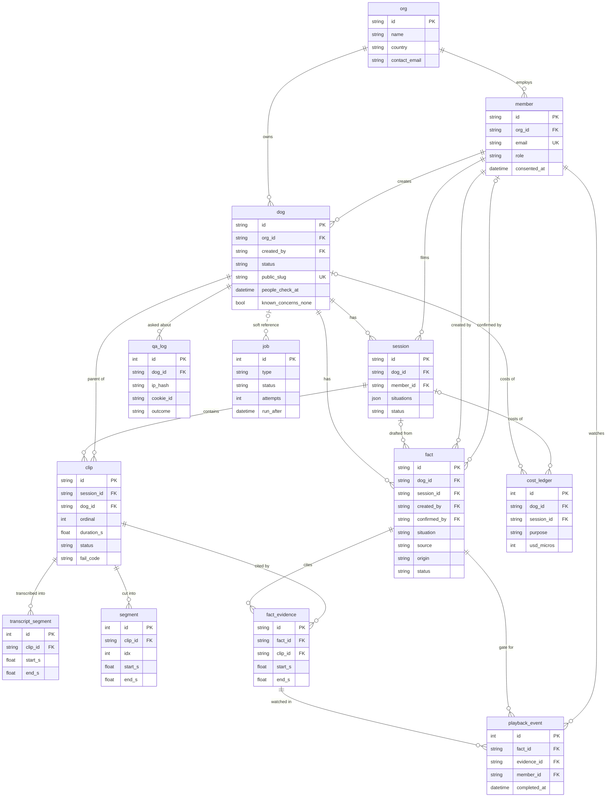
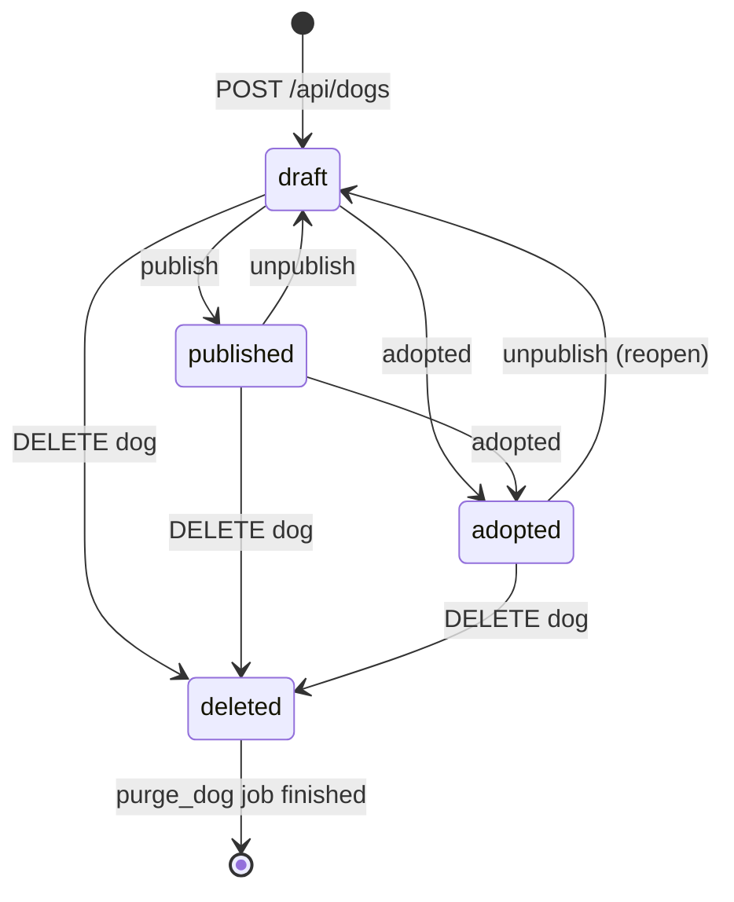
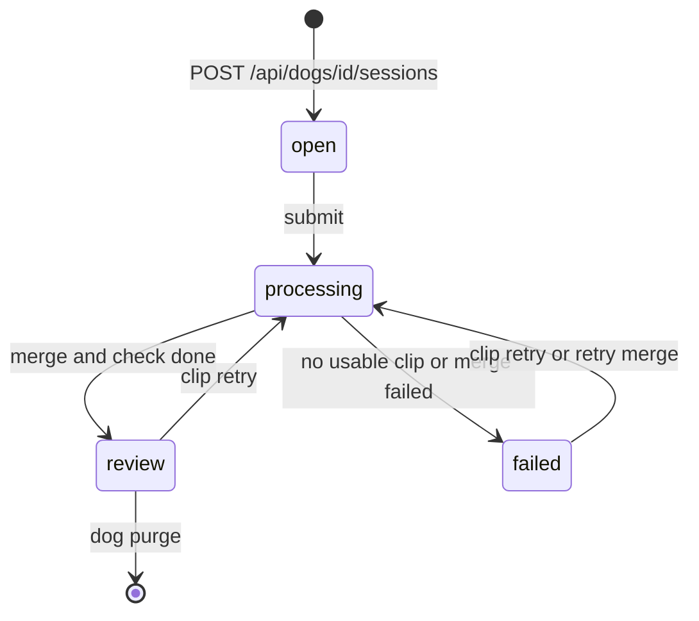
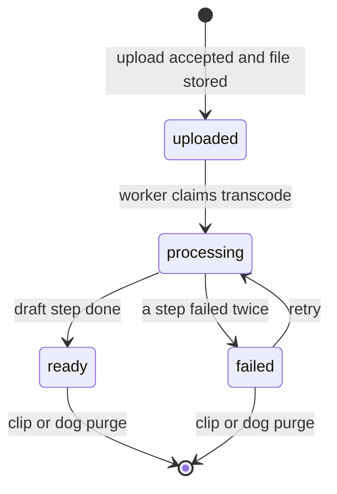
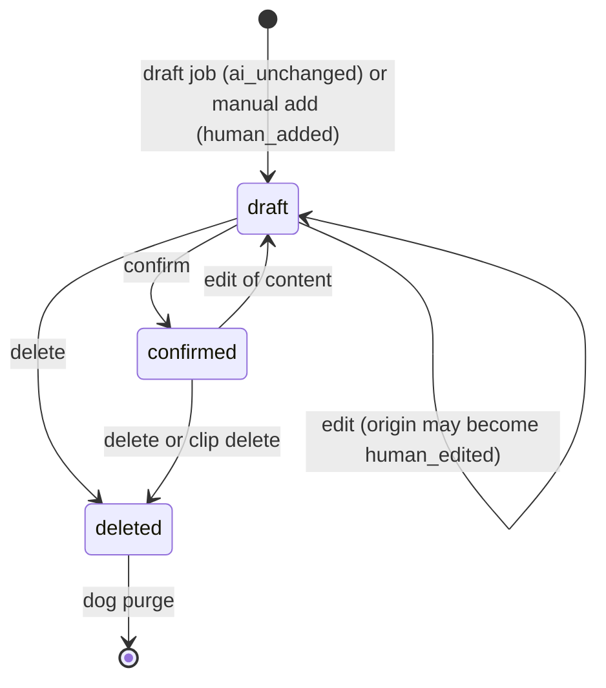
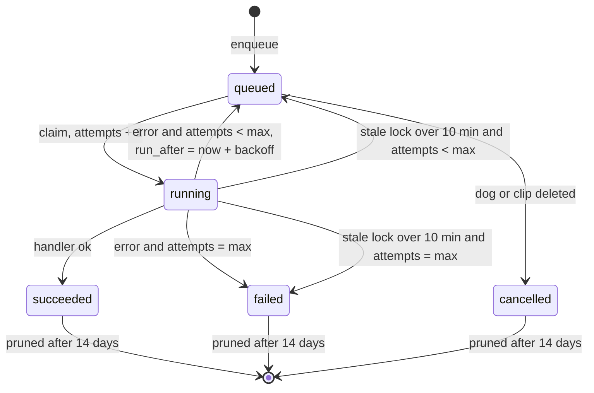

# Watch Me! R1: Data Model (v0.2, 2026-10-28)

Input: `docs/PRD.md` v1.3 (R1 only) and `docs/DESIGN.md` v0.3 (sections 3, 5, 7, 9). v0.2 applies lead decisions D1-D11 and adopts additions from 03-07 (section 7, D20 onward).
Companion: `01-api-spec.md`. Where this file departs from DESIGN.md v0.1, see the
last section ("Decisions and deviations"). "(verify)" marks an unchecked assumption.

## 0. Conventions

| Topic            | Rule                                                                                                                                                                                                                                                                                                 |
| ---------------- | ---------------------------------------------------------------------------------------------------------------------------------------------------------------------------------------------------------------------------------------------------------------------------------------------------- |
| Engine           | SQLite, WAL, `PRAGMA foreign_keys=ON`, `busy_timeout=5000`, set on every connection. One api process and one worker process write.                                                                                                                                                                   |
| Primary keys     | Externally visible entities (`org`, `member`, `dog`, `session`, `clip`, `fact`, `fact_evidence`) use `String(32)` = `uuid4().hex`, generated in Python. Internal high-volume tables (`transcript_segment`, `segment`, `playback_event`, `job`, `qa_log`, `cost_ledger`) use `Integer` autoincrement. |
| Timestamps       | SQLAlchemy `DateTime` through a `UtcDateTime` TypeDecorator: always UTC, stored as ISO text, naive in SQLite, aware in Python. API output is RFC 3339 `Z`, second precision.                                                                                                                         |
| Dates            | `Date` (`observed_on`), `YYYY-MM-DD`.                                                                                                                                                                                                                                                                |
| Seconds in clips | `Float`, rounded to 0.1 s on write. Always `>= 0`.                                                                                                                                                                                                                                                   |
| Booleans         | `Boolean` (INTEGER 0/1 with CHECK).                                                                                                                                                                                                                                                                  |
| Enums            | `String` + `CheckConstraint` (no native enum), so Alembic migrations stay simple.                                                                                                                                                                                                                    |
| JSON             | SQLAlchemy `JSON` (TEXT, SQLite json1).                                                                                                                                                                                                                                                              |
| Situation codes  | `new_person`, `handling`, `leash_walk`, `other_dog`, `food_toys`, `alone_time`, `indoors_rest`, `children_cats` (PRD 5.2, numbers 1 to 8 in this order). `children_cats` is "situation 8".                                                                                                           |
| Soft delete      | `clip.deleted_at`, `fact.status='deleted'`. `dog.status='deleted'` is a transient tombstone until the purge job finishes. All other deletes are hard.                                                                                                                                                |
| Storage layout   | Everything for a dog lives under one prefix, so deleting a dog is one prefix delete: `dogs/{dog_id}/photo.jpg`, `dogs/{dog_id}/clips/{clip_id}/original.<ext>`, `.../playback.mp4`, `.../audio.wav`, `.../frames/t{seconds}.jpg`. Upload temp files: `tmp/{random}`.                                 |

## 1. Entity-relationship diagram



Cardinality notes:

- One `org` in R1 (seeded). Every creator query filters by `member.org_id`.
- `clip.dog_id` repeats `session.dog_id` on purpose: media access and coverage
  read it without a join. It must equal `session.dog_id` (invariant I-12).
- `fact.session_id` is null only for `staff_note` facts that carry no clip range.
- `job` has no foreign keys. It carries nullable `dog_id`, `session_id`,
  `clip_id` columns so a dog delete can cancel its jobs. Rows are not cascaded.
- `cost_ledger` keeps its rows when a dog is deleted (`ON DELETE SET NULL`).

## 2. Tables

Column table legend: Null = `N` nullable, `NN` not null. "PRD" lists the IDs the
column serves.

### 2.1 `org`

| Column        | Type (SQLAlchemy / SQLite) | Null | Default   | Constraints and notes                                | PRD          |
| ------------- | -------------------------- | ---- | --------- | ---------------------------------------------------- | ------------ |
| id            | `String(32)` / TEXT        | NN   | uuid4 hex | PK                                                   | ORG-0        |
| name          | `String(120)`              | NN   |           | length >= 1                                          | ORG-0, PUB-7 |
| country       | `String(2)`                | NN   |           | ISO 3166-1 alpha-2, uppercase                        | ORG-0        |
| location      | `String(120)`              | NN   |           | Shown in the header when a dog has no own `location` | PUB-1        |
| contact_url   | `String(300)`              | N    |           | `https://` only                                      | PUB-7        |
| contact_email | `String(254)`              | N    |           |                                                      | PUB-7        |
| contact_phone | `String(40)`               | N    |           |                                                      | PUB-7        |
| created_at    | `UtcDateTime`              | NN   | now       |                                                      |              |

Constraints: `CHECK (contact_url IS NOT NULL OR contact_email IS NOT NULL OR contact_phone IS NOT NULL)` (a profile must always show a contact).
There is no `verified` column (ORG-0: no badge in R1; ORG-1/2 are R2).
Indexes: PK only.

### 2.2 `member`

| Column          | Type          | Null | Default   | Constraints and notes                                                          | PRD          |
| --------------- | ------------- | ---- | --------- | ------------------------------------------------------------------------------ | ------------ |
| id              | `String(32)`  | NN   | uuid4 hex | PK                                                                             | ORG-0        |
| org_id          | `String(32)`  | NN   |           | FK `org.id` ON DELETE RESTRICT                                                 | ORG-0        |
| email           | `String(254)` | NN   |           | Lowercased on write. UNIQUE                                                    | ORG-0        |
| display_name    | `String(80)`  | NN   |           | Shown as "confirmed by" only through the role, never the name, on public pages | REV-4        |
| password_hash   | `String(255)` | NN   |           | argon2id. Seeded from env, never committed                                     | ORG-0        |
| role            | `String(12)`  | NN   |           | `CHECK role IN ('staff','volunteer')`                                          | ORG-0, REV-4 |
| consented_at    | `UtcDateTime` | N    | NULL      | Null until the member accepts the face and voice notice                        | ORG-4        |
| consent_version | `String(20)`  | N    | NULL      | Version string of the notice accepted (for example `2026-10-28`)               | ORG-4        |
| session_epoch   | `Integer`     | NN   | 0         | Incremented on logout; a cookie with a lower epoch is rejected                 | NFR-5        |
| last_login_at   | `UtcDateTime` | N    |           |                                                                                |              |
| created_at      | `UtcDateTime` | NN   | now       |                                                                                |              |

Constraints: `CHECK ((consented_at IS NULL) = (consent_version IS NULL))`.
Indexes: `uq_member_email(email)`, `ix_member_org(org_id)`.

### 2.3 `dog`

| Column              | Type          | Null | Default        | Constraints and notes                                                                                                                                   | PRD                 |
| ------------------- | ------------- | ---- | -------------- | ------------------------------------------------------------------------------------------------------------------------------------------------------- | ------------------- |
| id                  | `String(32)`  | NN   | uuid4 hex      | PK                                                                                                                                                      | CAP-1               |
| org_id              | `String(32)`  | NN   |                | FK `org.id` RESTRICT                                                                                                                                    | CAP-1               |
| created_by          | `String(32)`  | NN   |                | FK `member.id` RESTRICT                                                                                                                                 | CAP-1               |
| name                | `String(60)`  | NN   |                | trimmed, 1 to 60 chars                                                                                                                                  | CAP-1, PUB-1        |
| sex                 | `String(8)`   | NN   | `'unknown'`    | `CHECK sex IN ('male','female','unknown')`                                                                                                              | CAP-1               |
| age_estimate        | `String(40)`  | NN   |                | Free text such as "about 3 years"                                                                                                                       | CAP-1, PUB-1        |
| size                | `String(8)`   | NN   |                | `CHECK size IN ('small','medium','large')`                                                                                                              | CAP-1, PUB-1        |
| photo_path          | `String(300)` | N    | NULL           | Storage key `dogs/{id}/photo.jpg`. Null shows a placeholder                                                                                             | CAP-1, PUB-1        |
| location            | `String(120)` | N    | NULL           | Falls back to `org.location`                                                                                                                            | PUB-1               |
| status              | `String(10)`  | NN   | `'draft'`      | `CHECK status IN ('draft','published','adopted','deleted')`                                                                                             | REV-5, REV-6, NFR-5 |
| public_slug         | `String(16)`  | N    | NULL           | UNIQUE. 12 random chars from `[a-z2-9]` (no `0 1 l o`), created at first publish, kept after unpublish, set NULL on delete. Never derived from the name | REV-5               |
| known_concerns      | `Text`        | N    | NULL           | 0 to 1000 chars. Shown as is (escaped)                                                                                                                  | REV-9, PUB-8        |
| known_concerns_none | `Boolean`     | NN   | 0              | "none known" marked                                                                                                                                     | REV-9, PUB-8        |
| people_check_at     | `UtcDateTime` | N    | NULL           | Staff attested "no people other than consenting members in any clip". Cleared when a new clip is added                                                  | REV-9               |
| people_check_by     | `String(32)`  | N    | NULL           | FK `member.id` SET NULL                                                                                                                                 | REV-9               |
| published_at        | `UtcDateTime` | N    | NULL           | Last publish time                                                                                                                                       | REV-5               |
| adopted_at          | `UtcDateTime` | N    | NULL           |                                                                                                                                                         | REV-6               |
| deleted_at          | `UtcDateTime` | N    | NULL           | Tombstone time                                                                                                                                          | REV-6, NFR-8        |
| created_at          | `UtcDateTime` | NN   | now            |                                                                                                                                                         |                     |
| updated_at          | `UtcDateTime` | NN   | now, on update |                                                                                                                                                         |                     |

Constraints:

- `CHECK (NOT (known_concerns_none = 1 AND known_concerns IS NOT NULL AND length(trim(known_concerns)) > 0))`.
- `CHECK (status <> 'published' OR (public_slug IS NOT NULL AND people_check_at IS NOT NULL AND (known_concerns_none = 1 OR length(trim(coalesce(known_concerns,''))) > 0)))`. This makes REV-9 a database invariant, not only an API check. See the note below on clip uploads.
- `CHECK (status <> 'deleted' OR public_slug IS NULL)`.

Note on the `published` CHECK: a new clip must clear `people_check_at`, which
would violate the CHECK on a published dog. Rule: uploading a clip to a dog with
`status='published'` is rejected with `409 invalid_state` ("unpublish before
adding footage"). The people check is therefore cleared only on non-published
dogs (deviation D6).

Indexes: `uq_dog_slug(public_slug)`, `ix_dog_org_status(org_id, status)`.

### 2.4 `session`

| Column          | Type          | Null | Default   | Constraints and notes                                                                                                                            | PRD          |
| --------------- | ------------- | ---- | --------- | ------------------------------------------------------------------------------------------------------------------------------------------------ | ------------ |
| id              | `String(32)`  | NN   | uuid4 hex | PK                                                                                                                                               | CAP-3        |
| dog_id          | `String(32)`  | NN   |           | FK `dog.id` ON DELETE CASCADE (used only by the purge job)                                                                                       | CAP-3        |
| member_id       | `String(32)`  | NN   |           | FK `member.id` RESTRICT. The filming member; owner for REV-4                                                                                     | CAP-3, REV-4 |
| situations      | `JSON`        | NN   |           | List of 1 to 8 distinct situation codes. Validated in Pydantic; CHECK `json_valid(situations) AND json_array_length(situations) BETWEEN 1 AND 8` | CAP-3        |
| observed_on     | `Date`        | NN   |           | Not later than today (UTC) plus 1 day                                                                                                            | CAP-3, PUB-2 |
| status | `String(12)` | NN | `'open'` | `CHECK status IN ('open','processing','review','failed')` | CAP-4, CAP-8 |
| fail_code | `String(20)` | N | NULL | Set only when `status='failed'`: `no_usable_clip`, `merge_failed`. Cleared by `retry-merge` or a clip retry | CAP-8 |
| rules_ack_at    | `UtcDateTime` | NN   |           | Capture rules screen shown and acknowledged (request must send `capture_rules_ack=true`)                                                         | CAP-7        |
| created_at      | `UtcDateTime` | NN   | now       | Start of the time-per-listing measure (G1)                                                                                                       | G1           |
| submitted_at    | `UtcDateTime` | N    | NULL      |                                                                                                                                                  | G1, NFR-1    |
| review_ready_at | `UtcDateTime` | N | NULL | Cleared when a merge is (re)enqueued; set when the latest merge (with its `check` step) completes (D5). `review_ready_at - submitted_at` = NFR-1 for sessions in `review`; a retry therefore measures from the original `submitted_at` | NFR-1 |

Indexes: `ix_session_dog(dog_id)`, `ix_session_member(member_id)`, `ix_session_status(status)`.

### 2.5 `clip`

| Column              | Type          | Null | Default      | Constraints and notes                                                                                                                     | PRD          |
| ------------------- | ------------- | ---- | ------------ | ----------------------------------------------------------------------------------------------------------------------------------------- | ------------ |
| id                  | `String(32)`  | NN   | uuid4 hex    | PK. Used in the public media URL, so not guessable                                                                                        | CAP-4, CAP-9 |
| session_id          | `String(32)`  | NN   |              | FK `session.id` CASCADE (purge only)                                                                                                      | CAP-4        |
| dog_id              | `String(32)`  | NN   |              | FK `dog.id` CASCADE (purge only). Equals `session.dog_id`                                                                                 | NFR-5        |
| ordinal             | `Integer`     | NN   |              | 1 to 3, `CHECK ordinal BETWEEN 1 AND 3`. Smallest free slot among live clips. Used in segment labels `c2-seg4`                            | CAP-4, AI-2  |
| client_request_id   | `String(40)`  | N    | NULL         | Idempotency key from the uploader                                                                                                         | CAP-8        |
| original_filename   | `String(200)` | NN   |              | Display only; control characters stripped                                                                                                 | CAP-8        |
| original_path       | `String(300)` | N    |              | Storage key. Set to NULL when the original is deleted after `ready`                                                                       | NFR-5        |
| original_size_bytes | `Integer`     | NN   |              | `CHECK <= 209715200`                                                                                                                      | CAP-4        |
| source_container    | `String(40)`  | N    |              | ffprobe format name                                                                                                                       | CAP-4        |
| source_codec        | `String(20)`  | N    |              | for example `hevc`, `h264`                                                                                                                | CAP-9        |
| has_audio           | `Boolean`     | NN   |              | From ffprobe at upload                                                                                                                    | CAP-4, AI-1  |
| playback_path       | `String(300)` | N    | NULL         | Set by `transcode`. Storage key of the H.264/AAC MP4                                                                                      | CAP-9        |
| duration_s          | `Float`       | NN   |              | Probed at upload (original); replaced by the probe of the playback file after `transcode`. `CHECK duration_s > 0 AND duration_s <= 120.5` | CAP-4        |
| status              | `String(12)`  | NN   | `'uploaded'` | `CHECK status IN ('uploaded','processing','ready','failed')`                                                                              | CAP-8        |
| step                | `String(12)`  | N    | NULL         | `transcode`, `transcribe`, `sample`, `draft`. Current step while `processing`, failing step while `failed`. For progress display          | CAP-8        |
| fail_code           | `String(20)`  | N    | NULL         | Section 3.3. `CHECK ((status='failed') = (fail_code IS NOT NULL))`                                                                        | CAP-8        |
| fail_detail         | `String(300)` | N    | NULL         | Short internal text, never shown to adopters                                                                                              | CAP-8        |
| created_at          | `UtcDateTime` | NN   | now          |                                                                                                                                           |              |
| ready_at            | `UtcDateTime` | N    | NULL         | `ready_at - created_at` gives per-clip processing time                                                                                    | NFR-1        |
| deleted_at          | `UtcDateTime` | N    | NULL         | Soft delete; file purge is a job                                                                                                          | NFR-8        |

Indexes: partial unique `uq_clip_session_ordinal(session_id, ordinal) WHERE deleted_at IS NULL`;
partial unique `uq_clip_session_req(session_id, client_request_id) WHERE client_request_id IS NOT NULL`;
`ix_clip_dog(dog_id)`; `ix_clip_status(status)`.
Rule: at most 3 live clips per session (the ordinal range enforces it).

### 2.6 `transcript_segment`

| Column  | Type         | Null | Default       | Constraints                                        | PRD         |
| ------- | ------------ | ---- | ------------- | -------------------------------------------------- | ----------- |
| id      | `Integer`    | NN   | autoincrement | PK                                                 | AI-1        |
| clip_id | `String(32)` | NN   |               | FK `clip.id` ON DELETE CASCADE                     | AI-1        |
| idx     | `Integer`    | NN   |               | Order within the clip, from 0                      | AI-1        |
| start_s | `Float`      | NN   |               | `CHECK start_s >= 0`                               | AI-1        |
| end_s   | `Float`      | NN   |               | `CHECK end_s > start_s`                            | AI-1        |
| text    | `Text`       | NN   |               | May contain personal speech; deleted with the clip | AI-1, NFR-6 |
| lang    | `String(8)`  | N    | NULL          | `en`, `ko`, or null if unknown                     | AI-1, NFR-4 |

Indexes: `uq_tseg_clip_idx(clip_id, idx)`. Segments with empty text are not stored. A clip with zero rows is valid (silent clip).

### 2.7 `segment`

Fixed 10 s windows (AI-2 fallback mode). Always created by `sample`, so the mode can switch by config without reprocessing.

| Column  | Type         | Null | Default       | Constraints                                              | PRD  |
| ------- | ------------ | ---- | ------------- | -------------------------------------------------------- | ---- |
| id      | `Integer`    | NN   | autoincrement | PK                                                       | AI-2 |
| clip_id | `String(32)` | NN   |               | FK `clip.id` CASCADE                                     | AI-2 |
| idx     | `Integer`    | NN   |               | 0-based                                                  | AI-2 |
| start_s | `Float`      | NN   |               | `idx * 10`                                               | AI-2 |
| end_s   | `Float`      | NN   |               | `min((idx+1) * 10, duration_s)`; `CHECK end_s > start_s` | AI-2 |

Indexes: `uq_segment_clip_idx(clip_id, idx)`. The model-facing label is `c{ordinal}-seg{idx}`.

### 2.8 `fact`

| Column         | Type          | Null | Default        | Constraints and notes                                                                                   | PRD          |
| -------------- | ------------- | ---- | -------------- | ------------------------------------------------------------------------------------------------------- | ------------ |
| id             | `String(32)`  | NN   | uuid4 hex      | PK                                                                                                      | G2           |
| dog_id         | `String(32)`  | NN   |                | FK `dog.id` CASCADE (purge only)                                                                        | PUB-2        |
| session_id     | `String(32)`  | N    | NULL           | FK `session.id` CASCADE (purge only). Null only for `staff_note` without clip                           | REV-4        |
| created_by     | `String(32)`  | N    | NULL           | FK `member.id` SET NULL. Null for AI drafts; set for hand-added facts                                   | REV-3        |
| situation      | `String(14)`  | NN   |                | Situation code CHECK                                                                                    | PUB-2, PUB-9 |
| behavior       | `String(280)` | NN   |                | NFC-normalized, trimmed, 3 to 280 chars, no newline                                                     | PUB-2, QA-2  |
| source         | `String(10)`  | NN   |                | `CHECK source IN ('clip','narration','staff_note')`                                                     | G2, PUB-2    |
| origin         | `String(14)`  | NN   |                | `CHECK origin IN ('ai_unchanged','human_edited','human_added')`                                         | REV-10       |
| status         | `String(10)`  | NN   | `'draft'`      | `CHECK status IN ('draft','confirmed','deleted')` (no `published`, see D2)                              | REV-2, PUB-2 |
| merged         | `Boolean`     | NN   | 1              | 0 only for AI drafts waiting for the session merge. Reviewers and the public never see `merged=0` rows  | AI-2         |
| flags | `JSON` | NN | `'[]'` | List of `{code, severity, source, detail}`. Values are fixed: `banned_word` (severity `warn`, source `rules`), `trait_claim` (`warn`, `model`), `check_unavailable` (`info`, `system`). Only `warn` flags need `acknowledge_flags` at confirm | AI-3 |
| observed_on    | `Date`        | NN   |                | Session date; for session-less staff notes, supplied by the author                                      | PUB-2        |
| ai_model       | `String(60)`  | N    | NULL           | Model id that drafted it (provenance)                                                                   | NFR-2        |
| confirmed_by   | `String(32)`  | N    | NULL           | FK `member.id` SET NULL                                                                                 | PUB-2, REV-2 |
| confirmed_role | `String(10)`  | N    | NULL           | Role snapshot at confirm time (`staff` or `volunteer`)                                                  | PUB-2        |
| confirmed_at   | `UtcDateTime` | N    | NULL           |                                                                                                         | PUB-2        |
| deleted_at     | `UtcDateTime` | N    | NULL           |                                                                                                         | REV-2        |
| deleted_by     | `String(32)`  | N    | NULL           | FK `member.id` SET NULL. Null when deleted by the system (clip delete)                                  | REV-2        |
| created_at     | `UtcDateTime` | NN   | now            |                                                                                                         | G1           |
| updated_at     | `UtcDateTime` | NN   | now, on update |                                                                                                         |              |

Constraints:

- `CHECK ((status='confirmed') = (confirmed_at IS NOT NULL AND confirmed_role IS NOT NULL))`.
- `CHECK ((status='deleted') = (deleted_at IS NOT NULL))`.
- `CHECK (situation <> 'children_cats' OR status <> 'confirmed' OR confirmed_role = 'staff')` (PUB-9: only staff confirm situation 8, enforced in the database too).
- `CHECK (source <> 'staff_note' OR origin = 'human_added')`.
- `CHECK (merged = 1 OR (origin = 'ai_unchanged' AND status = 'draft'))`.

Indexes: `ix_fact_dog_status_sit(dog_id, status, situation)`, `ix_fact_session(session_id)`, `ix_fact_created_by(created_by)`.

### 2.9 `fact_evidence`

| Column  | Type         | Null | Default   | Constraints and notes                                                          | PRD          |
| ------- | ------------ | ---- | --------- | ------------------------------------------------------------------------------ | ------------ |
| id      | `String(32)` | NN   | uuid4 hex | PK                                                                             | REV-1        |
| fact_id | `String(32)` | NN   |           | FK `fact.id` ON DELETE CASCADE                                                 | REV-1        |
| clip_id | `String(32)` | NN   |           | FK `clip.id` ON DELETE CASCADE                                                 | REV-1, PUB-3 |
| start_s | `Float`      | NN   |           | `CHECK start_s >= 0`                                                           | PUB-3        |
| end_s   | `Float`      | NN   |           | `CHECK end_s > start_s AND end_s - start_s >= 1.0 AND end_s - start_s <= 60.0` | PUB-3        |

Application rules (cannot be a single-table CHECK; also covered by tests, invariant I-3): `end_s <= clip.duration_s`; the clip belongs to the same dog as the fact; the clip is `ready` and not deleted when the row is written. A fact has 0 to 3 evidence rows.
Indexes: `ix_evidence_fact(fact_id)`, `ix_evidence_clip(clip_id)`.

### 2.10 `playback_event`

One row says "this member played this exact evidence range to its end".

| Column       | Type          | Null | Default       | Constraints and notes                                                                   | PRD   |
| ------------ | ------------- | ---- | ------------- | --------------------------------------------------------------------------------------- | ----- |
| id           | `Integer`     | NN   | autoincrement | PK                                                                                      | REV-2 |
| fact_id      | `String(32)`  | NN   |               | FK `fact.id` CASCADE                                                                    | REV-2 |
| evidence_id  | `String(32)`  | NN   |               | FK `fact_evidence.id` CASCADE. Deleting or replacing an evidence row removes its events | REV-2 |
| member_id    | `String(32)`  | NN   |               | FK `member.id` RESTRICT                                                                 | REV-2 |
| start_s      | `Float`       | NN   |               | Snapshot of `fact_evidence.start_s` at event time                                       | REV-2 |
| end_s        | `Float`       | NN   |               | Snapshot of `fact_evidence.end_s`                                                       | REV-2 |
| watched_s    | `Float`       | NN   |               | Seconds of actual playback reported by the client                                       | REV-2 |
| completed_at | `UtcDateTime` | NN   | now           | Updated on a repeat call                                                                | REV-2 |

Constraints: `UNIQUE(evidence_id, member_id)` (upsert). Index: `ix_pbe_fact_member(fact_id, member_id)`.
A confirm guard accepts an event only when its snapshot equals the current evidence range. The client sends the reported numbers, so the gate proves a cooperating client, not that a human watched (stated limit; see invariants).

### 2.11 `job`

| Column       | Type          | Null | Default        | Constraints and notes                                                                                        | PRD   |
| ------------ | ------------- | ---- | -------------- | ------------------------------------------------------------------------------------------------------------ | ----- |
| id           | `Integer`     | NN   | autoincrement  | PK                                                                                                           | NFR-1 |
| type         | `String(20)`  | NN   |                | `transcode`, `transcribe`, `sample`, `draft`, `merge`, `check`, `purge_clip`, `purge_dog`, `retention_sweep` |       |
| payload      | `JSON`        | NN   | `'{}'`         | Ids needed by the step                                                                                       |       |
| dog_id       | `String(32)`  | N    | NULL           | No FK. For cancel and purge                                                                                  | NFR-8 |
| session_id   | `String(32)`  | N    | NULL           | No FK                                                                                                        |       |
| clip_id      | `String(32)`  | N    | NULL           | No FK                                                                                                        |       |
| dedupe_key | `String(80)` | N | NULL | UNIQUE while not terminal (partial unique index). Examples `merge:{session_id}`, `check:{session_id}:{merge_job_id}`, `purge_dog:{dog_id}`, `sweep:{utc_date}`. Makes enqueue idempotent | |
| status       | `String(10)`  | NN   | `'queued'`     | `CHECK status IN ('queued','running','succeeded','failed','cancelled')`                                      | CAP-8 |
| attempts     | `Integer`     | NN   | 0              | Incremented at claim                                                                                         | CAP-8 |
| max_attempts | `Integer` | NN | 2 | 2 for pipeline types, 8 for purge types, 1 for `retention_sweep`. Retries apply to transient errors only (network, timeout, HTTP 429/5xx; ffmpeg timeout, kill, disk full). Schema-invalid AI output and non-transient provider errors (HTTP 400/401/402/403/404) fail at once, whatever `max_attempts` is (D2) | CAP-8 |
| error        | `Text`        | N    | NULL           | Last error, truncated to 2000 chars. No personal text                                                        |       |
| run_after    | `UtcDateTime` | NN   | now            | Earliest start                                                                                               |       |
| locked_at    | `UtcDateTime` | N    | NULL           | Set at claim                                                                                                 |       |
| locked_by    | `String(40)`  | N    | NULL           | Worker id                                                                                                    |       |
| created_at   | `UtcDateTime` | NN   | now            |                                                                                                              |       |
| updated_at   | `UtcDateTime` | NN   | now, on update |                                                                                                              |       |

Indexes: `ix_job_claim(status, run_after)`, `ix_job_dog(dog_id)`, `ix_job_clip(clip_id)`,
partial unique `uq_job_dedupe(dedupe_key) WHERE status IN ('queued','running')`.
Claim query (single worker; still atomic):

```sql
UPDATE job SET status='running', attempts=attempts+1, locked_at=:now, locked_by=:w
WHERE id = (SELECT id FROM job WHERE status='queued' AND run_after <= :now
            ORDER BY run_after, id LIMIT 1)
RETURNING *;   -- needs SQLite >= 3.35 (verify)
```

### 2.12 `qa_log`

| Column      | Type          | Null | Default       | Constraints and notes                                                          | PRD              |
| ----------- | ------------- | ---- | ------------- | ------------------------------------------------------------------------------ | ---------------- |
| id          | `Integer`     | NN   | autoincrement | PK                                                                             | QA-1             |
| dog_id      | `String(32)`  | NN   |               | FK `dog.id` CASCADE                                                            | QA-1             |
| ip_hash     | `String(64)`  | NN   |               | `HMAC-SHA256(IP_HASH_KEY, ip + utc_date)` hex. Never the raw IP                | QA-1             |
| cookie_id   | `String(32)`  | NN   |               | Random visitor cookie `wm_visitor`                                             | QA-1             |
| question    | `String(300)` | N    |               | Nulled by `retention_sweep` after 30 days                                      | QA-1             |
| outcome     | `String(16)`  | NN   |               | `CHECK outcome IN ('answered','not_observed','health_redirect','error')`       | QA-2, QA-4, QA-7 |
| fact_ids    | `JSON`        | NN   | `'[]'`        | Fact ids actually rendered (after filtering)                                   | QA-2             |
| dropped_ids | `Integer`     | NN   | 0             | Count of model ids discarded as outside the dog's confirmed set (QA-7 counter) | QA-7             |
| ledger_id | `Integer` | N | NULL | FK `cost_ledger.id` SET NULL. With two model calls in one request (schema retry) it is the last ledger row; the first row exists in `cost_ledger` and counts toward the cap | QA-1 |
| latency_ms  | `Integer`     | N    | NULL          |                                                                                | NFR-2            |
| created_at  | `UtcDateTime` | NN   | now           |                                                                                | QA-1             |

Row rules: a row is written for every request that reaches processing (outcome `answered`, `not_observed`, `health_redirect`, or `error` for `qa_cost_cap_reached` and `qa_unavailable`). Requests rejected before processing (`404`, `422`, `429`) write no row. The 10-per-hour count (per `ip_hash`, per `cookie_id`) excludes `outcome='error'` rows. `ip_hash` includes the UTC date, so the per-IP count restarts at 00:00 UTC.

Row rules: a row is written for every request that reaches processing (outcome `answered`, `not_observed`, `health_redirect`, or `error` for `qa_cost_cap_reached` and `qa_unavailable`). Requests rejected before processing (`404`, `422`, `429`) write no row. The 10-per-hour count (per `ip_hash`, per `cookie_id`) excludes `outcome='error'` rows. `ip_hash` includes the UTC date, so the per-IP count restarts at 00:00 UTC.

Indexes: `ix_qa_ip_time(ip_hash, created_at)`, `ix_qa_cookie_time(cookie_id, created_at)`, `ix_qa_dog(dog_id)`.

### 2.13 `cost_ledger`

| Column     | Type          | Null | Default       | Constraints and notes                                                 | PRD         |
| ---------- | ------------- | ---- | ------------- | --------------------------------------------------------------------- | ----------- |
| id         | `Integer`     | NN   | autoincrement | PK                                                                    | NFR-2       |
| purpose    | `String(16)`  | NN   |               | `CHECK purpose IN ('transcribe','draft','check','qa_select','spike')` | NFR-2, QA-1 |
| provider   | `String(30)`  | NN   |               | adapter name                                                          | NFR-2       |
| model      | `String(60)`  | NN   |               |                                                                       | NFR-2       |
| tokens_in  | `Integer`     | NN   | 0             |                                                                       | NFR-2       |
| tokens_out | `Integer`     | NN   | 0             |                                                                       | NFR-2       |
| audio_s    | `Float`       | N    | NULL          | For transcription, priced per hour                                    | NFR-2       |
| usd_micros | `Integer`     | NN   | 0             | 1 USD = 1,000,000. Integer math avoids float drift in the cap sum     | NFR-2, QA-1 |
| dog_id     | `String(32)`  | N    | NULL          | FK `dog.id` SET NULL. Cost per listing                                | NFR-2       |
| session_id | `String(32)`  | N    | NULL          | FK `session.id` SET NULL                                              | NFR-2       |
| created_at | `UtcDateTime` | NN   | now           |                                                                       | NFR-2       |

Indexes: `ix_cost_purpose_time(purpose, created_at)`, `ix_cost_session(session_id)`.
Daily Q&A cap check: `SELECT COALESCE(SUM(usd_micros),0) FROM cost_ledger WHERE purpose='qa_select' AND created_at >= :utc_midnight` compared with `QA_DAILY_USD_CAP * 1_000_000` (default `QA_DAILY_USD_CAP=3.00` USD, D1; eval runs use purpose `spike` and do not count).

## 3. State machines

Roles: `S` staff, `V` volunteer (member), `M` any member, `sys` worker or api internals.
"Own" means `session.member_id = actor.id` (or `fact.created_by = actor.id` for session-less facts).

### 3.1 `dog.status`



| #   | Transition                       | Trigger                       | Actor | Guards                                                                                                                                                                                                                                    | Side effects                                                                                     |
| --- | -------------------------------- | ----------------------------- | ----- | ----------------------------------------------------------------------------------------------------------------------------------------------------------------------------------------------------------------------------------------- | ------------------------------------------------------------------------------------------------ |
| D1  | create to `draft`                | `POST /api/dogs`              | M     | member consent not required; name, sex, age, size valid                                                                                                                                                                                   | Row created; `created_by` set                                                                    |
| D2  | `draft` to `published`           | `POST /api/dogs/{id}/publish` | S     | status is `draft`; `people_check_at` not null; exactly one of `known_concerns` (non-blank) or `known_concerns_none` is set; at least one fact with `status='confirmed'` and `merged=1` | Generate `public_slug` if null; `published_at=now`. Profile and its cited clips become reachable |
| D3  | `published` to `draft`           | `POST .../unpublish`          | S     | status is `published`                                                                                                                                                                                                                     | Slug kept; public profile and media return 404 at once. `people_check_at` and concerns are kept  |
| D4  | `draft`/`published` to `adopted` | `POST .../adopted`            | S     | status in (`draft`,`published`)                                                                                                                                                                                                           | `adopted_at=now`. Public and media return 404. Clips and facts kept. Q&A stops (profile 404)     |
| D5  | `adopted` to `draft`             | `POST .../unpublish`          | S     | status is `adopted`                                                                                                                                                                                                                       | `adopted_at=NULL`. Not public until published again                                              |
| D6  | any to `deleted`                 | `DELETE /api/dogs/{id}`       | S     | status is not `deleted`                                                                                                                                                                                                                   | Section 6.1                                                                                      |

A clip that is still processing does not block publishing, because only
confirmed facts are public.

### 3.2 `session.status`



| #   | Transition                        | Trigger                          | Actor    | Guards                                                                                                         | Side effects                                                                                                                                |
| --- | --------------------------------- | -------------------------------- | -------- | -------------------------------------------------------------------------------------------------------------- | ------------------------------------------------------------------------------------------------------------------------------------------- |
| S1 | create to `open` | `POST /api/dogs/{id}/sessions` | M | consent accepted; dog is `draft` (not `published`, `adopted`, `deleted`); `capture_rules_ack=true`; situations valid; `observed_on` valid | `rules_ack_at=now` |
| S2 | `open` to `processing` | `POST /api/sessions/{id}/submit` | owner, S | at least 1 live clip; session `open`; consent | `submitted_at=now`. If every live clip is already `ready` or `failed`, enqueue `merge` now (clears `review_ready_at`). Otherwise the `draft` job of the last clip does |
| S3 | `processing` to `review` | worker, end of `check` job | sys | merge job succeeded; at least one live clip `ready` | `review_ready_at=now` (the latest merge completing, D5); AI drafts `merged=1`. A session whose ready clips produced zero facts is still `review` (D4) |
| S4 | `processing` to `failed` | worker | sys | all live clips `failed` (`fail_code=no_usable_clip`), or `merge` failed (`merge_failed`; the failure follows J4/J5, so a transient error is retried once first) | none |
| S5 | `failed`/`review` to `processing` | `POST /api/clips/{id}/retry` | owner, S | clip `failed` with a retryable code | Clip goes back to `processing`; when it finishes (and every live clip is terminal), a new `merge` is enqueued, which clears `review_ready_at` (D5) (idempotent: only `merged=0` facts are processed) |
| S6 | `failed` to `processing` | `POST /api/sessions/{id}/retry-merge` (D6) | owner, S | session `failed` with `fail_code=merge_failed`; consent; dog not `deleted` | `fail_code=NULL`, `review_ready_at=NULL`; enqueue `merge` (`dedupe_key=merge:{session_id}`); a repeat while that job is live is a no-op |

Uploads (`POST /api/sessions/{id}/clips`) are accepted only in `open`.

### 3.3 `clip.status` and fail codes



| #   | Transition                 | Trigger                         | Actor                                                       | Guards                                                                                                                                                    | Side effects                                                                                                                                                                                                                        |
| --- | -------------------------- | ------------------------------- | ----------------------------------------------------------- | --------------------------------------------------------------------------------------------------------------------------------------------------------- | ----------------------------------------------------------------------------------------------------------------------------------------------------------------------------------------------------------------------------------- |
| C1  | create to `uploaded`       | `POST /api/sessions/{id}/clips` | owner, S                                                    | consent; session `open`; fewer than 3 live clips; dog not `published`/`adopted`/`deleted`; file passes size, type, ffprobe checks (else rejected, no row) | Row + file stored; `dog.people_check_at=NULL`; enqueue `transcode`; `step=transcode`                                                                                                                                                |
| C2  | `uploaded` to `processing` | worker claims first job         | sys                                                         |                                                                                                                                                           | none                                                                                                                                                                                                                                |
| C3  | steps                      | each job success                | sys                                                         |                                                                                                                                                           | `step` moves `transcode`, `transcribe`, `sample`, `draft`; each enqueues the next in the same transaction. Outputs: `playback_path`, `duration_s` (re-probed), transcript rows, segment rows, frame files, draft facts (`merged=0`) |
| C4 | `processing` to `ready` | `draft` job success | sys | | `ready_at=now`; delete `original`, `audio.wav`, `frames/` (section 6.4); if the session is `processing` and all live clips are terminal, enqueue `merge`. A clip whose drafts were all dropped by post-processing, or that is under 1 s, is `ready` with zero facts (D4); the review screen shows "No facts were drafted from this clip. Add one by hand if you saw something." |
| C5 | `processing` to `failed` | a job fails (J5) | sys | a non-transient error (fails at once), or a transient error at `max_attempts` | `fail_code`, `fail_detail`, `step` set; if the session is `processing` and all live clips are terminal, enqueue `merge` (or fail the session when none is ready) |
| C6 | `failed` to `processing` | `POST /api/clips/{id}/retry` (manual retry) | owner, S | `fail_code` in the manually retryable set (`transcode_failed`, `ai_failed`, `ai_invalid_output`); dog not `deleted` | Delete partial outputs of the failing step and later steps; enqueue the job for `step` with fresh attempts; `fail_code=NULL` |
| C7  | delete                     | `DELETE /api/clips/{id}`        | S any; owner only if no fact citing the clip is `confirmed` | not already deleted                                                                                                                                       | Section 6.2                                                                                                                                                                                                                         |

Retry in an `open` session is allowed too (the clip may fail before submit).

Fail codes (CAP-8). Upload-time rejections never create a clip row, so they are API errors, not clip codes (see API catalog).

| `fail_code` | Set by | Meaning | Manual retry (`clip.error.retryable`) | User-facing cause |
| ------------------- | --------------------- | --------------------------------------------------------------------------------- | ------------------------- | -------------------------------------- |
| `unsupported_file`  | `transcode`           | ffprobe or ffmpeg cannot decode the video stream although the upload check passed | no (delete and re-upload) | "This video format could not be read." |
| `too_long`          | `transcode`           | Re-probe shows duration over 120.5 s                                              | no                        | "The clip is longer than 2 minutes."   |
| `transcode_failed` | `transcode`, `sample` | ffmpeg error exit, or timeout (10 min), kill, or out-of-disk. Timeout, kill and disk-full are transient (retried up to `max_attempts`); any other non-zero exit fails at once | yes (manual) | "We could not convert this clip." |
| `ai_failed` | `transcribe`, `draft` | Transient provider error that stayed after `max_attempts` (network, timeout 3 min, 429, 5xx), or a non-transient provider error (HTTP 400/401/402/403/404, including bad-image errors) that fails at once with no automatic retry. `transcribe` with invalid output also maps here | yes (manual) | "The AI step did not finish." |
| `ai_invalid_output` | `draft` | Schema-invalid output after the one retry inside the adapter (PRD AI-2). The job fails at once; no job-level retry (ADR-0017, ADR-0042) | yes (manual) | "The AI answer was not usable." |

### 3.4 `fact.status` and `origin`



| #   | Transition                                        | Trigger                                     | Actor                       | Guards                                                                                                        | Side effects                                                                                                                                                                                                                                                   |
| --- | ------------------------------------------------- | ------------------------------------------- | --------------------------- | ------------------------------------------------------------------------------------------------------------- | -------------------------------------------------------------------------------------------------------------------------------------------------------------------------------------------------------------------------------------------------------------- |
| F1  | create `draft`, `origin=ai_unchanged`, `merged=0` | `draft` job                                 | sys                         | schema-valid model output; `situation` in `session.situations`; ranges valid (snapped, clamped)               | Evidence rows written; `ai_model` set; `ledger` row                                                                                                                                                                                                            |
| F2 | `merged=0` to `merged=1` | `merge` job | sys | | Duplicates are merged, not blindly deleted (D3, ADR-0044). Same `source`, same situation, and equal meaning (overlapping evidence in one clip, or normalized text similarity; thresholds in 04 section 5.6): the survivor (longer text) takes the union of evidence rows (overlapping or touching ranges merge, at most 3 rows, longest first) and the other `merged=0` row is removed before anyone sees it (not counted as a draft). A `clip` fact beats a `narration` duplicate; the narration row is removed without merging evidence. Survivors set `merged=1`; rules flags run inline; then `check` runs with the surviving `fact_ids` |
| F3  | create `draft`, `origin=human_added`, `merged=1`  | `POST /api/dogs/{id}/facts`                 | M                           | clip evidence is `ready`, same dog, and (V: from own sessions; S: any). No evidence gives `source=staff_note` | `session_id` = session of the first evidence clip, else NULL; `observed_on` from the session or the request; rules check runs inline                                                                                                                           |
| F4  | `draft` to `draft` (edit)                         | `PATCH /api/facts/{id}`                     | owner or S                  | status `draft`; fact `merged=1`                                                                               | If `behavior`, `situation`, or `evidence` changed: `origin ai_unchanged -> human_edited` (sticky, `human_added` stays); changed evidence rows replaced, their playback events removed; flags recomputed by the rules checker inline (model pass is not re-run) |
| F5  | `draft` to `confirmed`                            | `POST /api/facts/{id}/confirm`              | owner or S (see guards)     | See guard list below                                                                                          | `confirmed_by`, `confirmed_role`, `confirmed_at` set                                                                                                                                                                                                           |
| F6  | `confirmed` to `draft`                            | `PATCH /api/facts/{id}` with content change | owner or S                  | Same permission as F5                                                                                         | Clears `confirmed_*`; origin rule as F4; the fact leaves every public page and Q&A at once                                                                                                                                                                     |
| F7  | to `deleted`                                      | `DELETE /api/facts/{id}`                    | owner (any status), S (any) | not already `deleted`                                                                                         | `deleted_at`, `deleted_by`; evidence rows and playback events removed; row kept for the REV-10 metric until the dog is purged                                                                                                                                  |
| F8  | to `deleted`                                      | clip delete cascade                         | sys                         | the fact has no evidence left and `source` is `clip` or `narration`                                           | `deleted_by=NULL`                                                                                                                                                                                                                                              |

Confirm guards (F5), checked in this order; the first failure is returned:

1. Fact exists in the actor's org, else `not_found`.
2. Actor has accepted consent, else `consent_required`.
3. Fact `status='draft'` and `merged=1`, else `invalid_state`.
4. Situation `children_cats` requires role `staff`, else `staff_only_situation` (PUB-9, REV-4 ordering: this check comes before ownership so a volunteer gets the more specific error).
5. Role `volunteer` requires ownership of the fact's session, else `not_own_session`. A fact with no session (`staff_note`) is confirmable by staff only (`forbidden_role` for a volunteer).
6. Every `fact_evidence` row has a `playback_event` for this actor whose snapshot equals the current range, else `playback_required` (REV-2). A fact with no evidence skips this guard.
7. If the fact has any flag with severity `warn` (`banned_word`, `trait_claim`) and the request did not send `acknowledge_flags=true`, `flags_unacknowledged`.
8. If `dog.status='published'`, `dog.people_check_at` must be set, else `publish_checklist_incomplete`. Because clip upload is blocked on published dogs (D6), this guard is a safety net.

### 3.5 `job.status`



| #   | Transition               | Trigger                                                          | Actor       | Guards                                                                   | Side effects                                                                                                                                                                                                                                                           |
| --- | ------------------------ | ---------------------------------------------------------------- | ----------- | ------------------------------------------------------------------------ | ---------------------------------------------------------------------------------------------------------------------------------------------------------------------------------------------------------------------------------------------------------------------- |
| J1  | to `queued`              | enqueue (upload, previous step, submit, delete, retention timer) | api, worker | `dedupe_key` not held by a live job                                      | `run_after=now` unless stated                                                                                                                                                                                                                                          |
| J2  | `queued` to `running`    | worker poll every 2 s                                            | worker      | `run_after <= now`                                                       | `attempts+1`, `locked_at`, `locked_by`                                                                                                                                                                                                                                 |
| J3  | `running` to `succeeded` | handler returns                                                  | worker      | the target dog is not `deleted` (else discard results, mark `cancelled`) | Next job(s) enqueued in the same transaction                                                                                                                                                                                                                           |
| J4 | `running` to `queued` | handler raises `JobError(code, retryable=True)` (network, timeout, HTTP 429/5xx; ffmpeg timeout, kill, disk full) | worker | `attempts < max_attempts` | `error` stored; `run_after = now + max(backoff[attempts], retry_after_s)`; backoff: pipeline 30 s then 120 s; purge 1 m, 5 m, 15 m, 1 h, 3 h, 6 h, 12 h |
| J5 | `running` to `failed` | handler raises `JobError(code, retryable=False)` (fails at once: `ai_invalid_output`, non-transient provider errors, non-transient ffmpeg exits), or a retryable error at `attempts = max_attempts` | worker | none | Failure hook: clip steps set `clip.status='failed'` with `JobError.code` (section 3.3); `merge` fails the session (`merge_failed`); `check` never fails a session (facts get a `check_unavailable` flag); `purge_*` logs an error and leaves the tombstone (operator action). Contract: AI adapters and handlers raise `JobError(code, retryable: bool)` (ADR-0042) |
| J6  | stale reset              | worker start and every minute                                    | worker      | `status='running'` and `locked_at < now - 10 min`                        | back to `queued` or `failed` as J4/J5 (the attempt was already counted)                                                                                                                                                                                                |
| J7  | `queued` to `cancelled`  | dog delete, clip delete                                          | api         | job has the matching `dog_id` or `clip_id`                               | A `running` job is not interrupted; J3 discards it                                                                                                                                                                                                                     |

Job types:

| Type              | Input   | Does                                                                                                | Timeout | Next                        |
| ----------------- | ------- | --------------------------------------------------------------------------------------------------- | ------- | --------------------------- |
| `transcode`       | clip    | ffprobe, ffmpeg to H.264/AAC MP4 (`+faststart`), 16 kHz mono WAV, re-probe duration                 | 10 min  | `transcribe`                |
| `transcribe`      | clip    | Transcriber on the WAV; writes `transcript_segment`; ledger row                                     | 3 min   | `sample`                    |
| `sample`          | clip    | Frames every `k = max(1, ceil(duration/48))` s labeled with time; 10 s `segment` rows               | 3 min   | `draft`                     |
| `draft` | clip | FactDrafter, one call per clip; post-processing (04 section 5); writes `fact` (`merged=0`) and `fact_evidence`; ledger row. Zero surviving facts is success (D4) | 3 min | none (clip becomes `ready`) |
| `merge` | session | Dedupe and evidence merge (F2), set `merged=1`, rules wording check inline; enqueues `check` with `fact_ids` (`dedupe_key=check:{session_id}:{merge_job_id}`) | 1 min | `check` |
| `check` | session | One model wording pass over the `fact_ids` of the payload (a batch call); writes `flags`; then session becomes `review` and `review_ready_at` is set | 3 min | none |
| `purge_clip`      | clip    | Section 6.2                                                                                         | 2 min   | none                        |
| `purge_dog`       | dog     | Section 6.1                                                                                         | 5 min   | none                        |
| `retention_sweep` | none    | Section 6.5. Scheduled by the worker once per day (self-enqueue with `dedupe_key=sweep:{utc_date}`) | 1 min   | none                        |

### 3.6 Role matrix summary

| Action                                                | Staff           | Volunteer                                     |
| ----------------------------------------------------- | --------------- | --------------------------------------------- |
| Create dog, session (own), upload clips (own session) | yes             | yes                                           |
| Confirm fact                                          | any fact in org | own-session facts only; never `children_cats` |
| Edit or delete fact                                   | any             | own-session facts, or facts they created      |
| Delete clip                                           | any             | own clip with no confirmed fact citing it     |
| Set known concerns and people check                   | yes             | no                                            |
| Publish, unpublish, adopted, delete dog               | yes             | no                                            |

## 4. Derived values

### 4.1 Coverage (PUB-1, CAP-2)

A situation is covered when at least one live, ready clip is cited by a confirmed
fact of that situation whose `source='clip'`. Narration-only and staff-note facts
never cover a situation (they have no clip showing the behavior; PRD 5.3 "never
fill an uncovered situation with a guess").

```sql
-- :dog_id bound. Result: one row per covered situation.
WITH cov AS (
  SELECT DISTINCT f.situation, c.id AS clip_id, c.duration_s
  FROM fact f
  JOIN fact_evidence e ON e.fact_id = f.id
  JOIN clip c          ON c.id = e.clip_id
  WHERE f.dog_id = :dog_id
    AND f.status = 'confirmed'
    AND f.source = 'clip'
    AND c.deleted_at IS NULL
    AND c.status = 'ready'
)
SELECT situation,
       COUNT(*)       AS clip_count,
       SUM(duration_s) AS filmed_s_raw        -- round half up in Python
FROM cov
GROUP BY situation;
```

Per situation the service returns:

- `clip_count` = count above.
- `filmed_s` = `round_half_up(sum of durations of those clips)`. DESIGN v0.1 rule ("sum their seconds"); it answers "how much footage backs this situation" and exposes footage-light profiles (PRD risk "shelters film only good moments").
- `confirmed_s` = seconds of the union of confirmed evidence ranges for that situation, computed in Python per clip (sort ranges, merge overlaps, sum lengths), then rounded half up. Always `<= filmed_s`. Shown next to `filmed_s` so a 2 minute clip with one 3 s moment does not read as 120 s of evidence.
- `covered` = `clip_count >= 1`.
- `situations_covered` = number of covered situations (0 to 8). The header text is "clips in n of 8 situations".

The same service function feeds the dog list (CAP-2), the dog detail, and the public profile, so the numbers cannot differ (CAP-2 "same rule as PUB-1").
A dog that is not `published` still gets coverage in the creator views.

### 4.2 "Not observed yet" list (PUB-4)

`not_observed = [s for s in SITUATIONS_IN_ORDER if s not covered]`. Equal to 8
minus covered, by construction (PUB-4 AC). Situation `children_cats` appears
here until a staff-confirmed fact with a clip covers it.

### 4.3 Fact clip length (PUB-2)

```
ranges   = evidence rows of the fact
per clip = union of its ranges (merge overlaps)
total_s  = sum of union lengths over clips
seconds  = max(1, round_half_up(total_s))
clips    = number of distinct clip_id
label    = "{clips} clip{s}, {seconds} s"        e.g. "1 clip, 9 s", "2 clips, 14 s"
```

Special cases: `source='narration'` gives `Narration only, {seconds} s` (the range is where the volunteer says it, not a view of the behavior); `source='staff_note'` gives `No clip`. The label is built on the server and returned together with the numbers.

## 5. Invariants

Each invariant states where it is enforced (DB = constraint, API = request guard, SVC = service logic) and how it is tested.

| ID   | Invariant                                                                                                                                                                                               | Enforced by                                                                                                                                                          |
| ---- | ------------------------------------------------------------------------------------------------------------------------------------------------------------------------------------------------------- | -------------------------------------------------------------------------------------------------------------------------------------------------------------------- |
| I-1  | A public profile and the Q&A selector see only facts with `status='confirmed'`, `merged=1`, of a dog with `status='published'`.                                                                         | SVC: one query function `public_facts(dog_id)` is the only reader for public and Q&A paths. Test: property test over random states.                                  |
| I-2  | Every confirmed fact whose `source` is `clip` or `narration` has at least one `fact_evidence` row. A `staff_note` has none.                                                                             | SVC + test; deleting the last evidence row of a `clip`/`narration` fact deletes the fact (F8) or is rejected on PATCH (`validation_error`).                          |
| I-3  | `fact_evidence`: `0 <= start_s < end_s <= clip.duration_s`, length 1 to 60 s, clip is live and `ready`.                                                                                                 | DB: single-table CHECKs. API: duration check on write. Test: every evidence row after the pipeline, after PATCH, after retranscode.                                  |
| I-4  | `fact_evidence.clip_id` belongs to the same dog as `fact.dog_id`.                                                                                                                                       | API on write; test.                                                                                                                                                  |
| I-5  | A `confirmed` fact has `confirmed_by`, `confirmed_role`, `confirmed_at`; a non-confirmed fact has none.                                                                                                 | DB CHECK (section 2.8).                                                                                                                                              |
| I-6  | A `confirmed` fact of situation `children_cats` has `confirmed_role='staff'`.                                                                                                                           | DB CHECK + API guard 4.                                                                                                                                              |
| I-7  | A fact with evidence is confirmed only if the confirmer has a `playback_event` per evidence row whose snapshot equals the current range. Any change to a range removes its events and demotes the fact. | API guard 6 + FK cascade. Limit: the client reports the playback; the server cannot see a human. The draft acceptance metric and time-per-card are the second guard. |
| I-8  | A volunteer never confirms a fact outside own sessions.                                                                                                                                                 | API guard 5.                                                                                                                                                         |
| I-9  | `dog.status='published'` implies a slug, `people_check_at`, and a concerns decision (REV-9).                                                                                                            | DB CHECK (section 2.3).                                                                                                                                              |
| I-10 | Exactly one of "known concerns text" and "none known" is set when published.                                                                                                                            | DB CHECK.                                                                                                                                                            |
| I-11 | A `deleted` or `adopted` dog is never reachable through a public or media endpoint; `deleted` dogs have no slug.                                                                                        | API: one dependency `get_public_dog(slug)`; DB CHECK for slug.                                                                                                       |
| I-12 | `clip.dog_id = session.dog_id`; `fact.dog_id = session.dog_id` when `session_id` is set.                                                                                                                | API on write; test.                                                                                                                                                  |
| I-13 | At most 3 live clips per session; at most 120.5 s and 209,715,200 bytes per clip.                                                                                                                       | DB: partial unique on ordinal + CHECKs.                                                                                                                              |
| I-14 | A published dog's media is served only for clips cited by a confirmed fact of that dog.                                                                                                                 | API media guard (see 01-api-spec section "Media").                                                                                                                   |
| I-15 | `merged=0` facts are never returned by any endpoint.                                                                                                                                                    | SVC query filter; test.                                                                                                                                              |
| I-16 | The Q&A response contains only text taken from `fact.behavior` of ids in the dog's confirmed set, plus fixed server templates.                                                                          | SVC; QA-7 runner asserts it.                                                                                                                                         |
| I-17 | After a dog purge finishes, no file under `dogs/{dog_id}/` and no row with that `dog_id` remains, except `cost_ledger` rows with NULLed references.                                                     | `purge_dog` verification step; test.                                                                                                                                 |
| I-18 | `qa_log.ip_hash` is never a raw IP; `question` text is nulled after 30 days.                                                                                                                            | SVC; `retention_sweep`.                                                                                                                                              |
| I-19 | The model output in AI paths is validated JSON; an id not in the allowed set is dropped before use.                                                                                                     | SVC; unit tests (draft clip ids, Q&A fact ids).                                                                                                                      |
| I-20 | Every model call writes one `cost_ledger` row.                                                                                                                                                          | SVC wrapper around providers; test with `mock` provider counting calls.                                                                                              |
| I-21 | Cross-org access returns not found.                                                                                                                                                                     | API dependency on `org_id`.                                                                                                                                          |
| I-22 | `session.status='review'` implies `review_ready_at` is set; `status='processing'` with a merge job enqueued implies `review_ready_at` is NULL. | SVC; test. |

## 6. Deletion and retention (REV-6, NFR-5, NFR-8)

Principle: hide first (one transaction), delete files second, delete rows last.
A failed file delete keeps the rows and retries; it never reports success early.

### 6.1 Delete a dog (REV-6, NFR-8), staff only

1. API, one transaction: `dog.status='deleted'`, `deleted_at=now`, `public_slug=NULL`; `UPDATE job SET status='cancelled' WHERE dog_id=:id AND status='queued'`; enqueue `purge_dog` (`dedupe_key=purge_dog:{id}`, `max_attempts=8`). The profile and all its media return 404 from this moment. Respond `202 Accepted`.
2. Worker, `purge_dog`: if any job with this `dog_id` is `running`, reschedule 30 s later without counting an attempt (the running step will discard its result, J3).
3. Delete the Storage prefix `dogs/{dog_id}/` (originals, playback files, WAV, frames, photo).
4. Verify: list the prefix; if anything remains, raise (J4 retries). Rows are not touched before this passes.
5. One transaction, in this order: `playback_event`, `fact_evidence`, `fact`, `transcript_segment`, `segment`, `clip`, `session`, `qa_log`, `job` rows with this `dog_id` (except the running purge job), finally `dog`. Set `cost_ledger.dog_id` and `session_id` to NULL (done by `ON DELETE SET NULL`).
6. Mark the purge job `succeeded`. If `purge_dog` fails 8 times it stays `failed` and the dog row stays `deleted`; the operator sees it in the metrics endpoint (`purge_pending`).

What is lost on purpose: draft-acceptance counts of that dog (REV-10) disappear with its facts. Export them before deletion if a running experiment needs them (verify with the team; the metrics endpoint reports live counts).

### 6.2 Delete a clip (NFR-8: "Staff deletes a dog or a clip")

1. API, one transaction: `clip.deleted_at=now`; cancel queued jobs with this `clip_id`; for each `fact_evidence` row of the clip, delete it (cascades its playback events); for each affected fact with no evidence left and `source IN ('clip','narration')`, set `status='deleted'`, `deleted_by=NULL`; affected facts that keep other evidence are demoted to `draft` if they were `confirmed` (their evidence changed); enqueue `purge_clip`.
2. The clip, its media, and its captions return 404 at once. Coverage recomputes without it.
3. Worker `purge_clip`: delete the prefix `dogs/{dog_id}/clips/{clip_id}/`, verify empty, then delete `transcript_segment`, `segment`, and the `clip` row.
4. If the session was `processing` and this was the last unfinished clip, the merge condition is re-evaluated; if no live clip remains in a session in `review`, the session stays `review` (nothing to do).

### 6.3 Unpublish and adopted

- Unpublish: `dog.status='draft'`. Nothing is deleted. Public profile and media are 404. Slug kept so a re-publish restores the same link.
- Adopted: `dog.status='adopted'`, `adopted_at` set. Profile hidden, clips and facts kept (REV-6 AC). Members still see the dog in the creator list.
- Neither state deletes anything. Only 6.1 and 6.2 do.

### 6.4 Derivative files after a clip is `ready`

Right after `ready` (transition C4), the worker deletes `original.<ext>`, `audio.wav`, and `frames/`, and sets `clip.original_path=NULL`. Reason: the original (HEVC, up to 200 MB) is not needed to play or review, and keeping it enlarges the privacy surface. Config `KEEP_ORIGINALS=true` disables the delete for debugging. A failed clip keeps its files so a retry can resume; they are removed by 6.1 or 6.2.

### 6.5 Retention sweep (daily)

| Data                           | Rule                                                                                                           |
| ------------------------------ | -------------------------------------------------------------------------------------------------------------- |
| `qa_log.question`              | Set to NULL when older than 30 days. Other columns stay for rate limiting and QA-7 counts.                     |
| `qa_log` rows                  | Deleted when older than 90 days.                                                                               |
| `job` rows in a terminal state | Deleted after 14 days.                                                                                         |
| `tmp/` upload files            | Deleted when older than 6 hours.                                                                               |
| `cost_ledger`                  | Kept (no personal data).                                                                                       |
| Backups                        | R1 has none. If added, retention must not exceed 30 days and a dog delete must be honored on restore (verify). |

### 6.6 Training use (NFR-5)

R1 never sends clips to a model that may train on inputs. The config key `AI_ALLOW_CONTRIBUTOR_MODEL` defaults to `false`; there is no opt-in screen or column in R1, so the opt-in path does not exist yet (gap, see section 8).

## 7. Decisions and deviations from DESIGN.md v0.1

| ID  | Topic                       | DESIGN v0.1                                                 | Decision here                                                                                                                                                                                                                               | Reason                                                                                                               |
| --- | --------------------------- | ----------------------------------------------------------- | ------------------------------------------------------------------------------------------------------------------------------------------------------------------------------------------------------------------------------------------- | -------------------------------------------------------------------------------------------------------------------- |
| D1  | IDs                         | not stated                                                  | uuid4 hex strings for external entities, integers for internal ones                                                                                                                                                                         | Media URLs and slugs cannot be enumerated.                                                                           |
| D2  | `fact.status`               | PRD lists `published`; DESIGN lists draft/confirmed/deleted | Keep DESIGN: three values. "Published" is a dog state.                                                                                                                                                                                      | Publishing never copies or flips facts (DESIGN note).                                                                |
| D3  | Deleted facts               | not stated                                                  | Soft delete (`status='deleted'`) kept until the dog is purged                                                                                                                                                                               | REV-10 draft acceptance needs deleted drafts in the denominator.                                                     |
| D4  | Session lifecycle           | `session.status` listed without values                      | `open, processing, review, failed` plus an explicit `submit` call and a `merge` job; `fact.merged` flag; `check` runs per session after merge, not per clip                                                                                 | The session merge needs a trigger; hand-uploads arrive one by one. A merged flag keeps unmerged AI output invisible. |
| D5  | `playback_event`            | `fact_id, member_id, completed_at`                          | Add `evidence_id`, range snapshot, `watched_s`, unique per (evidence, member)                                                                                                                                                               | A fact may cite several ranges; edits must invalidate old playback.                                                  |
| D6  | New clip after people check | not stated                                                  | No uploads to a `published` dog; uploading to a draft dog clears `people_check_at`                                                                                                                                                          | Keeps the REV-9 invariant a DB CHECK.                                                                                |
| D7  | Coverage                    | "clips with at least one confirmed fact; sum their seconds" | Count only `source='clip'` facts; return `filmed_s` (DESIGN rule) and `confirmed_s` (union of evidence)                                                                                                                                     | Narration cannot cover a situation; shows the gap between footage and evidence.                                      |
| D8  | Fail codes                  | five codes incl. `too_large`                                | `too_large`, wrong type, bad duration are upload-time API errors (no clip row); clip codes are `unsupported_file, too_long, transcode_failed, ai_failed, ai_invalid_output`                                                                 | Gives immediate CAP-8 feedback and avoids dead rows.                                                                 |
| D9  | ffprobe                     | "api never runs ffmpeg"                                     | The api runs ffprobe (metadata only, 10 s timeout, bounded) on the upload before saving                                                                                                                                                     | DESIGN section 9 already requires an ffprobe upload check; this makes it explicit. No transcoding in the api.        |
| D10 | Cost ledger                 | `usd`                                                       | `usd_micros` integer; added `audio_s`, `dog_id`, `session_id`                                                                                                                                                                               | Exact daily-cap sums; cost per listing (NFR-2).                                                                      |
| D11 | `job`                       | six columns                                                 | Added `max_attempts, dog_id, session_id, clip_id, dedupe_key, locked_*, timestamps`; job types incl. `merge, purge_clip, purge_dog, retention_sweep`                                                                                        | Retry rules, idempotent enqueue, cancel-on-delete.                                                                   |
| D12 | Dog delete                  | files then rows                                             | Tombstone first (`status='deleted'`, slug NULL), then prefix delete, verify, then rows; `202` response                                                                                                                                      | Immediate hiding and a retry path for failed file deletes.                                                           |
| D13 | Originals                   | not stated                                                  | Original, WAV, and frames deleted when the clip is `ready`                                                                                                                                                                                  | Privacy minimization; playback does not need them.                                                                   |
| D14 | Hand-added facts            | `fact.session_id` required                                  | Nullable (`staff_note` without clip); added `created_by`; staff-only confirm for session-less facts                                                                                                                                         | REV-4 ownership cannot apply without a session.                                                                      |
| D15 | Wording flags at confirm    | warning only                                                | Server requires `acknowledge_flags=true` when a `warn` flag exists (`info` flags such as `check_unavailable` need no acknowledgement)                                                                                                                                                                                   | Keeps AI-3 non-blocking but makes the human choice explicit and logged.                                              |
| D16 | Publish extra guard         | people check and concerns                                   | Also at least one confirmed fact                                                                                                                                                                                                            | An all-empty profile is not useful. Easy to drop if the team disagrees.                                              |
| D17 | Member and org columns      | minimal                                                     | Added `display_name, consent_version, session_epoch, last_login_at`; `org.location`; `dog.created_by, people_check_by, adopted_at, deleted_at`; `session.rules_ack_at, fail_code, timestamps`; `clip.ordinal, dog_id, step, has_audio, ...` | Needed by consent audit, logout, CAP-7, polling, metrics.                                                            |
| D18 | Public slug                 | `public_slug`                                               | 12 random chars, not name-derived                                                                                                                                                                                                           | Unguessable links for private-until-published (NFR-5).                                                               |
| D19 | Retention of Q&A            | not stated                                                  | Question text 30 days, rows 90 days                                                                                                                                                                                                         | Questions can hold personal data (QA-5 is R2).                                                                       |
| D20 | Error and retry contract | any handler error retries | `JobError(code, retryable)`; transient errors retry up to `max_attempts`; schema-invalid output retried once in the adapter then `ai_invalid_output`; non-transient provider errors fail at once as `ai_failed`; users can retry a failed clip by hand (D2, ADR-0042) | Retrying a bad request or key cannot help. |
| D21 | Duplicate facts | hard-delete duplicates (F2) | Merge evidence of same-source duplicates (up to 3 rows) before removing the loser; clip beats narration (D3, ADR-0044) | Deleting one fact would drop the second clip's evidence. |
| D22 | Zero-fact clip | not stated | `ready` with zero facts (D4) | Not a failure. |
| D23 | `review_ready_at` | not stated | Cleared when a merge is (re)enqueued, set when the latest merge completes (D5) | Defined NFR-1 behavior after a retry. |
| D24 | Retry merge | not stated | S6 and `POST /api/sessions/{id}/retry-merge` (D6) | `merge_failed` has no failed clip to retry. |
| D25 | Daily cap | example value only | `QA_DAILY_USD_CAP` default 3.00 USD (D1, ADR-0041) | Fits the US$150 credit. |
| D26 | New session guard | dog not `deleted`/`adopted` | Dog must be `draft` (D10) | A session on a published dog cannot take uploads. |
| D27 | `qa_log` counting | every call writes a row | Rows only for requests that reach processing; `outcome=error` rows excluded from the hourly count; `ledger_id` = last ledger row | A lockout must not extend itself (03 S3, S6). |
| D28 | Flag values | fields only | Fixed severity and source per code | From 04 deviation 4. |

## 8. Gaps found while designing the data

- NFR-5 "training use only with opt-in": no R1 column, endpoint, or screen. R1 handles it by never using the contributor model (6.6). Confirm this reading with the team.
- NFR-9 terms page and CAP-7 capture rules text are static frontend content; only the CAP-7 acknowledgement is stored (`session.rules_ack_at`).
- Mermaid `erDiagram` shows key columns only; the column tables above are the source of truth.
- SQLite `RETURNING` (3.35+) and partial indexes are assumed available in the deployed image (verify).
