# Watch Me! R1: Sequence Diagrams (v0.2, 2026-10-28)

Input: PRD v1.3, DESIGN v0.3, `01-api-spec.md` v0.2 (paths, codes, limits),
`02-data-model.md` v0.2 (tables, state machines, jobs). Companion:
`04-ai-design.md` (prompts, schemas, adapters, cost; it wins on AI specifics).
"(verify)" marks an unchecked assumption. Section 8 lists how each earlier
addition (S1-S7) was resolved and what v0.2 changed.

## 0. How to read this file

- Diagrams are Mermaid `sequenceDiagram` blocks (GitHub renders them). Every
  message starts with a step id (`A1`, `B4`, ...). The table under each diagram
  uses the same ids.
- Participants: `SPA` (React app in the phone browser), `API` (FastAPI process),
  `DB` (SQLite), `FS` (Storage interface on local disk), `W` (worker process),
  `FF` (ffmpeg and ffprobe), `AI` (an adapter from `04-ai-design.md`, behind a
  protocol), `MUSE` (Meta Model API).
- Paths, job types, statuses, and error codes are copied from 01 and 02. Job
  types: `transcode`, `transcribe`, `sample`, `draft`, `merge`, `check`,
  `purge_clip`, `purge_dog`, `retention_sweep`.
- Two id schemes appear. `D1`-`D11` in prose and in "Source" columns are the lead decisions (for example D5 = `review_ready_at` rule). Step ids such as `D4` or `D19` inside diagram B3 are step ids of that diagram only.
- Cross-cutting checks run before every creator endpoint and are not drawn again
  in each diagram:

| Order | Check                                                                               | Failure                                    |
| ----- | ----------------------------------------------------------------------------------- | ------------------------------------------ |
| 1     | `wm_session` signature, age (7 days), `session_epoch` equals `member.session_epoch` | `401 unauthenticated`                      |
| 2     | `X-CSRF-Token` on `POST`, `PUT`, `PATCH`, `DELETE`                                  | `403 csrf_failed`                          |
| 3     | Write limit 120 per member per minute (memory)                                      | `429 rate_limited`, `details.scope=member` |
| 4     | Org scope: the resource belongs to `member.org_id`                                  | `404 not_found`                            |
| 5     | Endpoint rules (role, consent, state), in the order listed in 01 for that endpoint  | endpoint codes                             |

- JSON `POST` bodies need `Content-Type: application/json`, else `415 unsupported_media_type`.
  A body that is not valid JSON gives `400 malformed_request`. A field error gives
  `422 validation_error` with `details.fields`. These are not repeated below.

## 1. (a) Login and consent

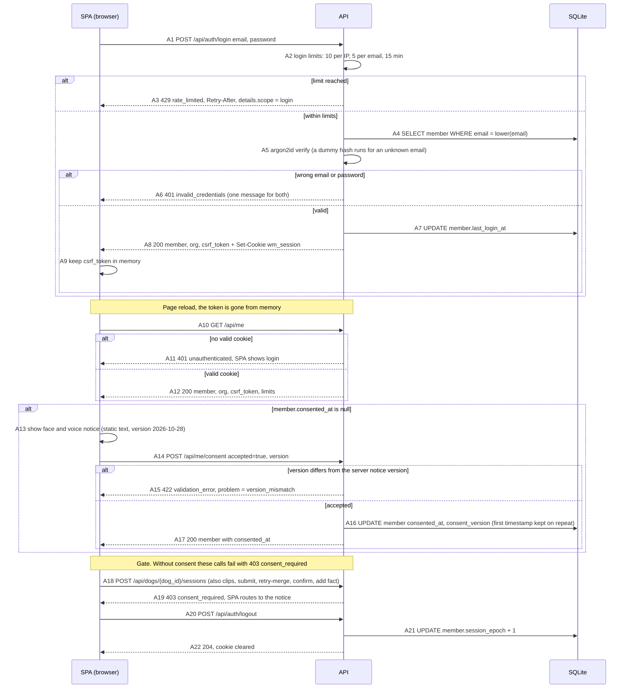

| Step    | Actor | What happens                                                                                              | Errors and notes                                                                                                         |
| ------- | ----- | --------------------------------------------------------------------------------------------------------- | ------------------------------------------------------------------------------------------------------------------------ |
| A1-A3   | API   | Login with the seeded account. IP and email counters live in memory.                                      | `429 rate_limited` with `Retry-After`. No CSRF on login (no session yet).                                                |
| A4-A6   | API   | Look up the member by lowercased email and verify the argon2id hash.                                      | One `401 invalid_credentials` for both cases, so accounts cannot be enumerated.                                          |
| A7-A9   | API   | Update `last_login_at`, set `wm_session` (HttpOnly, Secure, SameSite=Lax, 7 days), return the token.      | The SPA keeps `csrf_token` in memory only.                                                                               |
| A10-A12 | SPA   | On every reload the SPA asks `GET /api/me`. The body adds `limits` (`max_clip_bytes`, `max_clip_s`, ...). | `401 unauthenticated` sends the user to login.                                                                           |
| A13-A17 | SPA   | If `consented_at` is null, show the static notice, then record acceptance (ORG-4).                        | `accepted` must be `true`. A wrong `version` gives `422` with `problem="version_mismatch"`. Repeat calls are idempotent. |
| A18-A19 | API   | Consent gate on create session, upload clip, submit, retry-merge, confirm, add fact.                                   | `403 consent_required`. Dog list, dog create, and read endpoints do not need consent (data model D1).                    |
| A20-A22 | API   | Logout raises `session_epoch`, so every old cookie of this member stops working.                          | `204`. Other devices of the same member are logged out too.                                                              |

## 2. (b) Create session, upload clips, submit, process, review ready

The flow has three diagrams: B1 upload, B2 worker per clip, B3 submit, merge,
check, and polling. Clips can finish before or after `submit`; B3 shows both.

### 2.1 B1: create session and upload a clip

```mermaid
sequenceDiagram
    participant SPA as SPA (browser)
    participant API as API
    participant DB as SQLite
    participant FS as Storage
    participant FF as ffprobe

    SPA->>SPA: B0 show capture rules screen (CAP-7), member acknowledges
    SPA->>API: B1 POST /api/dogs/{dog_id}/sessions  situations, observed_on, capture_rules_ack = true
    alt rejected
        API-->>SPA: B2 403 consent_required, 404 not_found, 409 invalid_state (dog published or adopted; a deleted dog gives 404 not_found), 422 validation_error
    else accepted
        API->>DB: B3 INSERT session status = open, rules_ack_at = now
        API-->>SPA: B4 201 session
    end

    loop each clip, up to 3 live clips
        SPA->>API: B5 POST /api/sessions/{session_id}/clips  multipart file, client_request_id
        API->>DB: B6 checks in order: consent, org, owner or staff, session open and dog not published, clip count
        API->>API: B7 Content-Length above 209715200 gives 413 file_too_large before reading the body
        API->>FS: B8 stream body to tmp/random, count bytes
        alt body ends early
            API-->>SPA: B9 400 upload_incomplete, nothing stored
        else body complete
            API->>FF: B10 ffprobe with 10 s timeout
            alt not MP4 or MOV, or no video stream
                API-->>SPA: B11 415 unsupported_file_type, details.allowed, tmp file removed
            else duration above 120.5 s
                API-->>SPA: B12 422 clip_too_long, details.max_s, details.duration_s
            else probe ok
                API->>FS: B13 move tmp to dogs/{dog_id}/clips/{clip_id}/original.ext
                API->>DB: B14 one transaction: INSERT clip uploaded step transcode, UPDATE dog.people_check_at = NULL, INSERT job transcode
                API-->>SPA: B15 201 clip + warnings (no_audio_track when has_audio is false)
            end
        end
    end
```

| Step    | Actor | What happens                                                                                                         | Errors and notes                                                                                                                                    |
| ------- | ----- | -------------------------------------------------------------------------------------------------------------------- | --------------------------------------------------------------------------------------------------------------------------------------------------- |
| B0      | SPA   | Capture rules screen shown on every new session; the only stored trace is `session.rules_ack_at`.                    | Text is static frontend content.                                                                                                                    |
| B1-B4   | API   | Create the session in `open` with the chosen situations (1 to 8, distinct) and `observed_on` (default today UTC).    | `consent_required` 403, `not_found` 404, `invalid_state` 409, `validation_error` 422 (also `capture_rules_ack` false).                              |
| B5-B6   | API   | Upload request. Cheap checks run before any body byte is read, in the 01 order.                                      | `consent_required`, `not_found`, `not_own_session` 403, `invalid_state` 409, `clip_limit_reached` 409.                                              |
| B7-B9   | API   | Size gate from `Content-Length`, then a streamed byte counter. The file lands in `tmp/` first.                       | `file_too_large` 413 (`details.max_bytes`), `upload_incomplete` 400 (retryable), `storage_unavailable` 503.                                         |
| B10-B12 | API   | Bounded ffprobe. The MIME type is not trusted (iOS may send `application/octet-stream`); extension and probe decide. | `unsupported_file_type` 415, `clip_too_long` 422. A rejected upload leaves no row and no file.                                                      |
| B13-B15 | API   | Move the file, insert the `clip` row, clear `people_check_at`, enqueue `transcode`, all in one transaction.          | `201`. A repeated `client_request_id` returns the existing clip with `200` and creates nothing. `rate_limited` 429: 20 uploads per member per hour. |

### 2.2 B2: worker processes one clip

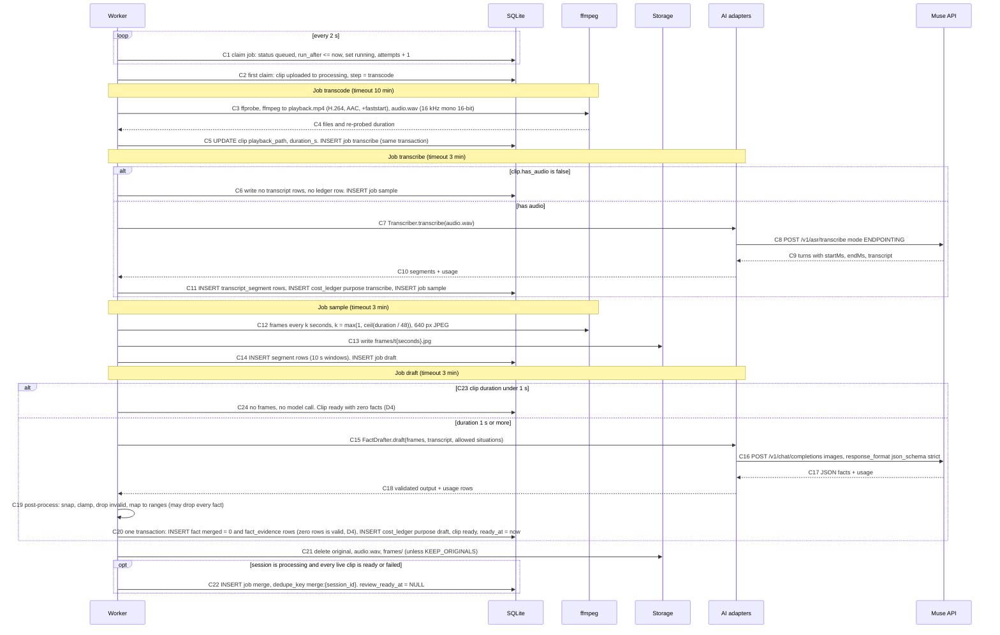

| Step    | Actor | What happens                                                                                                                                     | Errors and notes                                                                                                                   |
| ------- | ----- | ------------------------------------------------------------------------------------------------------------------------------------------------ | ---------------------------------------------------------------------------------------------------------------------------------- |
| C1      | W     | One worker polls every 2 s and claims atomically (`UPDATE ... RETURNING`, SQLite 3.35+ (verify)).                                                | A `running` row with `locked_at` older than 10 min is reset by the stale rule (J6).                                                |
| C2      | W     | The first claim moves the clip from `uploaded` to `processing` and sets `step`.                                                                  | `step` follows `transcode`, `transcribe`, `sample`, `draft` for the progress display.                                              |
| C3-C5   | W, FF | Write the H.264 playback file and the WAV, re-probe the duration (the original probe is replaced), enqueue the next job in the same transaction. | `unsupported_file`, `too_long`, `transcode_failed` (section 3).                                                                    |
| C6      | W     | A silent clip skips the provider. A transcript with zero rows is valid.                                                                          | Upload warning `no_audio_track` was already shown.                                                                                 |
| C7-C11  | W, AI | Muse Voice Transcribe in `ENDPOINTING` mode. Turns become `transcript_segment` rows; one ledger row with `audio_s`.                              | Transient errors retry, others fail at once (section 3). A malformed or invalid ASR answer maps to `ai_failed`. Details in 04 section 3.                                                          |
| C12-C14 | W, FF | Frames labeled by time, at most 48 per clip. The `segment` rows are always written so the mode can change by config without reprocessing.        | `transcode_failed` on ffmpeg error or timeout.                                                                                     |
| C15-C19 | W, AI | One FactDrafter call per clip (up to 50 images per Muse request). Output is validated, snapped to the frame grid, clamped to the duration.       | Invalid output is retried once inside the adapter; if still invalid the job fails with `ai_invalid_output` (section 3). The call returns `(result, list[Usage])`; the worker writes the ledger rows (04 section 2). |
| C23-C24 | W     | A clip under 1 s gets no frames and no model call (04 section 4.1). It is `ready` with zero facts. | Not a failure (D4, 02 C4). The review screen shows the zero-fact text (diagram G1, step G12). |
| C20-C21 | W     | Facts enter as `draft`, `origin=ai_unchanged`, `merged=0`, so reviewers never see them yet (I-15). If post-processing drops every fact, the clip is still `ready` with zero facts (D4), and a log counter is incremented. The derivative files are removed.             | Before commit the worker re-checks that the dog is not `deleted`; if it is, results are discarded and the job is `cancelled` (J3). |
| C22     | W     | The last clip to finish triggers the session merge; enqueueing it clears `session.review_ready_at` (D5). `dedupe_key` makes the enqueue idempotent when `submit` also tries it. | If the session is still `open`, nothing is enqueued; `submit` does it (B3 diagram).                                                |

### 2.3 B3: submit, merge, check, polling, review ready

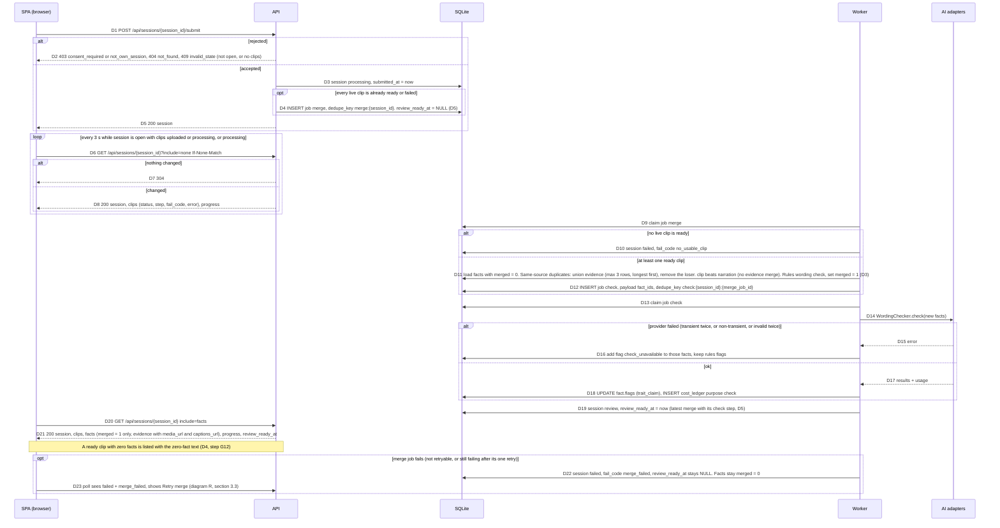

| Step    | Actor  | What happens                                                                                                                                                | Errors and notes                                                                                                                           |
| ------- | ------ | ----------------------------------------------------------------------------------------------------------------------------------------------------------- | ------------------------------------------------------------------------------------------------------------------------------------------ |
| D1-D5   | API    | Submit needs `open` and at least one live clip. The session becomes `processing`.                                                                           | Same guards as 01 5.4. If clips are already terminal, the merge is queued now; otherwise the `draft` job of the last clip queues it (C22). |
| D6-D8   | SPA    | Poll every 3 s with `include=none` (light body) and a weak ETag. `304` when nothing changed.                                                                | The SPA stops polling when the status is `review` or `failed`, or when the session is `open` and no clip is `uploaded` or `processing`.    |
| D9-D12  | W      | Merge only touches `merged=0` facts, so a rerun after a clip retry is safe. Same-source duplicates merge their evidence (union, at most 3 rows, longest first) before the loser row is removed; a `clip` fact beats a `narration` duplicate (the narration row goes, no evidence merge). Nobody sees the removed rows. Rules flags are written inline. | `session.fail_code`: `no_usable_clip`, or `merge_failed` (02 S4; a transient error is retried once first). Rules in 04 section 5.6, ADR-0044 (D3). |
| D13-D18 | W, AI  | One text-only model call for all new facts of the session. Flags go into `fact.flags`.                                                                      | The check never fails a session (J5): on failure the facts get `check_unavailable` and review continues.                                   |
| D19-D21 | W, SPA | `review_ready_at` is cleared when a merge is (re)enqueued (D4, C22, R7, F9) and set when the latest merge completes with its `check` step (D5, 02 S3). `review_ready_at - submitted_at` is the NFR-1 measure for sessions in `review` (target under 5 minutes, measure in the spike); after a retry it still counts from the original `submitted_at`. The SPA loads the facts once. | After a clip retry the session goes back to `processing` and returns here; failed clips stay visible with their retry button. |
| D22-D23 | W, SPA | A failed merge leaves the session `failed` with `merge_failed`; no clip is failed, so a clip retry does not apply. | `POST /api/sessions/{id}/retry-merge` (D6). Diagram R in section 3.3. |

Decision for the reader: a session is `review` as soon as one clip is `ready`,
even if another clip failed. The reviewer sees the failed clip with a retry or
delete action (section 3).

## 3. (c) Failure and retry paths

Four causes behave differently. The rule is the error contract of ADR-0042 (D2):
**AI adapters and handlers raise `JobError(code, retryable, retry_after_s?)`. This
is the single worker-facing error type; adapter-internal classes
(`AiTransientError`, `AiPermanentError`, `AiInvalidOutput`, 04 section 8.7) are
mapped to it. Only transient errors (network, timeout, HTTP 429, 5xx; for
ffmpeg: timeout, kill, disk full) have `retryable=true` and retry up to
`max_attempts`. Schema-invalid model output is retried once inside the adapter,
then fails at once as `ai_invalid_output`. Non-transient provider errors (HTTP
400, 401, 402, 403, 404, including bad-image errors) fail at once as
`ai_failed` with no automatic retry. Any failed clip can still be retried by
hand (`clip.error.retryable`, section 3.2).**

### 3.1 C: worker failure classification

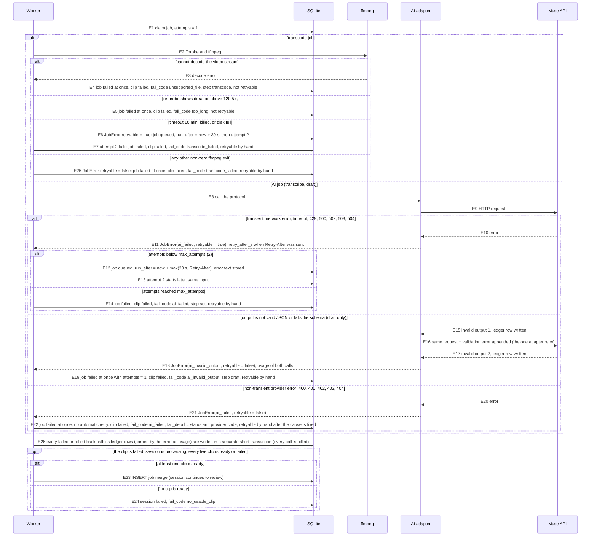

| Step    | Cause                                     | Retry rule                                                   | Result on the clip                                                  | Notes                                                                                                                     |
| ------- | ----------------------------------------- | ------------------------------------------------------------ | ------------------------------------------------------------------- | ------------------------------------------------------------------------------------------------------------------------- |
| E3-E4   | Unsupported or corrupt video              | none                                                         | `failed`, `unsupported_file`, `retryable=false`                     | "This video format could not be read." User deletes and re-uploads.                                                       |
| E5      | Re-probe over 120.5 s                     | none                                                         | `failed`, `too_long`, `retryable=false`                             | "The clip is longer than 2 minutes."                                                                                      |
| E6-E7   | ffmpeg timeout, kill, disk full           | one job retry after 30 s                                     | `failed`, `transcode_failed`, `retryable=true` after attempt 2      | `retryable=true` here is the manual retry flag of `clip.error`. |
| E25     | Any other non-zero ffmpeg exit            | none (`JobError retryable=false`)                            | `failed`, `transcode_failed`, `retryable=true` (manual only)        | Decode errors are `unsupported_file` (E3), not this row. |
| E8-E14  | Network, timeout, 429, 5xx (AI)           | `max_attempts=2`, backoff 30 s (a larger `Retry-After` wins) | `failed`, `ai_failed`, `retryable=true` after attempt 2             | "The AI step did not finish." Applies to `transcribe` and `draft`. A 504 `gateway_timeout` counts as a timeout.           |
| E15-E19 | Schema-invalid output (draft)             | one retry inside the adapter, none at job level              | `failed`, `ai_invalid_output`, `retryable=true` (manual retry only) | "The AI answer was not usable." Both calls are billed (two ledger rows). `attempts` stays 1.                              |
| E20-E22 | Auth, billing, bad request (also a bad image), forbidden, unknown model (400, 401, 402, 403, 404) | none (no automatic retry) | `failed`, `ai_failed`, `retryable=true` (manual only)               | Retrying at once cannot help; the operator must fix the key or the request first. `fail_detail` has status and code only. A 401, 402, or 403 also raises an operator alert in `GET /api/admin/metrics`. |
| E26     | Cost of failed calls                      | n/a                                                          | n/a                                                                 | Calls that failed or were rolled back still get their ledger rows (I-20); success writes result and rows in one transaction (C20). |
| E23-E24 | Session reaction                          | n/a                                                          | session continues or fails                                          | `fail_code=no_usable_clip` when every live clip failed.                                                                   |

The same classification applies to `check`, but it never fails a session: any
provider error or two invalid outputs add the flag `check_unavailable`
(severity `info`, source `system`) and review continues. Q&A has no job and no
job retry: the adapter does its one schema retry, then the request ends with
`503 qa_unavailable` (section 7). A malformed body or an invalid answer from the
transcription endpoint is a provider error and fails the job as `ai_failed`; the
schema-retry rule only covers model JSON (`draft`, `check`, Q&A).

### 3.2 C2: what the user does after a failure

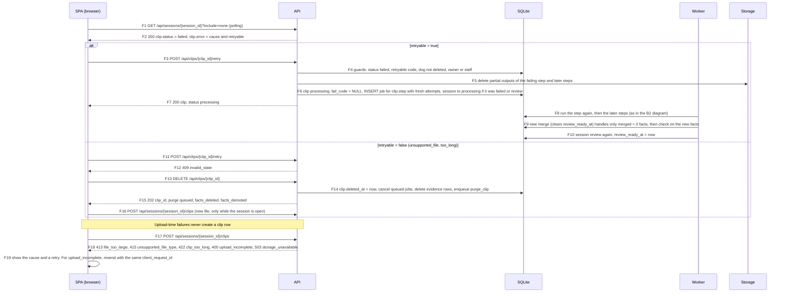

| Step    | Actor | What happens                                                                                                             | Errors and notes                                                                                                                                  |
| ------- | ----- | ------------------------------------------------------------------------------------------------------------------------ | ------------------------------------------------------------------------------------------------------------------------------------------------- |
| F1-F2   | SPA   | The polled clip body carries `status`, `step`, `fail_code`, and `error` (`cause`, `retryable`).                          | Every failure shows a cause and an action (CAP-8). No silent failure.                                                                             |
| F3-F7   | API   | Retry resumes at the failing step. Partial outputs of that step and later steps are removed first (C6).                  | `not_own_session` 403, `invalid_state` 409 (not failed, or not retryable), `not_found` 404.                                                       |
| F8-F10  | W     | The merge is idempotent: it only processes `merged=0` facts, so earlier facts and human edits are untouched. Enqueueing the new merge clears `review_ready_at`; the finished `check` sets it again (D5). | For a `ready` session this moves `review` to `processing` and back (02 S5). |
| F11-F16 | API   | A non-retryable clip is deleted and uploaded again. Delete is staff, or the owner when no confirmed fact cites the clip. | `forbidden_role` 403 if a volunteer deletes a clip cited by a confirmed fact. Upload needs the session in `open` (`invalid_state` 409 otherwise). |
| F17-F19 | SPA   | Upload errors are HTTP errors shown at once. `upload_incomplete` is safe to resend with `client_request_id`.             | `rate_limited` 429 after 20 uploads in an hour.                                                                                                   |

### 3.3 R: merge failed and retry-merge (D6)

A `merge` failure is a session problem, not a clip problem: every clip is `ready`
or `failed` on its own, so there is no clip to retry. The session shows
`failed` with `fail_code=merge_failed`, and the user retries the merge itself.

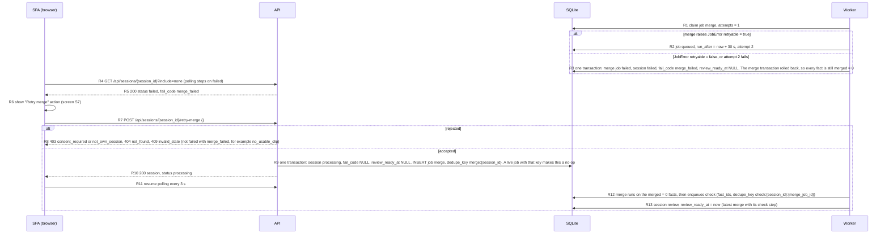

| Step    | Actor | What happens                                                                                              | Errors and notes                                                                                                                                  |
| ------- | ----- | --------------------------------------------------------------------------------------------------------- | ------------------------------------------------------------------------------------------------------------------------------------------------- |
| R1-R3   | W     | `merge` follows J4/J5: one automatic retry for a transient error, then the session is failed.             | `merge` writes no cost (no model call). A failed `check` never reaches here (it only sets `check_unavailable`).                                    |
| R4-R6   | SPA   | The failed session carries `fail_code=merge_failed`; the screen offers "Retry merge" to the owner or staff. | A session failed with `no_usable_clip` offers retry or delete of clips instead (diagram F).                                                       |
| R7-R10  | API   | Cross-cutting checks, then the 01 5.4a guards. Allowed for owner or staff. Idempotent while the merge job is live. | `consent_required` 403, `not_own_session` 403, `not_found` 404, `invalid_state` 409.                                                              |
| R12-R13 | W     | Same merge and check as diagram B3; only `merged=0` facts are touched, so human edits and confirmed facts stay. | `review_ready_at - submitted_at` includes the failure and the wait for the user (NFR-1 median uses sessions in `review`).                         |

## 4. (d) Review: play, confirm, edit, delete, hand-add

### 4.1 G1: play a range and report playback

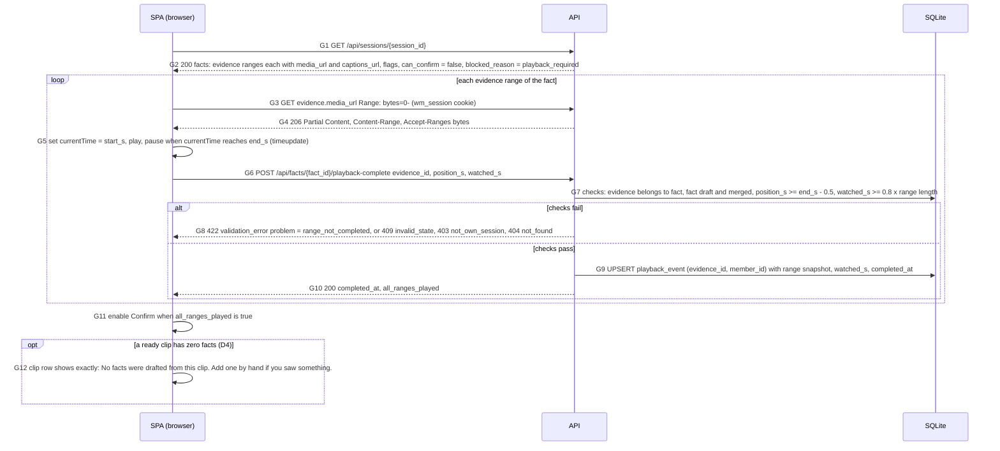

| Step   | Actor | What happens                                                                                                                        | Errors and notes                                                                                                                                               |
| ------ | ----- | ----------------------------------------------------------------------------------------------------------------------------------- | -------------------------------------------------------------------------------------------------------------------------------------------------------------- |
| G1-G2  | SPA   | One card per draft fact (REV-1). `can_confirm` and `blocked_reason` are computed for the signed-in member.                          | Volunteers can read any session of the org; actions are role-checked later.                                                                                    |
| G3-G4  | SPA   | The player streams the playback file from `evidence.media_url`; it never builds a URL from `clip_id` (D7). Captions load from `evidence.captions_url` (`null` when the clip has no transcript rows). Members may play any clip of the org except for `deleted` dogs, whatever the dog status.      | Range support is required on iOS Safari. `404 not_found` when the clip is deleted or not `ready`.                                                              |
| G5     | SPA   | The card starts at `start_s` and pauses at `end_s`.                                                                                 | Client-side only.                                                                                                                                              |
| G6-G10 | API   | One call per evidence row. The server checks the reported numbers and upserts one `playback_event` with the current range snapshot. | Stated limit: the numbers come from the client, so the gate proves a cooperating client, not that a person watched. The acceptance metric is the second guard. |
| G12    | SPA   | A clip that is `ready` with zero facts (post-processing dropped all, or the clip is under 1 s) is not an error. The review screen shows the fixed text and the hand-add action. | The session can still be `review` when every ready clip has zero facts (02 S3). |
| G11    | SPA   | Confirm enables only when every range has an event for this member.                                                                 | The server re-checks on confirm (next diagram).                                                                                                                |

### 4.2 G2: confirm

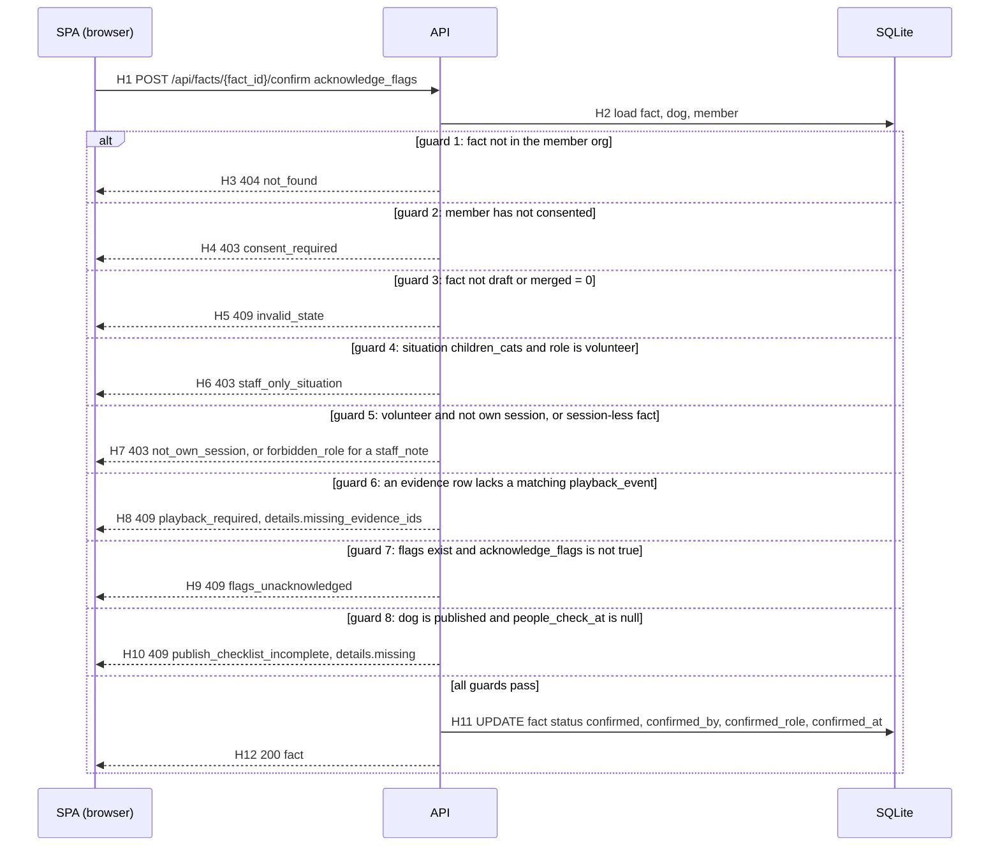

| Step   | What happens                                                                          | Notes                                                                                                                                                                                      |
| ------ | ------------------------------------------------------------------------------------- | ------------------------------------------------------------------------------------------------------------------------------------------------------------------------------------------ |
| H1-H12 | Eight guards run in the fixed order of data model 3.4. The first failure is returned. | A volunteer who confirms a `children_cats` fact of own session gets `staff_only_situation`, not `not_own_session`, because guard 4 comes first. The DB also enforces I-5 and I-6 by CHECK. |
| H6     | Only staff confirm situation 8 (PUB-9).                                               | Public output adds the notice `ask_shelter_in_person_meeting` for every `children_cats` fact.                                                                                              |
| H8     | A playback event counts only if its snapshot equals the current range.                | A range edit deletes the event and demotes the fact, so the member must watch again.                                                                                                       |
| H9     | Wording flags warn but do not block; the member must tick the acknowledgement.        | The choice is logged with the confirmation (D15).                                                                                                                                          |

### 4.3 G3: edit, delete, hand-add

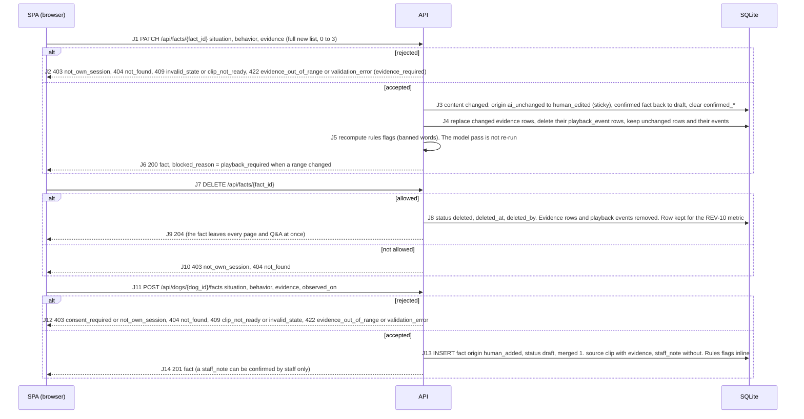

| Step    | What happens                                                                                                                 | Notes                                                                                                                                                        |
| ------- | ---------------------------------------------------------------------------------------------------------------------------- | ------------------------------------------------------------------------------------------------------------------------------------------------------------ |
| J1-J6   | Edit a draft or a confirmed fact. A content change demotes a confirmed fact: it leaves the public page and Q&A at once (F6). | Setting `evidence: []` on a `clip` or `narration` fact is `422 validation_error` with `problem="evidence_required"`. `origin=human_added` stays.             |
| J7-J10  | Owner (any status) or staff deletes. Soft delete keeps the REV-10 denominator.                                               | `204`, no body.                                                                                                                                              |
| J11-J14 | A member adds a fact by hand. Volunteers may cite clips from own sessions only; staff any clip of the dog.                   | Evidence range: 1 to 60 s, inside the clip, clip `ready`. No evidence means `source=staff_note`, labeled "Shelter staff note" and never counted as coverage. |

## 5. (e) Publish, unpublish, mark adopted, delete

### 5.1 K1: checklist and publish

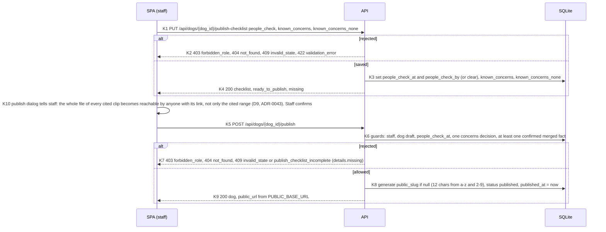

| Step  | What happens                                                                                                                   | Notes                                                                                                                                                                                        |
| ----- | ------------------------------------------------------------------------------------------------------------------------------ | -------------------------------------------------------------------------------------------------------------------------------------------------------------------------------------------- |
| K1-K4 | Only staff set the checklist. Both fields can be saved half-filled. `known_concerns_none=true` needs empty text.               | A published dog cannot clear its checklist (`invalid_state`): unpublish first.                                                                                                               |
| K5-K9 | Publish needs: dog `draft`, `people_check_at` set, either non-blank concerns or "none known", and at least one confirmed fact. | `details.missing` lists `people_check`, `known_concerns`, `confirmed_fact`. The DB CHECK on `dog` repeats the checklist rule (I-9, I-10). Publishing copies nothing; facts stay as they are. |
| K8    | The slug is random and kept after unpublish, so a re-publish restores the same link.                                           | The profile and its cited clips are reachable from this commit on (diagram L1). |
| K10   | The dialog states the whole-clip exposure before the call. No extra request field; the call is the confirmation.                | Accepted for R1; the public player plays only the cited range; per-range cutting is R2 (D9, ADR-0043, 01 section 7). |

### 5.2 K2: unpublish and mark adopted

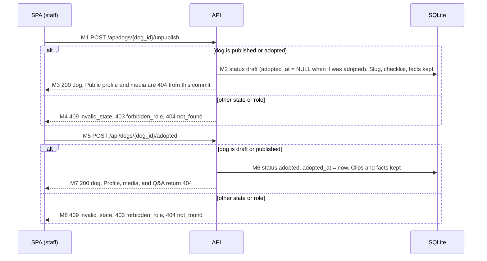

| Step  | What happens                                                                                       | Notes                                                                                                                   |
| ----- | -------------------------------------------------------------------------------------------------- | ----------------------------------------------------------------------------------------------------------------------- |
| M1-M4 | Unpublish moves `published` or `adopted` back to `draft`. Nothing is deleted.                      | Takes effect on the next request because media uses `Cache-Control: private, no-cache` and the profile uses `no-store`. |
| M5-M8 | Adopted hides the dog from every public and media route. Members still see it in the creator list. | A page already open in an adopter's browser keeps what it loaded; bytes already downloaded cannot be recalled (NFR-8).  |

### 5.3 K3: delete a dog (tombstone, then files, then rows)

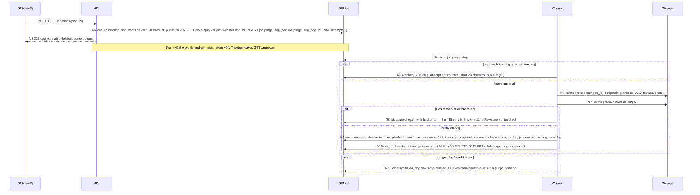

| Step   | What happens                                                                                            | Notes                                                                                                                                                                                  |
| ------ | ------------------------------------------------------------------------------------------------------- | -------------------------------------------------------------------------------------------------------------------------------------------------------------------------------------- |
| N1-N3  | Staff delete. The API hides first (tombstone, slug cleared), then queues the purge, then answers `202`. | The same call works from `draft`, `published`, or `adopted`. A second delete returns `404 not_found`.                                                                                  |
| N4-N5  | The purge waits for any running job of the dog; running jobs are not interrupted.                       | A running job that finishes sees the tombstone and discards its output.                                                                                                                |
| N6-N8  | Files go first, then verification. Rows stay until the prefix is empty.                                 | A failed file delete never reports success early.                                                                                                                                      |
| N9-N11 | Rows go in foreign-key order inside one transaction. `cost_ledger` rows survive with NULL references.   | I-17: afterward no file under `dogs/{dog_id}/` and no row with that `dog_id` remains, except the ledger. Draft-acceptance counts of the dog disappear with its facts (data model 6.1). |

Clip delete (`DELETE /api/clips/{clip_id}`, `202`) follows the same hide-first
pattern with `purge_clip`; it is drawn in diagram F (section 3.2).

## 6. (f) Public profile, media Range playback, access check

### 6.1 L1: open the profile

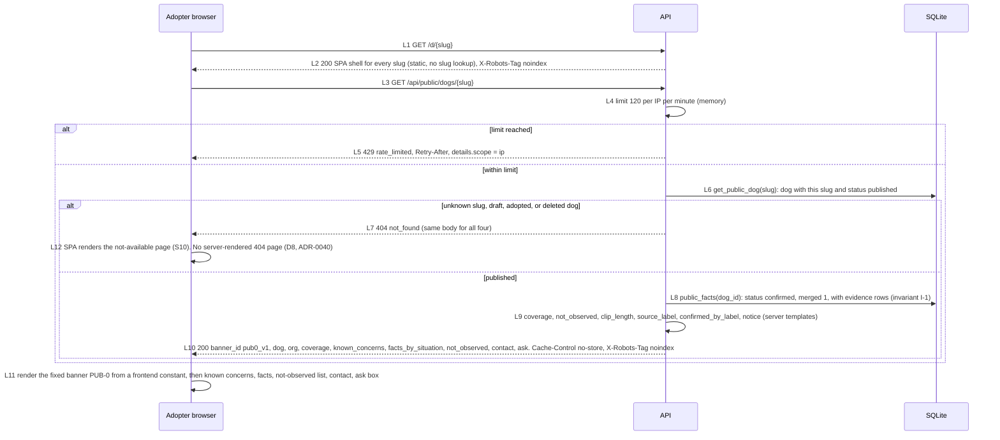

| Step   | What happens                                                                                                                                        | Notes                                                                                                                    |
| ------ | --------------------------------------------------------------------------------------------------------------------------------------------------- | ------------------------------------------------------------------------------------------------------------------------ |
| L1-L2  | The same origin serves the SPA route and the API (no CORS). The shell is served with `200` for every slug, because it cannot know the slug state.   | The route sends `X-Robots-Tag: noindex`; discovery is by the shelter's shared link only.                                 |
| L3-L5  | Public read limit: 120 per IP per minute. IP comes from the trusted proxy header when `TRUSTED_PROXY=true`.                                         | `429 rate_limited`.                                                                                                      |
| L6-L7  | One dependency, `get_public_dog(slug)`, decides visibility for all public and media routes (I-11).                                                  | The four hidden cases return one body, so a visitor cannot tell that a slug once existed. The HTTP `404` comes from the public API only; the SPA renders the not-available page (L12, D8, ADR-0040). |
| L8-L10 | One query function, `public_facts(dog_id)`, is the only reader for public and Q&A paths (I-1). Text is `fact.behavior` plus fixed server templates. | `facts_by_situation` omits situations with no confirmed fact. `children_cats` facts carry the `notice`.                  |
| L11    | The banner is not in the API response, so no API change can hide it. The test asserts `banner_id`.                                                  | Order: banner, header and coverage, known concerns, facts, not observed, contact, ask.                                   |

### 6.2 L2: play a fact range (media Range request and access check)

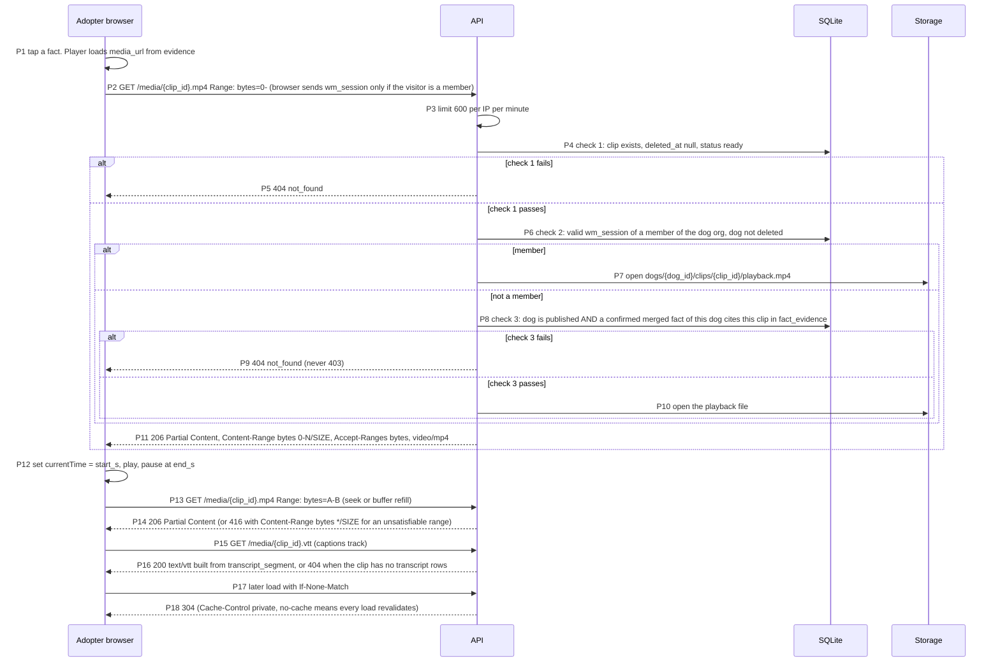

| Step    | What happens                                                                                           | Notes                                                                                                                                                                           |
| ------- | ------------------------------------------------------------------------------------------------------ | ------------------------------------------------------------------------------------------------------------------------------------------------------------------------------- |
| P2-P3   | The browser's `<video>` element asks for ranges itself; iOS Safari requires range support.             | `Accept-Ranges: bytes` on every response. A start-only range (`bytes=0-`) gets `206` to the end of the file.                                                                    |
| P4-P5   | Check 1: the clip must exist, be live, and be `ready`.                                                 | Photos check `dog.photo_path` instead.                                                                                                                                          |
| P6-P7   | Check 2: a signed-in member of the dog's org can play any clip of any dog that is not `deleted`.       | This is how reviewers preview unpublished clips. The cookie rides along on same-origin `<video>` loads.                                                                         |
| P8-P10  | Check 3 (public): the dog is `published` and the clip is cited by at least one confirmed, merged fact. | Extra footage and rejected moments stay private (A8 in 01). Limit (D9, ADR-0043): the whole file of a cited clip is served, not only the cited range. The public player plays only the cited range (P12), but anyone with the URL can fetch the full clip, so the people check applies to whole clips and the publish dialog says so (K10). |
| P11-P14 | Starlette `FileResponse` answers with `206` and `Content-Range`; unsatisfiable ranges give `416`.      | Multi-range requests may answer `multipart/byteranges` (verify); browsers do not use them for `<video>`. `HEAD` returns headers only.                                           |
| P15-P16 | Captions come from the transcript (NFR-6). Headers: `Content-Type: text/vtt; charset=utf-8`.           | `404` when no transcript rows exist; the player then shows no caption track.                                                                                                    |
| P17-P18 | `ETag` and `Last-Modified` come from the file. Unpublish or delete takes effect on the next request.   | Costs one revalidation per load. Headers also include `X-Content-Type-Options: nosniff`, `X-Robots-Tag: noindex`, `Vary: Cookie`.                                               |

## 7. (g) Q&A: question to rendered answer

The model sees the question and the dog's confirmed facts as aliases `F1..Fn`
and returns a list of aliases. The server maps the aliases back to fact ids,
filters, and renders every word the adopter reads from `fact.behavior` and fixed
templates (QA-2, AI-8, I-16).

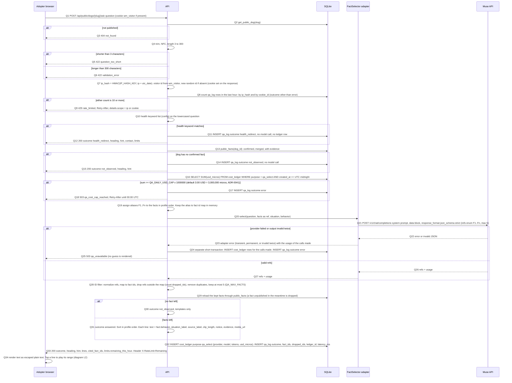

| Step    | What happens                                                                                                                       | Errors and notes                                                                                                                                                                                                       |
| ------- | ---------------------------------------------------------------------------------------------------------------------------------- | ---------------------------------------------------------------------------------------------------------------------------------------------------------------------------------------------------------------------- |
| Q1-Q3   | Resolve the dog with the same dependency as the profile. Hidden dogs are `404`, so Q&A stops when a dog is unpublished or adopted. | `404 not_found`.                                                                                                                                                                                                       |
| Q4-Q6   | Input validation. The question is data only and is never executed or interpreted by the server.                                    | `422 question_too_short` (under 3 after trim), `422 validation_error` (over 300). These calls write no `qa_log` row (section 8).                                                                                       |
| Q7-Q9   | Limit: 10 per hour per IP hash and 10 per `wm_visitor` cookie, both must pass, counted from `qa_log` (sliding hour).               | `429 rate_limited` with `Retry-After` and `details.scope` of `ip` or `cookie`. The cookie is set on the first call. The IP hash includes the UTC date, so the per-IP count restarts at 00:00 UTC (see 04 section 7.5). |
| Q10-Q12 | Health template. A keyword hit never reaches the model, so no medical wording can appear (QA-4). Heading: "Ask the shelter's vet." | Outcome `health_redirect`. Contact comes from the shelter (`org`). Works even when the cost cap is reached.                                                                                                            |
| Q13-Q15 | A dog with no confirmed fact answers "Not observed yet." with no model call.                                                       | Outcome `not_observed`.                                                                                                                                                                                                |
| Q16-Q18 | Daily cap check on the `qa_select` sum since 00:00 UTC against `QA_DAILY_USD_CAP`, default 3.00 USD (D1, ADR-0041; about 1,200 questions a day, 04 section 9). Eval runs use purpose `spike` and do not count. | `503 qa_cost_cap_reached`. Health and no-facts answers above still work (A12). In-flight calls can overshoot the cap by a few calls (accepted).                                                                        |
| Q19-Q21 | Aliases are per request. The data block holds the facts first and the question last (stable prefix for caching, verify).           | Prompt and schema in 04 section 7.                                                                                                                                                                                     |
| Q22-Q25 | Q&A has no job and no job-level retry. A provider failure or two invalid outputs end the request.                                  | `503 qa_unavailable`. No job retry for Q&A (D2); the adapter still does its one schema retry, so a request can cost two ledger rows, written even on failure. `outcome=error` rows do not count toward the hourly limit.                                                                                                              |
| Q28-Q29 | Alias map, then a second filter at the database: ids outside the dog's confirmed set are dropped and counted. At most 5 remain.    | `qa_log.dropped_ids` is the QA-7 counter. With constrained decoding it should stay 0; the filter still runs (I-19).                                                                                                    |
| Q30-Q33 | Render from templates and `fact.behavior`. Every answer writes one `qa_log` row; every model call writes one `cost_ledger` row.    | Fixed strings: "Here is what has been filmed:", "Not observed yet.", "Ask the shelter's vet.". `qa_log.ledger_id` points at the last ledger row of the request.                                                        |

## 8. Additions and changes relative to 01 and 02

v0.1 listed seven points (S1-S7) where drawing the flows needed a rule that
01/02 did not state. 01 and 02 v0.2 have adopted them. Each item is now
resolved with a pointer, or kept open with an owner. Rows T1-T10 are the changes
this version made to the diagrams.

### 8.1 Earlier additions S1-S7

| ID  | Topic                                   | Status                                                                                                                                               |
| --- | --------------------------------------- | ---------------------------------------------------------------------------------------------------------------------------------------------------- |
| S1  | Job retries for AI errors               | Resolved (D2, ADR-0042): 01 section 2 retry contract, 02 J4/J5, `JobError(code, retryable)`. Drawn in section 3.1.                                    |
| S2  | ffmpeg failures                         | Resolved (D2): 02 section 3.3 `transcode_failed`; timeout, kill, disk full retry once, other non-zero exits fail at once. Drawn as E6, E7, E25.        |
| S3  | `qa_log` rows and the hourly limit      | Resolved (lead ruling): 01 6.2 and 02 2.12. Calls rejected with 404, 422, 429 write no row; `outcome=error` rows are not counted. Drawn in section 7.   |
| S4  | Merge across clips                      | Resolved (D3, ADR-0044): 02 F2 and 04 section 5.6. Evidence union (max 3 rows, longest first); `clip` beats `narration`. Drawn as D11.                  |
| S5  | `check` job input                       | Resolved: 02 job types (`check` payload `fact_ids`) and 02 F2; `dedupe_key` is `check:{session_id}:{merge_job_id}`. Drawn as D12.                       |
| S6  | `qa_log.ledger_id` with two model calls | Resolved: 02 2.12; the id of the last ledger row of the request. Both rows count toward the cap.                                                       |
| S7  | `review` while a clip failed            | Resolved: 02 S3 (at least one live clip `ready`). The UI part (failed clips beside the cards, Retry merge) is in 05 screen S7.                          |

### 8.2 Changes made in v0.2

| ID  | Topic                          | Change in this file                                                                                                                                       | Source          |
| --- | ------------------------------ | --------------------------------------------------------------------------------------------------------------------------------------------------------- | --------------- |
| T1  | Retry merge                    | New diagram R (section 3.3), steps R1-R13; consent gate list in A18 includes retry-merge; D22-D23 in diagram B3.                                          | D6, 01 5.4a, 02 S6 |
| T2  | Zero-fact clip                 | C23-C24 (clip under 1 s), C20 (all facts dropped), G12 (review text), D21 note.                                                                           | D4, 02 C4, 04 4.1 |
| T3  | `review_ready_at`              | Cleared at merge enqueue (C22, D4, F9, R9), set after `check` (D19, F10, R13). NFR-1 note in the D19-D21 row.                                              | D5, 02 S3, I-22 |
| T4  | Error and retry flow           | Section 3 intro and diagram C rewritten around `JobError`: transient retry, non-transient fail at once (E20-E22), schema-invalid (E15-E19), other ffmpeg exits (E25). | D2, ADR-0042    |
| T5  | Ledger rows on failure         | E26 and Q24: rows of failed or rolled-back calls go in a separate short transaction; success keeps one transaction (C20).                                  | lead ruling, 04 9.2 |
| T6  | Cross-clip evidence merge      | D11 and the D9-D12 table row describe the union rule and the `clip` over `narration` rule.                                                                | D3, ADR-0044    |
| T7  | SPA shell and hidden profile   | L2 (shell is `200` for every slug), L7 and L12 (SPA renders S10); no server 404 page.                                                                      | D8, ADR-0040    |
| T8  | Creator `media_url`            | G2-G3: the player calls `evidence.media_url` and `captions_url`, never builds a URL from `clip_id`; D21 response.                                            | D7, 01 section 2 |
| T9  | Whole-clip exposure            | K10 (publish dialog text) and the P8-P10 note: the whole file of a cited clip is public, the player plays only the cited range.                            | D9, ADR-0043    |
| T10 | Cost cap                       | Q16-Q18: `QA_DAILY_USD_CAP` default 3.00 USD per UTC day.                                                                                                  | D1, ADR-0041    |

### 8.3 Open items

| ID | Item                                                                                                                             | Owner         |
| -- | -------------------------------------------------------------------------------------------------------------------------------- | ------------- |
| O1 | Muse behavior marked "(verify)" in 04: strict-mode min/max, output-cap parameter names, cached-token reporting, token counts, max video duration, Korean ASR quality | day-1 spike   |
| O2 | SQLite `UPDATE ... RETURNING` support (3.35+) on the target host (C1); multi-range media requests (P11-P14)                       | day-1 spike   |
| O3 | Proxy body limit of at least 210 MiB for uploads (01 5.3)                                                                         | day-1 spike   |
| O4 | NFR-1 timing (under 5 minutes for 3 clips) and Muse key and credit                                                                | user (key, credit), day-1 spike (timing) |
| O5 | Per-range clip cutting so only the cited range is public                                                                          | R2            |
