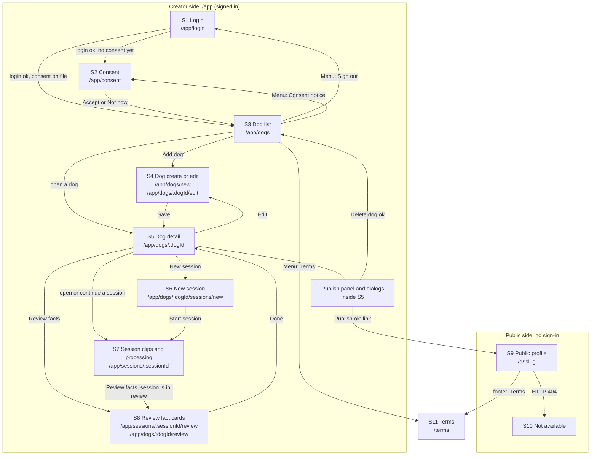

# Watch Me! R1: Screen Design (v0.2, 2026-10-28)

Input, in order of authority (earlier wins on conflict):

1. `docs/design/01-api-spec.md` and `docs/design/02-data-model.md` (both v0.2)
2. `docs/PRD.md` v1.3 (sections 4.2 to 4.5, 5.2, 5.3, PUB-0 text)
3. `docs/DESIGN.md` v0.3 section 8 (frontend screens)
4. `SERVICE.md` section 11 (user flows)

This file is design only: screens, states, copy, and rules. It contains no
application code. Endpoint paths and error codes are exact copies from the API
spec. "(verify)" marks an assumption to check against the running API or on a
real phone. Section 12 lists every deviation from the inputs; section 13 lists
open questions.

## 0. Conventions

| Topic            | Rule                                                                                                                                                                                                                                                                    |
| ---------------- | ----------------------------------------------------------------------------------------------------------------------------------------------------------------------------------------------------------------------------------------------------------------------- |
| Roles            | **Staff** (`staff`), **Volunteer** (`volunteer`), **Visitor** (no sign-in). "Member" means staff or volunteer. The UI hides or disables what a role cannot do. The server decides; the UI never relies on its own check.                                                |
| Screen ids       | `S1` to `S11`, used in the map, the tables, and the copy keys.                                                                                                                                                                                                          |
| Width            | Wireframes show a 375 px wide phone: the frame is 44 characters wide, about 8.5 px per character. Content never scrolls sideways.                                                                                                                                                                       |
| Wireframe legend | `[ Label ]` button. `[ ]` / `[x]` checkbox. `( )` / `(o)` radio. `[____]` text field. `[v]` select. `(!)` warning. `>` opens a screen. `<` back. Lines of `-` inside a wireframe separate list items.                                                                   |
| Calls            | "Call" means a request to the API spec. Paths are exact. Creator calls use the `wm_session` cookie. State-changing creator calls send `X-CSRF-Token`. Public calls send neither.                                                                                        |
| Copy keys        | Every user-visible string has a key in section 9. Error text is written inline in the per-screen tables and repeated in section 9 only when a key is shared. English only (NFR-4).                                                                                      |
| Numbers          | Seconds in clips use the API labels (`1 clip, 9 s`). Positions inside the player use `m:ss` (`0:12`). Dates show as `Oct 28, 2026`. A date-only value (`observed_on`) is parsed as a calendar date, never as a UTC instant, so it cannot shift by a day in a time zone. |
| Safety wording   | The UI never prints a trait label or a judgment word. Sample data and helper text follow PRD 5.3. The banned-word list lives in server config; this document does not copy it.                                                                                          |

## 1. Screen map and navigation

### 1.1 Inventory

| Id  | Route                                                                | Role                                                | Screen                                    |
| --- | -------------------------------------------------------------------- | --------------------------------------------------- | ----------------------------------------- |
| S1  | `/app/login`                                                         | Visitor (signed out)                                | Login                                     |
| S2  | `/app/consent`                                                       | Member                                              | Consent notice (ORG-4)                    |
| S3  | `/app/dogs` (`/app` redirects here)                                  | Member                                              | Dog list                                  |
| S4  | `/app/dogs/new`, `/app/dogs/:dogId/edit`                             | Member                                              | Dog create and edit                       |
| S5  | `/app/dogs/:dogId`                                                   | Member (publish panel: staff acts, volunteer reads) | Dog detail                                |
| S6  | `/app/dogs/:dogId/sessions/new`                                      | Member with consent                                 | New session: capture rules and situations |
| S7  | `/app/sessions/:sessionId`                                           | Member (acts: session owner or staff)               | Session: clips, upload, processing        |
| S8  | `/app/sessions/:sessionId/review`, `/app/dogs/:dogId/review`         | Member                                              | Review: fact cards                        |
| S9  | `/d/:slug`                                                           | Visitor                                             | Public profile                            |
| S10 | `/d/:slug` when the public API returns 404 (the SPA shell itself is served with 200, ADR-0040); `/` and any unknown public path | Visitor                                             | Not available                             |
| S11 | `/terms`                                                             | Anyone                                              | Terms (NFR-9)                             |
| S0  | any other `/app/...` path                                            | Member                                              | App page not found                        |

### 1.2 Map



### 1.3 Route rules

1. On app start the SPA calls `GET /api/me`. `401 unauthenticated` sends the
   member to S1 with `?returnTo=<path>`. The CSRF token and `limits` from this
   response live in memory only.
2. A signed-in member who opens S1 goes to S3.
3. After a successful login, a member with `consented_at = null` goes to S2
   once. S2 has a "Not now" link, so a staff member who only publishes is not
   blocked. Until consent is on file the app disables every action that the
   API rejects with `consent_required`: create session, upload clip, submit,
   confirm, hand-add fact (these are listed per screen).
4. S9 and S10 never call a creator endpoint and never read `wm_session`. A
   signed-in member who opens a public link sees the public view.
5. `/d/:slug` and `/terms` send `X-Robots-Tag: noindex` (set by the server).
   The SPA also sets `<meta name="robots" content="noindex">`.
6. Browser Back follows the map. Dialogs and sheets are part of the page and
   do not add history entries, except the S8 edit and hand-add sheets, which
   add one entry so Back closes the sheet (not the screen).

## 2. Global behavior

### 2.1 App shell (creator)

```text
+--------------------------------------------+
| <  Dogs                       [ Menu ]     |
+--------------------------------------------+
|                                            |
|  (screen content, 16 px side gutter)       |
|                                            |
+--------------------------------------------+
|  [ Primary action bar, when needed ]       |
+--------------------------------------------+
```

- Top bar: 56 px high. Back button (44 px target) on every screen except S3.
  Title is the screen name. "Menu" opens a sheet with: Dogs, Consent notice,
  Terms, Sign out, and the signed-in name and role.
- Bottom action bar (S6, S7, S8 only) is fixed, holds one primary button, and
  adds `env(safe-area-inset-bottom)` padding.
- Sign out calls `POST /api/auth/logout`. On any outcome the SPA clears its
  memory and goes to S1. A failed call shows "You were signed out on this
  device. The server could not confirm it."

### 2.2 Loading, polling, and refresh

- First load of a screen shows static skeleton blocks (grey boxes, no
  animation) plus the text "Loading..." in a live region. After 10 s of
  waiting the screen shows "This is taking longer than usual." and a
  "Try again" button.
- Reloading a screen refetches its data. There is no pull to refresh.
- Polling (S7, S5 while a session processes): `GET /api/sessions/{id}?include=none`
  every 3 s with `If-None-Match`; `304` is a no-op. After 3 failed polls in a
  row the screen shows a non-blocking line "Connection problem. Trying again."
  and polls every 10 s until one succeeds. Polling stops when the screen
  closes or the tab is hidden, and resumes with one immediate fetch when the
  tab is visible again.
- S5 polls `GET /api/dogs/{dog_id}` every 5 s only while a session of the dog
  is `processing` (UI choice; the API has no push).

### 2.3 Global errors (every creator call can return these)

| Code or condition                                     | UI message and behavior                                                                                                                                                                                                               |
| ----------------------------------------------------- | ------------------------------------------------------------------------------------------------------------------------------------------------------------------------------------------------------------------------------------- |
| `unauthenticated` 401                                 | Redirect to S1 with the notice "Your session ended. Sign in again." The page the member was on is kept in `returnTo`.                                                                                                                 |
| `csrf_failed` 403                                     | The SPA refetches `GET /api/me` and retries the call once without telling the member. If it fails again: "Your session is out of date. Reload the page and try again."                                                                |
| `rate_limited` 429                                    | "Too many requests. Try again in {n} seconds." If `Retry-After` is 60 or more, show minutes: "Try again in {m} minutes." The triggering button stays disabled until the countdown ends. Login and upload use their own text (S1, S7). |
| `internal_error` 500                                  | "Something went wrong on our side. Try again. If it keeps happening, send this ID to the team: {request_id}." (`details.request_id`; omit the second sentence if absent)                                                              |
| `malformed_request` 400, `unsupported_media_type` 415 | "The app sent a request the server could not read. Reload the page. If it keeps happening, send this ID to the team: {request_id}." These mean an app bug.                                                                            |
| Network failure or timeout (no response)              | "No connection. Check your network and try again."                                                                                                                                                                                    |
| Unknown `code`                                        | Show the response `message` (the API says it is safe to show) under the heading "Something went wrong."                                                                                                                               |
| `validation_error` 422                                | Field messages from `details.fields[]`, see 2.4. Above the form: "Check the highlighted fields."                                                                                                                                      |
| `not_found` 404 (default)                             | "This item was not found. It may have been deleted." with a "Back to dogs" link.                                                                                                                                                      |
| `forbidden_role` 403 (default)                        | "Your role cannot do this. Ask staff."                                                                                                                                                                                                |
| `consent_required` 403 (default)                      | "Accept the consent notice first." with a link "Open consent notice".                                                                                                                                                                 |
| `invalid_state` 409 (default)                         | "That action is not possible right now. Reload the page."                                                                                                                                                                             |

Screens override a default only when their table says so.

### 2.4 Field validation messages

`details.fields[]` carries `{path, problem, limit}`. The SPA maps
`path` (`body.behavior`) to the field and `problem` to text.

| `problem`             | Message                            |
| --------------------- | ---------------------------------- |
| `required`            | "Enter {field}."                   |
| `too_short`           | "Use at least {limit} characters." |
| `too_long`            | "Use {limit} characters or fewer." |
| `invalid_value`       | "Check this value."                |
| `duplicate`           | "Remove the repeated item."        |
| `version_mismatch`    | See S2.                            |
| `evidence_required`   | See S8.                            |
| `range_not_completed` | See S8.                            |
| any other             | "Check this value."                |

These are all the `problem` values in API 1.2.

Client checks run first and use the same texts, so a typical error never
reaches the server.

### 2.5 Interaction rules used by every screen

- **Double submit:** a button that sends a request becomes disabled and shows
  its busy label until the response arrives (`aria-busy="true"`).
- **Destructive actions:** use a dialog. The dialog states what is removed,
  whether it can be undone, and names the dog or fact. The initial focus is
  the Cancel button.
- **Unsaved changes:** S4 and the S8 sheets ask "Discard your changes?" before
  closing a dirty form.
- **Toasts:** success toasts use `role="status"` and disappear after 6 s.
  Error toasts use `role="alert"` and stay until dismissed. A toast never
  carries the only copy of an important error: errors also appear in the
  screen.
- **Status uses text plus a shape,** never color alone.
- **Copy to clipboard** (publish link) falls back to selecting the text when
  the clipboard API is not available.

## 3. Shared components

| Component      | Used on                                   | Behavior                                                                                                                                   |
| -------------- | ----------------------------------------- | ------------------------------------------------------------------------------------------------------------------------------------------ |
| `TopBar`       | S2 to S8                                  | Back, title, Menu.                                                                                                                         |
| `StatusChip`   | S3, S5, S7, S8                            | Text plus icon: dog `Draft`, `Published`, `Adopted`; session `Open`, `Processing`, `Ready to review`, `Failed`; fact `Draft`, `Confirmed`. |
| `OriginChip`   | S5, S8                                    | `AI draft` (`ai_unchanged`), `Edited` (`human_edited`), `Added by hand` (`human_added`). Shown to members only.                            |
| `CoverageList` | S5, S9                                    | The 8 situations in PRD order with clip count and seconds. S5 adds the confirmed seconds.                                                  |
| `RangePlayer`  | S5 (preview), S7, S8, S9                  | Section 4.                                                                                                                                 |
| `FactCard`     | S8 (creator), S9 (public and answer line) | Variants in section 5 (S8) and S9.                                                                                                         |
| `FlagNotice`   | S8                                        | The wording-check warning block.                                                                                                           |
| `Dialog`       | S3 to S8                                  | Modal, focus trap, `Esc` closes, returns focus to the opener.                                                                              |
| `Sheet`        | S8, Menu                                  | Bottom sheet with the same rules as `Dialog`.                                                                                              |
| `ErrorBlock`   | all                                       | Message text, optional retry button, optional request id. `role="alert"`.                                                                  |
| `FormField`    | S1, S4, S6, S8                            | Visible label, helper text, error text linked with `aria-describedby`.                                                                     |
| `Toast`        | all creator screens                       | Section 2.5.                                                                                                                               |

## 4. Range player (shared component)

One component plays a part of a clip: from `start_s` to `end_s`. It serves four
modes. The review mode also reports "played to the end" to the API (REV-2).

| Mode      | Used on                                         | Range                               | Reports completion                            |
| --------- | ----------------------------------------------- | ----------------------------------- | --------------------------------------------- |
| `review`  | S8 fact cards                                   | the evidence range                  | yes, `POST /api/facts/{id}/playback-complete` |
| `public`  | S9 fact cards and answer lines                  | the evidence range                  | no                                            |
| `preview` | S7 "Watch clip" (people check), S8 range editor | the whole clip, `0` to `duration_s` | no                                            |

### 4.1 Element and controls

- One `<video playsinline preload="metadata">` with no `controls`
  attribute, `disablePictureInPicture`, and `controlsList="nodownload nofullscreen"`.
  Native controls are off because the native scrubber can leave the range.
  Native fullscreen is off in R1 for the same reason (on iOS it brings back
  the native scrubber).
- Source: the `media_url` of the evidence row, from the API (creator fact
  evidence, public fact evidence, and answer lines all carry it, D7). Captions:
  `<track kind="captions" default src="{captions_url}">`; no track element when
  `captions_url` is `null`. The player never builds a URL from `clip_id`.
  For the S7 whole-clip preview it uses the `media_url` and `captions_url` of
  the `Clip` object.
- Own controls, all real buttons with a 44 px target: Play or Pause, Replay
  (after the end), Captions on/off (`aria-pressed`), Sound on/off. A range
  slider (`input type=range`, `min=start`, `max=end`, step 0.1) shows and
  changes the position. A time label shows `0:12 - 0:21` and the position.
- The video box keeps the clip aspect ratio, `object-fit: contain`, at most
  60% of the viewport height, black letterbox bars. Captions sit inside the
  box (section 8).
- No autoplay on page load. Playback starts only from a tap.

### 4.2 Behavior rules

| Rule                         | Spec                                                                                                                                                                                                                                                                                                                                                                                                      |
| ---------------------------- | --------------------------------------------------------------------------------------------------------------------------------------------------------------------------------------------------------------------------------------------------------------------------------------------------------------------------------------------------------------------------------------------------------- |
| P1 Start position            | When metadata has loaded (`loadedmetadata`), set `currentTime = start_s` (clamped to the media duration) and wait for `seeked`. Seeking before metadata is ignored on iOS Safari, so Play stays disabled with the label "Loading clip" until then. The transcode step writes `+faststart`, so metadata arrives first (API 7).                                                                             |
| P2 Play press                | If the position is before `start_s - 0.25`, or at or after `end_s - 0.05` (the range was finished), seek to `start_s` first. Then `play()`. Pause any other player first (P12).                                                                                                                                                                                                                           |
| P3 Stop at the end           | While playing, read `currentTime` on every animation frame, with `timeupdate` as a backup. When `currentTime >= end_s`, call `pause()` and set `currentTime = end_s`. Also treat the `ended` event as the range end when `end_s` equals the media end. If `end_s` is above the real media duration, use `duration - 0.05` as the effective end. The page never plays past `end_s` by more than one frame. |
| P4 Seeking                   | Allowed only through the range slider, and clamped to `[start_s, end_s]`. Keyboard: Left and Right move 1 s. A seek outside the range (for example from a headset or lock screen control) is clamped back. The Media Session handlers are `play` and `pause` only; `seekto`, `seekforward`, `seekbackward`, `nexttrack` are unset.                                                                        |
| P5 Speed                     | Fixed at 1x. The player has no speed control. If `ratechange` reports another value, reset it to 1 (review mode).                                                                                                                                                                                                                                                                                         |
| P6 Unique watched time       | While playing, on each sample inside `[start_s, end_s]`: if `0 < t - lastT <= 0.5`, mark the 0.5 s bins covered by `[lastT, t]`. A larger jump (a seek, a stall resume) is not counted. `watched_s = covered bins x 0.5`, capped at the range length. Replaying a part already covered adds nothing. Pause, seek, and tab hidden reset `lastT`.                                                           |
| P7 "Played to the end"       | The range counts as played when both hold at a natural stop at the end (P3, not a seek): the position is at least `end_s - 0.5`, and `watched_s >= 0.8 x (end_s - start_s)`. These are the server's thresholds (API 5.8). Coverage accumulates across plays in the same screen visit, so a member who skipped a part can replay just that part and finish. Muting or low volume is not detected.          |
| P8 Report (review mode only) | On P7, once per evidence row: `POST /api/facts/{id}/playback-complete` with `{evidence_id, position_s, watched_s}` (`watched_s` rounded to 0.1). On success the range shows "Watched" and the card learns `all_ranges_played`. On a network failure the range shows "Watched, not saved" with a "Save" button, and the SPA retries once after 3 s. A later play does not repeat a saved report.           |
| P9 Already watched           | `played_by_me = true` from the API shows "Watched" at once. The member can still play the range. No new report is sent.                                                                                                                                                                                                                                                                                   |
| P10 Range edited             | When the evidence range or clip of a fact changes (S8 edit), the coverage resets and the API has already removed the old playback events. The card shows "Not watched" again.                                                                                                                                                                                                                             |
| P11 Loading and buffering    | Show "Loading clip" while waiting for metadata or data. If `waiting` lasts over 300 ms, show a buffering label. If no progress for 10 s, show the error state (P13). Moving the range slider while buffering is allowed.                                                                                                                                                                                  |
| P12 One at a time            | Starting a player pauses every other `RangePlayer`. On `visibilitychange` to hidden, the player pauses. On S8, media loads when a card is within 200 px of the viewport and unloads when it is more than two screens away. On S9, one shared `<video>` element moves between cards (4.3).                                                                                                                 |
| P13 Errors                   | On `error` or no progress for 10 s, the player sends `HEAD` for the same URL: `404` shows "This clip is not available anymore."; `429` shows "Too many video requests. Wait a minute and try again."; anything else shows "This clip could not be played." Every state has a "Try again" button that reloads the source and keeps the coverage.                                                           |
| P14 Captions                 | The track is on by default. The Captions button hides or shows it. If the `.vtt` returns 404 (no transcript), the button is hidden and the player shows "No captions for this clip." Cues are for the whole clip; because playback stays in the range, only cues in the range appear.                                                                                                                     |
| P15 Sound                    | Sound is on by default. The label "Sound on" has an `aria-pressed` state. For a `narration` fact the review card shows "This fact comes from narration. Turn sound on."                                                                                                                                                                                                                                   |
| P16 Reduced motion           | The player has no animation. The only moving element is the video. Spinners are replaced by text when `prefers-reduced-motion: reduce` is set.                                                                                                                                                                                                                                                            |
| P17 Screen lock              | If the OS pauses the video, the player shows Paused at the same position. Coverage is kept.                                                                                                                                                                                                                                                                                                               |
| P18 Multi-range facts        | A fact with 2 or 3 ranges shows one player and a row of range buttons ("Range 1 of 2"). Each button shows its own state: Not watched, Watched, Watched not saved. Review mode needs every range Watched before Confirm enables. Public mode lists the ranges as "Play range 1", "Play range 2".                                                                                                           |

### 4.3 Public shared element (S9)

iOS Safari allows `play()` only inside a tap handler. S9 therefore creates the
single `<video>` once, at page load, and reuses it:

1. A tap on "Play clip" runs, in the same handler: set `src`, `play()`, move
   the element into the tapped card's player slot.
2. When metadata arrives, the player seeks to `start_s` (P1) and continues
   playing from there.
3. A tap on another fact's "Play clip" pauses, swaps the source, and moves the
   element. The previous card collapses.
4. The source is removed (`removeAttribute('src')` and `load()`) when the card
   collapses, to free memory.

### 4.4 Player acceptance cases

1. Open a range 12.0 to 21.0 s. The player waits at 0:12. Play starts at 0:12.
   It pauses at 0:21 and shows Replay.
2. Drag the slider to 0:20 and play to the end. The fact is not marked Watched
   (about 1 s of 9 s was covered). A message appears: "You skipped part of this
   range. Play it from the start." The slider cannot go below 0:12 or above 0:21.
3. Play the whole range once without seeking. Watched is saved with one
   `playback-complete` call and `watched_s` near 9.0.
4. Play the first 5 s, then the last 4 s after a seek. Coverage is 100% by
   bins. The range counts as played only after the natural stop at the end.
5. Go offline at the end. The range shows "Watched, not saved". Reconnect and
   press Save. The call succeeds once.
6. On S9 a tap on a second fact stops the first one and starts the second at
   its own start.
## 5. Creator screens

Format per screen: route and role, purpose, wireframe, components, calls,
states, disabled conditions, accessibility. "Global" errors are in 2.3.

### S1 Login

- **Route:** `/app/login`. **Who:** anyone signed out. A signed-in member is
  redirected to S3.
- **Purpose:** seeded members sign in (ORG-0). There is no sign-up and no
  password reset in R1.

```text
+--------------------------------------------+
|  Watch Me!                                 |
+--------------------------------------------+
|                                            |
|  Sign in                                   |
|  Use the account your shelter gave you.    |
|                                            |
|  Email                                     |
|  [______________________________________]  |
|                                            |
|  Password                                  |
|  [_______________________________][Show]   |
|                                            |
|  [ Sign in                             ]   |
|                                            |
|  Accounts are created by your shelter.     |
|  Ask staff if you cannot sign in.          |
|                                            |
+--------------------------------------------+
```

**Components:** `FormField` x2 (email, password with show/hide button),
primary button, `ErrorBlock`.

**Calls**

| Call                   | When                                                                    |
| ---------------------- | ----------------------------------------------------------------------- |
| `GET /api/me`          | On load. `200` and signed in: go to S3 or S2. `401`: show the form.     |
| `POST /api/auth/login` | Submit. Body `{email, password}`. On `200` keep `csrf_token` in memory. |

**States**

| State       | What the member sees                                                     |
| ----------- | ------------------------------------------------------------------------ |
| Loading     | While `GET /api/me` runs: "Checking your session..." and no form.        |
| Idle        | The form.                                                                |
| Submitting  | Button label "Signing in...", fields read-only.                          |
| Success     | Redirect: S2 if `consented_at` is null, else `returnTo` or S3.           |
| Empty field | On submit, "Enter your email." / "Enter your password." under the field. |

**Errors**

| Code                                                                     | Message                                                                                                                 |
| ------------------------------------------------------------------------ | ----------------------------------------------------------------------------------------------------------------------- |
| `invalid_credentials` 401                                                | "Email or password is not correct." (one message, shown above the form; focus moves to it)                              |
| `validation_error` 422                                                   | Email: "Enter a valid email address." Password: "Enter your password."                                                  |
| `rate_limited` 429 (`details.scope` is `login`)                          | "Too many sign-in attempts. Try again in {m} minutes." The button is disabled until the countdown ends.                 |
| `internal_error`, network, `malformed_request`, `unsupported_media_type` | Global (2.3).                                                                                                           |
| `unauthenticated` from `GET /api/me`                                     | Not an error here. Show the form. If `returnTo` exists and the notice flag is set: "Your session ended. Sign in again." |

**Disabled conditions:** the button is disabled only while the request runs or
a rate-limit countdown runs. Empty fields do not disable it, because a
disabled button gives no reason.

**Accessibility:** labels are visible and linked to inputs. `autocomplete`
is `username` and `current-password`. Input font is 16 px (no iOS zoom). The
error block has `role="alert"`. The Show button has `aria-pressed` and the
label "Show password" for screen readers.

### S2 Consent

- **Route:** `/app/consent`. **Who:** any signed-in member.
- **Purpose:** the member accepts the notice for their face and voice in clips
  (ORG-4). A member cannot upload before accepting.

```text
+--------------------------------------------+
| <  Consent notice                          |
+--------------------------------------------+
|                                            |
|  Faces and voices in clips                 |
|                                            |
|  Clips can show your face and record your  |
|  voice. If you accept:                     |
|                                            |
|  - Clips go to an AI service that writes   |
|    a transcript and drafts facts.          |
|  - A clip is public only after staff       |
|    publish the dog and a confirmed fact    |
|    uses that clip. Visitors can then play |
|    the whole clip, not only the cited part.|
|  - Staff can delete a clip or a dog. Copies|
|    already downloaded cannot be recalled.  |
|  - Clips are not used to train AI models   |
|    in this version.                        |
|                                            |
|  Only the dog and members who accepted this|
|  notice may be in a clip.                  |
|                                            |
|  [ ] I agree that my face and voice may    |
|      appear in clips I upload.             |
|                                            |
|  Not now                                   |
+--------------------------------------------+
|  [ Accept and continue                 ]   |
+--------------------------------------------+
```

**Components:** `TopBar`, notice text (static, versioned `2026-10-28`),
checkbox with a 44 px row, primary button, text link "Not now".

**Calls:** `POST /api/me/consent` with `{accepted: true, version: "2026-10-28"}`.
The member comes from the shell's `GET /api/me`.

**States**

| State            | What the member sees                                                                                                      |
| ---------------- | ------------------------------------------------------------------------------------------------------------------------- |
| Not accepted     | Notice, unticked box, disabled button.                                                                                    |
| Already accepted | Notice plus "You accepted this notice on Oct 28, 2026." The box is ticked and read-only. The button reads "Back to dogs". |
| Submitting       | Button "Saving...".                                                                                                       |
| Success          | Toast "Consent saved." Go to `returnTo` or S3.                                                                            |

**Errors**

| Code                                                   | Message                                                                                     |
| ------------------------------------------------------ | ------------------------------------------------------------------------------------------- |
| `validation_error` 422, `problem` = `version_mismatch` | "This notice was updated. Reload the page to read the new version." with a "Reload" button. |
| `validation_error` 422, other                          | "Tick the box to continue."                                                                 |
| Others                                                 | Global.                                                                                     |

**Disabled conditions:** "Accept and continue" is disabled until the box is
ticked. "Not now" leads to S3. Without consent the app shows the reason
wherever an action is disabled (key `consent.blocked`).

**Accessibility:** the notice is real text with a list, not an image. The
checkbox label is the full sentence. Focus lands on the page heading on load.

### S3 Dog list

- **Route:** `/app/dogs`. **Who:** staff and volunteers.
- **Purpose:** find a dog, see situation coverage and open work (CAP-1, CAP-2).

```text
+--------------------------------------------+
| Maple Street Rescue           [ Menu ]     |
+--------------------------------------------+
|                                            |
|  (!) Accept the consent notice before you  |
|      add clips.  Open consent notice       |
|                                            |
|  Dogs (3)                  [ + Add dog ]   |
|                                            |
|  ----------------------------------------- |
|  [photo]  Biscuit                  Draft   |
|           Clips in 3 of 8 situations       |
|           5 drafts to review - 4 confirmed |
|  ----------------------------------------- |
|  [photo]  Juno                 Published   |
|           Clips in 6 of 8 situations       |
|           0 drafts to review - 12 confirmed|
|  ----------------------------------------- |
|  [photo]  Moss                   Adopted   |
|           Clips in 2 of 8 situations       |
|  ----------------------------------------- |
|                                            |
+--------------------------------------------+
```

**Components:** `TopBar` (org name, Menu), consent notice line (only when
`consented_at` is null), "Add dog" button, dog rows. A row is one link with a
64 px photo (placeholder when `photo_url` is null), name, `StatusChip`,
coverage line, and counts line. Order: newest first, as the API returns it.

**Calls:** `GET /api/dogs`. Menu: `POST /api/auth/logout`.

**Row text rules**

- Coverage line: `Clips in {situations_covered} of 8 situations`.
- Counts line: `{draft_facts} drafts to review - {confirmed_facts} confirmed`.
  Hide the line when both are 0 and `clips` is 0. If `sessions_in_review` is
  more than 0 and `draft_facts` is 0, show "Session ready to review".
- `deleted` dogs never appear (the API excludes them).

**States**

| State   | What the member sees                                                         |
| ------- | ---------------------------------------------------------------------------- |
| Loading | Three skeleton rows, "Loading dogs...".                                      |
| Empty   | "No dogs yet." / "Add the first dog to start a profile." / button "Add dog". |
| Success | The list.                                                                    |
| Error   | `ErrorBlock` with "Try again".                                               |

**Errors:** `GET /api/dogs` has no endpoint-specific codes. Global only.
`POST /api/auth/logout`: any failure shows the sign-out line in 2.1.

**Disabled conditions:** none on this screen. The consent line is shown, not
a blocker.

**Accessibility:** the list is a `<ul>`; each row is one link whose accessible
name reads "Biscuit, draft, clips in 3 of 8 situations, 5 drafts to review".
The chip is text, not color only. The page title is "Dogs".

### S4 Dog create and edit

- **Route:** `/app/dogs/new` and `/app/dogs/:dogId/edit`. **Who:** staff and
  volunteers.
- **Purpose:** enter the header data of a dog (CAP-1).

```text
+--------------------------------------------+
| <  Add dog                                 |
+--------------------------------------------+
|                                            |
|  Photo                                     |
|  [ photo preview 120 x 120 ]               |
|  [ Choose photo ]                          |
|  JPEG, PNG, or HEIC, up to 8 MB. Location  |
|  data is removed from photos.              |
|                                            |
|  Name                                      |
|  [______________________________________]  |
|                                            |
|  Sex                                       |
|  ( ) Male   ( ) Female   ( ) Unknown       |
|                                            |
|  Age estimate                              |
|  [______________________________________]  |
|  For example: about 3 years                |
|                                            |
|  Size                                      |
|  ( ) Small   ( ) Medium   ( ) Large        |
|                                            |
|  Location (optional)                       |
|  [______________________________________]  |
|  Shown on the public profile.              |
|                                            |
+--------------------------------------------+
|  [ Save dog                            ]   |
+--------------------------------------------+
```

**Components:** `TopBar`, photo picker (`input type=file`,
`accept="image/jpeg,image/png,image/heic"`), `FormField` x5, radio groups
(each option a 44 px row), bottom action bar.

**Calls**

| Call                           | When                                                                             |
| ------------------------------ | -------------------------------------------------------------------------------- |
| `GET /api/dogs/{dog_id}`       | Edit only. Prefill the form.                                                     |
| `POST /api/dogs`               | Create. Body `{name, sex, age_estimate, size, location}`. `201` returns the dog. |
| `PATCH /api/dogs/{dog_id}`     | Edit. Only changed fields. `location: null` clears.                              |
| `PUT /api/dogs/{dog_id}/photo` | After create or edit, only if a new photo was chosen. Multipart field `photo`.   |

Create order: `POST /api/dogs`, then `PUT .../photo`. If the photo fails the
dog still exists: go to S4 edit for that dog with the photo error showing,
and a toast "Dog saved. The photo was not uploaded."

**States**

| State          | What the member sees                                                                                                                            |
| -------------- | ----------------------------------------------------------------------------------------------------------------------------------------------- |
| Loading (edit) | Skeleton form, "Loading dog...".                                                                                                                |
| Idle           | The form. Edit of a published dog adds a line at the top: "This dog is published. Changes to the header show on the public profile right away." |
| Saving         | Button "Saving...".                                                                                                                             |
| Success        | Toast "Dog saved." Go to S5.                                                                                                                    |
| Dirty and Back | Dialog "Discard your changes?" with "Keep editing" and "Discard".                                                                               |

**Errors**

| Call and code                               | Message                                                                                                                                                                             |
| ------------------------------------------- | ----------------------------------------------------------------------------------------------------------------------------------------------------------------------------------- |
| `POST /api/dogs` `validation_error`         | Name: "Enter a name of 1 to 60 characters." Age estimate: "Enter an age estimate of 1 to 40 characters." Sex or size: "Choose one option." Location: "Use 120 characters or fewer." |
| `PATCH` `validation_error`                  | Same texts as create.                                                                                                                                                               |
| `PATCH` `not_found`                         | "This dog was not found. It may have been deleted." with link "Back to dogs".                                                                                                       |
| `PUT .../photo` `file_too_large` 413        | "This photo is larger than 8 MB. Choose a smaller photo."                                                                                                                           |
| `PUT .../photo` `unsupported_file_type` 415 | "This photo type is not supported. Use JPEG, PNG, or HEIC."                                                                                                                         |
| `PUT .../photo` `not_found`                 | Same as `PATCH` `not_found`.                                                                                                                                                        |
| `GET /api/dogs/{dog_id}` `not_found`        | Same as `PATCH` `not_found`.                                                                                                                                                        |
| Others                                      | Global.                                                                                                                                                                             |

**Disabled conditions:** on edit, "Save dog" is disabled while nothing changed.
On create, the button is enabled and validates on submit.

**Accessibility:** the photo preview has `alt=""` (the name field carries the
information) and the button label is "Choose photo" or "Change photo". Radio
groups are `fieldset` with a `legend`. Error text is linked with
`aria-describedby`, and focus moves to the first invalid field on submit.

### S5 Dog detail

- **Route:** `/app/dogs/:dogId`. **Who:** staff and volunteers. The publish
  panel is interactive for staff and read-only for volunteers.
- **Purpose:** see coverage, sessions, facts by situation; start a session;
  publish, unpublish, mark adopted, delete (CAP-2, REV-1, REV-5, REV-6, REV-9).

```text
+--------------------------------------------+
| <  Biscuit                     [ Menu ]    |
+--------------------------------------------+
|                                            |
|  [photo]  Biscuit               Draft      |
|           Male, about 3 years, medium      |
|           Portland, OR      [ Edit ]       |
|                                            |
|  Coverage                                  |
|  Clips in 3 of 8 situations                |
|  Meeting a new person    2 clips, 74 s     |
|  Handling                Not observed yet  |
|  Leash walk              1 clip, 31 s      |
|  ...                                       |
|                                            |
|  [ New session ]                           |
|                                            |
|  Sessions                                  |
|  Oct 28 - Minji - Ready to review          |
|  4 drafts            [ Review facts ]      |
|  Oct 27 - Sam - Processing                 |
|  2 of 3 clips ready  [ Open ]              |
|                                            |
|  Facts (9)             [ Review facts ]    |
|  Leash walk                                |
|  Walked beside the handler on a loose      |
|  leash for the whole hallway.              |
|  Draft - AI draft - 1 clip, 9 s            |
|  ----------------------------------------- |
|                                            |
|  Publish                                   |
|  (checklist, see below)                    |
|                                            |
|  Danger zone  [ Mark as adopted ]          |
|               [ Delete dog ]               |
+--------------------------------------------+
```

Publish panel, staff, dog is a draft:

```text
+--------------------------------------------+
|  Publish                                   |
|                                            |
|  [x] No one other than consenting members  |
|      appears in any clip of this dog.      |
|      Check the whole clip, not only the    |
|      cited part. Visitors can play the     |
|      full clip.  Watch clips in sessions.  |
|                                            |
|  Known concerns                            |
|  [______________________________________]  |
|  [______________________________________]  |
|  [ ] None known                            |
|                                            |
|  [ Save checklist ]                        |
|                                            |
|  Still needed to publish:                  |
|  - Known concerns                          |
|  - At least one confirmed fact             |
|                                            |
|  [ Publish                              ]  |
+--------------------------------------------+
```

Publish panel, published:

```text
+--------------------------------------------+
|  Published Oct 28, 2026                    |
|  https://watchme.example.org/d/k7m2q9x4tbwe|
|  [ Copy link ]  [ Open public page ]       |
|                                            |
|  [ Unpublish ]  [ Mark as adopted ]        |
+--------------------------------------------+
```

**Components:** header block, `CoverageList` (with filmed and confirmed
seconds), session rows, fact list grouped by situation (compact rows with
`StatusChip`, `OriginChip`, flag icon, clip length label), publish panel, three
dialogs. Facts show only situations that have facts. A fact row opens S8 (dog
scope) at that fact.

**Calls**

| Call                                       | When                                                                                      |
| ------------------------------------------ | ----------------------------------------------------------------------------------------- |
| `GET /api/dogs/{dog_id}`                   | On load; every 5 s while a session is `processing`.                                       |
| `PUT /api/dogs/{dog_id}/publish-checklist` | "Save checklist". Body `{people_check, known_concerns, known_concerns_none}`. Staff only. |
| `POST /api/dogs/{dog_id}/publish`          | "Publish". Body `{}`. Staff only.                                                         |
| `POST /api/dogs/{dog_id}/unpublish`        | "Unpublish" (dog published) and "Reopen as draft" (dog adopted).                          |
| `POST /api/dogs/{dog_id}/adopted`          | "Mark as adopted".                                                                        |
| `DELETE /api/dogs/{dog_id}`                | "Delete dog". `202`.                                                                      |

**Publish panel rules**

1. The checklist has three rows, all from `checklist`: People check (a),
   Known concerns (b: text, or "None known"), and Confirmed facts (read-only,
   "{n} confirmed"). Only (a) and (b) are editable.
2. "None known" ticked clears and disables the text area (the API needs empty
   text when `known_concerns_none` is true). Typing text unticks it.
3. "Save checklist" sends all three fields. It is disabled while nothing
   changed. "Publish" is disabled while the form has unsaved changes, so the
   server's saved state is what gets published.
4. "Publish" is enabled only when `checklist.ready_to_publish` is true, the
   dog is a draft, the member is staff, and the form is saved. Under a disabled
   button the panel lists `checklist.missing` as text: `people_check` is "People
   check", `known_concerns` is "Known concerns", `confirmed_fact` is "At least
   one confirmed fact".
5. After a new clip is uploaded the API clears the people check. The panel
   then shows the box unticked and the line "A clip was added after the last
   check. Check all clips again."
6. While the dog is published the checklist is read-only with the line "Unpublish
   to change the checklist." (the API rejects it with `invalid_state`).
7. Volunteers see the same panel as text: each row shows done or not done, no
   inputs, and the line "Only staff can publish."

**Dialogs**

| Dialog               | Title                     | Body                                                                                                                                                                                             | Buttons                                                                       |
| -------------------- | ------------------------- | ------------------------------------------------------------------------------------------------------------------------------------------------------------------------------------------------ | ----------------------------------------------------------------------------- |
| Publish              | "Publish {name}?"         | "Anyone with the link can watch the clips that confirmed facts use. The public page plays only the cited part, but anyone with a clip's link can play the whole clip. Check every whole clip before you publish. You can unpublish at any time." (whole-clip text, D9, ADR-0043) | "Publish", "Cancel"                                                           |
| Unpublish            | "Unpublish {name}?"       | "The public link stops working right away. Nothing is deleted. Publishing again restores the same link."                                                                                         | "Unpublish", "Cancel"                                                         |
| Reopen (adopted dog) | "Reopen {name}?"          | "The dog goes back to draft. It stays hidden until you publish it again."                                                                                                                        | "Reopen as draft", "Cancel"                                                   |
| Mark as adopted      | "Mark {name} as adopted?" | "The public profile is hidden. Clips and facts are kept. You can reopen the dog later."                                                                                                          | "Mark as adopted", "Cancel"                                                   |
| Delete               | "Delete {name}?"          | "This removes the dog, its clips, and its facts from storage. It cannot be undone. Copies that someone already downloaded cannot be recalled. Type the dog's name to confirm." plus a text field | "Delete dog" (disabled until the typed name matches, ignoring case), "Cancel" |

**States**

| State                  | What the member sees                                                                                                                                                                       |
| ---------------------- | ------------------------------------------------------------------------------------------------------------------------------------------------------------------------------------------ |
| Loading                | Skeleton header and sections, "Loading dog...".                                                                                                                                            |
| Dog draft, no sessions | Sessions: "No sessions yet. Start one to add clips." Facts: "No facts yet."                                                                                                                |
| Dog published          | Status `Published`; panel shows the link; "New session" disabled (see below).                                                                                                              |
| Dog adopted            | Status `Adopted`; panel text "Marked as adopted on {date}. The profile is hidden. Clips are kept." and buttons "Reopen as draft" (staff) and "Delete dog" (staff). "New session" disabled. |
| Session processing     | Row "Processing - {ready} of {total} clips ready" with the page polling.                                                                                                                   |
| Session failed         | Row "Failed - {reason}" and a button "Open".                                                                                                                                               |
| Error                  | `ErrorBlock` with "Try again".                                                                                                                                                             |

Session failure text by `session.fail_code`: `no_usable_clip` is "No clip
could be processed." and `merge_failed` is "We could not finish drafting facts."
The "Open" button leads to S7, where a `merge_failed` session offers "Retry
merge" (D6). Session rows show the filming member as `session.owner_name`.

**Errors**

| Call and code                                     | Message                                                                                                                                      |
| ------------------------------------------------- | -------------------------------------------------------------------------------------------------------------------------------------------- |
| `GET /api/dogs/{dog_id}` `not_found`              | "This dog was not found. It may have been deleted." with "Back to dogs".                                                                     |
| `PUT .../publish-checklist` `forbidden_role`      | "Only staff can change the checklist."                                                                                                       |
| `PUT .../publish-checklist` `not_found`           | As above.                                                                                                                                    |
| `PUT .../publish-checklist` `validation_error`    | Text over 1000 characters: "Known concerns can have 1,000 characters at most." Text plus none known: "Clear the text, or untick None known." |
| `PUT .../publish-checklist` `invalid_state`       | "The checklist cannot change now. Unpublish the dog first."                                                          |
| `POST .../publish` `forbidden_role`               | "Only staff can publish."                                                                                                                    |
| `POST .../publish` `not_found`                    | As above.                                                                                                                                    |
| `POST .../publish` `invalid_state`                | "This dog is not a draft anymore. Reload the page."                                                                                          |
| `POST .../publish` `publish_checklist_incomplete` | "Cannot publish yet. Still needed: {list from details.missing}." The panel refreshes its checklist.                                          |
| `POST .../unpublish` `forbidden_role`             | "Only staff can unpublish."                                                                                                                  |
| `POST .../unpublish` `invalid_state`              | "This dog is not published or adopted. Reload the page."                                                                                     |
| `POST .../adopted` `forbidden_role`               | "Only staff can mark a dog as adopted."                                                                                                      |
| `POST .../adopted` `invalid_state`                | "This dog cannot be marked as adopted now. Reload the page."                                                                                 |
| `DELETE /api/dogs/{dog_id}` `forbidden_role`      | "Only staff can delete a dog."                                                                                                               |
| `DELETE` `not_found`                              | "This dog was already deleted." and go to S3.                                                                                                |
| Others                                            | Global.                                                                                                                                      |

Success feedback: publish: toast "Published. The link works now." and the panel
shows the link. Unpublish: "Unpublished. The link no longer works." Adopted:
"Marked as adopted." Reopen: "Reopened as draft." Delete (`202`): toast "Deleting {name}. Files are being removed." and go to S3. Copy link: "Link copied."

**Disabled conditions**

| Control                             | Disabled when                                                                        | Reason text shown                                                                    |
| ----------------------------------- | ------------------------------------------------------------------------------------ | ------------------------------------------------------------------------------------ |
| New session                         | Member has no consent                                                                | "Accept the consent notice to add clips."                                            |
| New session                         | Dog is published                                                                     | "Unpublish this dog before you add clips." (uploads to a published dog are rejected) |
| New session                         | Dog is adopted                                                                       | "This dog is marked as adopted. Reopen it to add clips."                             |
| Publish                             | See rule 4                                                                           | List of missing items                                                                |
| Save checklist                      | No change, or volunteer, or dog published                                            | Volunteer: "Only staff can change the checklist."                                    |
| Publish, Unpublish, Adopted, Delete | Member is a volunteer (controls hidden; the text "Only staff can publish." is shown) |                                                                                      |

**Accessibility:** one `h1` (dog name), `h2` per section. Status chips are
text. The coverage list is a table with header cells. The checklist uses real
checkboxes and a `fieldset` named "Before you publish". The disabled Publish
button stays focusable (`aria-disabled="true"`) and is linked to the missing
list with `aria-describedby`. Dialogs follow 2.5. Status changes (published,
unpublished) are announced with `role="status"`.
### S6 New session: capture rules and situations

- **Route:** `/app/dogs/:dogId/sessions/new`. **Who:** staff and volunteers who
  accepted the consent notice.
- **Purpose:** show the capture rules every time (CAP-7), pick the situations
  the member will film (CAP-3), then create the session. Upload happens on S7.

```text
+--------------------------------------------+
| <  New session - Biscuit                   |
+--------------------------------------------+
|                                            |
|  Capture rules                             |
|  Read these before you film.               |
|  1. Only the dog and you may be in the     |
|     frame. You must have accepted the      |
|     consent notice.                        |
|  2. Do not film other people, children     |
|     included. Stop and start again if      |
|     someone walks into the frame.          |
|  3. Each clip is up to 2 minutes. A session|
|     takes up to 3 clips.                   |
|  4. Talk while you film. Say what the dog  |
|     does and where you are. Korean or      |
|     English both work.                     |
|  5. Film what happens, including moments   |
|     that are hard to watch.                |
|                                            |
|  [ ] I have read the capture rules.        |
|                                            |
|  What will you film?                       |
|  Pick at least one.                        |
|  [ ] Meeting a new person                  |
|      Not observed yet                      |
|  [x] Leash walk                            |
|      1 clip, 31 s so far                   |
|  [ ] Handling                              |
|  ...                                       |
|                                            |
|  Date filmed                               |
|  [ Oct 28, 2026 ]                          |
+--------------------------------------------+
|  [ Start session                       ]   |
+--------------------------------------------+
```

**Components:** `TopBar`, rules list (static text), acknowledgement checkbox,
situation checklist with 8 rows in PRD order, date input, bottom action bar.
Each situation row shows the dog's current coverage from `coverage.by_situation`
("Not observed yet" or "{clip_count} clip(s), {filmed_s} s so far") and a one-line
hint from SERVICE section 10:

| Situation            | Hint                                                                    |
| -------------------- | ----------------------------------------------------------------------- |
| Meeting a new person | Approach, sniffing, jumping up, backing away.                           |
| Handling             | Touching paws, ears, or mouth; lifting; putting on a harness or collar. |
| Leash walk           | Pulling, reaction to traffic, noise, or other dogs.                     |
| Meeting another dog  | Through a fence or on leash.                                            |
| Food and toys        | Eating near a person, giving up a toy.                                  |
| Alone time           | A short separation: barking, pacing, settling.                          |
| Indoors and rest     | Settling on a bed, house-training notes.                                |
| Children or cats     | Only film this when it actually happens. Staff confirm these facts.     |

**Calls**

| Call                               | When                                                                                                             |
| ---------------------------------- | ---------------------------------------------------------------------------------------------------------------- |
| `GET /api/dogs/{dog_id}`           | On load: dog name, status, coverage.                                                                             |
| `POST /api/dogs/{dog_id}/sessions` | "Start session". Body `{situations, observed_on, capture_rules_ack: true}`. `201` returns the session; go to S7. |

**States**

| State                  | What the member sees                                                                                                                            |
| ---------------------- | ----------------------------------------------------------------------------------------------------------------------------------------------- |
| Loading                | Skeleton, "Loading dog...".                                                                                                                     |
| Ready                  | The form. The rules box is always shown, even for a member who has filmed before.                                                               |
| Blocked: no consent    | Replace the form with "Accept the consent notice before you add clips." and a button "Open consent notice".                                     |
| Blocked: dog published | "This dog is published. Unpublish it before you add clips." Staff see the button "Go to dog"; volunteers see "Ask staff to unpublish this dog." |
| Blocked: dog adopted   | "This dog is marked as adopted. Staff can reopen it to add clips."                                                                              |
| Starting               | Button "Starting...".                                                                                                                           |
| Success                | Go to S7.                                                                                                                                       |

**Errors**

| Code                   | Message                                                                                                                               |
| ---------------------- | ------------------------------------------------------------------------------------------------------------------------------------- |
| `consent_required` 403 | "Accept the consent notice before you add clips." with the link.                                                                      |
| `not_found` 404        | "This dog was not found. It may have been deleted." with "Back to dogs".                                                              |
| `invalid_state` 409    | "This dog cannot get new sessions right now. Open the dog page to see its status." (The API allows a new session only for a `draft` dog, D10. The blocked states above show the same rule before the call; this row covers a dog whose status changed while the form was open. On this error the SPA reloads the dog and shows the matching blocked state.) |
| `validation_error` 422 | Situations: "Pick at least one situation." Rules: "Confirm that you read the capture rules." Date: "Choose today or an earlier date." |
| Others                 | Global.                                                                                                                               |

**Disabled conditions:** "Start session" is disabled until the rules box is
ticked and at least one situation is ticked. The date input has `max` set to
today. The whole form is replaced in the blocked states above.

**Accessibility:** the rules are an ordered list and the checkbox sits after
them. The situation group is a `fieldset` with the legend "What will you film?".
Hints are linked with `aria-describedby`. Focus lands on the page heading.

### S7 Session: clips, upload, and processing

- **Route:** `/app/sessions/:sessionId`. **Who:** all members can open it. The
  session owner and staff can upload, submit, retry, and delete. Others see it
  read-only with the line "This session belongs to another member."
- **Purpose:** upload up to 3 clips (CAP-4), see the status of each clip with a
  cause and a retry on failure (CAP-8), submit, and wait for drafts.

Session `open`, one clip uploading and one failed:

```text
+--------------------------------------------+
| <  Session - Biscuit           [ Menu ]    |
+--------------------------------------------+
|                                            |
|  Oct 28, 2026                              |
|  Leash walk, Meeting a new person          |
|                                            |
|  Add clips (2 of 3)                        |
|  MP4 or MOV, up to 2 minutes and 200 MB.   |
|  [ Record with camera ]                    |
|  [ Choose from library ]                   |
|                                            |
|  Clip 1  IMG_0412.MOV                      |
|  Uploading 42%                             |
|  [==========------------]   [ Cancel ]     |
|  ----------------------------------------- |
|  Clip 2  IMG_0413.MOV                      |
|  (!) This file is larger than 200 MB.      |
|      Choose a smaller file.                |
|  [ Remove ]                                |
|  ----------------------------------------- |
|                                            |
+--------------------------------------------+
|  [ Draft facts                         ]   |
+--------------------------------------------+
```

Session `processing` and clips at different steps:

```text
+--------------------------------------------+
| <  Session - Biscuit           [ Menu ]    |
+--------------------------------------------+
|                                            |
|  Drafting facts                            |
|  You can leave this page. Processing       |
|  continues.                                |
|                                            |
|  Clip 1  IMG_0412.MOV   0:47               |
|  Ready                       [ Watch clip ]|
|  ----------------------------------------- |
|  Clip 2  IMG_0413.MOV   1:12               |
|  Step 3 of 4: Picking frames               |
|  ----------------------------------------- |
|  Clip 3  IMG_0414.MOV                      |
|  (!) The AI step did not finish.           |
|  [ Try again ]   [ Delete clip ]           |
|                                            |
+--------------------------------------------+
```

Session `review`:

```text
+--------------------------------------------+
|  Facts are ready to review.                |
|  4 drafts from 3 clips.                    |
|                                            |
|  [ Review facts                        ]   |
+--------------------------------------------+
```

**Components:** `TopBar`, session header (date, situation labels, and
"Filmed by {owner_name}" from `session.owner_name`), add-clip
area (two file inputs), clip rows, bottom action bar, `RangePlayer` in
`preview` mode inside a "Watch clip" sheet.

- "Record with camera" is a file input with `accept="video/*"` and
  `capture="environment"`. On phones it opens the camera app and returns the
  file to the page (no in-page recorder in R1). "Choose from library" is a file
  input with `accept=".mp4,.mov,video/mp4,video/quicktime"`.
- Clips upload one at a time, in the order chosen. The client sends a fresh
  `client_request_id` per clip and reuses it on retry, so a dropped response
  never makes a second clip.
- Before sending, the client checks the limits from `GET /api/me`
  (`max_clip_bytes`, `allowed_extensions`, `max_clips_per_session`) and shows
  the same texts as the server codes below. It also reads the video duration
  from a hidden element when the browser can decode the file; if it cannot
  (HEVC in Chrome), it sends the file and lets the server decide.

**Clip row states**

| State            | Source                                          | Row text                                                                                                                                          |
| ---------------- | ----------------------------------------------- | ------------------------------------------------------------------------------------------------------------------------------------------------- |
| Waiting          | local                                           | "Waiting to upload"                                                                                                                               |
| Uploading        | local                                           | "Uploading {n}%" with a progress bar and "Cancel"                                                                                                 |
| Upload failed    | local or HTTP error                             | Cause text from the error table, plus "Try again" when the cause is retryable, plus "Remove"                                                      |
| Uploaded, queued | `clip.status = uploaded`                        | "Uploaded. Waiting to start."                                                                                                                     |
| Processing       | `clip.status = processing`, `clip.step`         | "Step {1 to 4} of 4: {Converting video, Listening to narration, Picking frames, Drafting facts}" for `transcode`, `transcribe`, `sample`, `draft` |
| Ready            | `clip.status = ready`                           | "Ready" and the length `m:ss` and "Watch clip"                                                                                                    |
| Failed           | `clip.status = failed`                          | `clip.error.cause`, plus "Try again" if `clip.error.retryable`, plus "Delete clip"                                                                |
| Warning          | upload response `warnings` has `no_audio_track` | Extra line: "This clip has no sound. It will have no narration and no captions."                                                                  |

`clip.fail_code` to text when `clip.error.cause` is missing (the API sends the
cause; these are the fallbacks): `unsupported_file` "This video format could
not be read."; `too_long` "The clip is longer than 2 minutes."; `transcode_failed`
"We could not convert this clip."; `ai_failed` "The AI step did not finish.";
`ai_invalid_output` "The AI answer was not usable." Codes with `retryable =
false` (`unsupported_file`, `too_long`) show only "Delete clip", with the line
"Delete this clip and upload a different file."

**Calls**

| Call                                                   | When                                                                                                    |
| ------------------------------------------------------ | ------------------------------------------------------------------------------------------------------- |
| `GET /api/sessions/{session_id}`                       | On load. Polling uses `?include=none` (2.2).                                                            |
| `GET /api/dogs/{dog_id}`                               | Once, for dog name and status (blocks upload on a published dog).                                       |
| `POST /api/sessions/{session_id}/clips`                | Each file. Multipart `file`, `client_request_id`. `201` new clip; `200` repeated id (treated the same). |
| `POST /api/sessions/{session_id}/submit`               | "Draft facts". Body `{}`.                                                                               |
| `GET /api/clips/{clip_id}`                             | Optional single-clip refresh after a retry.                                                             |
| `POST /api/clips/{clip_id}/retry`                      | "Try again" on a failed clip.                                                                           |
| `POST /api/sessions/{session_id}/retry-merge`          | "Retry merge" on a session that is `failed` with `fail_code = merge_failed` (D6). Body `{}`.            |
| `DELETE /api/clips/{clip_id}`                          | "Delete clip". `202`.                                                                                   |
| `GET` of `clip.media_url` and `clip.captions_url`      | "Watch clip" preview (the `Clip` object carries both for a `ready` clip; the SPA never builds the path). |

**Page states**

| State                             | What the member sees                                                                                                                       |
| --------------------------------- | ------------------------------------------------------------------------------------------------------------------------------------------ |
| Loading                           | Skeleton, "Loading session...".                                                                                                            |
| Open, no clips                    | "Add your first clip." under the two buttons.                                                                                              |
| Open                              | Add buttons and clip rows. Add buttons disabled at 3 clips (2 of 3 -> "Add clips (3 of 3)" and the line "A session takes up to 3 clips."). |
| Processing                        | Heading "Drafting facts" and rows with steps. Poll every 3 s. "Draft facts" button is gone.                                                |
| Review                            | The review-ready box with "Review facts" (to S8, session scope).                                                                           |
| Failed, `no_usable_clip`          | "No clip could be processed. Try a failed clip again, or start a new session and upload new clips."                                        |
| Failed, `merge_failed`            | "We could not finish drafting facts." with the button "Retry merge" (owner or staff; D6). Pressing it sends `POST /api/sessions/{id}/retry-merge`; the page switches to Processing and polls. |
| Read-only (not owner, not staff)  | All controls hidden; text "This session belongs to another member."                                                                        |
| Blocked: no consent               | Add buttons and "Draft facts" disabled; line "Accept the consent notice before you upload." with a link.                                   |
| Blocked: dog published or adopted | Add buttons disabled; line "This dog is {published or adopted}. Staff must unpublish or reopen it before you add clips."                   |
| Error                             | `ErrorBlock` with "Try again".                                                                                                             |

**Errors, per call**

| Call and code                                          | Message                                                                                                                                                                                                                        |
| ------------------------------------------------------ | ------------------------------------------------------------------------------------------------------------------------------------------------------------------------------------------------------------------------------ |
| `GET /api/sessions/{id}` `not_found`                   | "This session was not found. It may have been deleted." with "Back to dogs".                                                                                                                                                   |
| Upload `consent_required`                              | "Accept the consent notice before you upload." with the link. No retry.                                                                                                                                                        |
| Upload `not_found`                                     | "This session no longer exists." No retry.                                                                                                                                                                                     |
| Upload `not_own_session`                               | "Only the member who started this session, or staff, can add clips." No retry.                                                                                                                                                 |
| Upload `invalid_state`                                 | "This session no longer takes clips. It may be submitted already, or the dog is published or adopted." No retry.                                                                                                               |
| Upload `clip_limit_reached`                            | "This session already has 3 clips. Delete one to add another." No retry.                                                                                                                                                       |
| Upload `file_too_large`                                | "This file is larger than 200 MB. Choose a smaller file or film a shorter clip." No retry.                                                                                                                                     |
| Upload `unsupported_file_type`                         | "This file type is not supported. Use an MP4 or MOV video." No retry.                                                                                                                                                          |
| Upload `unsupported_file_type` with `details.reason = probe_timeout` | "We could not read this video in time. Try again, or choose a different file." Retry.                                                                                                              |
| Upload `upload_incomplete`, or network loss mid-upload | "The upload stopped before it finished. Check your connection and try again." Retry.                                                                                                                                           |
| Upload `clip_too_long`                                 | "This clip is {duration_s} s long. The limit is 2 minutes (120 s). Trim it or film a shorter clip." No retry.                                                                                                                  |
| Upload `storage_unavailable`                           | "The server cannot store files right now. Try again in a few minutes." Retry.                                                                                                                                                  |
| Upload `service_busy`                                  | The SPA waits `Retry-After` (at most 5 s) and resends the same file with the same `client_request_id`, up to 2 times, with no message. If it still fails: "The server is busy right now. Try again in a moment." Retry. |
| Upload `rate_limited`                                  | "You have reached the limit of 20 uploads per hour. Try again in {m} minutes." Retry after the wait.                                                                                                                           |
| Upload `internal_error`                                | Global text. Retry.                                                                                                                                                                                                            |
| Upload `unauthenticated`                               | Global. The queued files stay in memory only until the page closes; after sign-in the member must choose them again. The login notice says so: "Your session ended. Sign in again. Choose your clips again after you sign in." |
| Submit `consent_required`                              | As upload.                                                                                                                                                                                                                     |
| Submit `not_found`                                     | As `GET`.                                                                                                                                                                                                                      |
| Submit `not_own_session`                               | "Only the member who started this session, or staff, can submit it."                                                                                                                                                           |
| Submit `invalid_state`                                 | "Add at least one clip first, or this session was already submitted. Reload the page."                                                                                                                                         |
| Retry merge `not_found`                                | As `GET`.                                                                                                                                                                                                                      |
| Retry merge `not_own_session`                          | "Only the member who started this session, or staff, can retry it."                                                                                                                                                             |
| Retry merge `invalid_state`                            | "This session is not waiting for a retry. Reload the page."                                                                                                                                                                    |
| Retry merge `consent_required`                         | As upload.                                                                                                                                                                                                                     |
| Retry `not_found`                                      | "This clip was not found."                                                                                                                                                                                                     |
| Retry `not_own_session`                                | "Only the member who started this session, or staff, can retry a clip."                                                                                                                                                        |
| Retry `invalid_state`                                  | "This clip cannot be retried. Delete it and upload a different file."                                                                                                                                                          |
| Delete clip `not_found`                                | "This clip was already deleted." and refresh.                                                                                                                                                                                  |
| Delete clip `not_own_session`                          | "Only the member who started this session, or staff, can delete this clip."                                                                                                                                                    |
| Delete clip `forbidden_role`                           | "A confirmed fact uses this clip. Ask staff to delete it."                                                                                                                                                                     |
| `GET /media/...` 404                                   | In the player: "This clip is not available anymore."                                                                                                                                                                           |
| Others                                                 | Global.                                                                                                                                                                                                                        |

Success feedback: delete clip toast: "Clip deleted. {facts_deleted} facts
deleted, {facts_demoted} facts set back to draft." (omit zero parts). Retry:
the row returns to Processing. Submit: the page switches to Processing.

**Delete clip dialog**

- Title: "Delete this clip?"
- Body: "The clip is removed from storage. Facts that use only this clip are deleted. Facts with other clips go back to draft. This cannot be undone."
- Buttons: "Delete clip" (danger), "Cancel" (initial focus).

**Disabled conditions**

| Control          | Disabled when                                                                                                                                                                                                                                 |
| ---------------- | --------------------------------------------------------------------------------------------------------------------------------------------------------------------------------------------------------------------------------------------- |
| Add clip buttons | 3 clips exist or are queued; any blocked state above; the session is not `open`.                                                                                                                                                              |
| Draft facts      | No clip is uploaded, processing, or ready; any clip is waiting or uploading; no consent; dog published or adopted. Under the button when a clip failed: "{n} failed clip(s) will be skipped. Try them again first if you want them included." |
| Try again (clip) | `error.retryable` is false.                                                                                                                                                                                                                   |
| Retry merge      | Read-only member, or no consent (the button stays hidden for a session that is not `failed` with `merge_failed`).                                                                                                                              |
| Delete clip      | Volunteer and a confirmed fact cites the clip (the server decides; the UI shows the `forbidden_role` text).                                                                                                                                   |

**Accessibility:** each clip row is a list item with a status that is plain
text; the progress bar is `role="progressbar"` with `aria-valuenow`. Step
changes and the move to Review are announced in a live region (`polite`). The
file inputs are real labelled buttons, 44 px high. "Watch clip" opens a sheet
with `RangePlayer` `preview` mode; captions are on by default.

### S8 Review: fact cards

- **Routes:** `/app/sessions/:sessionId/review` (session scope) and
  `/app/dogs/:dogId/review` (dog scope). **Who:** members. Actions follow the
  role matrix (data model 3.6).
- **Purpose:** the human check. Each draft fact has its clip range playing in
  the card. The member watches, then confirms, edits, or deletes (REV-1, REV-2,
  REV-3, REV-4, REV-10, AI-3). Nothing is public until a member confirms it and
  staff publish the dog.

|               | Session scope                                                     | Dog scope                                                                                           |
| ------------- | ----------------------------------------------------------------- | --------------------------------------------------------------------------------------------------- |
| Data          | `GET /api/sessions/{session_id}` (facts and clips of one session) | `GET /api/dogs/{dog_id}` (all facts and all live clips of the dog, 01 4.3)                          |
| Order         | Clip order, then start time (API order)                           | Situation order, then newest first (API order)                                                      |
| Use           | Right after processing                                            | Staff notes with no session, facts from older sessions, a quick look at everything                  |
| Hand-add      | Clip range or staff note, any member                              | Clip range or staff note, any member (clips come from `clips` in the dog response; a volunteer sees only clips of own sessions, matched through `sessions[].member_id`) |
| Evidence edit | Clip list from the session response                               | Clip list from `clips` in the dog response (no per-session call); `media_url` of each clip is used for the range editor |
| Redirect      | Session `open`, `processing`, or `failed`: go to S7               | none                                                                                                |

A fact card, draft with a wording warning, one range not yet watched:

```text
+--------------------------------------------+
| <  Review - Biscuit            [ Menu ]    |
+--------------------------------------------+
|                                            |
|  2 to review - 5 confirmed                 |
|  [ To review (2) ] [ Confirmed ] [ All ]   |
|                                            |
|  Leash walk                      Draft     |
|  AI draft                                  |
|                                            |
|  Walked beside the handler on a loose      |
|  leash for the whole hallway.              |
|                                            |
|  (!) Wording check: this text may state    |
|      a trait. Possible trait wording       |
|      found in this text.                   |
|                                            |
|  Seen in clip - 1 clip, 9 s                |
|  Observed Oct 28, 2026                     |
|                                            |
|  +-----------------------------------+     |
|  |                                   |     |
|  |        (video, range 0:12-0:21)   |     |
|  |                                   |     |
|  +-----------------------------------+     |
|  [ Play ] ----o------------ 0:12 / 0:21    |
|  [ CC ] [ Sound ]        Not watched       |
|                                            |
|  [ ] I checked the wording.                |
|                                            |
|  [ Confirm ]  (disabled)                   |
|  Watch the whole range to confirm.         |
|  [ Edit ]  [ Delete ]                      |
|  ----------------------------------------- |
|                                            |
+--------------------------------------------+
|  [ Add a fact by hand ]                    |
+--------------------------------------------+
```

The same card after the range was watched and the box ticked: the status line
reads "Watched. You can confirm." and "Confirm" is enabled.

A confirmed card: the status chip is `Confirmed`, the line "Confirmed by Minji,
volunteer, Oct 28, 2026" replaces the confirm area, the player is collapsed
behind "Watch range", and "Edit" and "Delete" stay.

**Components:** `TopBar`, progress line, filter chips (`To review`,
`Confirmed`, `All`; default `To review`), `FactCard` list, `FlagNotice`,
`RangePlayer` (review mode), edit sheet, hand-add sheet, delete dialog, bottom
action bar with "Add a fact by hand" (both scopes; in dog scope the clip list
comes from the dog response).

**Fact card content**

1. Header: situation label, `StatusChip` (`Draft` / `Confirmed`), `OriginChip`.
   A `children_cats` fact adds the chip "Staff confirm only".
2. Behavior text (`fact.behavior`, plain text).
3. `FlagNotice` when `flags` is not empty: "Wording check: this text may state
   a trait, not something you can see in the clip." plus each `flag.detail`
   as a line. Only flags with `severity = warn` count as "real flags" (they
   need the checkbox and `acknowledge_flags`). Unknown `severity` values are
   treated as `warn`. A `check_unavailable` flag has `severity = info`,
   `source = system`: it renders as a plain notice "The wording check could not
   run for this fact. Read the text yourself.", with no checkbox and no effect
   on Confirm. The `FlagNotice` heading follows `limits.wording_check` from
   `GET /api/me`: `model` shows "Wording check: this text may state a trait,
   not something you can see in the clip."; `rules_only` shows "Wording check:
   banned-word list only." as a line above the card list (once per screen), and
   `trait_claim` flags never appear then.
4. Source line: `source` as "Seen in clip", "Said by volunteer, not in clip",
   or "Shelter staff note"; then `clip_length.label`; then "Observed {date}".
5. Player area, one of: `RangePlayer` (source `clip`), `RangePlayer` plus the
   note "This fact comes from narration. Turn sound on." (source `narration`),
   or no player and the line "No clip. This is a staff note." (source `staff_note`).
6. Range buttons for facts with 2 or 3 ranges (4.2 rule P18).
7. Wording checkbox "I checked the wording." (only when at least one `warn` flag exists).
8. Confirm area: Confirm button, the reason line, Edit, Delete.

**Confirm rules (all must hold for the button to enable)**

1. `can_confirm` from the API is true, or its `blocked_reason` is only
   `flags_unacknowledged` or `playback_required` and the UI has satisfied that
   reason locally (checkbox ticked, ranges watched and saved).
2. Every range of the fact is Watched and saved. A fact with no ranges (staff
   note) skips this rule.
3. If the fact has a `warn` flag, the wording box is ticked (an `info` flag needs nothing).
4. No request is running.

Reason line under a disabled Confirm (`blocked_reason` and local state):

| Reason                                        | Text                                                                                                              |
| --------------------------------------------- | ----------------------------------------------------------------------------------------------------------------- |
| `playback_required`, or any range not watched | "Watch the whole range to confirm." With two ranges: "Watch both ranges to confirm."                              |
| A range is "Watched, not saved"               | "Save your watch progress to confirm."                                                                            |
| `flags_unacknowledged`, box not ticked        | "Tick the wording box to confirm."                                                                                |
| `staff_only_situation`                        | "Only staff can confirm facts about children or cats."                                                            |
| `not_own_session`                             | "You can confirm only facts from your own sessions."                                                              |
| `forbidden_role` (staff note, volunteer)      | "Only staff can confirm a staff note."                                                                            |
| `consent_required`                            | "Accept the consent notice to confirm facts." with link                                                           |
| `publish_checklist_incomplete`                | "This dog is published but its people check is missing. Ask staff to unpublish the dog and finish the checklist." |
| `invalid_state`                               | "This fact is not a draft. Reload the page."                                                                      |

**Calls**

| Call                                                         | When                                                                                                     |
| ------------------------------------------------------------ | -------------------------------------------------------------------------------------------------------- |
| `GET /api/sessions/{session_id}` or `GET /api/dogs/{dog_id}` | On load. Session scope also calls `GET /api/dogs/{dog_id}` once for the dog name, status, and checklist. |
| `GET` of `evidence[].media_url` and `evidence[].captions_url` | Player. The URLs come from the creator `Fact.evidence[]` (D7); the SPA never builds them from `clip_id`. |
| `POST /api/facts/{fact_id}/playback-complete`                | Player (rule P8).                                                                                        |
| `POST /api/facts/{fact_id}/confirm`                          | Confirm. Body `{acknowledge_flags}`; `true` only when the box is ticked.                                 |
| `PATCH /api/facts/{fact_id}`                                 | Edit sheet "Save".                                                                                       |
| `DELETE /api/facts/{fact_id}`                                | Delete dialog. `204`.                                                                                    |
| `POST /api/dogs/{dog_id}/facts`                              | Hand-add sheet "Add fact".                                                                               |

**Edit sheet**

```text
+--------------------------------------------+
|  Edit fact                        [ Close ]|
|                                            |
|  Situation                                 |
|  [Leash walk                            v] |
|                                            |
|  What happens in the clip                  |
|  [______________________________________]  |
|  [______________________________________]  |
|  3 to 280 characters, one line. 41 / 280   |
|  Write what a viewer can see or hear, for  |
|  example how many times, or what the dog   |
|  does next.                                |
|                                            |
|  Clip ranges (1 of 3)                      |
|  Clip   [Clip 1  0:47                  v]  |
|  [video preview, full clip]                |
|  [ Play ] ----o------------ 0:14 / 0:47    |
|  Start (s) [12.0]  [ Use current time ]    |
|  End (s)   [21.0]  [ Use current time ]    |
|  Length 9.0 s     [ Remove range ]         |
|  [ Add another range ]                     |
|                                            |
|  (!) Saving sets this fact back to draft.  |
|      You must watch it again and confirm.  |
|                                            |
|  [ Save changes                        ]   |
+--------------------------------------------+
```

- Fields: situation select (8 labels), behavior textarea (one line, counter),
  0 to 3 ranges. Each range: clip select (ready clips only), start and end in
  seconds with one decimal, and "Use current time" buttons driven by a
  `preview` player of the whole clip. A live line shows the length.
- Client checks: end greater than start; length 1 to 60 s; end not above the
  clip length; a fact with source `clip` or `narration` keeps at least 1 range.
  A staff note (no ranges) can add ranges only through the hand-add flow in
  R1; its edit sheet hides the range section.
- Warning line text depends on state: draft fact: "Saving clears the watch
  progress for changed ranges. You must watch them again." Confirmed fact:
  "Saving sets this fact back to draft. It leaves the public profile until you
  confirm it again." (The second text is shown when `status = confirmed`.)
- `PATCH` sends only changed keys; `evidence` is the full list, and keeps
  `id` for unchanged rows.

**Hand-add sheet**

- Fields: situation select, behavior textarea (same counter and helper text),
  "Attach a clip range" switch (both scopes; in dog scope the clips come from
  `clips` in `GET /api/dogs/{id}`, filtered to own sessions for a volunteer),
  clip select, start and end
  with the same preview player, and "Date observed" (shown only when no range
  is attached, default today, not after today).
- A line shows the result before saving: with a range "This will be saved as:
  Seen in clip. You must watch the range and confirm it."; without a range
  "This will be saved as: Shelter staff note. No clip. Only staff can confirm
  it." (shown to volunteers in either scope as a disabled option: a volunteer
  can add a staff note, but cannot confirm it).
- Result: a new `draft` fact with `origin = human_added` appears in the list.

**Delete dialog:** Title "Delete this fact?" Body "It disappears from every page
right away. This cannot be undone." Buttons "Delete fact" (danger), "Cancel"
(initial focus). A confirmed fact adds the first line: "This fact is confirmed.
It leaves the public profile now."

**States**

| State                   | What the member sees                                                                                                                            |
| ----------------------- | ----------------------------------------------------------------------------------------------------------------------------------------------- |
| Loading                 | Skeleton cards, "Loading facts...".                                                                                                             |
| Empty, session scope    | "No facts were drafted for this session." / "Add a fact by hand, or check that your clips have narration."                                      |
| Clip with zero facts (session scope) | For every `ready` clip that no fact in the session cites, a note row "Clip {n}: No facts were drafted from this clip. Add one by hand if you saw something." (exact sentence, D4) with a button "Add a fact by hand" that opens the hand-add sheet with this clip preselected. The clip is `ready`, not failed. |
| Empty, filter           | To review: "Nothing left to review." Confirmed: "No confirmed facts yet."                                                                       |
| All confirmed           | Success box: "All facts here are confirmed." and, for staff when `checklist.ready_to_publish`, "Publish {name}" (to S5); otherwise "Go to dog". |
| Card: draft             | Fields above.                                                                                                                                   |
| Card: confirmed         | Collapsed player, confirmed line.                                                                                                               |
| Card: playing           | Player active; other players paused.                                                                                                            |
| Card: confirming        | Button "Confirming...".                                                                                                                         |
| Error                   | `ErrorBlock` with "Try again".                                                                                                                  |
| Offline while reviewing | Players keep what is loaded; saves show the network error and keep state.                                                                       |

**Errors, per call**

| Call and code                                                  | Message                                                                                                                                                                                                                                  |
| -------------------------------------------------------------- | ---------------------------------------------------------------------------------------------------------------------------------------------------------------------------------------------------------------------------------------- |
| Load `not_found`                                               | "This session was not found. It may have been deleted." / "This dog was not found. It may have been deleted." with "Back to dogs".                                                                                                       |
| `playback-complete` `not_found`                                | "This fact no longer exists. The list will reload."                                                                                                                                                                                      |
| `playback-complete` `not_own_session`                          | "You can record watching only for facts from your own sessions, or as staff."                                                                                                                                                            |
| `playback-complete` `invalid_state`                            | "This fact is not a draft anymore. The list will reload."                                                                                                                                                                                |
| `playback-complete` `validation_error` (`range_not_completed`) | "That play did not count. Watch the whole range without skipping." The range returns to Not watched.                                                                                                                                     |
| `confirm` `not_found`                                          | "This fact no longer exists. The list will reload."                                                                                                                                                                                      |
| `confirm` `consent_required`                                   | "Accept the consent notice to confirm facts." with link.                                                                                                                                                                                 |
| `confirm` `invalid_state`                                      | "This fact changed since you opened it. The list will reload."                                                                                                                                                                           |
| `confirm` `staff_only_situation`                               | "Only staff can confirm facts about children or cats."                                                                                                                                                                                   |
| `confirm` `not_own_session`                                    | "You can confirm only facts from your own sessions."                                                                                                                                                                                     |
| `confirm` `forbidden_role`                                     | "Only staff can confirm a staff note."                                                                                                                                                                                                   |
| `confirm` `playback_required`                                  | "Watch the whole range before you confirm." The ranges in `details.missing_evidence_ids` return to Not watched.                                                                                                                          |
| `confirm` `flags_unacknowledged`                               | "Tick the wording box before you confirm."                                                                                                                                                                                               |
| `confirm` `publish_checklist_incomplete`                       | "This dog is published but its people check is missing. Ask staff to unpublish the dog and finish the checklist."                                                                                                                        |
| `PATCH` `not_found`                                            | "This fact no longer exists. The list will reload."                                                                                                                                                                                      |
| `PATCH` `not_own_session`                                      | "You can edit only facts from your own sessions."                                                                                                                                                                                        |
| `PATCH` `invalid_state`                                        | "This fact cannot be edited now. It may be deleted. The list will reload."                                                                                                                                                               |
| `PATCH` `clip_not_ready`                                       | "One of the clips is still processing. Try again when it is ready."                                                                                                                                                                      |
| `PATCH` `evidence_out_of_range`                                | "A range is outside its clip, shorter than 1 s, or longer than 60 s. Fix the ranges and save again."                                                                                                                                     |
| `PATCH` `validation_error`                                     | Behavior: `too_short` or `too_long` "Write between 3 and 280 characters."; line break "Use one line."; `evidence_required` "Add a clip range. A fact seen in a clip, or said in narration, needs one."; situation: "Choose a situation." |
| `DELETE` `not_found`                                           | Toast "This fact was already deleted." and the card is removed.                                                                                                                                                                          |
| `DELETE` `not_own_session`                                     | "You can delete only facts from your own sessions."                                                                                                                                                                                      |
| `POST .../facts` `consent_required`                            | "Accept the consent notice to add facts." with link.                                                                                                                                                                                     |
| `POST .../facts` `not_found`                                   | "This dog was not found. It may have been deleted."                                                                                                                                                                                      |
| `POST .../facts` `not_own_session`                             | "You can cite only clips from your own sessions."                                                                                                                                                                                        |
| `POST .../facts` `clip_not_ready`                              | "One of the clips is still processing. Try again when it is ready."                                                                                                                                                                      |
| `POST .../facts` `evidence_out_of_range`                       | As `PATCH`.                                                                                                                                                                                                                              |
| `POST .../facts` `validation_error`                            | As `PATCH`.                                                                                                                                                                                                                              |
| Others                                                         | Global.                                                                                                                                                                                                                                  |

Success feedback: confirm: toast "Fact confirmed." For a published dog:
"Fact confirmed. It is on the public profile now." Edit: "Fact saved." (draft)
or "Fact saved and set back to draft." (was confirmed). Delete: "Fact deleted."
Hand-add: "Fact added. Watch the range, then confirm it." (with a range) or
"Staff note added." (without).

**Disabled conditions (summary)**

| Control            | Disabled when                                                                                      |
| ------------------ | -------------------------------------------------------------------------------------------------- |
| Confirm            | Any confirm rule fails (table above). Never enabled before the range is watched and saved (REV-2). |
| Confirm, volunteer | Fact is `children_cats` (staff only, PUB-9).                                                       |
| Confirm, volunteer | Fact is not from the member's session, or is a staff note.                                         |
| Confirm            | No consent.                                                                                        |
| Edit, Delete       | Volunteer and the fact is from another member's session.                                           |
| Add a fact by hand | No consent; dog deleted.                                                                           |
| Range slider       | Always limited to the range (4.2 P4).                                                              |

**Accessibility:** one `article` per fact with an `h2` (situation label). The
range slider has `aria-valuetext` such as "0:15 of 0:21". The Confirm button
stays focusable when disabled (`aria-disabled`) and its reason line is linked by
`aria-describedby`. Filter chips are a radio-like group (`role="tablist"` is
not used; they are buttons with `aria-pressed`). After Confirm, delete, or
filter change, focus moves to the next card heading, and a live region says
"Fact confirmed. 1 left to review." Sheets and dialogs follow 2.5. Flag
warnings carry the text "Wording check" so they do not depend on the icon.
The edit sheet's preview player has the same controls as the review player,
without the completion report.
## 6. Public screens

### S9 Public profile

- **Route:** `/d/:slug`. **Who:** anyone with the link, no sign-in.
- **Purpose:** an adopter sees what the dog did on camera, plays the moment
  behind each fact, and asks questions answered only with confirmed facts
  (PUB-0 to PUB-4, PUB-7 to PUB-9, QA-1, QA-2, QA-4).
- **Section order (fixed):** banner, header and coverage, known concerns, facts
  by situation, not observed yet, contact, ask box, footer. A row of three
  links under the header jumps to "Facts", "Not observed yet", and "Ask".

Top of the page (banner, header, coverage, concerns):

```text
+--------------------------------------------+
| Watch Me!         Shared by Maple Street   |
+--------------------------------------------+
|                                            |
|  ========================================  |
|  These clips are short samples. They are   |
|  not a behavior or safety assessment. Meet |
|  the dog and talk to the shelter before    |
|  adopting.                                 |
|  ========================================  |
|                                            |
|  [photo]  Biscuit                          |
|           Male, about 3 years, medium      |
|           Portland, OR                     |
|           Maple Street Rescue              |
|                                            |
|  Clips in 2 of 8 situations                |
|  Meeting a new person                      |
|    0 clips                                 |
|  Handling                                  |
|    0 clips                                 |
|  Leash walk                                |
|    2 clips, 74 s filmed                    |
|    16 s of it is used in facts             |
|  Meeting another dog                       |
|    0 clips                                 |
|  Food and toys                             |
|    1 clip, 31 s filmed                     |
|    7 s of it is used in facts              |
|  ...                                       |
|                                            |
|  Facts - Not observed yet - Ask            |
|                                            |
|  Known concerns from the shelter           |
|  Pulls hard toward other dogs on leash.    |
|                                            |
+--------------------------------------------+
```

Facts (collapsed card, then the same card playing, then a situation 8 card):

```text
+--------------------------------------------+
|  Facts                                     |
|                                            |
|  Leash walk                                |
|  ----------------------------------------- |
|  Walked beside the handler on a loose      |
|  leash for the whole hallway.              |
|  1 clip, 9 s - Seen in clip                |
|  Observed Oct 28, 2026                     |
|  Confirmed by volunteer                    |
|  [ Play clip ]                             |
|  ----------------------------------------- |
|  Walked beside the handler on a loose      |
|  leash for the whole hallway.              |
|  1 clip, 9 s - Seen in clip                |
|  +-----------------------------------+     |
|  |        (video, range 0:12-0:21)   |     |
|  +-----------------------------------+     |
|  [ Pause ] ----o---------- 0:15 / 0:21     |
|  [ CC ] [ Sound ]            [ Close ]     |
|  ----------------------------------------- |
|                                            |
|  Children or cats                          |
|  ----------------------------------------- |
|  Looked at the shelter cat for 4 seconds   |
|  and walked past.                          |
|  1 clip, 4 s - Seen in clip                |
|  Observed Oct 27, 2026                     |
|  Confirmed by staff                        |
|  Ask the shelter about an in-person        |
|  meeting.                                  |
|  [ Play clip ]                             |
+--------------------------------------------+
```

Not observed, contact, ask, and footer:

```text
+--------------------------------------------+
|  Not observed yet                          |
|  No clip shows these situations yet.       |
|  - Meeting a new person                    |
|  - Handling                                |
|  - Meeting another dog                     |
|                                            |
|  Contact the shelter                       |
|  Maple Street Rescue                       |
|  [ Open the shelter's page ]               |
|  [ Email adopt@example.org ]               |
|  Applications happen with the shelter,     |
|  not on this page.                         |
|                                            |
|  Ask about this dog                        |
|  Answers use only confirmed facts on this  |
|  page.                                     |
|  [______________________________________]  |
|  [______________________________________]  |
|  0 / 300         8 questions left this hour|
|  [ Ask                                 ]   |
|                                            |
|  Here is what has been filmed:             |
|  Leash walk                                |
|  Walked beside the handler on a loose      |
|  leash for the whole hallway.              |
|  1 clip, 9 s - Seen in clip                |
|  [ Play clip ]                             |
|                                            |
|  Questions use a cookie to count your      |
|  hourly limit.                             |
|  Terms                                     |
+--------------------------------------------+
```

**Components:** a plain header (wordmark and "Shared by {org name}"), `Banner`
(fixed constant), header block, `CoverageList`, concerns block, fact groups with
`FactCard` (public variant), `RangePlayer` (public mode, one shared element,
4.3), not-observed list, contact block, ask box, answer block.

- **Banner:** the text is a constant in the frontend, never read from the API.
  It is the first block after the top bar on every profile, in every state in
  which the profile shows: loading, success, and the empty-facts state. The
  text is exactly: "These clips are short samples. They are not a behavior or
  safety assessment. Meet the dog and talk to the shelter before adopting." The
  banner cannot be dismissed or collapsed. The response field `banner_id`
  (`pub0_v1`) is read only by tests.
- **Header:** `dog.name`, then `sex`, `age_estimate`, `size` as one line
  ("Male, about 3 years, medium"), then `dog.location` if present, then
  `org.name`. Sex values show as "Male", "Female", "Unknown"; size as
  "small", "medium", "large". The photo is `dog.photo_url`; without it a
  96 px box with the text "No photo yet".
- **Coverage:** line `Clips in {situations_covered} of 8 situations`
  (`coverage.summary`, built from the numbers). Below it, all 8 situations in
  PRD order from `coverage.by_situation`: "{clip_count} clip(s), {filmed_s} s
  filmed" and, for covered situations, "{confirmed_s} s of it is used in facts".
  Uncovered: "0 clips". Seconds are never added up into one number that hides a
  gap.
- **Known concerns** (PUB-8, above the facts): heading "Known concerns from the
  shelter"; `known_concerns.text` as plain text with line breaks kept; when
  `none_known` is true, the text "None known." plus "The shelter marked this
  field as none known."
- **Facts** (PUB-2): groups follow `facts_by_situation` (PRD order, only
  situations with a confirmed fact). A card shows `behavior`, `clip_length.label`,
  `source_label`, "Observed {date}", `confirmed_by_label`, and `notice.text`
  when present (every situation 8 fact: "Ask the shelter about an in-person
  meeting."). Source `narration` adds "The volunteer says this in the clip. The
  clip may not show it." under the player. Source `staff_note` has no player;
  its line reads "No clip." and it has no Play button.
- **Tap a fact** (PUB-3): "Play clip" expands the card, starts the shared
  player, and begins at `evidence[0].start_s`. With 2 or 3 ranges the card
  shows "Play range 1", "Play range 2" instead. Another tap collapses the
  previous card. "Close" pauses and collapses.
- **Not observed yet** (PUB-4): list from `not_observed`. When it is empty:
  "Every situation has at least one clip. The clips are still short samples."
- **Contact** (PUB-7): only the channels that exist: link (`contact.url`, opens
  in a new tab with `rel="noopener noreferrer"`), mail link, phone link. No
  application form.
- **Ask box** (QA-1, QA-2, QA-4): see below.
- **Footer:** link "Terms" (S11) and the cookie line.

**Calls**

| Call                                                             | When                                                    |
| ---------------------------------------------------------------- | ------------------------------------------------------- |
| `GET /api/public/dogs/{slug}`                                    | On load.                                                |
| `GET /media/dogs/{dog_id}/photo.jpg` (the `dog.photo_url` value) | Header image.                                           |
| `GET /media/{clip_id}.mp4`, `GET /media/{clip_id}.vtt`           | Player, from `evidence[].media_url` and `captions_url`. |
| `POST /api/public/dogs/{slug}/ask`                               | Ask. Body `{question}`.                                 |

**Ask box behavior**

1. Field label "Ask about this dog", counter `{n} / 300`, placeholder
   "For example: Does he pull on the leash?". The button is "Ask".
2. Under the field, the line "{remaining} questions left this hour." once the
   first answer arrives (before: "Up to {limit_per_hour} questions per hour.").
3. While waiting: button "Asking...", field read-only.
4. Result block under the field, with focus moved to its heading:
   - `answered`: heading `heading` ("Here is what has been filmed:") and
     `lines` (at most 5). Each line is a public `FactCard` variant: situation
     label, `text`, length label, source label, date, confirmed label, `notice`,
     "Play clip". Plain text only; HTML in the text is shown as text.
   - `not_observed`: heading "Not observed yet." and `hint`. The hint ends
     with a link "See what has not been filmed" that jumps to the list.
   - `health_redirect`: heading "Ask the shelter's vet." and `hint`, then the
     contact buttons from `contact`.
5. The model writes none of this text. Headings and hints are fixed server
   templates; line text equals the stored fact text. The UI adds no words to
   an answer.
6. Only the latest result is shown. The text stays in the field.

**Page states**

| State                   | What the visitor sees                                                                                                                                                                                             |
| ----------------------- | ----------------------------------------------------------------------------------------------------------------------------------------------------------------------------------------------------------------- |
| Loading                 | Banner, then grey blocks for header and facts, "Loading profile...".                                                                                                                                              |
| Success                 | All sections.                                                                                                                                                                                                     |
| No facts to show        | Banner, header, coverage, concerns; Facts section reads "No facts are shown right now. The shelter may be updating this profile." Not observed lists all 8. Ask still works (server answers "Not observed yet."). |
| Clip error              | Inside the player (rule P13). The rest of the page keeps working.                                                                                                                                                 |
| Not found               | S10.                                                                                                                                                                                                              |
| Rate limited            | "Too many requests from your network. Try again in {n} seconds." with "Try again".                                                                                                                                |
| Server or network error | `ErrorBlock` with "Try again".                                                                                                                                                                                    |

**Errors, per call**

| Call and code                                                | Message                                                                                                                                                              |
| ------------------------------------------------------------ | -------------------------------------------------------------------------------------------------------------------------------------------------------------------- |
| Profile `not_found` 404                                      | Show S10 (the SPA shell itself came with HTTP 200; only the API call returned 404, ADR-0040).                                                                        |
| Profile `rate_limited` 429                                   | "Too many requests from your network. Try again in {n} seconds."                                                                                                     |
| Profile `internal_error` 500                                 | "Something went wrong on our side. Try again."                                                                                                                       |
| Profile, network                                             | "No connection. Check your network and try again."                                                                                                                   |
| Ask `not_found` 404                                          | Replace the page with S10 (the shelter unpublished the dog).                                                                                                         |
| Ask `question_too_short` 422                                 | "Type at least 3 characters."                                                                                                                                        |
| Ask `validation_error` 422                                   | "Keep your question to 300 characters or fewer."                                                                                                                     |
| Ask `rate_limited` 429 (`details.scope` is `ip` or `cookie`) | "You have used all {limit_per_hour} questions for this hour. Try again in {m} minutes." The Ask button is disabled until the countdown ends.                         |
| Ask `qa_cost_cap_reached` 503                                | "Questions are paused for today. The facts on this page are still here. Questions open again in about {h} hours." The Ask button is disabled until the page reloads. |
| Ask `qa_unavailable` 503                                     | "We could not look up an answer. Nothing was guessed. Try again, or contact the shelter."                                                                            |
| Ask `internal_error` 500                                     | "Something went wrong on our side. Try again."                                                                                                                       |
| Ask `malformed_request` 400, `unsupported_media_type` 415    | "The question could not be sent. Reload the page and try again."                                                                                                     |
| Ask, network                                                 | "No connection. Your question was not sent."                                                                                                                         |
| Media 404 / 429 / other                                      | Player texts (P13).                                                                                                                                                  |

**Disabled conditions**

| Control   | Disabled when                                                                                                                                                                                                             |
| --------- | ------------------------------------------------------------------------------------------------------------------------------------------------------------------------------------------------------------------------- |
| Ask       | Trimmed text has fewer than 3 or more than 300 characters; a request is running; a rate-limit or cost-cap countdown is active. `ask.enabled = false` hides the box and shows "Questions are turned off for this profile." |
| Play clip | Never disabled. A `staff_note` has no button.                                                                                                                                                                             |

**Accessibility**

- Heading order: `h1` dog name; `h2` for Coverage, Known concerns, Facts, Not
  observed yet, Contact, Ask; `h3` for situation groups.
- The banner is an `aside` with `aria-label="Important notice"` and is first in
  reading order.
- Each Play clip button has an accessible name: "Play clip for: {behavior}".
  Expand state uses `aria-expanded`. Focus stays on the button; the player
  controls follow it in the DOM.
- Answer results are in a `role="region"` with `aria-live="polite"`; the new
  heading takes focus.
- The player follows section 4: real buttons, slider with `aria-valuetext`,
  captions on by default, no autoplay.
- Text contrast follows section 8. Zoom to 200% keeps the layout in one
  column with no sideways scroll.

### S10 Not available

- **Route:** `/d/:slug` when `GET /api/public/dogs/{slug}` or `POST .../ask`
  returns 404; also `/` and any unknown public path. The server serves the SPA
  HTML shell for every `/d/:slug` with HTTP 200 (a static shell cannot know the
  slug state, and it does not reveal that a slug once existed); there is no
  server-rendered 404 page. The "not available" text comes from the frontend
  after the API's 404 (D8, ADR-0040; PRD REV-5: "the public API returns HTTP
  404; the page says 'not available'").
- **Who:** anyone. **Purpose:** one page for unknown, unpublished, adopted, and
  deleted profiles. It must not reveal which one (API A19).

```text
+--------------------------------------------+
| Watch Me!                                  |
+--------------------------------------------+
|                                            |
|  This profile is not available             |
|                                            |
|  The link may be wrong, or the shelter     |
|  has taken this profile down. Ask the      |
|  shelter that shared the link.             |
|                                            |
|  Watch Me! has no search page. A profile   |
|  opens only from a link that a shelter     |
|  shares.                                   |
|                                            |
|  Terms                                     |
+--------------------------------------------+
```

**Components:** wordmark, heading, text, "Terms" link. No banner (there is no
profile), no photo, no dog name, no organization name.

**Calls:** none of its own (the 404 comes from S9's `GET /api/public/dogs/{slug}`
or `POST .../ask`). Tests assert the API status 404 and the page text, not an
HTTP 404 for the HTML.

**States:** a single state. Page title: "Profile not available". If the 404
arrived after the page showed a profile (from Ask), the profile content is
replaced.

**Errors:** none.

**Accessibility:** the heading is the `h1`; focus lands on it on load.

### S11 Terms

- **Route:** `/terms`. **Who:** anyone. **Purpose:** the short terms page that
  NFR-9 asks for in R1. Legal review comes in R2 (open question 6; copy owner: user).

The page has one `h1` ("Terms") and these sections, in this order. The text
below is the draft copy.

| Section              | Text                                                                                                                                                                                          |
| -------------------- | --------------------------------------------------------------------------------------------------------------------------------------------------------------------------------------------- |
| What Watch Me! shows | "Watch Me! shows short clips of shelter dogs, shared by shelters. The clips are samples. They are not a behavior or safety assessment. Meet the dog and talk to the shelter before adopting." |
| How facts are made   | "An AI tool drafts each fact from a clip. A shelter member watches the clip and confirms or changes the fact. Shelter staff publish the profile."                                             |
| Questions            | "Questions are answered only with confirmed facts. If no fact applies, Watch Me! says so. Health questions go to the shelter's vet."                                                          |
| Adoption             | "Watch Me! does not take adoption applications or payments. Contact the shelter."                                                                                                             |
| Your data            | "A question you type is stored for up to 30 days. Counts of questions are kept for up to 90 days. Questions use a cookie to count the hourly limit."                                          |
| Clips                | "Shelter staff can delete a clip or a dog. Copies that someone already downloaded cannot be recalled."                                                                                        |
| Whole clips          | "The profile plays only the part of a clip that a fact cites. The whole clip file is reachable by anyone who has its link while the dog is published."                                        |
| Status of this page  | "This is a draft for the first release. It has not had a legal review."                                                                                                                       |

**Accessibility:** plain headings and paragraphs, no accordions.

### S0 App page not found

- **Route:** any other `/app/...` path. **Who:** members.
- Text: "This page does not exist." and a link "Back to dogs". No calls.

## 7. Traceability: requirement to screen

| Requirement      | Screen                                       |
| ---------------- | -------------------------------------------- |
| ORG-0            | S1                                           |
| ORG-4            | S2, and the disabled states in S3 to S8      |
| CAP-1            | S4                                           |
| CAP-2            | S3, S5                                       |
| CAP-3            | S6                                           |
| CAP-4            | S7                                           |
| CAP-7            | S6                                           |
| CAP-8            | S7                                           |
| CAP-9            | S7, S8, S9 (playback)                        |
| AI-1             | S7 (step "Listening to narration"), section 4 (captions from the transcript) |
| AI-2             | S7 (processing steps, "Retry merge"), S8 (drafts, zero-fact clip text) |
| AI-3             | S8 (`FlagNotice`, wording checkbox)          |
| REV-1            | S8                                           |
| REV-2            | S8, section 4                                |
| REV-3            | S8 (hand-add)                                |
| REV-4            | S8 (disabled reasons)                        |
| REV-5            | S5                                           |
| REV-6            | S5                                           |
| REV-9            | S5 (publish panel)                           |
| REV-10           | S8 (`OriginChip`; the metric is server side) |
| PUB-0            | S9                                           |
| PUB-1            | S9                                           |
| PUB-2            | S9                                           |
| PUB-3            | S9, section 4                                |
| PUB-4            | S9                                           |
| PUB-7            | S9                                           |
| PUB-8            | S5 (input), S9 (display)                     |
| PUB-9            | S8 (staff only), S9 (notice)                 |
| QA-1, QA-2, QA-4 | S9                                           |
| AI-8             | S9 (question and fact text shown as plain text only), S8 (behavior text is plain text) |
| NFR-1            | S7 (processing view and step labels; the measured time is server side) |
| NFR-3            | Sections 0, 4, 8, 11 (mobile web, 375 px frame, iOS Safari and Android Chrome) |
| NFR-4            | Section 9 (English UI); S6 rule 4 (Korean or English narration) |
| NFR-5            | S2 (consent text), S10 (hidden profile), S5 (publish dialog, whole-clip text) |
| NFR-8            | S5 (delete dog), S7 (delete clip) |
| NFR-6            | Section 4 (captions), section 10             |
| NFR-9            | S9 banner, S11                               |

No screen by design (not user-facing in R1): QA-7 (offline runner), NFR-2
(cost, server side), NFR-7 (availability).

Not designed because they are R2: ORG-1 to ORG-3, CAP-5, CAP-6, REV-7, REV-8,
PUB-5, PUB-6, QA-3, QA-5, QA-6, AI-4 to AI-6, and the SERVICE flows for
vaccination records, the requests inbox, and "report a fact".

## 8. Visual rules

Short, strict, and the same on every screen.

### 8.1 Layout

- Side gutter 16 px on all screens. Max content width 640 px, centered on wider
  screens; the layout is one column at every width.
- Spacing scale (px): 4, 8, 12, 16, 24, 32, 48. Between sections: 32. Between a
  label and its field: 4. Between cards or rows: 16.
- Fixed top bar 56 px; fixed bottom action bar 72 px plus the safe-area inset.
  Content gets matching bottom padding so nothing hides behind a bar.
- Radius: 8 px for fields, buttons, cards, video; 0 for rules. One 1 px border
  style. No shadows, no gradients, no glow, no blur, no decorative emoji or
  illustrations. Icons are plain 24 px line icons used only as functional
  labels next to text (play, pause, replay, captions, sound, warning, check).

### 8.2 Type

System font stack: `system-ui, -apple-system, "Segoe UI", Roboto, sans-serif`. Two
weights: 400 and 600.

| Token       | Size / line height | Use                                        |
| ----------- | ------------------ | ------------------------------------------ |
| `text-xs`   | 14 / 20            | Meta lines, helper text, captions in forms |
| `text-base` | 16 / 24            | Body, fields, buttons, fact text           |
| `text-lg`   | 18 / 26            | Group headings, card titles                |
| `text-xl`   | 22 / 30            | Section headings                           |
| `text-2xl`  | 28 / 36            | Page title, dog name                       |

No text is smaller than 14 px. Inputs are at least 16 px, so iOS does not zoom.
Do not set text in all caps. Line length stays under 75 characters.

### 8.3 Color tokens

Light theme only in R1 (`color-scheme: light`). Contrast ratios are computed
against `color-bg` unless stated.

| Token                  | Value     | Use                                        | Contrast        |
| ---------------------- | --------- | ------------------------------------------ | --------------- |
| `color-bg`             | `#FFFFFF` | Page                                       |                 |
| `color-surface`        | `#F4F4F1` | Skeletons, player bar, sheets              | Text on it 15:1 |
| `color-text`           | `#1A1A1A` | Body text                                  | 17:1            |
| `color-text-muted`     | `#555B61` | Meta lines, helper text                    | 6.9:1           |
| `color-border`         | `#D5D8DC` | Dividers, card rules (decorative)          |                 |
| `color-border-strong`  | `#6B7178` | Field and checkbox outlines                | 4.9:1           |
| `color-accent`         | `#1F5FA8` | Buttons, links, focus ring, slider         | 6.4:1           |
| `color-on-accent`      | `#FFFFFF` | Text on accent                             | 6.4:1           |
| `color-success`        | `#1E6B3A` | Confirmed, Watched, Ready                  | 6.5:1           |
| `color-danger`         | `#B3261E` | Errors, Delete                             | 6.5:1           |
| `color-warning-bg`     | `#FFF4D6` | Banner PUB-0, wording check, blocked notes |                 |
| `color-warning-text`   | `#5C4300` | Text on warning background                 | 8.5:1           |
| `color-warning-border` | `#8A6100` | Border of warning boxes                    | 5.6:1           |
| `color-video-bg`       | `#000000` | Video box                                  |                 |

Rules: color never carries meaning alone (every status has a word and, where
useful, an icon). The accent is the only decorative hue. Disabled controls use
`color-text-muted` text on `color-surface` with a dashed outline and keep the
reason text visible next to them; disabled text is exempt from contrast rules
but stays readable at 4.5:1 or better.

### 8.4 Components

- **Touch targets:** at least 44 x 44 px for every button, link in a list, chip,
  checkbox row, radio row, slider thumb area, and icon button. At least 8 px
  between two targets. Inline links inside a sentence are exempt but have a
  44 px tall line box when they stand alone.
- **Buttons:** primary = accent fill, white text, 48 px high, full width in
  action bars. Secondary = white fill, 1 px accent border, accent text. Danger =
  white fill, 1 px danger border, danger text; the final confirm button in a
  delete dialog is danger fill with white text. Labels name the action ("Delete
  dog"), never "OK".
- **Focus:** every focusable element shows a 3 px `color-accent` outline with a
  2 px offset and a 1 px white inner ring on `:focus-visible`. The outline is
  never removed. Focus moves in a logical order and into a dialog when it
  opens.
- **Fields:** visible label above, 48 px high, 1 px `color-border-strong`,
  error text in `color-danger` below with an icon and the word "Error:" before
  the message for screen readers.
- **Banner and warning boxes:** `color-warning-bg`, 1 px `color-warning-border`,
  a 4 px left border in the same color, text `color-warning-text`. The PUB-0
  banner uses `text-base`, weight 600.
- **Captions on video:** on by default (NFR-6). Cue style: white text,
  `text-base` (16 px), on a solid `rgba(0,0,0,0.8)` background, no outline
  glow, placed at the bottom of the video box above the control bar. A "CC"
  button with the text "Captions" for screen readers toggles them.
- **Motion:** none, except video. No transitions longer than 150 ms. Under
  `prefers-reduced-motion: reduce` all transitions are removed.

## 9. UX copy

All text is English (NFR-4). Style: plain, specific, no praise, no hype, no
exclamation marks, no trait words. Buttons name actions. Messages say what
happened and what to do. `{x}` marks a value filled in at runtime.

### 9.1 Labels, empty states, confirmations

| Key                         | Text                                                                                                                                                                         |
| --------------------------- | ---------------------------------------------------------------------------------------------------------------------------------------------------------------------------- |
| app.name                    | Watch Me!                                                                                                                                                                    |
| nav.menu                    | Menu                                                                                                                                                                         |
| nav.back                    | Back                                                                                                                                                                         |
| menu.dogs                   | Dogs                                                                                                                                                                         |
| menu.consent                | Consent notice                                                                                                                                                               |
| menu.terms                  | Terms                                                                                                                                                                        |
| menu.signout                | Sign out                                                                                                                                                                     |
| menu.signedin               | Signed in as {name}, {role}                                                                                                                                                  |
| role.staff                  | staff                                                                                                                                                                        |
| role.volunteer              | volunteer                                                                                                                                                                    |
| common.loading              | Loading...                                                                                                                                                                   |
| common.slow                 | This is taking longer than usual.                                                                                                                                            |
| common.retry                | Try again                                                                                                                                                                    |
| common.cancel               | Cancel                                                                                                                                                                       |
| common.close                | Close                                                                                                                                                                        |
| common.save                 | Save                                                                                                                                                                         |
| common.saving               | Saving...                                                                                                                                                                    |
| common.dismiss              | Dismiss                                                                                                                                                                      |
| common.copied               | Link copied.                                                                                                                                                                 |
| discard.title               | Discard your changes?                                                                                                                                                        |
| discard.body                | Your changes are not saved.                                                                                                                                                  |
| discard.keep                | Keep editing                                                                                                                                                                 |
| discard.confirm             | Discard                                                                                                                                                                      |
| consent.blocked             | Accept the consent notice to add clips.                                                                                                                                      |
| consent.link                | Open consent notice                                                                                                                                                          |
| poll.trouble                | Connection problem. Trying again.                                                                                                                                            |
| signout.unconfirmed         | You were signed out on this device. The server could not confirm it.                                                                                                         |
| login.notice.expired        | Your session ended. Sign in again.                                                                                                                                           |
| login.notice.expired.upload | Your session ended. Sign in again. Choose your clips again after you sign in.                                                                                                |
| s1.title                    | Sign in                                                                                                                                                                      |
| s1.intro                    | Use the account your shelter gave you.                                                                                                                                       |
| s1.checking                 | Checking your session...                                                                                                                                                     |
| s1.email                    | Email                                                                                                                                                                        |
| s1.password                 | Password                                                                                                                                                                     |
| s1.show                     | Show                                                                                                                                                                         |
| s1.hide                     | Hide                                                                                                                                                                         |
| s1.submit                   | Sign in                                                                                                                                                                      |
| s1.submitting               | Signing in...                                                                                                                                                                |
| s1.help                     | Accounts are created by your shelter. Ask staff if you cannot sign in.                                                                                                       |
| s1.email.empty              | Enter your email.                                                                                                                                                            |
| s1.password.empty           | Enter your password.                                                                                                                                                         |
| s2.title                    | Consent notice                                                                                                                                                               |
| s2.heading                  | Faces and voices in clips                                                                                                                                                    |
| s2.intro                    | Clips can show your face and record your voice. If you accept:                                                                                                               |
| s2.b1                       | Clips go to an AI service that writes a transcript and drafts facts.                                                                                                         |
| s2.b2                       | A clip is public only after staff publish the dog and a confirmed fact uses that clip. Visitors can then play the whole clip, not only the cited part.                                                                                       |
| s2.b3                       | Staff can delete a clip or a dog. Copies already downloaded cannot be recalled.                                                                                              |
| s2.b4                       | Clips are not used to train AI models in this version.                                                                                                                       |
| s2.rule                     | Only the dog and members who accepted this notice may be in a clip.                                                                                                          |
| s2.check                    | I agree that my face and voice may appear in clips I upload.                                                                                                                 |
| s2.accept                   | Accept and continue                                                                                                                                                          |
| s2.notnow                   | Not now                                                                                                                                                                      |
| s2.done                     | You accepted this notice on {date}.                                                                                                                                          |
| s2.back                     | Back to dogs                                                                                                                                                                 |
| s2.saved                    | Consent saved.                                                                                                                                                               |
| s3.title                    | Dogs                                                                                                                                                                         |
| s3.add                      | Add dog                                                                                                                                                                      |
| s3.empty.title              | No dogs yet.                                                                                                                                                                 |
| s3.empty.body               | Add the first dog to start a profile.                                                                                                                                        |
| s3.coverage                 | Clips in {n} of 8 situations                                                                                                                                                 |
| s3.counts                   | {drafts} drafts to review - {confirmed} confirmed                                                                                                                            |
| s3.inreview                 | Session ready to review                                                                                                                                                      |
| status.draft                | Draft                                                                                                                                                                        |
| status.published            | Published                                                                                                                                                                    |
| status.adopted              | Adopted                                                                                                                                                                      |
| status.session.open         | Open                                                                                                                                                                         |
| status.session.processing   | Processing                                                                                                                                                                   |
| status.session.review       | Ready to review                                                                                                                                                              |
| status.session.failed       | Failed                                                                                                                                                                       |
| status.fact.draft           | Draft                                                                                                                                                                        |
| status.fact.confirmed       | Confirmed                                                                                                                                                                    |
| origin.ai                   | AI draft                                                                                                                                                                     |
| origin.edited               | Edited                                                                                                                                                                       |
| origin.hand                 | Added by hand                                                                                                                                                                |
| s4.title.new                | Add dog                                                                                                                                                                      |
| s4.title.edit               | Edit dog                                                                                                                                                                     |
| s4.photo                    | Photo                                                                                                                                                                        |
| s4.photo.choose             | Choose photo                                                                                                                                                                 |
| s4.photo.change             | Change photo                                                                                                                                                                 |
| s4.photo.help               | JPEG, PNG, or HEIC, up to 8 MB. Location data is removed from photos.                                                                                                        |
| s4.name                     | Name                                                                                                                                                                         |
| s4.sex                      | Sex                                                                                                                                                                          |
| s4.sex.male                 | Male                                                                                                                                                                         |
| s4.sex.female               | Female                                                                                                                                                                       |
| s4.sex.unknown              | Unknown                                                                                                                                                                      |
| s4.age                      | Age estimate                                                                                                                                                                 |
| s4.age.help                 | For example: about 3 years                                                                                                                                                   |
| s4.size                     | Size                                                                                                                                                                         |
| s4.size.small               | Small                                                                                                                                                                        |
| s4.size.medium              | Medium                                                                                                                                                                       |
| s4.size.large               | Large                                                                                                                                                                        |
| s4.location                 | Location (optional)                                                                                                                                                          |
| s4.location.help            | Shown on the public profile.                                                                                                                                                 |
| s4.submit                   | Save dog                                                                                                                                                                     |
| s4.published                | This dog is published. Changes to the header show on the public profile right away.                                                                                          |
| s4.saved                    | Dog saved.                                                                                                                                                                   |
| s4.photo.failed             | Dog saved. The photo was not uploaded.                                                                                                                                       |
| s5.edit                     | Edit                                                                                                                                                                         |
| s5.coverage                 | Coverage                                                                                                                                                                     |
| s5.notobserved              | Not observed yet                                                                                                                                                             |
| s5.cov.row                  | {n} clip(s), {filmed} s filmed, {confirmed} s in facts                                                                                                                       |
| s5.newsession               | New session                                                                                                                                                                  |
| s5.sessions                 | Sessions                                                                                                                                                                     |
| s5.sessions.empty           | No sessions yet. Start one to add clips.                                                                                                                                     |
| s5.session.processing       | Processing - {ready} of {total} clips ready                                                                                                                                  |
| s5.session.review           | {n} drafts                                                                                                                                                                   |
| s5.session.open             | Open - add clips                                                                                                                                                             |
| s5.session.failed.nousable  | No clip could be processed.                                                                                                                                                  |
| s5.session.failed.merge     | We could not finish drafting facts.                                                                                                                                          |
| s5.session.review.btn       | Review facts                                                                                                                                                                 |
| s5.session.open.btn         | Open                                                                                                                                                                         |
| s5.facts                    | Facts ({n})                                                                                                                                                                  |
| s5.facts.empty              | No facts yet.                                                                                                                                                                |
| s5.review                   | Review facts                                                                                                                                                                 |
| s5.publish                  | Publish                                                                                                                                                                      |
| s5.check.people             | No one other than consenting members appears in any clip of this dog.                                                                                                        |
| s5.check.people.help        | Check the whole clip, not only the cited part. Visitors can play the full clip. Watch clips in each session.                                                                 |
| s5.check.people.stale       | A clip was added after the last check. Check all clips again.                                                                                                                |
| s5.concerns                 | Known concerns                                                                                                                                                               |
| s5.concerns.none            | None known                                                                                                                                                                   |
| s5.check.facts              | Confirmed facts: {n}                                                                                                                                                         |
| s5.checklist.save           | Save checklist                                                                                                                                                               |
| s5.checklist.saved          | Checklist saved.                                                                                                                                                             |
| s5.checklist.locked         | Unpublish to change the checklist.                                                                                                                                           |
| s5.checklist.volunteer      | Only staff can publish.                                                                                                                                                      |
| s5.missing.heading          | Still needed to publish:                                                                                                                                                     |
| s5.missing.people_check     | People check                                                                                                                                                                 |
| s5.missing.known_concerns   | Known concerns                                                                                                                                                               |
| s5.missing.confirmed_fact   | At least one confirmed fact                                                                                                                                                  |
| s5.publish.btn              | Publish                                                                                                                                                                      |
| s5.published.on             | Published {date}                                                                                                                                                             |
| s5.copy                     | Copy link                                                                                                                                                                    |
| s5.open                     | Open public page                                                                                                                                                             |
| s5.unpublish                | Unpublish                                                                                                                                                                    |
| s5.adopted                  | Mark as adopted                                                                                                                                                              |
| s5.reopen                   | Reopen as draft                                                                                                                                                              |
| s5.delete                   | Delete dog                                                                                                                                                                   |
| s5.danger                   | Danger zone                                                                                                                                                                  |
| s5.adopted.text             | Marked as adopted on {date}. The profile is hidden. Clips are kept.                                                                                                          |
| s5.dialog.publish.title     | Publish {name}?                                                                                                                                                              |
| s5.dialog.publish.body | Anyone with the link can watch the clips that confirmed facts use. The public page plays only the cited part, but anyone with a clip's link can play the whole clip. Check every whole clip before you publish. You can unpublish at any time. |
| s5.dialog.unpublish.title   | Unpublish {name}?                                                                                                                                                            |
| s5.dialog.unpublish.body    | The public link stops working right away. Nothing is deleted. Publishing again restores the same link.                                                                       |
| s5.dialog.reopen.title      | Reopen {name}?                                                                                                                                                               |
| s5.dialog.reopen.body       | The dog goes back to draft. It stays hidden until you publish it again.                                                                                                      |
| s5.dialog.adopted.title     | Mark {name} as adopted?                                                                                                                                                      |
| s5.dialog.adopted.body      | The public profile is hidden. Clips and facts are kept. You can reopen the dog later.                                                                                        |
| s5.dialog.delete.title      | Delete {name}?                                                                                                                                                               |
| s5.dialog.delete.body       | This removes the dog, its clips, and its facts from storage. It cannot be undone. Copies that someone already downloaded cannot be recalled. Type the dog's name to confirm. |
| s5.dialog.delete.field      | Dog's name                                                                                                                                                                   |
| s5.toast.published          | Published. The link works now.                                                                                                                                               |
| s5.toast.unpublished        | Unpublished. The link no longer works.                                                                                                                                       |
| s5.toast.adopted            | Marked as adopted.                                                                                                                                                           |
| s5.toast.reopened           | Reopened as draft.                                                                                                                                                           |
| s5.toast.deleting           | Deleting {name}. Files are being removed.                                                                                                                                    |
| s5.blocked.published        | Unpublish this dog before you add clips.                                                                                                                                     |
| s5.blocked.adopted          | This dog is marked as adopted. Reopen it to add clips.                                                                                                                       |
| s6.title                    | New session - {name}                                                                                                                                                         |
| s6.rules.heading            | Capture rules                                                                                                                                                                |
| s6.rules.intro              | Read these before you film.                                                                                                                                                  |
| s6.rule1                    | Only the dog and you may be in the frame. You must have accepted the consent notice.                                                                                         |
| s6.rule2                    | Do not film other people, children included. Stop and start again if someone walks into the frame.                                                                           |
| s6.rule3                    | Each clip is up to 2 minutes. A session takes up to 3 clips.                                                                                                                 |
| s6.rule4                    | Talk while you film. Say what the dog does and where you are. Korean or English both work.                                                                                   |
| s6.rule5                    | Film what happens, including moments that are hard to watch.                                                                                                                 |
| s6.ack                      | I have read the capture rules.                                                                                                                                               |
| s6.situations               | What will you film?                                                                                                                                                          |
| s6.situations.help          | Pick at least one.                                                                                                                                                           |
| s6.cov.none                 | Not observed yet                                                                                                                                                             |
| s6.cov.some                 | {n} clip(s), {s} s so far                                                                                                                                                    |
| s6.date                     | Date filmed                                                                                                                                                                  |
| s6.start                    | Start session                                                                                                                                                                |
| s6.starting                 | Starting...                                                                                                                                                                  |
| s6.blocked.published.staff  | This dog is published. Unpublish it before you add clips.                                                                                                                    |
| s6.blocked.published.vol    | This dog is published. Ask staff to unpublish it before you add clips.                                                                                                       |
| s6.blocked.adopted          | This dog is marked as adopted. Staff can reopen it to add clips.                                                                                                             |
| s6.gotodog                  | Go to dog                                                                                                                                                                    |
| s7.title                    | Session - {name}                                                                                                                                                             |
| s7.add                      | Add clips ({n} of 3)                                                                                                                                                         |
| s7.add.help                 | MP4 or MOV, up to 2 minutes and 200 MB.                                                                                                                                      |
| s7.add.camera               | Record with camera                                                                                                                                                           |
| s7.add.library              | Choose from library                                                                                                                                                          |
| s7.add.first                | Add your first clip.                                                                                                                                                         |
| s7.add.full                 | A session takes up to 3 clips.                                                                                                                                               |
| s7.clip                     | Clip {n}                                                                                                                                                                     |
| s7.waiting                  | Waiting to upload                                                                                                                                                            |
| s7.uploading                | Uploading {n}%                                                                                                                                                               |
| s7.cancel                   | Cancel                                                                                                                                                                       |
| s7.remove                   | Remove                                                                                                                                                                       |
| s7.queued                   | Uploaded. Waiting to start.                                                                                                                                                  |
| s7.step                     | Step {i} of 4: {label}                                                                                                                                                       |
| s7.step.transcode           | Converting video                                                                                                                                                             |
| s7.step.transcribe          | Listening to narration                                                                                                                                                       |
| s7.step.sample              | Picking frames                                                                                                                                                               |
| s7.step.draft               | Drafting facts                                                                                                                                                               |
| s7.ready                    | Ready                                                                                                                                                                        |
| s7.watch                    | Watch clip                                                                                                                                                                   |
| s7.retry                    | Try again                                                                                                                                                                    |
| s7.delete                   | Delete clip                                                                                                                                                                  |
| s7.nosound                  | This clip has no sound. It will have no narration and no captions.                                                                                                           |
| s7.noretry                  | Delete this clip and upload a different file.                                                                                                                                |
| s7.submit                   | Draft facts                                                                                                                                                                  |
| s7.submit.skipped           | {n} failed clip(s) will be skipped. Try them again first if you want them included.                                                                                          |
| s7.processing.title         | Drafting facts                                                                                                                                                               |
| s7.processing.body          | You can leave this page. Processing continues.                                                                                                                               |
| s7.review.title             | Facts are ready to review.                                                                                                                                                   |
| s7.review.body              | {n} drafts from {m} clips.                                                                                                                                                   |
| s7.review.btn               | Review facts                                                                                                                                                                 |
| s7.failed.nousable          | No clip could be processed. Try a failed clip again, or start a new session and upload new clips.                                                                            |
| s7.failed.merge | We could not finish drafting facts. |
| s7.retrymerge | Retry merge |
| s7.retrymerge.busy | Retrying... |
| s7.probe_timeout | We could not read this video in time. Try again, or choose a different file. |
| s7.owner | Filmed by {name} |
| s7.readonly                 | This session belongs to another member.                                                                                                                                      |
| s7.blocked.dog              | This dog is {state}. Staff must unpublish or reopen it before you add clips.                                                                                                 |
| s7.blocked.consent          | Accept the consent notice before you upload.                                                                                                                                 |
| s7.delete.title             | Delete this clip?                                                                                                                                                            |
| s7.delete.body              | The clip is removed from storage. Facts that use only this clip are deleted. Facts with other clips go back to draft. This cannot be undone.                                 |
| s7.toast.deleted            | Clip deleted. {a} facts deleted, {b} facts set back to draft.                                                                                                                |
| s8.title                    | Review - {name}                                                                                                                                                              |
| s8.progress                 | {a} to review - {b} confirmed                                                                                                                                                |
| s8.filter.review            | To review ({n})                                                                                                                                                              |
| s8.filter.confirmed         | Confirmed                                                                                                                                                                    |
| s8.filter.all               | All                                                                                                                                                                          |
| s8.staffonly                | Staff confirm only                                                                                                                                                           |
| s8.flag.heading             | Wording check                                                                                                                                                                |
| s8.flag.body                | This text may state a trait, not something you can see in the clip.                                                                                                          |
| s8.flag.unavailable         | The wording check could not run for this fact. Read the text yourself.                                                                                                       |
| s8.flag.check               | I checked the wording.                                                                                                                                                       |
| s8.source.clip              | Seen in clip                                                                                                                                                                 |
| s8.source.narration         | Said by volunteer, not in clip                                                                                                                                               |
| s8.source.note              | Shelter staff note                                                                                                                                                           |
| s8.observed                 | Observed {date}                                                                                                                                                              |
| s8.nonclip                  | No clip. This is a staff note.                                                                                                                                               |
| s8.narration                | This fact comes from narration. Turn sound on.                                                                                                                               |
| s8.range                    | Range {i} of {n}                                                                                                                                                             |
| s8.range.unwatched          | Not watched                                                                                                                                                                  |
| s8.range.watched            | Watched                                                                                                                                                                      |
| s8.range.unsaved            | Watched, not saved                                                                                                                                                           |
| s8.range.save               | Save                                                                                                                                                                         |
| s8.watched.ok               | Watched. You can confirm.                                                                                                                                                    |
| s8.skipped                  | You skipped part of this range. Play it from the start.                                                                                                                      |
| s8.confirm                  | Confirm                                                                                                                                                                      |
| s8.confirming               | Confirming...                                                                                                                                                                |
| s8.edit                     | Edit                                                                                                                                                                         |
| s8.delete                   | Delete                                                                                                                                                                       |
| s8.confirmed.by             | Confirmed by {name}, {role}, {date}                                                                                                                                          |
| s8.watchrange               | Watch range                                                                                                                                                                  |
| s8.add                      | Add a fact by hand                                                                                                                                                           |
| s8.done.all                 | All facts here are confirmed.                                                                                                                                                |
| s8.done.publish             | Publish {name}                                                                                                                                                               |
| s8.done.dog                 | Go to dog                                                                                                                                                                    |
| s8.empty.session            | No facts were drafted for this session.                                                                                                                                      |
| s8.empty.session.help       | Add a fact by hand, or check that your clips have narration.                                                                                                                 |
| s8.zerofacts | No facts were drafted from this clip. Add one by hand if you saw something. |
| s8.flag.rulesonly | Wording check: banned-word list only. |
| s8.empty.review             | Nothing left to review.                                                                                                                                                      |
| s8.empty.confirmed          | No confirmed facts yet.                                                                                                                                                      |
| s8.edit.title               | Edit fact                                                                                                                                                                    |
| s8.field.situation          | Situation                                                                                                                                                                    |
| s8.field.behavior           | What happens in the clip                                                                                                                                                     |
| s8.field.behavior.help      | 3 to 280 characters, one line. Write what a viewer can see or hear, for example how many times, or what the dog does next.                                                   |
| s8.field.ranges             | Clip ranges ({n} of 3)                                                                                                                                                       |
| s8.field.clip               | Clip                                                                                                                                                                         |
| s8.field.start              | Start (s)                                                                                                                                                                    |
| s8.field.end                | End (s)                                                                                                                                                                      |
| s8.field.usecurrent         | Use current time                                                                                                                                                             |
| s8.field.length             | Length {n} s                                                                                                                                                                 |
| s8.field.remove             | Remove range                                                                                                                                                                 |
| s8.field.addrange           | Add another range                                                                                                                                                            |
| s8.edit.warn.draft          | Saving clears the watch progress for changed ranges. You must watch them again.                                                                                              |
| s8.edit.warn.confirmed      | Saving sets this fact back to draft. It leaves the public profile until you confirm it again.                                                                                |
| s8.edit.save                | Save changes                                                                                                                                                                 |
| s8.hand.title               | Add a fact                                                                                                                                                                   |
| s8.hand.attach              | Attach a clip range                                                                                                                                                          |
| s8.hand.date                | Date observed                                                                                                                                                                |
| s8.hand.result.clip         | This will be saved as: Seen in clip. You must watch the range and confirm it.                                                                                                |
| s8.hand.result.note         | This will be saved as: Shelter staff note. No clip. Only staff can confirm it.                                                                                               |
| s8.hand.save                | Add fact                                                                                                                                                                     |
| s8.delete.title             | Delete this fact?                                                                                                                                                            |
| s8.delete.body              | It disappears from every page right away. This cannot be undone.                                                                                                             |
| s8.delete.body.confirmed    | This fact is confirmed. It leaves the public profile now. It disappears from every page right away. This cannot be undone.                                                   |
| s8.delete.confirm           | Delete fact                                                                                                                                                                  |
| s8.toast.confirmed          | Fact confirmed.                                                                                                                                                              |
| s8.toast.confirmed.public   | Fact confirmed. It is on the public profile now.                                                                                                                             |
| s8.toast.saved              | Fact saved.                                                                                                                                                                  |
| s8.toast.saved.demoted      | Fact saved and set back to draft.                                                                                                                                            |
| s8.toast.deleted            | Fact deleted.                                                                                                                                                                |
| s8.toast.added.clip         | Fact added. Watch the range, then confirm it.                                                                                                                                |
| s8.toast.added.note         | Staff note added.                                                                                                                                                            |
| s8.live.confirmed           | Fact confirmed. {n} left to review.                                                                                                                                          |
| s8.why.playback             | Watch the whole range to confirm.                                                                                                                                            |
| s8.why.playback2            | Watch both ranges to confirm.                                                                                                                                                |
| s8.why.unsaved              | Save your watch progress to confirm.                                                                                                                                         |
| s8.why.flags                | Tick the wording box to confirm.                                                                                                                                             |
| s8.why.staffonly            | Only staff can confirm facts about children or cats.                                                                                                                         |
| s8.why.notown               | You can confirm only facts from your own sessions.                                                                                                                           |
| s8.why.note                 | Only staff can confirm a staff note.                                                                                                                                         |
| s8.why.consent              | Accept the consent notice to confirm facts.                                                                                                                                  |
| s8.why.checklist            | This dog is published but its people check is missing. Ask staff to unpublish the dog and finish the checklist.                                                              |
| s8.why.state                | This fact is not a draft. Reload the page.                                                                                                                                   |
| player.play                 | Play                                                                                                                                                                         |
| player.pause                | Pause                                                                                                                                                                        |
| player.replay               | Replay                                                                                                                                                                       |
| player.captions             | Captions                                                                                                                                                                     |
| player.sound                | Sound                                                                                                                                                                        |
| player.loading              | Loading clip                                                                                                                                                                 |
| player.buffering            | Buffering                                                                                                                                                                    |
| player.nocaptions           | No captions for this clip.                                                                                                                                                   |
| player.range                | {a} - {b}                                                                                                                                                                    |
| player.unavailable          | This clip is not available anymore.                                                                                                                                          |
| player.ratelimit            | Too many video requests. Wait a minute and try again.                                                                                                                        |
| player.error                | This clip could not be played.                                                                                                                                               |
| player.reached              | Reached the end of the range.                                                                                                                                                |
| s9.title                    | {name}                                                                                                                                                                       |
| s9.shared                   | Shared by {org}                                                                                                                                                              |
| s9.banner                   | These clips are short samples. They are not a behavior or safety assessment. Meet the dog and talk to the shelter before adopting.                                           |
| s9.nophoto                  | No photo yet                                                                                                                                                                 |
| s9.sex.male                 | Male                                                                                                                                                                         |
| s9.sex.female               | Female                                                                                                                                                                       |
| s9.sex.unknown              | Unknown                                                                                                                                                                      |
| s9.coverage                 | Clips in {n} of 8 situations                                                                                                                                                 |
| s9.cov.row                  | {n} clip(s), {s} s filmed                                                                                                                                                    |
| s9.cov.facts                | {s} s of it is used in facts                                                                                                                                                 |
| s9.cov.zero                 | 0 clips                                                                                                                                                                      |
| s9.jump                     | Facts - Not observed yet - Ask                                                                                                                                               |
| s9.concerns                 | Known concerns from the shelter                                                                                                                                              |
| s9.concerns.none            | None known.                                                                                                                                                                  |
| s9.concerns.none.note       | The shelter marked this field as none known.                                                                                                                                 |
| s9.facts                    | Facts                                                                                                                                                                        |
| s9.facts.empty              | No facts are shown right now. The shelter may be updating this profile.                                                                                                      |
| s9.play                     | Play clip                                                                                                                                                                    |
| s9.play.range               | Play range {i}                                                                                                                                                               |
| s9.close                    | Close                                                                                                                                                                        |
| s9.observed                 | Observed {date}                                                                                                                                                              |
| s9.nonclip                  | No clip.                                                                                                                                                                     |
| s9.narration.note           | The volunteer says this in the clip. The clip may not show it.                                                                                                               |
| s9.notobserved              | Not observed yet                                                                                                                                                             |
| s9.notobserved.intro        | No clip shows these situations yet.                                                                                                                                          |
| s9.notobserved.empty        | Every situation has at least one clip. The clips are still short samples.                                                                                                    |
| s9.contact                  | Contact the shelter                                                                                                                                                          |
| s9.contact.page             | Open the shelter's page                                                                                                                                                      |
| s9.contact.email            | Email {email}                                                                                                                                                                |
| s9.contact.phone            | Call {phone}                                                                                                                                                                 |
| s9.contact.note             | Applications happen with the shelter, not on this page.                                                                                                                      |
| s9.ask                      | Ask about this dog                                                                                                                                                           |
| s9.ask.intro                | Answers use only confirmed facts on this page.                                                                                                                               |
| s9.ask.placeholder          | For example: Does he pull on the leash?                                                                                                                                      |
| s9.ask.counter              | {n} / 300                                                                                                                                                                    |
| s9.ask.limit                | Up to {limit} questions per hour.                                                                                                                                            |
| s9.ask.remaining            | {n} questions left this hour.                                                                                                                                                |
| s9.ask.remaining1           | 1 question left this hour.                                                                                                                                                   |
| s9.ask.submit               | Ask                                                                                                                                                                          |
| s9.ask.busy                 | Asking...                                                                                                                                                                    |
| s9.ask.off                  | Questions are turned off for this profile.                                                                                                                                   |
| s9.answer.heading           | Here is what has been filmed:                                                                                                                                                |
| s9.answer.none              | Not observed yet.                                                                                                                                                            |
| s9.answer.none.link         | See what has not been filmed                                                                                                                                                 |
| s9.answer.health            | Ask the shelter's vet.                                                                                                                                                       |
| s9.answer.health.hint       | Health information comes from the shelter, not from these clips.                                                                                                             |
| s9.answer.hint.none         | Check the list of situations that have not been filmed, or ask the shelter.                                                                                                  |
| s9.cookie                   | Questions use a cookie to count your hourly limit.                                                                                                                           |
| s9.terms                    | Terms                                                                                                                                                                        |
| s10.title                   | This profile is not available                                                                                                                                                |
| s10.body                    | The link may be wrong, or the shelter has taken this profile down. Ask the shelter that shared the link.                                                                     |
| s10.note                    | Watch Me! has no search page. A profile opens only from a link that a shelter shares.                                                                                        |
| s11.title                   | Terms                                                                                                                                                                        |
| s0.title                    | This page does not exist.                                                                                                                                                    |
| s0.link                     | Back to dogs                                                                                                                                                                 |

Note: `s9.answer.heading`, `s9.answer.none`, `s9.answer.health`, and the two
hints are the fixed server templates (API 6.2). The frontend shows what the
server sends; the table lists the current values so tests can compare them.

### 9.2 Error and notice strings (one source for all screens)

The tables in sections 2 and 5 and 6 contain the exact error text beside each
API code. The table below repeats them in one place, in the order of the
screens, so copy review needs one list.

| Screen | Call and code | Text |
| ------ | ------------- | ---- |
| Global | `unauthenticated` 401 | Redirect to S1 with the notice "Your session ended. Sign in again." The page the member was on is kept in `returnTo`. |
| Global | `csrf_failed` 403 | The SPA refetches `GET /api/me` and retries the call once without telling the member. If it fails again: "Your session is out of date. Reload the page and try again." |
| Global | `rate_limited` 429 | "Too many requests. Try again in {n} seconds." If `Retry-After` is 60 or more, show minutes: "Try again in {m} minutes." The triggering button stays disabled until the countdown ends. Login and upload use their own text (S1, S7). |
| Global | `internal_error` 500 | "Something went wrong on our side. Try again. If it keeps happening, send this ID to the team: {request_id}." (`details.request_id`; omit the second sentence if absent) |
| Global | `malformed_request` 400, `unsupported_media_type` 415 | "The app sent a request the server could not read. Reload the page. If it keeps happening, send this ID to the team: {request_id}." These mean an app bug. |
| Global | Network failure or timeout (no response) | "No connection. Check your network and try again." |
| Global | Unknown `code` | Show the response `message` (the API says it is safe to show) under the heading "Something went wrong." |
| Global | `validation_error` 422 | Field messages from `details.fields[]`, see 2.4. Above the form: "Check the highlighted fields." |
| Global | `not_found` 404 (default) | "This item was not found. It may have been deleted." with a "Back to dogs" link. |
| Global | `forbidden_role` 403 (default) | "Your role cannot do this. Ask staff." |
| Global | `consent_required` 403 (default) | "Accept the consent notice first." with a link "Open consent notice". |
| Global | `invalid_state` 409 (default) | "That action is not possible right now. Reload the page." |
| Global | `required` (verify) | "Enter {field}." |
| Global | `too_short` (verify) | "Use at least {limit} characters." |
| Global | `too_long` | "Use {limit} characters or fewer." |
| Global | `version_mismatch` | See S2. |
| Global | `evidence_required` | See S8. |
| Global | `range_not_completed` | See S8. |
| Global | any other | "Check this value." |
| S1 | `invalid_credentials` 401 | "Email or password is not correct." (one message, shown above the form; focus moves to it) |
| S1 | `validation_error` 422 | Email: "Enter a valid email address." Password: "Enter your password." |
| S1 | `rate_limited` 429 (`details.scope` is `login`) | "Too many sign-in attempts. Try again in {m} minutes." The button is disabled until the countdown ends. |
| S1 | `internal_error`, network, `malformed_request`, `unsupported_media_type` | Global (2.3). |
| S1 | `unauthenticated` from `GET /api/me` | Not an error here. Show the form. If `returnTo` exists and the notice flag is set: "Your session ended. Sign in again." |
| S2 | `validation_error` 422, `problem` = `version_mismatch` | "This notice was updated. Reload the page to read the new version." with a "Reload" button. |
| S2 | `validation_error` 422, other | "Tick the box to continue." |
| S2 | Others | Global. |
| S4 | `POST /api/dogs` `validation_error` | Name: "Enter a name of 1 to 60 characters." Age estimate: "Enter an age estimate of 1 to 40 characters." Sex or size: "Choose one option." Location: "Use 120 characters or fewer." |
| S4 | `PATCH` `validation_error` | Same texts as create. |
| S4 | `PATCH` `not_found` | "This dog was not found. It may have been deleted." with link "Back to dogs". |
| S4 | `PUT .../photo` `file_too_large` 413 | "This photo is larger than 8 MB. Choose a smaller photo." |
| S4 | `PUT .../photo` `unsupported_file_type` 415 | "This photo type is not supported. Use JPEG, PNG, or HEIC." |
| S4 | `PUT .../photo` `not_found` | Same as `PATCH` `not_found`. |
| S4 | `GET /api/dogs/{dog_id}` `not_found` | Same as `PATCH` `not_found`. |
| S4 | Others | Global. |
| S5 | `GET /api/dogs/{dog_id}` `not_found` | "This dog was not found. It may have been deleted." with "Back to dogs". |
| S5 | `PUT .../publish-checklist` `forbidden_role` | "Only staff can change the checklist." |
| S5 | `PUT .../publish-checklist` `not_found` | As above. |
| S5 | `PUT .../publish-checklist` `validation_error` | Text over 1000 characters: "Known concerns can have 1,000 characters at most." Text plus none known: "Clear the text, or untick None known." |
| S5 | `PUT .../publish-checklist` `invalid_state` | "The checklist cannot change now. Unpublish the dog first." |
| S5 | `POST .../publish` `forbidden_role` | "Only staff can publish." |
| S5 | `POST .../publish` `not_found` | As above. |
| S5 | `POST .../publish` `invalid_state` | "This dog is not a draft anymore. Reload the page." |
| S5 | `POST .../publish` `publish_checklist_incomplete` | "Cannot publish yet. Still needed: {list from details.missing}." The panel refreshes its checklist. |
| S5 | `POST .../unpublish` `forbidden_role` | "Only staff can unpublish." |
| S5 | `POST .../unpublish` `invalid_state` | "This dog is not published or adopted. Reload the page." |
| S5 | `POST .../adopted` `forbidden_role` | "Only staff can mark a dog as adopted." |
| S5 | `POST .../adopted` `invalid_state` | "This dog cannot be marked as adopted now. Reload the page." |
| S5 | `DELETE /api/dogs/{dog_id}` `forbidden_role` | "Only staff can delete a dog." |
| S5 | `DELETE` `not_found` | "This dog was already deleted." and go to S3. |
| S5 | Others | Global. |
| S6 | `consent_required` 403 | "Accept the consent notice before you add clips." with the link. |
| S6 | `not_found` 404 | "This dog was not found. It may have been deleted." with "Back to dogs". |
| S6 | `invalid_state` 409 | "This dog cannot get new sessions right now. Open the dog page to see its status." |
| S6 | `validation_error` 422 | Situations: "Pick at least one situation." Rules: "Confirm that you read the capture rules." Date: "Choose today or an earlier date." |
| S6 | Others | Global. |
| S7 | `GET /api/sessions/{id}` `not_found` | "This session was not found. It may have been deleted." with "Back to dogs". |
| S7 | Upload `consent_required` | "Accept the consent notice before you upload." with the link. No retry. |
| S7 | Upload `not_found` | "This session no longer exists." No retry. |
| S7 | Upload `not_own_session` | "Only the member who started this session, or staff, can add clips." No retry. |
| S7 | Upload `invalid_state` | "This session no longer takes clips. It may be submitted already, or the dog is published or adopted." No retry. |
| S7 | Upload `clip_limit_reached` | "This session already has 3 clips. Delete one to add another." No retry. |
| S7 | Upload `file_too_large` | "This file is larger than 200 MB. Choose a smaller file or film a shorter clip." No retry. |
| S7 | Upload `unsupported_file_type` | "This file type is not supported. Use an MP4 or MOV video." No retry. |
| S7 | Upload `upload_incomplete`, or network loss mid-upload | "The upload stopped before it finished. Check your connection and try again." Retry. |
| S7 | Upload `clip_too_long` | "This clip is {duration_s} s long. The limit is 2 minutes (120 s). Trim it or film a shorter clip." No retry. |
| S7 | Upload `storage_unavailable` | "The server cannot store files right now. Try again in a few minutes." Retry. |
| S7 | Upload `rate_limited` | "You have reached the limit of 20 uploads per hour. Try again in {m} minutes." Retry after the wait. |
| S7 | Upload `internal_error` | Global text. Retry. |
| S7 | Upload `unauthenticated` | Global. The queued files stay in memory only until the page closes; after sign-in the member must choose them again. The login notice says so: "Your session ended. Sign in again. Choose your clips again after you sign in." |
| S7 | Submit `consent_required` | As upload. |
| S7 | Submit `not_found` | As `GET`. |
| S7 | Submit `not_own_session` | "Only the member who started this session, or staff, can submit it." |
| S7 | Submit `invalid_state` | "Add at least one clip first, or this session was already submitted. Reload the page." |
| S7 | Retry `not_found` | "This clip was not found." |
| S7 | Retry `not_own_session` | "Only the member who started this session, or staff, can retry a clip." |
| S7 | Retry `invalid_state` | "This clip cannot be retried. Delete it and upload a different file." |
| S7 | Delete clip `not_found` | "This clip was already deleted." and refresh. |
| S7 | Delete clip `not_own_session` | "Only the member who started this session, or staff, can delete this clip." |
| S7 | Delete clip `forbidden_role` | "A confirmed fact uses this clip. Ask staff to delete it." |
| S7 | `GET /media/...` 404 | In the player: "This clip is not available anymore." |
| S7 | Others | Global. |
| S8 | Load `not_found` | "This session was not found. It may have been deleted." / "This dog was not found. It may have been deleted." with "Back to dogs". |
| S8 | `playback-complete` `not_found` | "This fact no longer exists. The list will reload." |
| S8 | `playback-complete` `not_own_session` | "You can record watching only for facts from your own sessions, or as staff." |
| S8 | `playback-complete` `invalid_state` | "This fact is not a draft anymore. The list will reload." |
| S8 | `playback-complete` `validation_error` (`range_not_completed`) | "That play did not count. Watch the whole range without skipping." The range returns to Not watched. |
| S8 | `confirm` `not_found` | "This fact no longer exists. The list will reload." |
| S8 | `confirm` `consent_required` | "Accept the consent notice to confirm facts." with link. |
| S8 | `confirm` `invalid_state` | "This fact changed since you opened it. The list will reload." |
| S8 | `confirm` `staff_only_situation` | "Only staff can confirm facts about children or cats." |
| S8 | `confirm` `not_own_session` | "You can confirm only facts from your own sessions." |
| S8 | `confirm` `forbidden_role` | "Only staff can confirm a staff note." |
| S8 | `confirm` `playback_required` | "Watch the whole range before you confirm." The ranges in `details.missing_evidence_ids` return to Not watched. |
| S8 | `confirm` `flags_unacknowledged` | "Tick the wording box before you confirm." |
| S8 | `confirm` `publish_checklist_incomplete` | "This dog is published but its people check is missing. Ask staff to unpublish the dog and finish the checklist." |
| S8 | `PATCH` `not_found` | "This fact no longer exists. The list will reload." |
| S8 | `PATCH` `not_own_session` | "You can edit only facts from your own sessions." |
| S8 | `PATCH` `invalid_state` | "This fact cannot be edited now. It may be deleted. The list will reload." |
| S8 | `PATCH` `clip_not_ready` | "One of the clips is still processing. Try again when it is ready." |
| S8 | `PATCH` `evidence_out_of_range` | "A range is outside its clip, shorter than 1 s, or longer than 60 s. Fix the ranges and save again." |
| S8 | `PATCH` `validation_error` | Behavior: `too_short` or `too_long` "Write between 3 and 280 characters."; line break "Use one line."; `evidence_required` "Add a clip range. A fact seen in a clip, or said in narration, needs one."; situation: "Choose a situation." |
| S8 | `DELETE` `not_found` | Toast "This fact was already deleted." and the card is removed. |
| S8 | `DELETE` `not_own_session` | "You can delete only facts from your own sessions." |
| S8 | `POST .../facts` `consent_required` | "Accept the consent notice to add facts." with link. |
| S8 | `POST .../facts` `not_found` | "This dog was not found. It may have been deleted." |
| S8 | `POST .../facts` `not_own_session` | "You can cite only clips from your own sessions." |
| S8 | `POST .../facts` `clip_not_ready` | "One of the clips is still processing. Try again when it is ready." |
| S8 | `POST .../facts` `evidence_out_of_range` | As `PATCH`. |
| S8 | `POST .../facts` `validation_error` | As `PATCH`. |
| S8 | Others | Global. |
| S9 | Profile `not_found` 404 | Show S10. |
| S9 | Profile `rate_limited` 429 | "Too many requests from your network. Try again in {n} seconds." |
| S9 | Profile `internal_error` 500 | "Something went wrong on our side. Try again." |
| S9 | Profile, network | "No connection. Check your network and try again." |
| S9 | Ask `not_found` 404 | Replace the page with S10 (the shelter unpublished the dog). |
| S9 | Ask `question_too_short` 422 | "Type at least 3 characters." |
| S9 | Ask `validation_error` 422 | "Keep your question to 300 characters or fewer." |
| S9 | Ask `rate_limited` 429 (`details.scope` is `ip` or `cookie`) | "You have used all {limit_per_hour} questions for this hour. Try again in {m} minutes." The Ask button is disabled until the countdown ends. |
| S9 | Ask `qa_cost_cap_reached` 503 | "Questions are paused for today. The facts on this page are still here. Questions open again in about {h} hours." The Ask button is disabled until the page reloads. |
| S9 | Ask `qa_unavailable` 503 | "We could not look up an answer. Nothing was guessed. Try again, or contact the shelter." |
| S9 | Ask `internal_error` 500 | "Something went wrong on our side. Try again." |
| S9 | Ask `malformed_request` 400, `unsupported_media_type` 415 | "The question could not be sent. Reload the page and try again." |
| S9 | Ask, network | "No connection. Your question was not sent." |
| S9 | Media 404 / 429 / other | Player texts (P13). |

## 10. Accessibility (rules for every screen)

Target: WCAG 2.2 AA as a design aim; the audit is R2 (NFR-6 says captions in
R1). Screen-specific notes are in each screen section.

- **Structure:** one `h1` per screen; headings in order; landmarks `header`,
  `main`, `nav` (Menu), `footer`. A "Skip to content" link is the first
  focusable element on S9, S10, S11.
- **Language:** `lang="en"` on the page. The captions track carries the spoken
  language of the clip (`srclang` from the transcript `lang`, if known). A Korean
  transcript can show on an English page; that is correct.
- **Keyboard and switch access:** every action works without a pointer. Tab
  order follows reading order. `Esc` closes dialogs and sheets. The range slider
  moves in 1 s steps with the arrow keys.
- **Focus:** visible on every element (section 8.4). On route change, focus goes
  to the `h1`. After a dialog closes, focus returns to the opener.
- **Names and states:** icon buttons have text names ("Play", "Captions"). Toggles
  use `aria-pressed`. Expanding cards use `aria-expanded`. Disabled primary
  actions use `aria-disabled` and keep a visible reason (`aria-describedby`).
- **Announcements:** `role="status"` for success toasts, upload steps, and
  processing progress; `role="alert"` for errors. Do not announce progress
  more than once every 5 s.
- **Forms:** visible labels, helper text linked, error text linked, focus to the
  first error on submit, correct `autocomplete` and `inputmode`
  (`decimal` for the range fields).
- **Time:** nothing times out except the session cookie (7 days); the login
  notice explains an ended session.
- **Media:** no autoplay; captions on; the player exposes play, pause,
  captions, and sound with text names; no flashing content; the range limit is
  also announced ("Range 0:12 to 0:21").
- **Zoom and size:** layout holds at 200% zoom and 320 px width, no sideways
  scroll, no fixed-size text containers. Safe-area insets are respected.
- **Motion:** `prefers-reduced-motion` removes all transitions.

## 11. Manual check list for the first build

Run on a real iPhone (Safari) and an Android phone (Chrome), 375 px wide.

1. Play a range on S8 and S9: it starts at the range start and stops at the
   end (P1 to P4). Check with a 9 s range and a 60 s range.
2. Skip inside the range, finish: Confirm stays disabled (P6, P7).
3. Watch fully offline-then-online: "Watched, not saved", then Save works (P8).
4. Tap two facts in a row on S9: one video plays at a time (P12, 4.3).
5. Upload an iPhone HEVC `.MOV` through "Record with camera" and through
   "Choose from library"; each clip shows its steps; a 201 MB file shows the
   too-large text before upload.
6. Turn on a screen reader (VoiceOver, TalkBack) for S8 and S9: confirm that
   disabled reasons, range state, and answers are announced.
7. 200% text size: no clipped text in the wireframe screens.
8. S9 with zero confirmed facts, with `none_known`, with a situation 8 fact,
   and with a `narration` fact (use the `mock` provider).

## 12. Decisions and deviations

"Input" is the document that decides when this file differs.

| Id  | Topic                                 | Input says                                                        | Decision here                                                                              | Reason                                                                                                                |
| --- | ------------------------------------- | ----------------------------------------------------------------- | ------------------------------------------------------------------------------------------ | --------------------------------------------------------------------------------------------------------------------- |
| X1  | Review route                          | DESIGN section 8: one review screen                               | Two scopes: `/app/sessions/:id/review` and `/app/dogs/:id/review` with the same cards (accepted, D10) | Staff notes have no session; older facts need a place.                                                                |
| X2  | Player controls                       | DESIGN section 8: `timeupdate` pauses at `end`                    | Own controls, animation-frame stop, bin-based watched time, 80% rule mirrored from API 5.8 | `timeupdate` fires about every 250 ms and overshoots; native scrubber leaves the range; the server needs `watched_s`. |
| X3  | Playback report                       | DESIGN: "posts playback-complete at the range end"                | Posts only when the range counts as played (P7); one call per evidence row                 | API 5.8 rejects skipped playback.                                                                                     |
| X4  | Fullscreen                            | not stated                                                        | Off in R1                                                                                  | iOS fullscreen restores the native scrubber, which breaks range limits.                                               |
| X5  | Public tap                            | PUB-3: tap plays                                                  | One shared `<video>` created at load; tap expands the card and plays                       | iOS allows play only in a tap handler.                                                                                |
| X6  | New session and upload                | DESIGN lists one "New session" screen with upload                 | Two screens: S6 (rules and situations) and S7 (clips and processing)                       | The session must exist before upload (API 5.1, 5.3); S7 doubles as the processing screen of SERVICE flow step 4.      |
| X7  | Camera                                | CAP-4: file picker camera option                                  | Two buttons: one file input with `capture`, one without                                    | `capture` opens the camera app directly on phones; the library option stays available.                                |
| X8  | Sign-in                               | SERVICE: sign in by invite link                                   | Email and password (seeded accounts)                                                       | API 3.1, ORG-0; invites are R2 (ORG-3).                                                                               |
| X9  | Consent gate                          | ORG-4: cannot upload before accepting                             | Consent screen after first login with "Not now"; disabled controls show the reason         | A staff member who only publishes is not blocked; the API still enforces.                                             |
| X10 | Session on published dog              | 01 5.1 now returns `409 invalid_state` for a non-draft dog (D10)  | UI blocks "New session" for published and adopted dogs too                                 | A session with no possible upload is a dead end. Resolved (D10): API and UI agree.                                    |
| X11 | Coverage text                         | PUB-1: clip count and total seconds                               | Shows `filmed_s` and `confirmed_s` ("16 s of it is used in facts")                         | Data model 4.1 keeps both so a long clip with one short moment is not read as long evidence.                          |
| X12 | Flag handling                         | AI-3: warn only                                                   | Warning plus a checkbox "I checked the wording."                                           | API requires `acknowledge_flags=true` (A17).                                                                          |
| X13 | Confirm on edit                       | not stated                                                        | Editing a confirmed fact warns that it leaves the public profile                           | API 5.10 demotes it to draft.                                                                                         |
| X14 | Delete dog                            | REV-6                                                             | Typed-name confirmation                                                                    | Hard to reverse (NFR-8).                                                                                              |
| X15 | Publish dialog                        | REV-5                                                             | Dialog states that visitors can play the full clip, not only the cited range               | API section 7 states this limit; the people check must cover whole clips.                                             |
| X16 | People check helper                   | REV-9                                                             | Helper tells staff to watch the whole clip; S7 offers "Watch clip" previews                | Same reason as X15.                                                                                                   |
| X17 | Cookie line                           | QA-1 limit per cookie                                             | Footer text on S9 says that a cookie counts the hourly limit                               | The visitor cookie is set by the first ask; say so.                                                                   |
| X18 | "May be outdated"                     | SERVICE section 10: 90-day label                                  | Not in R1. S9 shows the observed date only                                                 | PRD PUB-5 is R2.                                                                                                      |
| X19 | Report a fact, request inbox, records | SERVICE section 11                                                | Not designed                                                                               | PRD marks them R2.                                                                                                    |
| X20 | Not-observed action                   | SERVICE: "send the question to the shelter"                       | Hint plus a link to the list, and the contact block                                        | QA-3 is R2.                                                                                                           |
| X21 | Dark theme                            | not stated                                                        | Light theme only (accepted, D10)                                                           | Hackathon scope.                                                                                                      |
| X22 | HTML status for hidden profiles       | REV-5: unpublished returns HTTP 404                               | The API call returns 404. The SPA shell is served for any `/d/:slug` and renders S10       | A static SPA host cannot know the slug state. Resolved (D8, ADR-0040), PRD REV-5 AC reworded.                                                       |
| X23 | Roles on the checklist                | REV-9                                                             | Volunteers see it read-only                                                                | API A15: only staff set it.                                                                                           |

## 13. Open questions

1. **Retry for `merge_failed`.** Resolved (D6): `POST /api/sessions/{id}/retry-merge`
   (01 5.4a); S7 shows "Retry merge" on a `failed` session with `merge_failed`.
2. **Creator `Fact` has no `media_url`.** Resolved (D7): creator evidence and
   `Clip` carry `media_url` and `captions_url`; the player never builds paths.
3. **HTTP status of the HTML page.** Resolved (D8, ADR-0040): the SPA shell is
   served with 200; the public API returns 404; the page renders S10. No
   server-rendered 404.
4. **Edit requests for the dog scope.** Resolved (01 A31): `GET /api/dogs/{id}`
   returns `clips`.
5. **Whole-clip exposure.** Resolved (D9, ADR-0043): accepted for R1, disclosed
   in the publish dialog (s5.dialog.publish.body); per-range cutting is R2.
6. **Consent and terms text.** The consent notice (S2) and Terms (S11) are draft
   copy. Two statements need an owner: "Clips go to an AI service" (names the
   provider? Meta Muse) and "Clips are not used to train AI models in this
   version" (true while `AI_ALLOW_CONTRIBUTOR_MODEL=false`). Legal review is R2.
7. **Volunteer path to raise a concern.** Deferred to R2 (D10). Only staff set the people check and
   known concerns. A volunteer who sees a person in a clip has no in-app way to
   tell staff. Add a note field for staff in R2, or accept the verbal route?
8. **Rubber-stamping.** Playback is client-reported, so a member can let a clip
   play and look away. The UI shows no minimum time per card. Is a hold-off
   after the range ends (for example 2 s before Confirm) wanted for R1?
9. **Flag severity values.** Resolved (01 A31, 04 6.1): wording flags are `warn`
   (`info` for `check_unavailable`). The UI treats every unknown value as `warn`.
10. **Validation problem values.** Resolved (01 1.2): the list includes
    `required` and `too_short` as well as `too_long`, `version_mismatch`,
    `evidence_required`, `range_not_completed`.
11. **Caption language.** Captions come from the transcript in the spoken
    language. A Korean narration shows Korean captions on an English page. Is a
    translated caption track wanted (R2, REV-8)?
12. **Photo formats.** Open (D11-style verify, day-1 spike): the API accepts HEIC only if the decoder exists (01 4.5).
    If it does not, S4 must drop HEIC from the helper text and from `accept`.
13. **Session ownership label.** Resolved (01 A31): `Session.owner_name` exists and S7 shows it.
14. **Dates and time zones.** `observed_on` is a UTC-derived date at session
    creation. A volunteer filming late at night may see a date one day off from
    local time. The date input in S6 lets the member correct it; keep that?
15. **Answer length.** `QA_MAX_FACTS` is 5. A question that matches more facts
    shows only five with no "more" hint. Add "Showing 5 facts" text?
