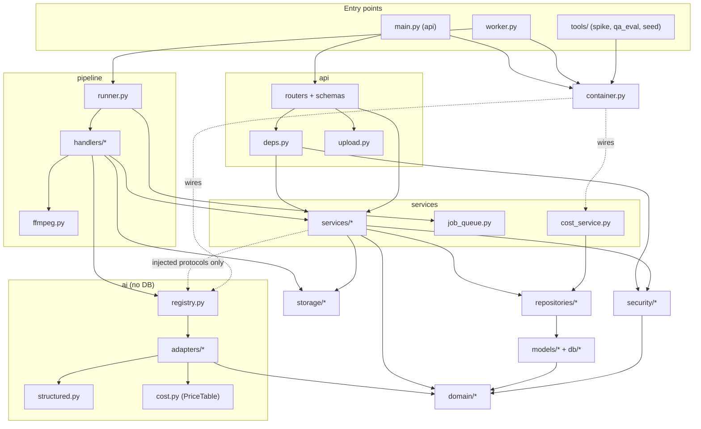
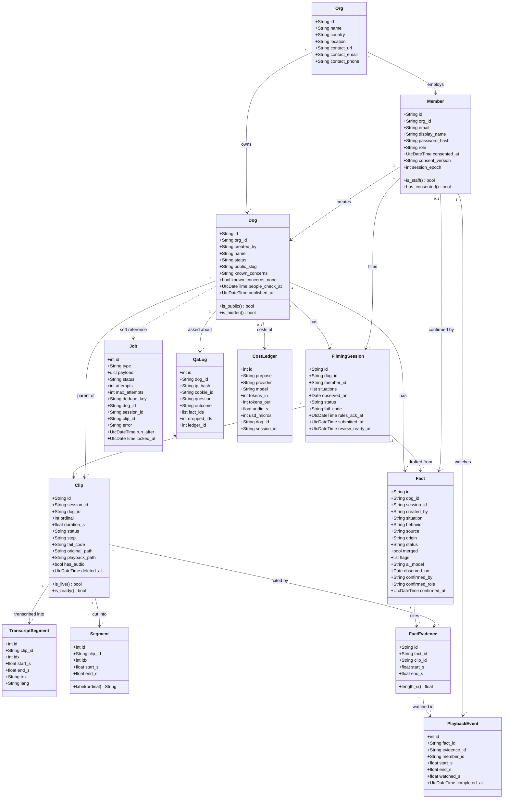
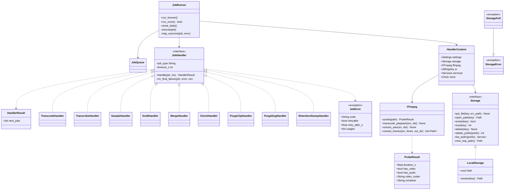
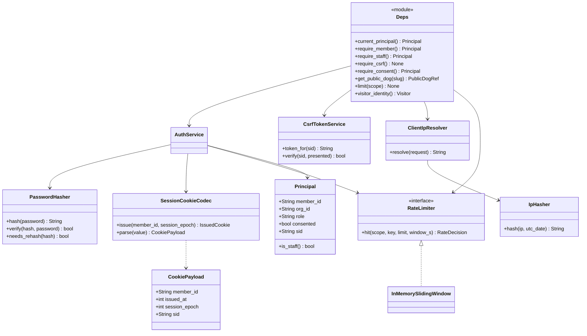
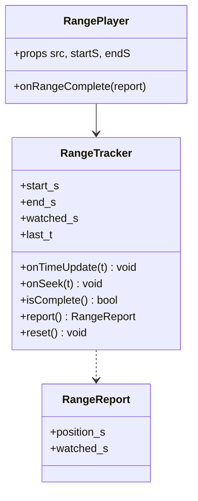
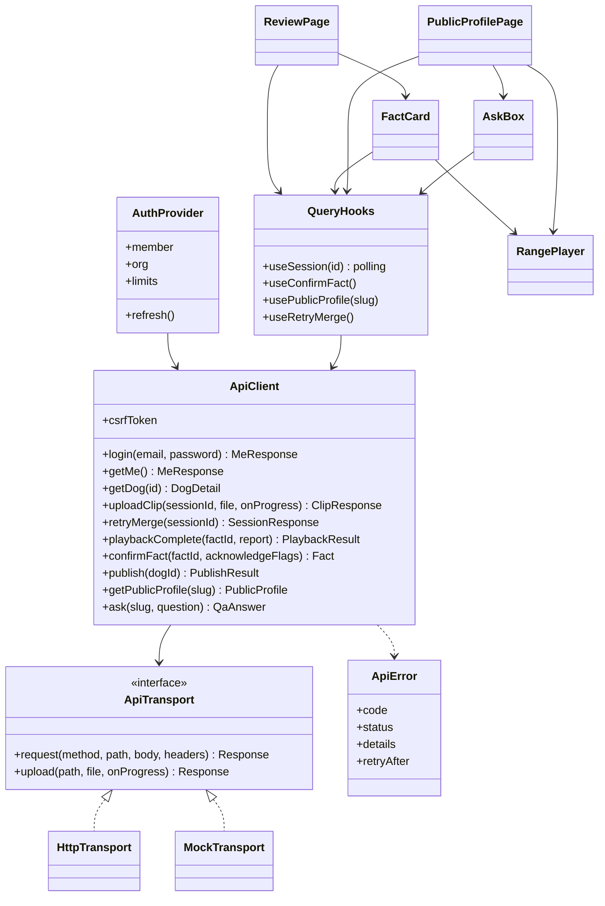
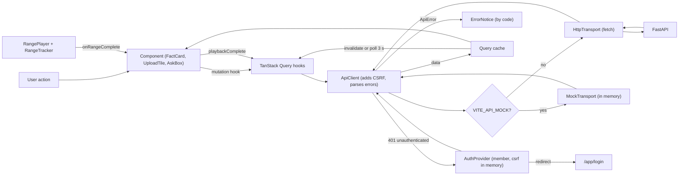

# Watch Me! R1: Module and Class Design (v0.2, 2026-10-28)

Input, in priority order: lead decisions D1-D11, `01-api-spec.md` v0.2,
`02-data-model.md` v0.2, `04-ai-design.md` v0.2 (wins on AI specifics),
`03-sequences.md` v0.2, `05-screens.md`, then `docs/PRD.md`, `docs/DESIGN.md`,
`docs/adr/`. `07-test-design.md` holds the tests for everything below. v0.2
aligns this file with 01 to 05 (change log: `_align-log-06.md`). Where AI
prompts, schemas, or screens are mentioned, the named file is the detailed
owner.

Scope: R1 only. Design only: no code exists yet. Signatures are Python-style
sketches, not final code. "(proposal)" marks a choice this file makes that the
inputs do not state. "(verify)" marks an unchecked assumption. Error codes are
the `code` values of `01-api-spec.md` section 1.2.

Contents: 1 backend module tree, 2 layering and dependency rules, 3 class
diagrams (models, services, AI, pipeline, auth), 4 method contracts, 5
settings, 6 frontend, 7 decisions and deviations.

## 1. Backend module tree

Refines DESIGN section 10. One package `app`, two entry points (`main.py` for
the api, `worker.py` for the worker), one composition root (`container.py`).

```
backend/
  app/
    main.py                  # create_app(): routers, error handlers, SPA shell (index.html with 200 for every non-/api, non-/media path, D8), security headers
    worker.py                # worker entry: build_container, JobRunner.run_forever
    container.py             # composition root: builds Settings, engine, Storage, AiRegistry, services
    config.py                # Settings (pydantic-settings), env parsing, validation at start
    clock.py                 # Clock protocol, SystemClock, FakeClock (tests)
    errors.py                # AppError hierarchy: code, http_status, details; one class per 01 error code; also JobError(code, retryable) for jobs (D2)
    logging.py               # structured logs, request id, IP hash helper (never raw IP)

    domain/                  # pure rules; stdlib only; no I/O, no DB, no clock reads
      situations.py          # 8 situation codes, labels, order, STAFF_ONLY set
      enums.py               # DogStatus, SessionStatus, ClipStatus, FactStatus, Origin, Source, JobType, FailCode
      ranges.py              # round_half_up, snap_to_grid, frame_citation_to_range, clamp, union_seconds, merge_ranges, frame_interval, segment_windows
      labels.py              # clip_length_label, source_label, confirmed_by_label, fixed Q&A templates
      wording.py             # BannedWordMatcher (rules checker core), NFC/trim/length normalization of behavior
      confirm_policy.py      # ConfirmPolicy: ordered guards, returns first failing code (pure)
      slugs.py               # public slug generator ([a-z2-9], 12 chars)
      health.py              # HealthQuestionMatcher (keyword list)

    db/
      engine.py              # engine factory, SQLite pragmas on every connection (WAL, FK, busy_timeout)
      base.py                # DeclarativeBase, naming convention for constraints
      types.py               # UtcDateTime TypeDecorator, JsonList helpers
      uow.py                 # UnitOfWork: session scope, commit, rollback, independent_session()

    models/                  # SQLAlchemy 2 ORM, one file per table group, CHECKs as in 02
      org.py  member.py  dog.py  filming_session.py  clip.py  transcript.py
      fact.py  playback.py  job.py  qa_log.py  cost_ledger.py

    repositories/            # all SQL lives here; no business rules
      dogs.py  sessions.py  clips.py  facts.py  playback.py  jobs.py
      qa_log.py  cost_ledger.py  members.py  transcripts.py  metrics.py
      public_facts.py        # the ONLY reader for public and Q&A fact queries (invariant I-1)

    security/                # request-independent auth primitives
      passwords.py           # PasswordHasher (argon2id)
      cookies.py             # SessionCookieCodec (itsdangerous), visitor cookie helpers
      csrf.py                # CsrfTokenService (HMAC of sid)
      ratelimit.py           # RateLimiter protocol, InMemorySlidingWindow, NullLimiter
      client_ip.py           # ClientIpResolver (TRUSTED_PROXY aware), IpHasher

    services/                # business rules and transactions; return view objects, never ORM rows to api
      auth_service.py        # login, logout, consent, cookie to Principal
      dog_service.py         # dog CRUD, photo, list with coverage short form
      session_service.py     # filming sessions: create, get, submit, retry_merge (D6), enqueue_merge (clears review_ready_at, D5), review/fail transitions
      clip_upload_service.py # accept upload (probe, store, row, job), idempotency
      clip_service.py        # get, retry, delete (hide part)
      fact_review_service.py # playback, confirm, edit, delete, add manual fact
      evidence_validator.py  # evidence range rules for human input (I-3, I-4)
      coverage_service.py    # Coverage, not_observed, fact clip length (single implementation)
      publish_service.py     # checklist, publish, unpublish, adopted
      public_profile_service.py  # builds PublicProfile from public_facts
      qa_service.py          # Q&A flow; collaborators: QaLimiter, CostCapGuard, AliasMapper, AnswerRenderer
      media_access_service.py    # resolves a media request to a file or NotFound
      deletion_service.py    # dog/clip hide + purge execution + retention sweep
      draft_ingest_service.py    # turns DraftOutput into fact rows and ledger rows (04 section 5); zero facts is valid (D4)
      merge_service.py       # session merge: cross-clip evidence merge (D3), merged=1, rules flags, returns fact_ids for check
      wording_service.py     # applies rule flags and model flags to facts
      clip_pipeline_service.py   # clip state transitions used by handlers (step, ready, failed)
      job_queue.py           # JobQueue: enqueue (dedupe), claim, complete, fail, cancel, reset stale
      cost_service.py        # CostService: writes cost_ledger rows from Usage lists, DailySpend queries
      metrics_service.py     # admin metrics
      views.py               # view dataclasses + assemblers (FactView with can_confirm, media_url, captions_url)

    api/
      deps.py                # FastAPI dependencies: uow, principal, require_*, csrf, get_public_dog, limits
      errors.py              # exception handlers: AppError, validation, 500 with request id
      upload.py              # UploadReceiver: streams multipart to tmp with byte counter
      spa.py                 # SpaShell: index.html with 200 for SPA paths, noindex on /d/*; unknown /api and /media paths stay JSON 404 (D8)
      routers/
        auth.py  me.py  dogs.py  sessions.py  clips.py  facts.py  public.py  media.py  admin.py  health.py
      schemas/               # Pydantic request/response models (snake_case), one file per router

    pipeline/
      runner.py              # JobRunner: poll, claim, dispatch, timeout, outcome mapping, stale reset
      handlers/
        base.py              # JobHandler protocol, HandlerContext, HandlerResult (the one error type is JobError in app/errors.py)
        transcode.py  transcribe.py  sample.py  draft.py  merge.py  check.py
        purge_clip.py  purge_dog.py  retention_sweep.py
      ffmpeg.py              # FFmpeg wrapper (probe, transcode, extract_wav, extract_frames), no DB
      sampling.py            # frame time plan from domain.ranges, builds DraftRequest frames

    ai/                      # no DB, no models, no services. Nothing reaches out: adapters return Usage lists and the caller writes the ledger
      protocols.py           # Transcriber, FactDrafter, WordingChecker, FactSelector (each returns (result, list[Usage]))
      types.py               # Pydantic (04 sections 2 to 7): Usage, TranscribeRequest/TranscriptResult, DraftRequest/DraftOutput, CheckRequest/CheckResult, SelectRequest/SelectOutput, FactRef
      errors.py              # AiError, AiTransientError, AiPermanentError, AiInvalidOutput; to_job_error(error, purpose) -> JobError
      cost.py                # PriceTable: usd_micros from tokens and audio ms (04 section 9.1)
      structured.py          # StructuredCaller: validate, retry once with the error appended, collect Usage
      registry.py            # AiRegistry: build adapters from Settings
      prompts/               # prompt builders and templates (owner: 04-ai-design.md)
      adapters/
        mock.py              # MockTranscriber, MockDrafter, MockChecker, MockSelector, scripted behaviors
        openai_compat.py     # OpenAICompatDrafter / Checker / Selector over one ChatClient (openai SDK, max_retries=0)
        local_whisper.py     # faster-whisper
        muse_transcribe.py   # Muse Voice Transcribe (multipart ASR)
        rules.py             # RulesChecker: wraps domain.wording (no network)

    storage/
      base.py                # Storage protocol, StorageError, StorageFull
      local.py               # LocalStorage: root dir, traversal guard, atomic put, prefix delete/list

  alembic/                   # migrations; env.py imports app.models
  tests/                     # see 07-test-design.md
tools/    spike_timestamps.py  qa_eval.py  seed.py  make_fixtures.py
eval/     qa_adversarial.jsonl  spike_labels.jsonl  results/
```

One-line responsibilities not already in the tree comments:

| Module                      | Responsibility                                                                                                                                                                                           |
| --------------------------- | -------------------------------------------------------------------------------------------------------------------------------------------------------------------------------------------------------- |
| `domain`                    | Every rule that can be written as a pure function lives here, so unit tests need no DB: ranges, labels, wording, confirm order, slugs.                                                                   |
| `repositories.public_facts` | `public_facts(dog_id)` is the only query behind the public profile, the Q&A selector input, and media citation checks (I-1, I-14).                                                                       |
| `services.views`            | The api layer never sees ORM rows. Services return frozen view dataclasses. `FactView.can_confirm` and `blocked_reason` are computed here with `ConfirmPolicy`, the same code the confirm endpoint runs. `MediaUrls` builds `media_url` and `captions_url` for creator and public facts alike (D7). |
| `security`                  | Primitives with no database. `services.auth_service` combines them with the member table.                                                                                                                |
| `container`                 | Only place that chooses concrete classes. Tests build the same container with fakes.                                                                                                                     |
| `api.upload`                | Streams the multipart body, counts bytes, and aborts early. It is the one api module that does file I/O.                                                                                                 |

## 2. Layering and dependency rules

Allowed direction is downward only. A module may import from the layers listed
in its row and nothing else. An import-linter contract set in `pyproject.toml`
enforces this (test U-ARCH-01 in `07-test-design.md`).

| Layer          | May import                                                                                                                                    | Must not import                                                                                                                                                                                       |
| -------------- | --------------------------------------------------------------------------------------------------------------------------------------------- | ----------------------------------------------------------------------------------------------------------------------------------------------------------------------------------------------------- |
| `api`          | `services`, `security` (deps only), `domain` (enums, situations), `errors`, `config`                                                          | `repositories`, `models`, `pipeline`, `ai`, `storage`                                                                                                                                                 |
| `services`     | `repositories`, `models`, `domain`, `storage` (protocol), `ai` (protocols and types, through injected objects), `security`, `errors`, `clock` | `api`, `pipeline`                                                                                                                                                                                     |
| `pipeline`     | `services`, `ai` (protocols, errors, types), `storage`, `domain`, `config`, `clock`                                                           | `api`, `repositories`, `models` (all DB work goes through services)                                                                                                                                   |
| `repositories` | `models`, `db`, `domain`                                                                                                                      | `services`, `api`                                                                                                                                                                                     |
| `models`       | `db`, `domain.enums`                                                                                                                          | everything else                                                                                                                                                                                       |
| `ai`           | `domain` (situation codes, ranges, wording), `errors` (`JobError` only), `openai`, `httpx`, `pydantic`, stdlib                                                                               | `db`, `models`, `repositories`, `services`, `storage`, `pipeline`, `api`. Cost leaves the layer only as `Usage` objects in return values and on `JobError`; the caller writes the ledger through `services.cost_service`. |
| `storage`      | stdlib only                                                                                                                                   | everything else                                                                                                                                                                                       |
| `domain`       | stdlib only                                                                                                                                   | everything else                                                                                                                                                                                       |
| `security`     | stdlib, `itsdangerous`, `argon2-cffi`                                                                                                         | `services`, `api`, `repositories`                                                                                                                                                                     |

Rules that follow:

1. Only `services` and `repositories` open transactions. A service method is a
   transaction boundary. The api commits through `uow` after the service returns.
2. The worker calls the same services as the api. `pipeline/handlers` hold no SQL.
3. `ai` adapters never read a clip row. The handler builds the request object
   (`DraftRequest`, `TranscribeRequest`, and so on) from files and transcript. Requests carry a
   `fixture_key` for the mock and nothing else about the dog or session; the
   adapters never see dog or session ids (04 section 2). The caller owns the
   ledger columns `dog_id` and `session_id`.
4. Every adapter call returns `(result, list[Usage])`. On success the caller
   writes the ledger rows with the result in one transaction
   (`CostService.record_usages`). On `JobError` or rollback the rows carried on
   `JobError.usages` are written in a separate short transaction
   (`record_usages_independent`), so a failed call still leaves its ledger
   rows (invariant I-20, 03 E26).
5. Public and Q&A code paths read facts only through `public_facts`.



The dotted arrows are runtime wiring by `container`, not imports of `ai` into
`services` internals: `QAService` receives a `FactSelector` object. `ai` has no
cost hook: adapters return `Usage` objects and `CostService` stores them.

## 3. Class diagrams

### 3.1 Domain and ORM models

The session ORM class is named `FilmingSession` (table `session`) to avoid
clashing with the SQLAlchemy `Session` (deviation M2). Columns not needed to
read the relations are left out; `02-data-model.md` section 2 is the source of
truth.



### 3.2 Services

Notation: every service gets `uow` (unit of work), the repositories it needs,
`clock`, and `settings` through its constructor. Constructors are omitted.
`Principal` is the authenticated member (id, org_id, role, consented). View
types come from `services/views.py`.

```mermaid
classDiagram
    class AuthService {
        +login(email, password, ip) LoginResult
        +logout(principal) None
        +accept_consent(principal, version) MemberView
        +principal_from_cookie(cookie_value) Principal
    }
    class DogService {
        +create(principal, data) DogView
        +update(principal, dog_id, patch) DogView
        +list_for_org(principal) list~DogListItem~
        +get_detail(principal, dog_id) DogDetailView
        +set_photo(principal, dog_id, image_bytes) DogView
    }
    class SessionService {
        +create(principal, dog_id, situations, observed_on, rules_ack) SessionView
        +get(principal, session_id, include_facts) SessionBundle
        +submit(principal, session_id) SessionView
        +retry_merge(principal, session_id) SessionView
        +enqueue_merge(session_id) None
        +on_clip_terminal(session_id) None
        +mark_review_ready(session_id) None
        +mark_failed(session_id, fail_code) None
    }
    class ClipUploadService {
        +accept(principal, session_id, tmp_file, filename, size, client_request_id) UploadResult
    }
    class ClipService {
        +get(principal, clip_id) ClipView
        +retry(principal, clip_id) ClipView
        +delete(principal, clip_id) ClipDeleteResult
    }
    class FactReviewService {
        +record_playback(principal, fact_id, evidence_id, position_s, watched_s) PlaybackResult
        +confirm(principal, fact_id, acknowledge_flags) FactView
        +edit(principal, fact_id, patch) FactView
        +delete(principal, fact_id) None
        +add_manual(principal, dog_id, data) FactView
    }
    class ConfirmPolicy {
        +evaluate(ctx) str
    }
    class EvidenceValidator {
        +validate(principal, dog, fact_session, items) list~EvidenceItem~
    }
    class CoverageService {
        +for_dog(dog_id) Coverage
        +short_for_dogs(dog_ids) dict
        +clip_length(fact) ClipLength
    }
    class PublishService {
        +get_checklist(principal, dog_id) Checklist
        +set_checklist(principal, dog_id, data) Checklist
        +publish(principal, dog_id) PublishResult
        +unpublish(principal, dog_id) DogView
        +mark_adopted(principal, dog_id) DogView
    }
    class PublicProfileService {
        +get_profile(slug) PublicProfile
    }
    class QAService {
        +ask(slug, question, visitor) QaAnswer
    }
    class QaLimiter {
        +check(dog_id, ip_hash, cookie_id) None
    }
    class CostCapGuard {
        +ensure_below_cap() None
    }
    class AliasMapper {
        +build(facts) AliasTable
        +resolve(table, refs) ResolvedSelection
    }
    class AnswerRenderer {
        +answered(facts) QaAnswer
        +not_observed() QaAnswer
        +health_redirect(contact) QaAnswer
    }
    class MediaAccessService {
        +resolve_clip_video(clip_id, principal) MediaFile
        +resolve_clip_captions(clip_id, principal) MediaFile
        +resolve_dog_photo(dog_id, principal) MediaFile
    }
    class DeletionService {
        +request_dog_delete(principal, dog_id) PurgeTicket
        +request_clip_delete(principal, clip_id) ClipDeleteResult
        +run_purge_dog(dog_id) None
        +run_purge_clip(clip_id) None
        +run_retention_sweep() SweepReport
    }
    class DraftIngestService {
        +store_drafts(clip_id, output, usages, plan) IngestReport
    }
    class MergeService {
        +merge_session(session_id) MergeReport
    }
    class WordingService {
        +apply_rule_flags(fact) None
        +apply_model_flags(session_id, fact_ids, checker) None
    }
    class ClipPipelineService {
        +begin_step(clip_id, step) None
        +complete_transcode(clip_id, playback_key, duration_s) None
        +save_transcript(clip_id, result, usages) None
        +save_segments(clip_id, windows) None
        +mark_ready(clip_id) None
        +mark_failed(clip_id, fail_code, detail) None
    }
    class JobQueue {
        +enqueue(type, payload, dedupe_key, max_attempts, run_after) int
        +claim(worker_id) Job
        +complete(job_id, next_jobs) None
        +fail_or_retry(job_id, error) JobOutcome
        +cancel_for_dog(dog_id) int
        +cancel_for_clip(clip_id) int
        +reset_stale(now) int
    }
    class CostService {
        +record_usages(usages, dog_id, session_id) list~int~
        +record_usages_independent(usages, dog_id, session_id) list~int~
        +qa_spend_today_micros() int
    }
    class MediaUrls {
        +clip_video(clip_id) str
        +clip_captions(clip_id, has_transcript) str
    }
    class MetricsService {
        +admin_metrics(principal) MetricsView
    }

    AuthService --> Principal
    DogService --> CoverageService
    SessionService --> JobQueue
    ClipUploadService --> JobQueue
    ClipUploadService --> SessionService
    ClipService --> JobQueue
    ClipService --> DeletionService
    FactReviewService --> ConfirmPolicy
    FactReviewService --> EvidenceValidator
    FactReviewService --> WordingService
    PublishService --> CoverageService
    PublicProfileService --> CoverageService
    QAService --> QaLimiter
    QAService --> CostCapGuard
    QAService --> AliasMapper
    QAService --> AnswerRenderer
    QAService --> CostService
    CostCapGuard --> CostService
    DeletionService --> JobQueue
    MergeService --> WordingService
    MergeService --> JobQueue
    ClipPipelineService --> SessionService
    DraftIngestService --> EvidenceValidator
    MetricsService --> CostService
    DraftIngestService --> CostService
    ClipPipelineService --> CostService
    WordingService --> CostService
    FactReviewService --> MediaUrls
    SessionService --> MediaUrls
    PublicProfileService --> MediaUrls
```



Responsibilities worth stating:

- `ConfirmPolicy` is pure (in `domain`). `FactReviewService.confirm` and the
  `FactView` assembler both call `evaluate`, so the UI hint (`blocked_reason`)
  and the server check cannot drift.
- `CoverageService` is the single implementation of data model section 4
  (coverage, not-observed list, clip length). Dog list, dog detail, public
  profile, and Q&A line rendering all call it (CAP-2 "same rule as PUB-1").
- `QAService` owns the flow in 01 section 6.2; its collaborators are small so
  each rule has a unit test. `QaLimiter` is swappable: `QaLogLimiter`
  (counts `qa_log`) in the api, `NullLimiter` in `tools/qa_eval.py`.
- `DeletionService` has an api half (hide in one transaction, enqueue purge)
  and a worker half (files, verify, rows). Both halves live in one class so
  the deletion order is readable in one place (data model section 6).
- `SessionService.enqueue_merge` is the one place that enqueues `merge`. It
  clears `review_ready_at` and inserts the job with `dedupe_key=merge:{session_id}`
  (a live job makes it a no-op). `submit` (S2), `on_clip_terminal` (C22), and
  `retry_merge` (S6, D6) all call it. `mark_review_ready` is the only writer of
  `review_ready_at` (S3, I-22; D5).
- `SessionService.on_clip_terminal` is the one place that decides "all live
  clips are terminal, so call `enqueue_merge` or fail the session" (S2, C4,
  C5, C22).
- `CostService` is the only writer of `cost_ledger`. It receives `Usage` lists
  from the caller of an adapter, never from the adapter, and stores them in
  the caller's transaction (`record_usages`) or in its own short one
  (`record_usages_independent`, used on failure and rollback).

### 3.3 AI layer

Provider interfaces follow `04-ai-design.md` section 2 (it wins on AI
specifics): each call takes one request object and returns
`(result, list[Usage])`. The caller writes the ledger, so the AI layer needs no
dog or session ids (deviation M4 is superseded). Prompt text and schemas are
owned by `04-ai-design.md`; this file fixes the shape. The diagram shows the
result type of each method; every method also returns the `Usage` list.

```mermaid
classDiagram
    class Transcriber {
        <<interface>>
        +transcribe(req) TranscriptResult
    }
    class FactDrafter {
        <<interface>>
        +draft(req) DraftOutput
    }
    class WordingChecker {
        <<interface>>
        +check(req) list~CheckResult~
    }
    class FactSelector {
        <<interface>>
        +select(req) SelectOutput
    }
    class Usage {
        +String provider
        +String model
        +int tokens_in
        +int tokens_out
        +float audio_s
        +int usd_micros
        +String purpose
    }
    class PriceTable {
        +usd_micros(provider, model, tokens_in, tokens_out, audio_ms) int
    }
    class StructuredCaller {
        +call(send, schema, purpose) StructuredResult
    }
    class TranscribeRequest {
        +String audio_path
        +float duration_s
        +String lang_hint
        +list keywords
        +String fixture_key
    }
    class TranscriptResult {
        +String language
        +list segments
        +String full_text
    }
    class DraftRequest {
        +String mode
        +int clip_ord
        +float duration_s
        +int k
        +list frames
        +list segments
        +list transcript
        +list allowed_situations
        +String dog_name
        +Date observed_on
        +int max_facts
        +String fixture_key
    }
    class DraftOutput {
        +list~DraftFactOut~ facts
    }
    class DraftFactOut {
        +String situation
        +String behavior
        +String source
        +list evidence
    }
    class EvidenceFrames {
        +int start_t
        +int end_t
    }
    class CheckRequest {
        +list~CheckItem~ items
        +String fixture_key
    }
    class CheckItem {
        +String ref
        +String situation
        +String behavior
        +String source
    }
    class CheckResult {
        +String ref
        +String kind
        +String phrase
    }
    class SelectRequest {
        +String question
        +list~FactRef~ facts
        +int max_refs
        +String fixture_key
    }
    class FactRef {
        +String ref
        +String situation
        +String behavior
    }
    class SelectOutput {
        +list refs
    }
    class Flag {
        +String code
        +String severity
        +String source
        +String detail
    }
    class JobError {
        <<exception>>
        +String code
        +bool retryable
        +float retry_after_s
        +list usages
    }
    class AiError {
        <<exception>>
        +float retry_after_s
        +list usages
    }
    class AiTransientError {
        <<exception>>
    }
    class AiPermanentError {
        <<exception>>
    }
    class AiInvalidOutput {
        <<exception>>
    }
    class MockAdapter {
        +fixtures_dir
        +faults
    }
    class OpenAICompatDrafter
    class OpenAICompatChecker
    class OpenAICompatSelector
    class ChatClient {
        +complete(messages, response_schema) RawCompletion
    }
    class LocalWhisperTranscriber
    class MuseTranscribeTranscriber
    class RulesChecker
    class AiRegistry {
        +transcriber() Transcriber
        +drafter() FactDrafter
        +checker() WordingChecker
        +selector() FactSelector
        +from_settings(settings) AiRegistry
    }

    Transcriber <|.. LocalWhisperTranscriber
    Transcriber <|.. MuseTranscribeTranscriber
    Transcriber <|.. MockAdapter
    FactDrafter <|.. OpenAICompatDrafter
    FactDrafter <|.. MockAdapter
    WordingChecker <|.. OpenAICompatChecker
    WordingChecker <|.. RulesChecker
    WordingChecker <|.. MockAdapter
    FactSelector <|.. OpenAICompatSelector
    FactSelector <|.. MockAdapter
    OpenAICompatDrafter --> StructuredCaller
    OpenAICompatChecker --> StructuredCaller
    OpenAICompatSelector --> StructuredCaller
    OpenAICompatDrafter --> ChatClient
    OpenAICompatChecker --> ChatClient
    OpenAICompatSelector --> ChatClient
    StructuredCaller --> PriceTable
    MuseTranscribeTranscriber --> PriceTable
    PriceTable ..> Usage
    StructuredCaller ..> Usage
    Transcriber ..> TranscribeRequest
    Transcriber ..> TranscriptResult
    FactDrafter ..> DraftRequest
    FactDrafter ..> DraftOutput
    WordingChecker ..> CheckRequest
    WordingChecker ..> CheckResult
    FactSelector ..> SelectRequest
    FactSelector ..> SelectOutput
    DraftOutput *-- DraftFactOut
    DraftFactOut *-- EvidenceFrames
    CheckRequest *-- CheckItem
    SelectRequest *-- FactRef
    CheckResult ..> Flag : rendered by the server
    AiRegistry --> Transcriber
    AiRegistry --> FactDrafter
    AiRegistry --> WordingChecker
    AiRegistry --> FactSelector
    AiTransientError --|> AiError
    AiPermanentError --|> AiError
    AiInvalidOutput --|> AiError
    AiError ..> JobError : to_job_error
```



Design points:

- **Structured output and the one retry (D2, section 7 M1).**
  `StructuredCaller.call(send, schema, purpose)` does this and nothing else:
  1. Call `send(messages)`. Collect one `Usage` for the call.
  2. Parse and validate against the Pydantic `schema`. On success return it.
  3. On a parse or schema failure, call `send(messages + validation error)`
     once. Collect a second `Usage`. Validate again.
  4. Still invalid: raise `AiInvalidOutput` carrying both `Usage` rows. No third
     call.
     Transport errors (network, timeout, HTTP 429, HTTP 5xx) are not caught
     here: `ChatClient` raises `AiTransientError`, with zero retries inside the
     adapter (the `openai` SDK runs with `max_retries=0`). Non-transient
     provider errors (HTTP 400, 401, 402, 403, 404, including image errors)
     raise `AiPermanentError` (04 section 8.7).
- **Error boundary: `JobError`.** The adapter's public methods raise
  `JobError(code, retryable)` (D2, 01 section 2, 02 J4/J5), built by
  `ai.errors.to_job_error(error, purpose)` from the internal `AiError` classes.
  `AiTransientError` becomes `JobError("ai_failed", retryable=True,
  retry_after_s=...)`. `AiPermanentError` becomes `JobError("ai_failed",
  retryable=False)`. `AiInvalidOutput` becomes `JobError("ai_invalid_output",
  retryable=False)` for `draft`, and `JobError("ai_failed", retryable=False)`
  for `transcribe`, `check`, and `select`. `JobError.usages` carries the `Usage`
  rows of the calls already made. `JobError` lives in `app/errors.py` so `ai`
  does not import `pipeline`. (04 sections 2 and 8.8 describe the handler doing
  this translation; the worker sees the same `JobError` either way.)
- **What counts as schema-invalid (04 section 4.3).** Not valid JSON, missing or
  extra fields, wrong types, `situation` or `source` outside the enum, more than
  8 facts, empty `evidence`. Not schema-invalid, handled after validation by
  the server and counted, never retried: off-grid frame times, `end_t < start_t`,
  a range past the clip, an unknown segment ref, a `behavior` over 280
  characters (truncated) or under 3 (dropped). These are repaired or dropped by
  `DraftIngestService` (04 section 5, section 4.6 below).
- **Cost (04 section 9.2).** Each provider round trip yields exactly one
  `Usage`, including the first, invalid try. `usd_micros` comes from
  `PriceTable` (integer math, half up, prices from config; the cached-token
  discount is ignored). A call that failed before the provider counted it
  yields no `Usage` (nothing was billed). The mock yields rows with
  `usd_micros=0`.
- **Prompt isolation (AI-8).** Prompt builders in `ai/prompts/` put
  transcripts, narration, and questions in one delimited data block with a
  per-request random nonce, JSON-escape the data, and remove the nonce string
  and `<`, `>` from it. The system prompt states that data is never
  instructions. Owner: `04-ai-design.md`.
- **Registry.** `AiRegistry.from_settings` reads `AI_TRANSCRIBER`, `AI_DRAFTER`,
  `AI_CHECKER`, `AI_SELECTOR` and the connection settings in section 5. It
  refuses a contributor model id (`*-contributor`) unless
  `AI_ALLOW_CONTRIBUTOR_MODEL=true` (NFR-5, data model 6.6). `GET /api/me`
  reports `limits.wording_check = "rules_only"` when `AI_CHECKER=rules`, else
  `"model"` (01 section 3.3, 04 section 8.5).
- **Mock.** `MockAdapter` loads `{AI_MOCK_FIXTURES_DIR}/{fixture_key}.json`
  (the stem of `clip.original_filename`) and falls back to `default.json`. Its
  `faults` block injects errors by call number: `transient`, `invalid_output`,
  `permanent` (04 section 8.1). A fault raises the `AiError` class directly, so
  `to_job_error`, the handlers, and the ledger rules run for real in tests. The
  one-retry loop itself is tested on `StructuredCaller` with a scripted
  `ChatClient` fake.

### 3.4 Pipeline



Step handlers (one per job type; data model 3.5 lists timeouts, max attempts,
and the `dedupe_key` rules). Handlers raise only `JobError(code, retryable)`
(D2). `code` is the clip or session fail code of the step.

| Handler | Reads | Does | Writes (through services) | Errors |
| --- | --- | --- | --- | --- |
| `TranscodeHandler` | original file | `probe`, `transcode_playback` (H.264/AAC, `+faststart`), `extract_wav` if audio, re-probe | playback key, new `duration_s`, `step` | decode failure: `JobError("unsupported_file", False)`. Duration over 120.5 s: `JobError("too_long", False)`. ffmpeg timeout, kill, or `StorageFull`: `JobError("transcode_failed", True)`. Any other non-zero ffmpeg exit: `JobError("transcode_failed", False)` (03 E25) |
| `TranscribeHandler` | `audio.wav` | skip when `has_audio=false` (no call, no ledger row); else `Transcriber.transcribe(TranscribeRequest)` | `transcript_segment` rows and `cost_ledger` rows in one transaction (`ClipPipelineService.save_transcript`) | `JobError` from the adapter: transient is `("ai_failed", True)`; permanent, malformed ASR body, or invalid output is `("ai_failed", False)` |
| `SampleHandler` | playback file | frame plan with `k = max(1, ceil(duration/48))`, `extract_frames`, write 10 s windows (always, so the mode can change without reprocessing) | frame files, `segment` rows | ffmpeg timeout, kill, disk full: `("transcode_failed", True)`; other exits: `("transcode_failed", False)` |
| `DraftHandler` | frames, transcript, segments | build `DraftRequest` (mode from `DRAFT_MODE`, `fixture_key`, `allowed_situations`); a clip under 1 s makes no call (D4); else `FactDrafter.draft`, then `DraftIngestService.store_drafts`; then `SessionService.on_clip_terminal` | draft facts `merged=0`, evidence, `cost_ledger`, clip `ready` (one transaction). Zero facts is success (D4) | adapter `JobError` unchanged: transient `("ai_failed", True)`; permanent `("ai_failed", False)`; schema-invalid twice `("ai_invalid_output", False)` at once |
| `MergeHandler` | session | `MergeService.merge_session` (cross-clip evidence merge, D3), then returns `next_jobs=[check(fact_ids)]` with `dedupe_key=check:{session_id}:{job.id}` | `merged=1`, duplicates removed, rule flags | SQLite busy or I/O error: `("merge_failed", True)`; anything else `("merge_failed", False)`. Final failure: session `failed` with `merge_failed`, `review_ready_at` stays NULL |
| `CheckHandler` | session, `fact_ids` | `WordingService.apply_model_flags` (empty `fact_ids`: no call), then `SessionService.mark_review_ready` | `flags`, `cost_ledger`, session `review`, `review_ready_at=now` (D5) | A `JobError` from the checker on a fact gives that fact `check_unavailable` (`info`, `system`); the job still succeeds (never fails the session) |
| `PurgeClipHandler`, `PurgeDogHandler` | ids | `DeletionService.run_purge_*` | storage delete, verify, rows | `StorageError` or leftover files: `("purge_failed", True)` (8 attempts, long backoff); final failure leaves the tombstone |
| `RetentionSweepHandler` | none | `DeletionService.run_retention_sweep`, self-enqueue next day (`sweep:{utc_date}`) | rows, tmp files | any error: logged; `max_attempts=1` |

**Retry classification (D2, ADR-0042).** The runner maps handler outcomes with
one rule, the contract in 02 J3 to J6:

| Raised by handler | Runner action | Counts toward |
| --- | --- | --- |
| nothing | `succeeded`, enqueue `next_jobs` in the same transaction (J3; if the dog is `deleted`, discard and mark `cancelled`) | n/a |
| `JobError(retryable=True)` and `attempts < max_attempts` | back to `queued`, `run_after = now + max(backoff[attempts], retry_after_s)` (pipeline 30 s then 120 s; purge 1 m, 5 m, 15 m, 1 h, 3 h, 6 h, 12 h) | job attempts |
| `JobError(retryable=True)` and `attempts == max_attempts` | `failed`, run `on_final_failure(code)` | job attempts |
| `JobError(retryable=False)` | `failed` now, whatever `attempts` is, run `on_final_failure(code)` | n/a |
| handler timeout | treated as `JobError(step code, retryable=True)` | job attempts |
| any other exception | treated as `JobError(step default code, retryable=False)` and logged with a traceback (proposal: an unknown bug is not retried) | n/a |
| stale lock (J6) | as J4 or J5; the attempt was already counted | n/a |

On every `JobError` the runner first writes `error.usages` with
`CostService.record_usages_independent(usages, job.dog_id, job.session_id)`, so
a failed call is still billed in the ledger (03 E26). `on_final_failure` maps to:
clip steps call `ClipPipelineService.mark_failed(clip_id, code, detail)` (which
then calls `SessionService.on_clip_terminal`); `merge` calls
`SessionService.mark_failed(session_id, "merge_failed")`; `check` never fails a
session; `purge_*` logs an error and leaves the tombstone.

A draft attempt makes at most two provider calls (the adapter's schema retry).
Invalid output ends the job at once, and the job retry applies to transient
errors only, so the usual worst case is two calls. A rare mix (an invalid answer
followed by a transient error on the repeat call, then an invalid pair on
attempt 2) reaches four billed calls. This closes the open issue in ADR-0017.

**Storage keys** (data model section 0): `dogs/{dog_id}/photo.jpg`,
`dogs/{dog_id}/clips/{clip_id}/{original.<ext>|playback.mp4|audio.wav|frames/t{seconds}.jpg}`,
`tmp/{random}`. `LocalStorage.resolve(key)` rejects absolute keys, `..`
segments, and symlink escapes, and returns a path under `STORAGE_ROOT` only.
`put_file` writes to `tmp/` then renames (atomic on one volume). `StorageFull`
wraps `ENOSPC`.

### 3.5 Authentication and authorization



Dependency behavior (all in `api/deps.py`; the order below is the order
FastAPI resolves them for a state-changing creator route):

| Dependency             | Does                                                                                                                    | Error                                                            |
| ---------------------- | ----------------------------------------------------------------------------------------------------------------------- | ---------------------------------------------------------------- |
| `current_principal`    | Read `wm_session`, verify signature and age (7 days), load member, compare `session_epoch`                              | `unauthenticated` 401 (no, bad, expired, or revoked cookie)      |
| `require_member`       | `current_principal` must succeed                                                                                        | `unauthenticated`                                                |
| `require_csrf`         | For `POST/PUT/PATCH/DELETE` only: `X-CSRF-Token` equals `HMAC-SHA256(SECRET_KEY, "csrf:" + sid)`, constant-time compare | `csrf_failed` 403                                                |
| `require_staff`        | `principal.role == "staff"`                                                                                             | `forbidden_role` 403                                             |
| `require_consent`      | `principal.consented`                                                                                                   | `consent_required` 403                                           |
| `get_public_dog(slug)` | Load dog by slug; only `status="published"` passes. Only the JSON API and media answer 404; the SPA shell for `/d/{slug}` is served with 200 for every slug (D8) | `not_found` 404 (same body for unknown, draft, adopted, deleted) |
| `limit(scope)`         | Calls `RateLimiter.hit` with the keys in 01 section 1.3                                                                 | `rate_limited` 429 with `Retry-After` and `details.scope`        |
| `visitor_identity`     | Read or create `wm_visitor`; compute `ip_hash`                                                                          | none                                                             |

JSON content-type enforcement (`unsupported_media_type` 415 on any JSON `POST`
without `application/json`) is a router-level dependency applied to every
route that takes a body, public ones included. Ownership (`not_own_session`)
and cross-org (`not_found`) checks are service rules, not dependencies, because
they need the loaded row. Check order for a creator route: cookie, CSRF, role,
then in the service: org scope, consent, state, ownership. Where 01 lists a
different per-endpoint order (upload, confirm), the service follows 01.

## 4. Key method contracts

Pre = what the caller must already satisfy or the method checks first. Post =
what holds when it returns. Errors use the 01 catalog; "txn" says whether the
method is atomic. Checks run in the order listed.

### 4.1 Upload and clip lifecycle

| Method                                  | Pre (checked in order)                                                                                                                                                                                                 | Post                                                                                                                                                                                                                                                                                                                                    | Errors                                                                                                                                                                                                                                              |
| --------------------------------------- | ---------------------------------------------------------------------------------------------------------------------------------------------------------------------------------------------------------------------- | --------------------------------------------------------------------------------------------------------------------------------------------------------------------------------------------------------------------------------------------------------------------------------------------------------------------------------------- | --------------------------------------------------------------------------------------------------------------------------------------------------------------------------------------------------------------------------------------------------- |
| `UploadReceiver.receive(request)` (api) | `Content-Length` header present and not over `MAX_CLIP_BYTES + overhead`                                                                                                                                               | File streamed to `tmp/{random}`; running byte count never exceeds `MAX_CLIP_BYTES`; on any exception the tmp file is removed                                                                                                                                                                                                            | `file_too_large` 413 (header or streamed count over 209,715,200), `upload_incomplete` 400 (stream ended early or connection broke), `malformed_request` 400, `storage_unavailable` 503 (`StorageFull`)                                              |
| `ClipUploadService.accept(...)`         | 1 consent; 2 session in the member's org; 3 owner or staff; 4 session `open` and dog `draft`; 5 live clips under 3; 6 `client_request_id` not already used in this session (if used: return existing clip, status 200) | Probe passed (`has_video`, duration within `MAX_CLIP_S + 0.5`); file moved to `dogs/{dog}/clips/{clip}/original.<ext>`; `clip` row `uploaded`, `step=transcode`, smallest free `ordinal`; `dog.people_check_at=NULL`; `transcode` job enqueued; all in one txn after the file move succeeds. Nothing persists on any error              | `consent_required`, `not_found`, `not_own_session`, `invalid_state`, `clip_limit_reached`, `unsupported_file_type` 415 (bad extension, no video stream, ffprobe error, probe timeout (proposal M7)), `clip_too_long` 422, `storage_unavailable` 503 |
| `ClipService.retry`                     | clip `failed`, `fail_code` in {`transcode_failed`, `ai_failed`, `ai_invalid_output`}, dog not `deleted`, actor owner or staff                                                                                          | partial outputs of the failing and later steps deleted; clip `processing` at `step`; job for `step` enqueued with fresh attempts; `fail_code=NULL`; if session was `review` or `failed` it becomes `processing` (`review_ready_at` is cleared later, when the merge is enqueued, D5)                                                                                                                         | `not_found`, `not_own_session`, `invalid_state` (not failed, or `unsupported_file`/`too_long`)                                                                                                                                                      |
| `ClipService.delete`                    | actor staff, or owner and no confirmed fact cites the clip                                                                                                                                                             | One txn: `clip.deleted_at`; queued jobs for the clip cancelled; evidence rows deleted (playback events cascade); facts left without evidence and `source` in (clip, narration) become `deleted` (`deleted_by=NULL`); facts keeping other evidence and `confirmed` are demoted to `draft`; `purge_clip` enqueued. Returns the two counts | `not_found`, `not_own_session`, `forbidden_role`                                                                                                                                                                                                    |
| `SessionService.create` | 1 consent; 2 dog in the member's org; 3 dog `draft` (a `published` or `adopted` dog gives `invalid_state`, D10; a `deleted` dog is hidden and gives `not_found`); 4 `capture_rules_ack=true` and 1 to 8 distinct situations | `open` session, `rules_ack_at=now`, `observed_on` default today UTC | `consent_required`, `not_found`, `invalid_state`, `validation_error` |
| `SessionService.submit` | 1 consent; 2 session in the member's org; 3 owner or staff; 4 session `open` with at least 1 live clip | `processing`, `submitted_at=now`. Then the `on_clip_terminal` decision (S2): if every live clip is already `ready` or `failed`, `enqueue_merge` (or fail with `no_usable_clip` when none is ready); otherwise the last clip's `draft` job does | `consent_required`, `not_found`, `not_own_session`, `invalid_state` |
| `SessionService.enqueue_merge` | session `processing` | One txn: `review_ready_at=NULL`; insert a `merge` job with `dedupe_key=merge:{session_id}`, or insert nothing while a job with that key is live (D5) | none |
| `SessionService.retry_merge` | 1 consent; 2 session in the member's org; 3 owner or staff; 4 session `failed` with `fail_code=merge_failed`, dog not `deleted` (D6, 01 5.4a, 02 S6) | One txn: session `processing`, `fail_code=NULL`, then `enqueue_merge`. A repeat while that job is live returns the same `processing` session. Facts are untouched (the failed merge rolled back, so they are still `merged=0`) | `consent_required`, `not_found`, `not_own_session`, `invalid_state` (not `failed` with `merge_failed`; a `no_usable_clip` session is fixed by retrying or deleting clips) |

### 4.2 Review

| Method                              | Pre                                                                                                                                                  | Post                                                                                                                                                                                                                                                                                                                                                                                                   | Errors                                                                                                                                                                                                                                                                                       |
| ----------------------------------- | ---------------------------------------------------------------------------------------------------------------------------------------------------- | ------------------------------------------------------------------------------------------------------------------------------------------------------------------------------------------------------------------------------------------------------------------------------------------------------------------------------------------------------------------------------------------------------ | -------------------------------------------------------------------------------------------------------------------------------------------------------------------------------------------------------------------------------------------------------------------------------------------- |
| `FactReviewService.record_playback` | fact is `draft`, `merged=1`; evidence belongs to the fact; actor owner or staff; `position_s >= end_s - 0.5`; `watched_s >= 0.8 * (end_s - start_s)` | One `playback_event` per (evidence, member): insert or update `completed_at`, snapshot of the current range, `watched_s`. Returns `all_ranges_played`                                                                                                                                                                                                                                                  | `not_found`, `not_own_session`, `invalid_state`, `validation_error` (`problem="range_not_completed"`)                                                                                                                                                                                        |
| `ConfirmPolicy.evaluate(ctx)`       | `ctx` holds fact, dog, actor, evidence, this actor's playback events, `acknowledge_flags`                                                            | Returns `None` or the first failing code from the list below; no side effects                                                                                                                                                                                                                                                                                                                          | n/a                                                                                                                                                                                                                                                                                          |
| `FactReviewService.confirm`         | `ConfirmPolicy` returns `None`                                                                                                                       | Fact `confirmed` with `confirmed_by`, `confirmed_role`, `confirmed_at` set (DB CHECKs agree); returns `FactView`                                                                                                                                                                                                                                                                                       | In order: `not_found`, `consent_required`, `invalid_state`, `staff_only_situation`, `not_own_session` (volunteer, session not own) or `forbidden_role` (volunteer, no session), `playback_required` (`details.missing_evidence_ids`), `flags_unacknowledged`, `publish_checklist_incomplete` |
| `FactReviewService.edit`            | fact `draft` or `confirmed`, `merged=1`, not deleted; actor owner or staff                                                                           | If `behavior`, `situation`, or evidence changed: NFC and trim applied; `origin` `ai_unchanged` becomes `human_edited` (`human_added` stays); changed or removed evidence rows replaced, their playback events removed; `confirmed` fact returns to `draft` and `confirmed_*` cleared; rule flags recomputed (model pass not re-run). Unchanged evidence rows (same `id`, same range) keep their events | `not_found`, `not_own_session`, `invalid_state`, `clip_not_ready` 409, `evidence_out_of_range` 422, `validation_error` (`evidence_required`, length, newline)                                                                                                                                |
| `FactReviewService.delete`          | owner (any status) or staff                                                                                                                          | `status=deleted`, `deleted_at`, `deleted_by`; evidence and events removed; row kept (REV-10 denominator)                                                                                                                                                                                                                                                                                               | `not_found`, `not_own_session`                                                                                                                                                                                                                                                               |
| `FactReviewService.add_manual`      | consent; dog not `deleted`; evidence clips live, `ready`, same dog; volunteer only from own sessions                                                 | `origin=human_added`, `status=draft`, `merged=1`; `source=clip` with evidence, `staff_note` without; `session_id` from the first evidence clip else NULL; rule flags run                                                                                                                                                                                                                               | `consent_required`, `not_found`, `not_own_session`, `clip_not_ready`, `evidence_out_of_range`, `validation_error` (a `deleted` dog gives `not_found`)                                                                                                                                         |
| `EvidenceValidator.validate`        | items list of 0 to 3                                                                                                                                 | Every item satisfies `0 <= start_s < end_s <= clip.duration_s`, length 1 to 60 s, 0.1 s rounding, clip same dog                                                                                                                                                                                                                                                                                        | `evidence_out_of_range`, `clip_not_ready`, `validation_error`                                                                                                                                                                                                                                |

`ConfirmPolicy` guard order (data model 3.4): 1 fact in org and visible
(`not_found`), 2 consent, 3 `draft` and `merged`, 4 `children_cats` needs
staff, 5 ownership (volunteer), 6 one matching `playback_event` per evidence
row for this actor, 7 every `warn` flag acknowledged (`info` flags such as
`check_unavailable` need none, 01 section 4), 8 if the dog is `published` then
`people_check_at` is set. A fact that fails several guards returns the first.

Every fact the services return (`FactView`, reviewer and public alike) carries
evidence items with `media_url` and `captions_url`, built by `MediaUrls`, so
the player never builds a URL from a `clip_id` (D7). Both are `null` only for a
clip that is not `ready`, and a fact cannot cite such a clip.

### 4.3 Publish, coverage, public profile

| Method                             | Pre                                                                                                                                       | Post                                                                                                                                                                                                                                                                                                                                                            | Errors                                                                                                                                                          |
| ---------------------------------- | ----------------------------------------------------------------------------------------------------------------------------------------- | --------------------------------------------------------------------------------------------------------------------------------------------------------------------------------------------------------------------------------------------------------------------------------------------------------------------------------------------------------------- | --------------------------------------------------------------------------------------------------------------------------------------------------------------- |
| `PublishService.set_checklist`     | staff; dog not `deleted`; if dog `published` the checklist may not be cleared; `known_concerns_none=true` requires empty `known_concerns` | `people_check_at/by` set or cleared; concerns text (NFC, trimmed, 0 to 1000) and flag saved; returns `Checklist` with `ready_to_publish` and `missing`                                                                                                                                                                                                          | `forbidden_role`, `not_found` (also a `deleted` dog), `validation_error`, `invalid_state` (published dog clearing the checklist)                                  |
| `PublishService.publish`           | staff; dog `draft`; `people_check_at` set; exactly one of non-blank concerns or `none`; at least one `confirmed`, `merged` fact           | `status=published`, `published_at=now`; `public_slug` generated on first publish (12 chars, unique, retry on collision), kept afterwards                                                                                                                                                                                                                        | `forbidden_role`, `not_found`, `invalid_state`, `publish_checklist_incomplete` (`details.missing` subset of `people_check`, `known_concerns`, `confirmed_fact`) |
| `PublishService.unpublish`         | staff; dog `published` or `adopted`                                                                                                       | `status=draft` (`adopted_at=NULL` when reopened); slug kept; public and media 404 from the next request                                                                                                                                                                                                                                                         | `forbidden_role`, `not_found`, `invalid_state`                                                                                                                  |
| `PublishService.mark_adopted`      | staff; dog `draft` or `published`                                                                                                         | `status=adopted`, `adopted_at`; clips and facts kept; public and media 404                                                                                                                                                                                                                                                                                      | same                                                                                                                                                            |
| `CoverageService.for_dog`          | none                                                                                                                                      | `Coverage` with 8 entries in PRD order; `covered` = at least one live, `ready` clip cited by a `confirmed`, `source=clip` fact; `clip_count`; `filmed_s` = half-up sum of the distinct covered clips' durations; `confirmed_s` = half-up seconds of the per-clip union of confirmed evidence ranges (always `<= filmed_s`); `not_observed` = uncovered in order | none                                                                                                                                                            |
| `PublicProfileService.get_profile` | dog `published` (via `get_public_dog`)                                                                                                    | Only facts from `public_facts` (confirmed, merged, published dog), each evidence item with `media_url` and `captions_url`; groups in PRD order, empty groups omitted; sort `observed_on` desc then `confirmed_at` desc; labels from `domain.labels`; `notice` set for every `children_cats` fact; `known_concerns.text=null` when `none_known`; no member names anywhere; `banner_id="pub0_v1"`                         | `not_found`                                                                                                                                                     |

### 4.4 Q&A

| Method                                   | Pre                                                | Post                                                                                                                                                                                                                                                                                                                                                                                                                                                                                                                                                                                                                                                                                                    | Errors                                                                                                                                                                                                                                           |
| ---------------------------------------- | -------------------------------------------------- | ------------------------------------------------------------------------------------------------------------------------------------------------------------------------------------------------------------------------------------------------------------------------------------------------------------------------------------------------------------------------------------------------------------------------------------------------------------------------------------------------------------------------------------------------------------------------------------------------------------------------------------------------------------------------------------------------------- | ------------------------------------------------------------------------------------------------------------------------------------------------------------------------------------------------------------------------------------------------ |
| `QAService.ask(slug, question, visitor)` | dog `published`; `question` trimmed 3 to 300 chars | Steps in order: 1 limiter (counts `qa_log` rows of the last hour with `outcome<>'error'`, per IP hash and per cookie; both pass); 2 health matcher hit: `health_redirect`, no model call, no ledger row; 3 no confirmed facts: `not_observed`, no model call; 4 cost cap: `CostService.qa_spend_today_micros()` at or above `QA_DAILY_USD_CAP` (default 3.00 USD, D1): stop; 5 build `AliasTable` (F1..Fn over the dog's public facts in profile order, at most 100), call `FactSelector.select(SelectRequest)`; 6 `AliasMapper.resolve`: drop unknown refs (counted as `dropped_ids`), deduplicate, keep first `QA_MAX_FACTS`, reload through `public_facts`, sort into profile order (04 section 7.4); 7 render with `AnswerRenderer` (text is exactly `fact.behavior` plus fixed templates); 8 write one `qa_log` row and the `Usage` rows with `CostService.record_usages` in the same transaction; `ledger_id` is the last ledger row. Returns the answer and `remaining_this_hour` | `not_found`, `question_too_short`, `validation_error` (too long), `rate_limited` (rejected before processing: no `qa_log` row), `qa_cost_cap_reached` (only if a model call is needed), `qa_unavailable` (any `JobError` from the selector: transient, permanent, or invalid output after the one adapter retry; no job retry, 04 section 7.5) |
| `AliasMapper.resolve(table, refs)` | `refs` already validated as a list of strings | Normalizes each ref (strip spaces, uppercase) and maps it through the request's alias dict. Returns `(fact_ids_in_order, dropped_count)`. A ref that is not a key (`"F3"`), a raw 32-hex id, a ref for another dog, or an empty string is dropped | none |
| `AnswerRenderer.*` | none | Pure function of the selected facts and fixed templates; never reads model text | none |

An `error` outcome (`qa_log.outcome='error'`) is written for `qa_unavailable`
and `qa_cost_cap_reached` (02 section 2.12), so the failure is visible in the
log without a rendered answer. It is not counted by the hourly limiter. On a
selector failure the `Usage` rows carried by the `JobError` are written with
`record_usages_independent`, so the billed calls are still in the ledger.

### 4.5 Media

| Method                                                      | Pre                  | Post                                                                                                                                                                                                                                                                                                                                                       | Errors                                                          |
| ----------------------------------------------------------- | -------------------- | ---------------------------------------------------------------------------------------------------------------------------------------------------------------------------------------------------------------------------------------------------------------------------------------------------------------------------------------------------------- | --------------------------------------------------------------- |
| `MediaAccessService.resolve_clip_video(clip_id, principal)` | none                 | Order: 1 clip exists, not soft-deleted, `ready`, dog not `deleted`; 2 principal in the dog's org: allowed for `draft`, `published`, `adopted`; 3 otherwise public: dog `published` and clip cited by at least one evidence row of a `confirmed`, `merged` fact of that dog (via `public_facts`). Returns an existing `playback.mp4` path with content type | Any failure: `not_found` (never 403; one body for every denial) |
| `MediaAccessService.resolve_clip_captions`                  | same as video        | Generates WebVTT from `transcript_segment`; same access rule                                                                                                                                                                                                                                                                                               | `not_found` also when the clip has no transcript rows           |
| `MediaAccessService.resolve_dog_photo`                      | dog has `photo_path` | Principal in org: any status except `deleted`; public: only `published`                                                                                                                                                                                                                                                                                    | `not_found`                                                     |

The router wraps the returned path in Starlette `FileResponse` (Range, ETag,
`Last-Modified`) and sets the headers in 01 section 7. Original files and any
key not ending in the three served names are unreachable by construction: the
route takes a `clip_id` and the service builds the key itself.
The whole file of every cited clip is reachable by anyone who has its URL; the
public player plays only the cited range. The access rule above tests whether
a confirmed fact cites the clip, not which part of it (D9, ADR-0043; per-range
cutting is R2).

### 4.6 Pipeline and deletion

| Method                                                   | Pre                                                   | Post                                                                                                                                                                                                                                                                                                                                                                                                                                              | Errors                                                                 |
| -------------------------------------------------------- | ----------------------------------------------------- | ------------------------------------------------------------------------------------------------------------------------------------------------------------------------------------------------------------------------------------------------------------------------------------------------------------------------------------------------------------------------------------------------------------------------------------------------- | ---------------------------------------------------------------------- |
| `DraftIngestService.store_drafts(clip_id, output, usages, plan)` | `output` is a structurally valid `DraftOutput`; clip `processing`; `usages` from the call | One txn (03 C20). Per draft, 04 section 5 steps 2 to 6: normalize text (NFC, trim, strip newlines, truncate at 280, drop under 3); drop a situation not in `session.situations`; repair evidence (snap frame times to the grid, convert `[start_t, end_t]` to `[start_t, min(end_t + k, duration)]`, apply the 1 s and 60 s rules, at most 3 rows, `narration` must overlap the transcript by 0.5 s); drop a fact left with no evidence; merge within-clip duplicates (same source: union of evidence, D3); cap at 8. Insert rows `merged=0`, `origin=ai_unchanged`, `status=draft`, `created_by` NULL, `ai_model="model@prompt_version"`; `CostService.record_usages`; clip `ready` with `ready_at`. If no fact survives, the clip is still `ready` with zero facts and the counter `zero_fact_clip` is logged (D4). Returns counts (kept, snapped, dropped, merged). Never raises on content problems | none (content problems are counted) |
| `MergeService.merge_session(session_id)` | session `processing` | Touches only `merged=0` facts (idempotent). 1 cross-clip duplicates (04 section 5.6, 02 F2, D3): same situation, same `source`, normalized-text Jaccard of at least 0.85: the fact with the longer text survives with the union of both evidence sets (overlapping or touching ranges merge, at most 3 rows, longest first) and the other `merged=0` row is removed before anyone sees it; a `clip` fact beats a `narration` duplicate and no evidence is merged; a `clip` and a `narration` fact are never merged otherwise. 2 repeat the within-clip check for facts added by a clip retry. 3 rule flags inline (`apply_rule_flags`). 4 survivors `merged=1`. Returns `MergeReport(fact_ids, counts)`; the handler enqueues `check` with `fact_ids` | `JobError` retryable only for a transient database error |
| `WordingService.apply_model_flags` | `fact_ids` of the `check` payload, facts `merged=1` | Empty `fact_ids`: no call, no ledger row. Otherwise one `CheckRequest` (aliases `C1..Cn`) through `WordingChecker.check`; `trait_claim` flags (`warn`, `model`) are appended; `CostService.record_usages`. Any `JobError` from the checker adds `check_unavailable` (`info`, `system`) to those facts and continues | never raises for checker errors |
| `SessionService.on_clip_terminal(session_id)` | a clip of the session just became `ready` or `failed` | If the session is `processing` and every live clip is `ready` or `failed`: at least one `ready` then `enqueue_merge` (clears `review_ready_at`), none ready then session `failed` with `no_usable_clip` | none |
| `JobQueue.claim(worker_id)`                              | none                                                  | Atomically picks the oldest `queued` job with `run_after <= now` (order `run_after`, `id`), sets `running`, `attempts+1`, `locked_*`; returns `None` when idle. Two callers never get the same job                                                                                                                                                                                                                                                | none                                                                   |
| `JobQueue.enqueue`                                       | none                                                  | Inserts a `queued` job; with a live `dedupe_key` returns the existing id and inserts nothing                                                                                                                                                                                                                                                                                                                                                      | none                                                                   |
| `DeletionService.request_dog_delete`                     | staff; dog not `deleted`                              | One txn: `status=deleted`, `deleted_at`, `public_slug=NULL`; queued jobs of the dog cancelled; `purge_dog` enqueued (`dedupe_key=purge_dog:{id}`, 8 attempts). Public and media are 404 from the commit                                                                                                                                                                                                                                           | `forbidden_role`, `not_found` (also for an already deleted dog)        |
| `DeletionService.run_purge_dog`                          | dog `deleted`                                         | If a job of this dog is `running`: reschedule 30 s later without counting an attempt. Else: 1 `delete_prefix("dogs/{id}/")`; 2 `list_prefix` must be empty else raise (rows untouched); 3 one txn deleting `playback_event`, `fact_evidence`, `fact`, `transcript_segment`, `segment`, `clip`, `session`, `qa_log`, other `job` rows, `dog`; `cost_ledger` references become NULL. Afterwards no file and no row with that `dog_id` remain (I-17) | `StorageError` and verification failure retried with the purge backoff |
| `DeletionService.run_retention_sweep`                    | none                                                  | `qa_log.question` NULL after 30 days; `qa_log` rows over 90 days deleted; terminal `job` rows over 14 days deleted; `tmp/` files over 6 hours deleted; `cost_ledger` kept                                                                                                                                                                                                                                                                         | none                                                                   |

**Snap, clamp, and drop rules** are owned by `04-ai-design.md` section 4.2 and
section 5 (step 4). `domain/ranges.py` implements them and the unit tests are
parameterized on 04's numbers. In short: in `frames` mode snap each cited
frame time to the nearest `i*k` (ties go down), clamp to `[0, last_frame_t]`,
swap if `end_t < start_t`, convert to `[start_t, min(end_t + k, duration_s)]`;
extend `start_s` back to make 1.0 s, else drop the row; drop a row over 60 s;
keep at most 3 rows and merge overlapping or touching ones. In `segments` mode
a segment ref maps to its 10 s window and needs no snapping. `round_half_up`
is for 0.1 s display rounding and coverage sums, not for snapping.

## 5. Configuration settings

`Settings` is a `pydantic-settings` class read from environment variables.
The app refuses to start when a required value is missing or invalid (for
example `SECRET_KEY` shorter than 32 bytes). Secrets never have defaults and
never appear in logs.

| Env var                                                                                                    | Type                                         | Default                                           | Purpose                                                                                |
| ---------------------------------------------------------------------------------------------------------- | -------------------------------------------- | ------------------------------------------------- | -------------------------------------------------------------------------------------- |
| `APP_ENV`                                                                                                  | `dev` / `test` / `prod`                      | `dev`                                             | Switches strictness (`prod` requires `COOKIE_SECURE=true`)                             |
| `SECRET_KEY`                                                                                               | secret str, 32+ bytes                        | none (required)                                   | Signs `wm_session`; derives CSRF tokens                                                |
| `IP_HASH_KEY`                                                                                              | secret str                                   | none (required)                                   | HMAC key for `qa_log.ip_hash` and rate-limit keys                                      |
| `DATABASE_URL`                                                                                             | str                                          | `sqlite:///./data/watchme.db`                     | SQLAlchemy URL; WAL, FK, `busy_timeout=5000` applied for SQLite                        |
| `STORAGE_ROOT`                                                                                             | path                                         | `./data/storage`                                  | `LocalStorage` root; `tmp/` lives under it (same volume for atomic rename)             |
| `PUBLIC_BASE_URL`                                                                                          | URL                                          | `http://localhost:8000`                           | Builds `public_url` on publish                                                         |
| `COOKIE_SECURE`                                                                                            | bool                                         | `true`                                            | `false` only for local HTTP development                                                |
| `SESSION_MAX_AGE_S`                                                                                        | int                                          | `604800` (7 days)                                 | Cookie age and signature max age                                                       |
| `TRUSTED_PROXY`                                                                                            | bool                                         | `false`                                           | Use last `X-Forwarded-For` hop as client IP (verify against the real proxy)            |
| `CONSENT_VERSION`                                                                                          | str                                          | `2026-10-28`                                      | Current face-and-voice notice version accepted by `POST /api/me/consent`               |
| `MAX_CLIP_BYTES`                                                                                           | int                                          | `209715200`                                       | Upload size limit (200 MiB)                                                            |
| `MAX_CLIP_S`                                                                                               | float                                        | `120.0`                                           | Clip duration limit                                                                    |
| `CLIP_DURATION_TOLERANCE_S`                                                                                | float                                        | `0.5`                                             | Tolerance on `MAX_CLIP_S` at upload; re-probe uses the same value                      |
| `MAX_CLIPS_PER_SESSION`                                                                                    | int                                          | `3`                                               | Live clips per session                                                                 |
| `ALLOWED_EXTENSIONS`                                                                                       | list                                         | `.mp4,.mov`                                       | Case-insensitive upload extensions                                                     |
| `MAX_PHOTO_BYTES`                                                                                          | int                                          | `8388608`                                         | Dog photo size limit                                                                   |
| `PHOTO_MAX_SIDE_PX`                                                                                        | int                                          | `1600`                                            | Photo re-encode size (JPEG, EXIF stripped)                                             |
| `FFMPEG_BIN`, `FFPROBE_BIN`                                                                                | path                                         | `ffmpeg`, `ffprobe`                               | Binaries; tests point them at a scripted fake to simulate timeouts                     |
| `FFPROBE_TIMEOUT_S`                                                                                        | int                                          | `10`                                              | Upload probe bound                                                                     |
| `TRANSCODE_TIMEOUT_S`                                                                                      | int                                          | `600`                                             | `transcode` job timeout                                                                |
| `TRANSCRIBE_TIMEOUT_S`, `SAMPLE_TIMEOUT_S`, `DRAFT_TIMEOUT_S`, `CHECK_TIMEOUT_S`                           | int                                          | `180` each                                        | Other step timeouts (data model 3.5)                                                   |
| `MERGE_TIMEOUT_S`                                                                                          | int                                          | `60`                                              | `merge` timeout                                                                        |
| `PURGE_CLIP_TIMEOUT_S`, `PURGE_DOG_TIMEOUT_S`, `SWEEP_TIMEOUT_S` | int | `120`, `300`, `60` | Timeouts of the other job types (data model 3.5) |
| `KEEP_ORIGINALS`                                                                                           | bool                                         | `false`                                           | Keep original, WAV, frames after `ready` (debug)                                       |
| `DRAFT_MODE` | `frames` / `segments` | `frames` | Timestamp strategy after the day-1 spike (04 section 8.6; `native_video` is not an R1 mode) |
| `FRAME_MAX_COUNT`                                                                                          | int                                          | `48`                                              | Divisor in `k = max(1, ceil(duration / FRAME_MAX_COUNT))`                              |
| `SEGMENT_LEN_S`                                                                                            | int                                          | `10`                                              | Fallback window length                                                                 |
| `AI_TRANSCRIBER`                                                                                           | `mock` / `local_whisper` / `muse_transcribe` | `mock`                                            | Transcriber adapter                                                                    |
| `AI_DRAFTER`                                                                                               | `mock` / `openai_compat`                     | `mock`                                            | Drafter adapter                                                                        |
| `AI_CHECKER`                                                                                               | `mock` / `rules` / `openai_compat`           | `rules`                                           | Wording checker adapter (rules always run inline besides). `rules` makes `GET /api/me` return `limits.wording_check=rules_only`                              |
| `AI_SELECTOR`                                                                                              | `mock` / `openai_compat`                     | `mock`                                            | Q&A selector adapter                                                                   |
| `AI_BASE_URL`, `AI_MODEL`, `AI_API_KEY` | str, str, secret | `https://api.meta.ai/v1`, `muse-spark-1.3`, none | Shared Muse connection (04 section 8.6). The key comes from the environment only |
| `AI_{ROLE}_BASE_URL`, `AI_{ROLE}_MODEL`, `AI_{ROLE}_API_KEY` | str, str, secret | the shared values | Per-role override (`DRAFTER`, `CHECKER`, `SELECTOR`, `TRANSCRIBER`). The transcriber model defaults to `muse-voice-transcribe-1.0`, never to `AI_MODEL` |
| `AI_TIMEOUT_S` | int | `75` | Per provider call; the first try and the schema retry fit the 3 min job timeout |
| `AI_STREAM`, `AI_SCHEMA_STRICT` | bool | `false`, `true` | Streamed draft read for HTTP 504; strict `response_format` |
| `AI_ALLOW_CONTRIBUTOR_MODEL`                                                                               | bool                                         | `false`                                           | Registry refuses `*-contributor` models unless true (NFR-5)                            |
| `AI_PRICES_FILE`                                                                                           | path                                         | `app/ai/prices.json`                              | USD per 1M tokens and per audio hour, by provider and model (Muse: 1.25 in, 4.25 out, 0.18 per audio hour); converted to `usd_micros`. File name is a proposal; 04 section 9.1 only says the constants live in config |
| `AI_MOCK_FIXTURES_DIR` | path | `fixtures/` | Mock fixtures `{fixture_key}.json`, fallback `default.json` (04 section 8.1) |
| `BANNED_WORDS_FILE`                                                                                        | path                                         | `app/config/banned_words.txt`                     | Wording rule list (grows over time)                                                    |
| `HEALTH_KEYWORDS_FILE`                                                                                     | path                                         | `app/config/health_keywords.txt`                  | Health question keywords                                                               |
| `QA_DAILY_USD_CAP` | float | `3.00` | Daily Q&A spend cap (UTC day); D1, ADR-0041, 01 section 6.2, 04 section 9.3 |
| `QA_MAX_FACTS`                                                                                             | int                                          | `5`                                               | Facts rendered per answer                                                              |
| `QA_QUESTION_MIN_CHARS`, `QA_QUESTION_MAX_CHARS`                                                           | int                                          | `3`, `300`                                        | Question bounds after trim                                                             |
| `QA_LIMIT_PER_HOUR`                                                                                        | int                                          | `10`                                              | Per IP hash and per cookie                                                             |
| `RATE_LOGIN_PER_IP`, `RATE_LOGIN_PER_EMAIL`                                                                | int                                          | `10`, `5`                                         | Per 15 minutes                                                                         |
| `RATE_WRITES_PER_MEMBER_MIN`                                                                               | int                                          | `120`                                             | Authenticated writes per minute                                                        |
| `RATE_UPLOADS_PER_MEMBER_HOUR`                                                                             | int                                          | `20`                                              | Clip uploads                                                                           |
| `RATE_PUBLIC_PER_IP_MIN`                                                                                   | int                                          | `120`                                             | Public profile reads                                                                   |
| `RATE_MEDIA_PER_IP_MIN`                                                                                    | int                                          | `600`                                             | Media reads (verify with the proxy)                                                    |
| `WORKER_POLL_S`                                                                                            | float                                        | `2.0`                                             | Job poll interval                                                                      |
| `JOB_STALE_S`                                                                                              | int                                          | `600`                                             | Lock age that resets a running job                                                     |
| `JOB_RETENTION_DAYS`                                                                                       | int                                          | `14`                                              | Terminal job pruning                                                                   |
| `QA_QUESTION_RETENTION_DAYS`, `QA_ROW_RETENTION_DAYS`                                                      | int                                          | `30`, `90`                                        | Retention sweep                                                                        |
| `TMP_MAX_AGE_H`                                                                                            | int                                          | `6`                                               | Stale upload temp files                                                                |
| `SEED_ORG_*`, `SEED_STAFF_EMAIL`, `SEED_STAFF_PASSWORD`, `SEED_VOLUNTEER_EMAIL`, `SEED_VOLUNTEER_PASSWORD` | str                                          | none                                              | Read only by `tools/seed.py` (ORG-0)                                                   |
| `LOG_LEVEL`                                                                                                | str                                          | `INFO`                                            | Logging                                                                                |

## 6. Frontend

React 18, Vite, TypeScript (strict), mobile-first (ADR-0015, ADR-0031).
Libraries (proposal): React Router for routes, TanStack Query for server state
and polling, plain CSS modules, Vitest and Testing Library for tests. No global
state library: server state is in the query cache; the only app-level
client state is the signed-in member and the in-memory CSRF token. Screen
layouts and copy are owned by `05-screens.md`; this section fixes modules and
data flow.

### 6.1 Module tree

```
frontend/src/
  main.tsx                    # mount, QueryClientProvider, AuthProvider, Router
  app/
    router.tsx                # route table, guards
    guards.tsx                # RequireMember, RequireConsent, RequireStaff, RedirectIfAuthed
  routes/
    creator/                  # under /app (signed in)
      LoginPage.tsx           # /app/login
      ConsentPage.tsx         # /app/consent
      DogListPage.tsx         # /app
      DogNewPage.tsx          # /app/dogs/new
      DogDetailPage.tsx       # /app/dogs/:dogId   (sessions, facts by situation, PublishPanel)
      SessionNewPage.tsx      # /app/dogs/:dogId/sessions/new  (situations, capture rules)
      SessionPage.tsx         # /app/sessions/:sessionId       (upload tiles, status polling)
      ReviewPage.tsx          # /app/sessions/:sessionId/review (FactCard list)
    public/
      PublicProfilePage.tsx   # /d/:slug
      NotAvailablePage.tsx    # rendered when the public API answers 404 (the SPA shell itself is served with 200, D8)
    TermsPage.tsx             # /terms (static text, NFR-9)
  components/
    RangePlayer.tsx           # video element for one evidence range
    RangeTracker.ts           # framework-free watch logic used by RangePlayer
    FactCard.tsx              # review card: text, flags, ranges, confirm/edit/delete
    FactEditor.tsx            # edit behavior, situation, evidence ranges
    EvidenceRangeList.tsx     # chips for each range with played state
    CoverageBar.tsx           # "clips in n of 8 situations" and per-situation numbers
    SituationPicker.tsx
    CaptureRules.tsx          # CAP-7 static rules, acknowledgement checkbox
    UploadTile.tsx            # one clip: progress, status badge, retry/delete
    ClipStatusBadge.tsx
    PublishPanel.tsx          # REV-9 checklist and publish (staff)
    SafetyBanner.tsx          # PUB-0 text, a constant in this repo (never from the API)
    PublicFactItem.tsx        # tap to play, labels, notice
    NotObservedList.tsx
    KnownConcerns.tsx
    AskBox.tsx  AnswerLines.tsx
    ErrorNotice.tsx           # maps error codes to messages (CAP-8 causes)
  api/
    transport.ts              # ApiTransport interface
    httpTransport.ts          # fetch, credentials same-origin, JSON, multipart upload with progress
    mock/
      mockTransport.ts        # in-memory implementation of ApiTransport
      fixtures.ts             # org, members, dogs, sessions, facts, public profile, answers
      scenarios.ts            # named scenarios: happy path, failed clip, merge failed, zero-fact clip, 429, cost cap, hidden profile (API 404)
    client.ts                 # ApiClient: typed methods per endpoint, CSRF header, error envelope parsing
    errors.ts                 # ApiError(code, status, details, retryAfter)
    types.ts                  # generated from FastAPI openapi.json (drift test) plus hand-written unions
    hooks.ts                  # useMe, useDog, useSession (polling), usePublicProfile, mutations (incl. useRetryMerge)
  state/
    AuthProvider.tsx          # member, org, csrfToken in memory; refetch /api/me on load
  lib/
    constants.ts              # SITUATIONS (order, labels), limits fallback, BANNER_ID = "pub0_v1"
    time.ts                   # seconds formatting, 0.1 s rounding helpers
```

### 6.2 Mock mode

`VITE_API_MOCK=1` makes `main.tsx` build `ApiClient` with `MockTransport`
instead of `HttpTransport`. No network call is made. The mock implements the
same `ApiTransport` interface and enforces the same error codes for the
scenarios the UI needs (`consent_required`, `playback_required`,
`csrf_failed`, `rate_limited`, `qa_cost_cap_reached`, upload failures). The
mock lets screen work (`05-screens.md`) and frontend tests run before the
backend exists. A video file under `public/mock/` backs `RangePlayer` in mock
mode. A contract test regenerates `types.ts` from the backend OpenAPI schema
and fails on drift (F-CONTRACT-01 in `07-test-design.md`).

### 6.3 `RangePlayer` and `RangeTracker`

`RangePlayer` props: `src`, `captionsSrc?`, `startS`, `endS`, `autoplay`,
`onRangeComplete({ positionS, watchedS })`, `onProgress?`. Behavior (DESIGN
section 8): on `loadedmetadata` set `currentTime = startS`; on `timeupdate`
pause when `currentTime >= endS`; call `onRangeComplete` once per play-through
when the tracker says the range is complete. The element uses `playsInline`,
`preload="metadata"`, `controls` without seeking outside the range (the range
is shown as the playable window; a seek outside snaps back).
`src` and `captionsSrc` are the fact's `evidence[].media_url` and
`captions_url` exactly as served (creator and public alike). The component never
builds a URL from a `clip_id` (D7).

`RangeTracker` (pure TypeScript class, no React, no DOM) holds the logic so it
can be unit tested with synthetic time sequences:



Rules: `watched_s` grows only by forward steps of at most 1.0 s between
consecutive `timeupdate` events inside `[start_s, end_s]`; a jump larger than
1.0 s (scrub) adds nothing; `isComplete()` is true when the position reached
`end_s - 0.5` and `watched_s >= 0.8 * (end_s - start_s)`. These are the same
thresholds as the server check in `record_playback`, so a legitimate full
watch always passes and the server check stays a sanity guard (A18).
The numbers are client-reported: the gate proves a cooperating client, not a
person (stated limit, data model I-7).

### 6.4 State and data flow





Flow rules:

- `ApiClient` attaches `X-CSRF-Token` to every non-`GET` request except login
  and the public `ask`. It reads the token from `AuthProvider` (memory only,
  refetched with `GET /api/me` on reload).
- `useSession(id)` polls every 3 s while the session is `open` with clips in
  `uploaded`/`processing`, or `processing`; it sends `If-None-Match` and stops
  on `review`, `failed`, or an `open` session with no active clips.
- `FactCard` disables Confirm when `fact.can_confirm` is false (the server's
  `blocked_reason` selects the hint) or when the local `RangeTracker` for any
  range is not complete. The server still re-checks. After a successful
  `playbackComplete`, the card marks the range as played.
- Public pages render `SafetyBanner` from a constant above the facts. The API
  field `banner_id` is only compared with the frontend constant (a mismatch is
  logged to the console and shown in dev builds).
- Fact and answer text is rendered as React text nodes (escaped). No
  `dangerouslySetInnerHTML` anywhere (enforced by an ESLint rule).
- Any `401 unauthenticated` clears the auth state and redirects to login.
  `429` shows `Retry-After`. Upload errors map to CAP-8 causes in
  `ErrorNotice`.
- A session that is `failed` with `fail_code="merge_failed"` shows "Retry merge"
  to its owner or staff. The button calls `retryMerge`; `useSession` then
  resumes polling (D6; screen S7 in `05-screens.md`).
- The profile route calls the public API. The SPA shell for `/d/:slug` arrives
  with 200 for every slug; a `404 not_found` from the API renders
  `NotAvailablePage` (D8, ADR-0040).
- A `ready` clip that no fact cites shows the zero-fact note (D4). The sentence
  is owned by `05-screens.md` (string `s8.zerofacts`), not hard-coded here.

## 7. Decisions and deviations

"Source" names the document that this file refines or departs from. "Status"
says whether the point is resolved by a lead decision (D#), adopted into 01 or
02, or still open and why.

| ID  | Topic | Source says | Decision here | Reason | Status |
| --- | --- | --- | --- | --- | --- |
| M1  | AI retry rules                   | DESIGN 4 and PRD AI-2: one retry for invalid output, "any step failing twice" fails the clip; data model J4/J5 (v0.1): any handler error retries until `max_attempts`. ADR-0017 flagged up to four attempts. | Lead decision D2 (ADR-0042): a schema-invalid AI answer is retried once inside the adapter (`StructuredCaller`); if still invalid the job fails at once with `ai_invalid_output`. Job-level retries apply only to transient errors (network, timeout, HTTP 429, HTTP 5xx; ffmpeg timeout, kill, disk full). Non-transient provider errors (HTTP 400/401/402/403/404) fail at once as `ai_failed`. Adapters and handlers raise `JobError(code, retryable)`;. | Removes the four-attempt path. An invalid answer is unlikely to be fixed by waiting 30 s; a network blip often is. | Resolved (D2). Adopted into 01 section 2, 02 J4/J5, 04 section 8.8 |
| M2  | ORM class name                   | DESIGN 5 table `session`                                                                                                                                                                                             | ORM class `FilmingSession`, table name stays `session`                                                                                                                                                                                                                                                                                                                                                                                                     | Avoids the clash with SQLAlchemy `Session` in imports and type hints.                                                                                                        | Open (local): 02 keeps table `session`, nothing contradicts the class name |
| M3  | `JobQueue` placement             | DESIGN 10 puts job runner under `pipeline/`                                                                                                                                                                          | Queue operations live in `services/job_queue.py`; `pipeline/runner.py` only drives the loop                                                                                                                                                                                                                                                                                                                                                                | The api enqueues jobs (upload, submit, delete) and must not import `pipeline` (layering rule).                                                                               | Open (local): consistent with 03, where the api enqueues merge, check, and purge jobs |
| M4  | Provider signatures              | DESIGN 4: `transcribe(wav_path, lang_hint)`, `draft(inp)`, `check(behavior)`, `select(question, facts)` | Superseded by 04 section 2: each method takes one request object and returns `(result, list[Usage])`. `fixture_key` is a request field. No `AiCallContext`: the caller writes the ledger. | The caller needs the `Usage` of every call, failed ones too, to ledger them in the right transaction; adapters never see dog or session ids. | Resolved: replaced by 04 (its deviations 5 and 7) |
| M5  | Single confirm check             | 01 computes `can_confirm` and `blocked_reason`; 02 lists confirm guards                                                                                                                                              | `domain/confirm_policy.py` holds the ordered guards; both the view assembler and `confirm` call it                                                                                                                                                                                                                                                                                                                                                         | One source for the UI hint and the server decision.                                                                                                                          | Open (local): consistent with 01 `can_confirm` and `blocked_reason` |
| M6  | Invalid output outside `draft`   | Fail-code table: `ai_invalid_output` is set by `draft` only | `transcribe` with invalid or permanent errors maps to `ai_failed` (not retryable); `check` never fails the session (flag `check_unavailable`, severity `info`, source `system`); the Q&A selector maps to `qa_unavailable` | Keeps the fail-code table as written. | Resolved (D2). Adopted into 02 J5 and 04 sections 6.1, 8.7 |
| M7  | Probe timeout on upload          | 01: bounded ffprobe 10 s; no code stated for a timeout                                                                                                                                                               | Timeout returns `unsupported_file_type` 415 with `details.reason="probe_timeout"`                                                                                                                                                                                                                                                                                                                                                                          | A file that cannot be probed in 10 s is not usable; no new code needed.                                                                                                      | Resolved: 01 section 2 (415 row) now names the probe timeout |
| M8  | Deleted and unmerged fact lookup | 02 guard 3 says `invalid_state` for a non-draft fact; 01 says deleted and `merged=0` facts are never returned                                                                                                        | Repository lookups for actors exclude `deleted` and `merged=0` rows, so they give `not_found`; `confirmed` gives `invalid_state` on confirm                                                                                                                                                                                                                                                                                                                | Consistent with "never returned"; a client cannot learn that a hidden fact exists. Confirm with the 01 owner.                                                                | Adopted into 01 section 4 (deleted and `merged=0` give `not_found`); `confirmed` keeps `invalid_state` per 02 F5. Closed |
| M9  | Draft ingestion repairs          | 01 and 02: snap to grid, clamp to duration | Superseded: `04-ai-design.md` section 4.2 and section 5 own the snap, convert, clamp, and drop rules; section 4.6 here summarizes them | Tests need exact rules, and 04 wins on AI specifics. | Resolved: replaced by 04 |
| M10 | Transient errors in Q&A          | 01: `qa_unavailable` when the provider "failed or returned invalid output twice"                                                                                                                                     | A transient provider error in the inline Q&A call is not retried (no job queue, adopter waiting); invalid output gets the one adapter retry                                                                                                                                                                                                                                                                                                                | Latency; the Q&A call is the only inline model call.                                                                                                                         | Adopted into 04 section 7.5 (deviation 13) and 03 section 7 |
| M11 | Permanent provider errors        | not stated | HTTP 400/401/402/403/404 (including image errors) raise `AiPermanentError`, mapped to `JobError("ai_failed", retryable=False)`: the job fails at once | Waiting does not fix a bad key or a bad request; extends M1 consistently. | Resolved (D2). Adopted into 01 section 2, 02 J5, 04 section 8.7 |
| M12 | Cost recording transaction       | DESIGN 4: every call writes a ledger row | Success: ledger rows are written with the result in one transaction (`CostService.record_usages`). Failure or rollback: the `Usage` rows carried on `JobError` are written in a separate short transaction (`record_usages_independent`) | Rows survive a handler rollback (I-20); the first, invalid try is also paid for. | Adopted from 04 section 9.2 and 03 E26 (T5) |
| M13 | Service return types             | not stated                                                                                                                                                                                                           | Services return view dataclasses; the api layer imports no ORM classes                                                                                                                                                                                                                                                                                                                                                                                     | Keeps the layering test meaningful and the API schema independent of the DB.                                                                                                 | Open (local): no other document states return types |
| M14 | Rate-limit stores                | 01: memory counters, reset on restart                                                                                                                                                                                | `RateLimiter` protocol with an in-memory implementation; the Q&A limiter reads `qa_log` through `QaLimiter`                                                                                                                                                                                                                                                                                                                                                | A database-backed limiter can replace memory later without touching routers.                                                                                                 | Open (local): consistent with 01 section 1.3 (memory counters) |
| M15 | QA limiter in the eval runner    | 01 section 9: `tools/qa_eval.py` calls the service because HTTP limits would block 50+ questions                                                                                                                     | `QAService` takes a `QaLimiter`; the runner injects `NullLimiter` and a fixed cost-cap guard. Every other rule (alias filter, confirmed set, templates) is unchanged and still runs                                                                                                                                                                                                                                                                        | The runner tests the real service path, not a copy.                                                                                                                          | Adopted: matches 01 section 9 and 04 section 10.2 (eval uses purpose `spike`) |
| M16 | Frontend libraries               | ADR-0015: React, Vite, TypeScript                                                                                                                                                                                    | Adds React Router and TanStack Query; no Redux                                                                                                                                                                                                                                                                                                                                                                                                             | Polling and cache invalidation fit TanStack Query; the app has little client-only state.                                                                                     | Open (local): ADR-0015 is not contradicted |
| M17 | Dependency enforcement           | DESIGN 10 gives a tree only                                                                                                                                                                                          | Layer rules (section 2) enforced by an import-linter contract in CI                                                                                                                                                                                                                                                                                                                                                                                        | A rule that is not checked drifts.                                                                                                                                           | Open (local) |
| M18 | Config file locations            | DESIGN lists "banned-word list in config"                                                                                                                                                                            | Plain-text files `banned_words.txt`, `health_keywords.txt` loaded at start, paths in settings                                                                                                                                                                                                                                                                                                                                                              | Lists grow without a code change (PRD 5.3).                                                                                                                                  | Open (local) |
| M19 | `QA_DAILY_USD_CAP` default       | ADR-0033: value not set | Default `3.00` USD per UTC day | Fits the US$150 hackathon credit (ADR-0041). | Resolved (D1). Adopted into 01 section 6.2, 02 section 2.13, 04 section 9.3 |
| M20 | Retry merge | not stated before v0.2 | `SessionService.retry_merge` behind `POST /api/sessions/{id}/retry-merge` (owner or staff); it calls `enqueue_merge` | A `merge_failed` session has no failed clip to retry. | Resolved (D6). In 01 5.4a, 02 S6, 03 diagram R, 05 S7 |
| M21 | `review_ready_at` | not stated before v0.2 | `enqueue_merge` clears it; `mark_review_ready` (end of `check`) is the only writer that sets it | Defines NFR-1 after a retry; keeps I-22 true. | Resolved (D5). In 02 S3 and I-22, 03 T3 |
| M22 | Zero-fact clip | not stated before v0.2 | A clip whose drafts are all dropped, or that is under 1 s, is `ready` with zero facts; counter `zero_fact_clip` is logged | Nothing failed. | Resolved (D4). In 02 D22, 03 T2, 04 section 5 |
| M23 | Cross-clip duplicates | 02 F2 (v0.1): hard-delete duplicates | `MergeService` unions evidence of same-source duplicates (at most 3 rows) and removes the loser; `clip` beats `narration` | Deleting one fact would drop the second clip's evidence. | Resolved (D3). In 02 F2, 03 T6, 04 section 5.6 |
| M24 | Creator `media_url` | not stated before v0.2 | `MediaUrls` builds `media_url` and `captions_url` for creator and public fact views; the frontend never builds media URLs | The player needs no `clip_id` logic. | Resolved (D7). In 01 section 5, 03 T8 |
| M25 | Hidden profile | PRD REV-5: "returns not available" | Public API and media answer 404 `not_found`; `api/spa.py` serves the SPA shell with 200 for every `/d/{slug}`, and the frontend renders `NotAvailablePage` | Does not reveal that a slug once existed. | Resolved (D8, ADR-0040). In 01 section 1, 03 T7 |
| M26 | Where `JobError` is defined and raised | 04 sections 2 and 8.8: handlers translate `AiError` to `JobError`, field named `fail_code`; D2, 01, 02: adapters raise `JobError(code, retryable)` | `JobError` lives in `app/errors.py`; adapters raise it at their public boundary through `to_job_error`; `AiError` classes stay inside `ai`. Field name is `code` (D2) | `ai` must not import `pipeline`; the worker sees the same type either way. | Resolved: 04 8.8 now uses `code`, optional `retry_after_s` |
| M27 | Checker method name | 03 diagram D14 writes `WordingChecker.check_batch(...)` | `WordingChecker.check(CheckRequest)` as in 04 section 2 | 04 wins on AI specifics. | Resolved: 03 D14 now says `check` |
| M28 | Whole-clip exposure | not stated before v0.2 | `MediaAccessService` tests whether a confirmed fact cites the clip, not which range; per-range cutting is R2 | Accepted for R1 and disclosed in the publish dialog. | Resolved (D9, ADR-0043). In 01 section 7 |
| M29 | Flag acknowledgement | 02 F5 guard 7: "non-empty flags"; 02 2.8, 01 section 4, and 04 section 6: only `warn` flags | `ConfirmPolicy` guard 7 checks `warn` flags only | `check_unavailable` is `info` and needs no acknowledgement. | Resolved: 02 F5 guard 7 now says `warn` flags |
| M30 | `qa_log.dropped_ids` | 02 2.12: Integer count; 04 section 7.4: raw ref text appended | Integer count, as in 02 | 02 wins over 04 on the schema. | Resolved: 04 7.4 now counts |
| M31 | Unexpected handler exceptions | 02 J4/J5 list only transient causes as retryable | Treated as `JobError(step default code, retryable=False)` and logged | Retrying a bug wastes attempts; replaces the earlier "one retry for unknown bugs" rule. | Open (proposal): confirm with the 02 owner |
| M32 | Scope and verify items | D10, D11 | D10: `SessionService.create` requires a `draft` dog; the other D10 items need no module. D11 items stay "(verify)" and no module depends on the answer | Day-1 spike decides them. | D10 resolved. D11 open: strict-mode min/max, output-cap parameter names, cached-token reporting, token counts, Muse max video duration, Korean ASR quality |

Open points for other documents are the rows above marked Open and the list in
`_align-log-06.md`. Prompt text and JSON schemas belong to `04-ai-design.md`;
message sequences between api, worker, and storage belong to `03-sequences.md`;
screen copy and layout belong to `05-screens.md`.
