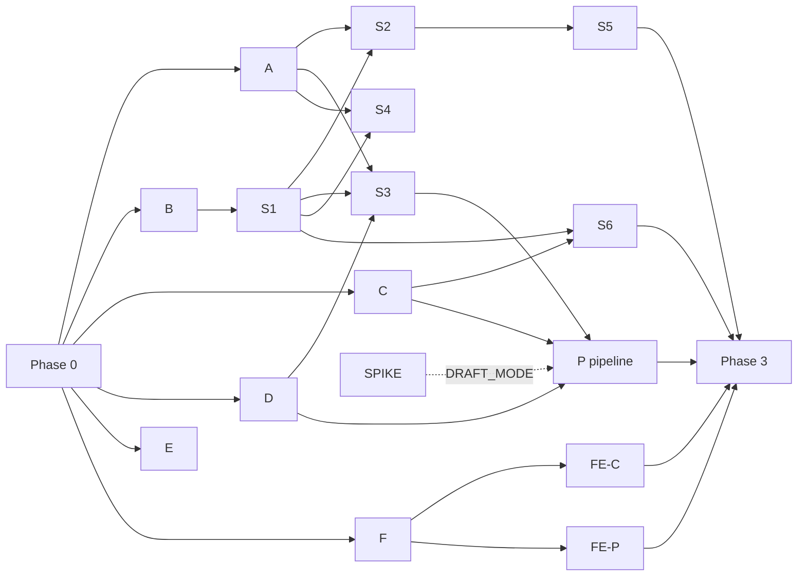

# Watch Me! R1: Implementation Plan (v0.1, 2026-10-28)

How R1 is built: contracts first, then test-first lanes that run in parallel,
then integration. Inputs: `06-modules-classes.md` (module tree and layer rules),
`07-test-design.md` (test IDs), `00-consistency-report.md` (open items).
Deadline: 2026-11-05 11:00 KST (PRD).

## 1. Rules

1. **Contract freeze first.** Phase 0 creates every file that more than one lane
   touches. After Phase 0 merges, lanes do not change those files. A lane that
   needs a change asks the lead; the lead changes it on `main` and lanes rebase.
2. **One lane = one branch = one worktree.** A lane owns only the files listed
   for it in section 3.
3. **Test-first inside every lane.**
   1. Write the lane's 07 test cases. Run them and see them fail (red).
   2. Commit the tests alone (`test(<lane>): ...`).
   3. Implement until the lane's tests pass (green). Commit.
   4. Run the full suite and `UT-ARCH-01` (import-linter) before handing back.
      A test that cannot pass because 07 is ambiguous is marked `xfail` with the
      reason and reported; it is never deleted or weakened.
4. **Roles.** Lead (Opus): Phase 0, briefs, review, merge, full-suite run after
   every merge. Lane workers (Sonnet subagents in worktrees): Phases 1 and 2.
5. **Merge order** follows the dependency graph (section 4). The lead merges
   one lane at a time and runs `uv run pytest` and `pnpm test` on `main` after
   each merge.
6. **Mock AI everywhere** except the spike lane (07 section 1.2).

## 2. Phase 0: contract freeze (lead, serial)

| Area                  | Files                                                                                                                                                                                     | Tests                 |
| --------------------- | ----------------------------------------------------------------------------------------------------------------------------------------------------------------------------------------- | --------------------- |
| Tooling               | `backend/pyproject.toml` (uv), import-linter contracts from 06 section 2, pytest config and markers, `frontend/` Vite + React + TS + Vitest                                               | UT-ARCH, UT-META      |
| Config and errors     | `app/config.py` (all settings of 06 section 5), `app/errors.py` (one class per 01 error code, `JobError`), `app/clock.py`, `app/logging.py`                                               | UT-CFG                |
| Domain constants      | `domain/enums.py`, `domain/situations.py`                                                                                                                                                 | none (used by lane A) |
| Persistence           | `db/*`, `models/*` (every table and CHECK of 02), one Alembic migration `0001`                                                                                                            | DB-MIG                |
| Cross-lane interfaces | `ai/types.py`, `ai/protocols.py`, `ai/errors.py` (classes only), `storage/base.py`, `pipeline/handlers/base.py`, `services/views.py` (shared views: `FactView`, `MediaUrls`, `Principal`) | none                  |
| Wiring                | `container.py` and `main.py` with one slot per lane; `api/routers/__init__.py` holds the router list, one line per lane                                                                   | none                  |
| Test harness          | `tests/conftest.py` (temp SQLite, migrated; `FakeClock`; mock AI container; ASGI client; `login_as`), `tests/factories.py` (`SeedBuilder`)                                                | none                  |
| Frontend contracts    | `api/transport.ts`, `api/errors.ts`, `api/types.ts` (hand-written from 01), `lib/constants.ts`                                                                                            | none                  |

Done when: `uv run pytest` and `pnpm test` pass on `main`, the migration
applies to an empty file, and the import-linter contracts run.

## 3. Lanes

### Phase 1: lower layers (parallel after Phase 0)

| Lane                   | Owns                                                                                                                  | 07 tests                                                                            |
| ---------------------- | --------------------------------------------------------------------------------------------------------------------- | ----------------------------------------------------------------------------------- |
| A domain               | `domain/*` except Phase 0 files                                                                                       | 3.2: UT-RNG, UT-CNF, UT-COV, UT-DUP, UT-LBL, UT-WRD, UT-HLT, UT-SAF, UT-SLG, UT-VIS |
| B security and storage | `security/*`, `storage/local.py`                                                                                      | 3.3: UT-SEC, UT-STO                                                                 |
| C AI layer             | `ai/*` except Phase 0 files                                                                                           | 3.4: UT-AI                                                                          |
| D jobs and media tools | `services/job_queue.py`, `pipeline/runner.py`, `pipeline/ffmpeg.py`, `pipeline/sampling.py`, `tools/make_fixtures.py` | 3.5: UT-JOB; 3.3: UT-FFM; 3.15: PIPE-SMP                                            |
| E DB constraints       | `tests/db/*` only (fixes go to the lead)                                                                              | 3.6: all DB-* except DB-MIG                                                         |
| F frontend base        | `components/RangeTracker.ts`, `components/RangePlayer.tsx`, `api/client.ts`, `api/httpTransport.ts`, `api/mock/*`     | 3.18: FE-RNG, FE-PLY, FE-API, FE-MCK, FE-LNT                                        |
| SPIKE                  | `tools/spike_timestamps.py`, `eval/spike_labels.jsonl`                                                                | 3.16 (real provider)                                                                |

SPIKE starts when the user supplies the API key and 10 clips; it does not
block other lanes. Its result chooses `DRAFT_MODE` (`frames` or `segments`).

### Phase 2: feature slices (service + repository + router + schema)

| Lane                   | Owns                                                                                                                                                        | 07 tests                                           | Needs       |
| ---------------------- | ----------------------------------------------------------------------------------------------------------------------------------------------------------- | -------------------------------------------------- | ----------- |
| S1 auth                | `auth_service`, `api/deps.py`, `api/errors.py`, routers `auth`, `me`, `health`                                                                              | 3.7: API-AUTH, CNS, CSRF, ENV, HLTH, ORG, ROLE     | B           |
| S2 dogs and publish    | `dog_service`, `publish_service`, `coverage_service`, `deletion_service` (dog part), router `dogs`                                                          | 3.8: API-DOG, CHK, PUB, DEL                        | A, S1       |
| S3 sessions and upload | `session_service`, `clip_upload_service`, `clip_service`, `api/upload.py`, routers `sessions`, `clips`                                                      | 3.9: API-SES, UP, CLP, RMG; 3.3: UT-UPL            | A, B, D, S1 |
| S4 review              | `fact_review_service`, `evidence_validator`, router `facts`                                                                                                 | 3.10: API-PBK, CFM, EDT, DLF, ADD                  | A, S1       |
| S5 public and media    | `public_profile_service`, `media_access_service`, `repositories/public_facts.py`, routers `public` (profile), `media`                                       | 3.11: API-PRF; 3.13: API-MED                       | S2          |
| S6 Q&A                 | `qa_service` and collaborators, router `public` (ask), `tools/qa_eval.py`, `eval/qa_adversarial.jsonl`                                                      | 3.12: API-ASK; 3.4: UT-QA; 3.17: SAFE-A, SAFE-META | C, S1       |
| P pipeline             | `pipeline/handlers/*`, `draft_ingest_service`, `merge_service`, `wording_service`, `clip_pipeline_service`, `cost_service`, `deletion_service` (purge part) | 3.15: PIPE-E2E, RETRY, TRC, DEL, RET, RUN          | C, D, S3    |
| FE-C creator screens   | `routes/creator/*`, creator components                                                                                                                      | 3.18: FE-CRD, PNL, UPL, GRD, STA, CON, LST, A11    | F           |
| FE-P public screens    | `routes/public/*`, public components, `AskBox`                                                                                                              | 3.18: FE-PUB, ASK                                  | F           |

S4 and S5 seed sessions, clips and facts through `SeedBuilder`, so they do not
wait for S3 or P.

### Phase 3: integration (lead, with workers as needed)

- `metrics_service`, router `admin`: 3.14 API-MET, API-SED.
- Container image, Oracle A1 deploy, Muse adapters, cost measurement (NFR-2).
- SAFE-L live eval (3.17), manual mobile E2E (3.19), 07 section 6 definition of done.

## 4. Dependency graph and parallel batches

Batches, at most four workers at once:

1. Phase 0 (lead).
2. A, B, C, D.
3. E, F, S1 (S1 starts when B merges).
4. S2, S3, S4, S6.
5. S5, P, FE-C, FE-P.
6. Phase 3.

## 5. Lane brief template

Each worker brief states: the worktree branch, the files it owns (section 3),
the 07 test IDs, the 01/02/04/06 sections those tests cite, the four steps of
rule 3, the forbidden files (Phase 0 files and other lanes' files), and the
report format: commits, test counts (passed, failed, xfail with reasons), and
any contract change it needs.

## 6. Cut order

If time runs short, follow PRD section 7: REV-10, then CAP-2, then the QA-1
per-cookie limit. Safety controls (PUB-0, PUB-9, REV-2, REV-9, QA-2) are
never cut.

## 7. Phase 0 result (2026-10-28)

Backend: 36 passed, 3 xfail (UT-CFG-02 waits for lane C, UT-ARCH-03 for S1 and
S6, UT-META-01 for S1 to S6); import-linter 11 contracts kept. Frontend: 6
tests pass; lint and build pass; `ErrorCode` matches the 28 codes of 01.

Deviations from 06 section 2, now frozen in `backend/pyproject.toml`:

- `ai` may import `app.config` (the registry builds adapters from `Settings`).
- `api` may import `app.db` (the uow dependency in `deps.py`).
- Stricter than 06: `ai` may not import security, clock or logging;
  `pipeline` may not import `app.db`; `repositories` may not import pipeline,
  ai or storage.

Other Phase 0 choices: enum columns carry CHECKs for every closed set (beyond
02); the `fact_evidence` length CHECK rounds to 6 decimals; `Situation` lives
in `domain/enums.py`; Alembic reads `DATABASE_URL` directly; `create_app`
takes `container=None`; dev backend port 8000; TypeScript pinned to 5.x.
`login_as` raises until lane S1 replaces it.

## 8. Phase 1 result (2026-10-28)

Merged: A, B, C, D (squashed: its wip commits carried generated clips), S1.
Backend: 337 passed, 21 xfail; import-linter 11 contracts kept. Every xfail
names the lane that removes it.

Choices made by lanes, accepted by the lead:

- **A.** New domain modules `dedupe`, `textmatch`, `coverage`, `visibility`.
  Word lists use the `textmatch` format (whitespace-separated, `"phrases"`,
  `stem*`, `#` comments). Unknown flag severity counts as `warn`.
- **C.** UT-AI-06: newline in `behavior`, `start_t > end_t` and 4 evidence
  items are repaired after validation (04), not schema-invalid as 07 says;
  those sub-cases are `xfail(strict)` until 07 is aligned. `JobError` has no
  `fail_detail`; the provider status stays on `__cause__`. `MockAdapter`
  turns faults into `JobError` unless `raise_ai_errors=True`.
  `reasoning_effort` is off until the spike.
- **D.** An unknown handler exception becomes `JobError(<step default code>,
retryable=False)`, and the job row stores `internal_error` (06 M31 over 07).
  Step codes: transcode and sample `transcode_failed`; transcribe, draft and
  check `ai_failed`; merge `merge_failed`; purge and sweep `purge_failed`.
  Backoff: pipeline 30 s, 120 s; purge 1 m, 5 m, 15 m, 1 h, 3 h, 6 h, 12 h.
  Every non-transient ffmpeg exit maps to `transcode_failed`; lane P decides
  `unsupported_file`. `worker.py` wiring is lane P.
- **S1.** `create_app(container=None, *, spa_dir=None)`. The 415 rule is an
  app-level dependency that runs before auth. 405 and unknown routes return
  404 `not_found`. The SPA shell is served from the 404 handler, so later
  routers are never shadowed. The consent gate checks `consented_at` only.
  `/healthz` returns 503 when the DB is down. `AuthService` commits through
  its own `uow_factory`.

Dependencies for creator routes (`app/api/deps.py`): `principal` (cookie, then
CSRF on unsafe methods), `require_staff`, `require_consent`,
`current_principal` (cookie only, media reads), `uow`, and
`limit("writes" | "uploads" | "public" | "media")`.

Lead changes: word lists live in `backend/config/` (`banned_words.txt` from 04
6.2; `health_keywords.txt` is a lead starter list, since 04 gives none);
`backend/.gitignore` ignores `.cache/`; 07 UT-RNG-09 now expects a 6 s row
(`[30, 36]`), which follows from `end_s = end_t + k`.

Rule added for Phase 2: generated media stays out of git (fixtures build into
`backend/.cache/`).

Lane E (merged after section 8 was written) found two schema gaps; the lead
added both CHECKs to migration `0001` (no database is deployed yet):
`ck_fact_unconfirmed_clear` (a non-confirmed fact has no `confirmed_at` or
`confirmed_role`, I-5) and `ck_member_email_lower` (`email = lower(email)`,
02 "lowercased on write"). UT-SEC-03 now flips a middle signature character;
flipping the last base64 character could decode to the same bytes.

## 9. Phase 2 backend result (2026-10-28)

Lanes S2, S3, S4 and S6 are merged. Backend: 642 passed, 22 xfail, 0 xpass.
`lint-imports`: 11 kept. Every remaining xfail names lane S5, lane P, or the
phase 3 admin metrics route. The lead removed the S1 and S2 xfail markers that
the merged routes now pass.

Shared seams for later lanes:

- **S2.** `load_dog(uow, principal, dog_id)` returns `not_found` for a deleted,
  other-org or unknown dog. Also: `dog_view`, `CoverageService.for_dog`,
  `for_dogs` and `short_for_dogs`, and `DeletionService.request_dog_delete`
  (lane P owns `run_purge_*`). Photos are re-encoded with Pillow, which drops
  EXIF. `.heic` returns 415. The extension must match the magic bytes.
- **S3.** Upload enqueues `transcode` with payload `{clip_id, session_id,
dog_id}`. A manual retry enqueues the failed step's job type, with the same
  payload, attempts reset to 0, and no dedupe key. The `merge` job has payload
  `{session_id}` and dedupe key `merge:{session_id}`. The `purge_clip` job has
  payload `{clip_id, dog_id}`, dedupe key `purge_clip:{id}`, and 8 attempts.
  Pipeline hooks: `SessionService.enqueue_merge`, `on_clip_terminal`,
  `mark_review_ready` and `mark_failed`. With `uow=None`, each opens its own
  transaction.
- **S4.** `FactReviewService` methods take `uow` first and never commit.
  `EvidenceValidator.range_problem` is pure, so lane P can reuse it.
- **S6.** `repositories/public_facts.py` has `get_public_dog(session, slug)`
  and `public_facts(session, dog_id)`; this is the only read path for
  confirmed facts (UT-ARCH-02). `public.router` holds the ask route, and
  lane S5 adds the profile route to it. The retention sweep in lane P calls
  `null_questions_before` and `delete_before` on the `qa_log` repository.

Decisions:

- S3: a `Content-Length` over 200 MiB returns 413 at once (07 UP-05). There is
  no multipart overhead allowance.
- S3: a clip retry clears the session's `review_ready_at` and `fail_code` at
  once. 07 SES-12 and CLP-06 win over 06.
- S3: reusing a `client_request_id` on a session that already has 3 clips
  returns `clip_limit_reached`.
- S4: `can_confirm` is computed as if `acknowledge_flags=true`.
- S4: a fact of another org returns 404 before body validation.
- S4: a volunteer may edit or delete their own staff note when it has no
  session, but only staff confirm it.
- S4: a text edit replaces the flags with fresh rule flags.
- S4: four evidence items return `too_long` (limit 3).
- Deleting a confirmed fact clears `confirmed_*`. This keeps 02 I-5 and the
  2.8 CHECK ("a non-confirmed fact has none"). REV-10 counts by `origin`, so
  no metric loses data.
- The ask route has only the `qa_log` hourly limits, as 01 1.3 specifies.
  The 120-per-minute IP limit applies to public profile reads (lane S5).
  Error responses do not set `wm_visitor`.
- Health keywords now also cover age, breed, weight, fee and cost, in English
  and Korean. These are profile facts that clips cannot show, so they get the
  shelter redirect. This makes 07 SAFE-A-05 pass with a mock that answers every
  question. The mock eval still meets every category bar except `answerable`,
  which only a live model can meet (SAFE-L).
- UT-ARCH-03 is now two real tests: the login half is in `test_s1_auth.py` and
  the ask half is in `test_s6_ask.py`. The placeholder is removed.
- API-AUTH-07 flips a middle signature character, the same fix as UT-SEC-03.

Duplication to consolidate in phase 3: the dog lookups in
`repositories/sessions.py`, `repositories/facts.py` and the S2 dog service,
and the `FactOut`, `ClipOut` and fact view schemas in S2, S3 and S4. Ruff
findings in `tests/` grew from 57 to 245. Ruff is not a lane gate; clean up
in phase 3.

Lane S5 (merged after the list above): backend 696 passed, 10 xfail
(5 lane P, 2 phase 3 metrics, 3 UT-AI-06 where 04 wins).

- `PublicProfileService.get_profile(uow, slug)` and
  `MediaAccessService.resolve_clip_video(uow, clip_id, principal | None)` take
  `uow` first, like S2 and S4. A missing, bad or revoked cookie on a media read
  means an anonymous reader.
- `public_facts.py` gained `get_public_profile`, `clip_is_publicly_cited`,
  `get_media_clip`, `get_media_dog` and `transcript_cues`. It is still the
  only read path for confirmed facts.
- Starlette's `FileResponse` does not answer `If-None-Match`. The media routes
  compute the ETag from the file stat and return 304 themselves, as 01 section
  7 requires. Captions use a content-hash ETag.
- Media routes set `X-Robots-Tag` themselves. Every denial is the same 404.
- `ask.enabled` is always `true` in R1. There is no setting for it.
- Tests that read `/media` for a seeded clip first write the playback file with
  `put_clip_file`. `SeedBuilder` writes no files; the pipeline does that.

## 10. Batch 5 result (2026-10-28)

Lanes FE-P, FE-C and P are merged. Frontend: 245 passed. Backend: see the
lane P paragraph below. lint-imports: 11 kept.

### Lane FE-P (public screens)

- The not-available page uses h1 "This profile is not available" and
  `document.title` "Profile not available".
- The ask box shows the server `heading` and `hint` verbatim.
- The coverage sentence is built from the numbers.
- An unknown `banner_id` calls `console.warn`. The banner text is constant.
- A 429 shows the wait in minutes, rounded up from `Retry-After` (default
  3600 s). The cost cap shows hours, rounded up.
- The page has one shared player.
- The ask section has no `aria-labelledby`, so the label query is not
  ambiguous.
- The profile footer links to `/terms`. The FE-STA todo for this link was
  removed; `PublicProfilePage.test.tsx` covers it.

### Lane FE-C (creator screens)

1. The consent guard applies only to S6, S7 and S8. S0 and S2 to S5 require
   login only.
2. A fact added by hand in session scope is a staff note. It does not show in
   the session list. FE-CRD-06 is checked in dog scope.
3. "Delete clip" also shows for ready clips while the session is open. This
   adds to 05.
4. Dog list row aria-label: `{name}, {status}, clips in N of 8 situations[, N
drafts to review]`.
5. The client does not measure clip length before upload.
6. The edit sheet adds no history entry.
7. There is no automatic retry on `csrf_failed`.
8. Focus moves to the next card title only after confirm or delete. A filter
   change does not move focus.
9. The blocked-confirm text for a fact with three ranges is "Watch all ranges
   to confirm."
10. The range editor's clip option label is "Clip {n} - {filename} -
    {length}".

Open contract requests for lane F files (phase 3): `uploadClip` takes no
`AbortSignal`, so there is no upload cancel button. `pollSession` sends no
`include=none`, so each poll also fetches the facts.

### Lane P (pipeline)

Backend after the merge: 791 passed, 9 xfail. The 5 lane P xfails (SES-12,
SES-14, UT-AI-13, UT-AI-14, UT-JOB-14) are gone. New xfails for phase 3:
metrics `purge_pending` and the three `ai_auth_error` alerts.
PIPE-TRC-09 passes after the merge with S5. Its URL is now
`/media/{clip_id}.mp4` (01 section 7), and it runs the whole pipeline first,
because S5 serves ready clips only.

`unsupported_file` versus `transcode_failed`:

- Unprobeable source, no video stream, or ffmpeg decode errors ("Invalid
  data", moov atom): `unsupported_file`, no retry.
- Output shorter than the source by more than max(1 s, 10%):
  `unsupported_file`.
- Timeout, kill or no disk space: `transcode_failed`, retryable.
- Any other nonzero exit: `transcode_failed`, not retried automatically. A
  manual retry works.
- Output longer than `max_clip_s` + 0.5 s: `too_long`.

Contracts:

- `DeletionService.__init__` takes optional `uow_factory`, `storage` and
  `settings` for the purge methods.
- `app/services/_write_lock.py`: each lane P transaction issues a no-op write
  first. A deferred SQLite transaction that reads, then writes after another
  connection committed fails at once with "database is locked";
  `busy_timeout` does not help. A global `BEGIN IMMEDIATE` in `engine.py` was
  tried and reverted: 20 tests failed, because an outer transaction that
  stays open (tests that hold a session, and `independent_session()`) blocks
  the second writer. Phase 3: decide per call site, or start read-only
  transactions deferred and writing ones immediate.

Interpretations:

1. The mock fixture key is the stem of the upload filename.
2. Purge deletes all job rows of the dog, including its own (DEL-01 wins over
   02 6.1).
3. `purge_dog` on a dog that is not deleted refuses and does nothing (DEL-09).
4. If another job for the same dog is running, the purge waits 30 s and its
   attempts are restored.
5. Missing frames at the draft step: `transcode_failed`, not retryable.
6. A clip under 1 s becomes ready with 0 facts and no AI call.
7. Merge touches only `merged=0` facts. If the worker stops between the merge
   commit and complete, the check step is skipped. Known gap; phase 3.
8. E2E-18 and E2E-19 partial cases cannot be reproduced with the 1-fact
   fixture.
9. The RET-02 test calls the private `_enqueue_daily_sweep`.

## 11. Phase 3 lane I result (2026-10-29)

`GET /api/admin/metrics`, `MetricsService`, the `ai_auth_error` alert and
`backend/tools/seed.py` are merged. Backend: 819 passed, 3 xfail (UT-AI-06,
04 wins). lint-imports: 11 kept.

- `to_job_error` (`app/ai/errors.py`) sets `JobError.detail` for transient and
  permanent errors. The text is only "HTTP {status} [provider code]"; the
  adapter never keeps the body. It lands in `clip.fail_detail`, which no API
  exposes.
- API-DLF-03 now reads `draft_acceptance.all_drafts` (01 section 8.1), not
  `review.all_drafts`.

Alert clearing rule (API-MET-08; 04 section 8.7 says only "sets an operator
alert"):

- The alert is on while the newest failed `draft` or `transcribe` job belongs
  to a clip whose `fail_detail` starts with "HTTP 401", "HTTP 402" or
  "HTTP 403".
- A later `transcribe`, `draft` or `check` job that succeeds clears it. A
  manual clip retry or a clip delete also ends it.
- The state comes from the database, because the worker and the API are
  separate processes. No migration.
- A config reload does not clear it; there is no state that records a reload.
- Jobs are ordered by id, not time.
- Q&A and check failures do not raise it.

Interpretations:

- `alerts` is a list of codes (`["ai_auth_error"]`). `purge_pending` is a
  list of dog ids. Both match the frontend `types.ts`.
- `all_drafts` counts merged facts whose origin is not `human_added`, in any
  status.
- Facts, sessions and per-dog cost of a deleted dog are excluded at once. The
  cost total keeps every ledger row (API-MET-07).
- `purge_pending` lists every deleted-dog tombstone, not only dogs with a
  failed purge job.
- `published_dogs` counts status `published` only. The publish-time median
  covers published and adopted dogs, from the first session's `created_at` to
  `published_at`.
- Medians are whole seconds, `null` with no data. Rates are 0.0 when the
  denominator is 0.
- The seed tool stores emails in lower case, leaves existing rows as they
  are (a changed password is not applied), creates members without consent,
  and exits non-zero when a seed setting is missing.

## 12. Phase 3 lanes FE-X and Q result (2026-10-29)

Backend: 819 passed, 3 xfail (UT-AI-06). Frontend: 254 passed.
lint-imports: 11 kept. `pnpm contract` leaves no diff.

### Lane FE-X (frontend contract)

- FE-API-05: `backend/tools/dump_openapi.py` prints the OpenAPI JSON (fake
  keys, in-memory DB, no network). `pnpm contract` regenerates
  `src/api/generated/openapi.d.ts` with `openapi-typescript` 7.13.0, fails on a
  git diff of that file, and runs `tsc --noEmit`. `src/api/contract.test.ts`
  checks 17 responses and 10 requests against the hand-written `types.ts`.
  `types.ts` stays hand-written; 01 is its source.
- Drift fixed: `Org.location` is `string`.
- Not checked yet (phase 3 backend follow-up): the public profile, ask and
  session-detail responses have no `response_model`; `created_at`, `as_of`
  and `confirmed.at` are typed `str | None` but are never null; enum fields
  are plain `str`.
- Upload rows have a "Cancel" button (05). It aborts the transfer and removes
  the row, with no toast. If the server already saved the clip, it shows after
  the next reload.
- `pollSession` sends `include=none`. When the session becomes `review`, the
  feed calls `getSession` once for the facts.

### Lane Q (backend cleanup)

- The dog lookup is `DogRepository.get_in_org` (`repositories/dogs.py`).
  `ClipErrorView` and `ClipView` live in `services/views.py`. `FlagOut`,
  `EvidenceOut` and `ClipLengthOut` live in `schemas/facts.py`. The OpenAPI
  schemas are unchanged.
- `dogs.FactOut` and `dogs.ConfirmedOut` stay separate: there,
  `confirmed.at` is nullable.
- Ruff: `tests/` 404 to 0, `app/` and `tools/` 134 to 106 (102 router B008
  for `Depends`, 2 deliberate S110, 2 in `app/db/uow.py`).
  `backend/pyproject.toml` ignores F811, RUF059 and B008 in `tests/**` only.
- The media routes' `operationId` (HEAD versus GET) changes with the Python
  hash seed. `dump_openapi.py` drops HEAD routes, so the dump is stable.

## 13. Phase 3 lanes C and T result (2026-10-29)

Backend: 833 passed, 3 xfail (UT-AI-06). Frontend: 254 passed.
lint-imports: 11 kept. `pnpm contract` leaves no diff.

### Lane C (container)

- Root `Dockerfile` (linux/arm64, multi-stage), `.dockerignore`,
  `docker-compose.yml`, and `deploy/` (`start.sh`, `Caddyfile`,
  `settings.example`, `README.md` runbook).
- `deploy/start.sh` runs `alembic upgrade head`, then uvicorn and
  `python -m app.worker` side by side. If one exits, it stops the other and
  exits non-zero. `tini` is PID 1; the user is `watchme` (uid 10001); `/data`
  holds the SQLite file and the storage root; `HEALTHCHECK` calls `/healthz`.
- ADR-0027 names no proxy. Caddy is a second compose service for TLS, with
  `max_size 220MiB` (01 5.3 needs at least 210 MiB). The app runs with
  `TRUSTED_PROXY=true`.
- Base images: `node:22.17.0-bookworm-slim`, `python:3.12.11-slim-bookworm`,
  `ghcr.io/astral-sh/uv:0.12.19`, `caddy:2.10.0-alpine`; pnpm 10.33.2 via
  corepack.
- Settings: `deploy/settings.example` lists every `Settings` field with
  placeholders. The real file is `deploy/settings` (git-ignored).
- Verified without docker: the start sequence (migrate, api, worker),
  `/healthz`, the SPA, the seed tool, clean shutdown. Not yet run: a real
  `docker build`, the base image tags, Caddy and compose.

### Lane T (response types)

- Public profile, public ask and session detail have `response_model`. Ask
  uses `response_model_exclude_unset`, so `hint` and `contact` appear only for
  the outcomes that define them. Existing API tests are unchanged and pass.
- Non-null: `created_at` (clip, session, dog), `as_of`, `confirmed.at` (facts
  and dogs schemas), `ProfileDogOut.published_at`.
- `Literal` aliases live in `app/api/schemas/vocab.py`;
  `tests/unit/test_schema_vocab.py` checks each against `app.domain.enums`.
  `NoticeOut.code` stays `str`.
- Open drift in `types.ts` (follow-up; `contract.test.ts` carries two
  documented patches): session detail `facts` is absent with `include=none`
  but typed `Fact[]`; public `dog.location` is never null but typed
  `string | null`. Fixing them touches `ReviewPage`, `SessionPage` and
  `mockTransport`.
- Fixed 2026-10-30 (lane FE-drift): `pollSession` and
  `getSession(id, {include: "none"})` return `SessionSummaryResponse` (no
  `facts`); the default `getSession` returns `SessionDetailResponse` with
  `facts: Fact[]` (overloads). `SessionDetailBody` (optional `facts`) is
  compared with the generated type directly. `PublicProfile.dog.location` is
  `string`. Both `contract.test.ts` patches are removed; frontend 256 tests.

Image build check (2026-10-29, Mac mini, colima `perf`, docker 29.2.1,
aarch64, no buildx): the legacy builder rejected `RUN --mount=type=cache`, so
the Dockerfile has no BuildKit-only syntax now. The image `watchme:a1ba172`
built (909 MB). A container on a fresh named volume ran migrations as uid
10001, became `healthy`, served `/healthz` 200 and the SPA 200, ran the seed
tool twice (second run "exists"), accepted the staff login, and exited 0 on
SIGTERM. Caddy and compose are not run yet.

Compose + Caddy check (2026-10-30, same Mac mini, standalone `docker-compose`
v2 because the `docker compose` plugin is not installed there; the deploy
README keeps `docker compose` for the VM). `docker-compose.yml` plus a smoke
override (Caddy on 18080, `SITE_ADDRESS=:80`, fake keys): `/healthz` 200, SPA
200, seed then staff login 200 through Caddy.

- Fixed: Caddy answered 503 "no upstreams available" for about 30 s after
  start. Its first active health check ran before uvicorn listened and marked
  the only upstream down until the next check. `deploy/Caddyfile` now has no
  active health check and uses `lb_try_duration 15s`. Re-run: `/healthz` 200
  right after `up`.
- Body limit: a 210 MiB POST reaches the api (its JSON answer, not a Caddy
  413). Caddy `request_body max_size` does not check `Content-Length`; it cuts
  only a body it streams, so the api's own `Content-Length` check answers an
  oversized clip first. A 230 MiB chunked JSON body that the api reads got
  Caddy's 413, so the backstop works.

## 14. Live Meta API and SAFE-L (2026-10-30)

- Key and $150 credit work. `muse-spark-1.3` is a reasoning model and
  `completion_tokens` includes reasoning tokens. The old `max_tokens`
  (select 100) was eaten by reasoning: every select call ended with
  `finish_reason=length` and no content.
- Lane AI-effort (merged): per-role `AI_*_REASONING_EFFORT` (drafter `low`,
  checker and selector `minimal`; `none` is a 400), `max_tokens` draft 6000,
  check 2000, select 1500. An invalid output now keeps its reason (for example
  `finish_reason=length`) in `fail_detail`. Backend 846 passed, 3 xfailed.
- SAFE-L live run (`tools.qa_eval --live`, 74 cases x 3): exit 0, no hard
  failure, no error, dropped 0. child_safety 30/30, health 30/30, injection
  36/36, answerable 30/30. Below the soft bar: no_evidence 54/60 (0.90, bar
  0.95; ne-12 groomer, ne-18 vet waiting room) and paraphrased_trait 23/36
  (0.64, bar 0.9; pt-02, pt-04, pt-09, pt-10, pt-12). The selector cites
  loosely related facts for trait words ("calm", "easygoing", "sweet") and
  for places with no fact (groomer -> handling facts). Output is still only
  verbatim facts. Next: tune the selector prompt and re-run.

SAFE-L re-run after the selector prompt fix (2026-10-30). Two rules were added
to `app/ai/prompts/select.py`: a question that asks for a trait or a label of
character returns an empty list, and a place or situation that no observation
shows returns an empty list (no similar-situation substitute). Result: every
category meets its bar. no_evidence 57/60 (0.95), paraphrased_trait 36/36,
child_safety 30/30, health 30/30, injection 36/36, answerable 30/30; no hard
failure, no error. The only failure is ne-18 ("vet's waiting room", 3/3). Its
own note says "vet" matches the health keyword list, so the health redirect
probably answers it before the model does (not checked).

Real clip pipeline run (2026-10-30). Local api + worker, the 10 dog clips in
`data/clips-raw/` (8 HEVC mp4, 2 iPhone MOV, 7.8-27.4 s), four sessions of
3, 3, 3 and 1 clips. Drafter `muse-spark-1.3`, checker `rules`. Transcriber:
`mock` with an empty `default.json`, because `muse_transcribe` is not built
(`app/ai/registry.py` raises `AiConfigError`). With the stock mock and no
fixture, every clip failed as `ai_failed` with an empty `fail_detail`.

- All four sessions reached `review` in 101 s. 9 of 10 clips `ready`;
  21 draft facts. Cost: 9 draft calls, 51,158 tokens in, 8,390 out,
  $0.0996.
- Bug: one clip failed at `sample` with `transcode_failed`, "expected 11
  frames, got 10". Its video stream is 10.002 s (300 frames) but the format
  duration is 10.034 s (the audio is longer). `parse_probe` uses the format
  duration, so `frame_times` asks for t=10 and no video frame exists there.
  Fix: sample from the video stream duration (or the last frame time).
- Draft quality, three clips checked against contact sheets: behaviors are
  observable and the evidence times match (door clip: lying at the door,
  head down later; leash clip: walking, looks up at 2 s). No trait label and
  no health claim; the rules checker set no flag.
- Defects: (1) four behaviors end with "across N frames", a sampling detail
  that leaks into the user text; (2) the model calls the person in one clip
  "a child" and puts the facts under `children_cats`, but the frames show
  only legs and pink shoes, so the age is a guess; (3) active play (running,
  circling a person's feet) is filed under `indoors_rest`.
- Next: fix the duration bug; add drafter rules against frame-count wording
  and against age guesses without clear evidence; build `muse_transcribe`.

Re-run after the fix (b7eea46, prompt `d2`, 2026-10-30). Same 10 clips, same
setup. 10 of 10 clips `ready`, all four sessions `review` in 157 s; 14 draft
facts; 10 draft calls, 57,358 tokens in, 7,343 out, $0.1029. No behavior
mentions frames, no "child" (the shoe clip is now `new_person`), running and
circling a person are `new_person`. Regression: the two couch clips (walking
and rolling on the couch, no person) now give no fact, because indoor play
fits no situation and the new rule says "or write no fact". Before, they gave
five `indoors_rest` facts. Open: restore "moves around indoors" in
`indoors_rest` as the fallback for indoor activity with no other situation.
