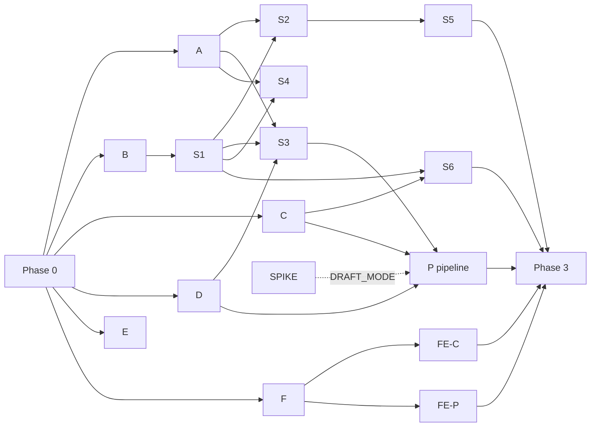

# Watch Me! R1: Implementation Plan (v0.1, 2026-10-28)

How R1 is built: contracts first, then test-first lanes that run in parallel,
then integration. Inputs: `06-modules-classes.md` (module tree and layer rules),
`07-test-design.md` (test IDs), `00-consistency-report.md` (open items).
Deadline: 2026-11-05 11:00 KST (PRD).

## 1. Rules

1. **Contract freeze first.** Phase 0 creates every file that more than one lane
   touches. After Phase 0 merges, lanes do not change those files. A lane that
   needs a change asks the lead; the lead changes it on `main` and lanes rebase.
2. **One lane = one branch = one worktree.** A lane owns only the files listed
   for it in section 3.
3. **Test-first inside every lane.**
   1. Write the lane's 07 test cases. Run them and see them fail (red).
   2. Commit the tests alone (`test(<lane>): ...`).
   3. Implement until the lane's tests pass (green). Commit.
   4. Run the full suite and `UT-ARCH-01` (import-linter) before handing back.
      A test that cannot pass because 07 is ambiguous is marked `xfail` with the
      reason and reported; it is never deleted or weakened.
4. **Roles.** Lead (Opus): Phase 0, briefs, review, merge, full-suite run after
   every merge. Lane workers (Sonnet subagents in worktrees): Phases 1 and 2.
5. **Merge order** follows the dependency graph (section 4). The lead merges
   one lane at a time and runs `uv run pytest` and `pnpm test` on `main` after
   each merge.
6. **Mock AI everywhere** except the spike lane (07 section 1.2).

## 2. Phase 0: contract freeze (lead, serial)

| Area                  | Files                                                                                                                                                                                     | Tests                 |
| --------------------- | ----------------------------------------------------------------------------------------------------------------------------------------------------------------------------------------- | --------------------- |
| Tooling               | `backend/pyproject.toml` (uv), import-linter contracts from 06 section 2, pytest config and markers, `frontend/` Vite + React + TS + Vitest                                               | UT-ARCH, UT-META      |
| Config and errors     | `app/config.py` (all settings of 06 section 5), `app/errors.py` (one class per 01 error code, `JobError`), `app/clock.py`, `app/logging.py`                                               | UT-CFG                |
| Domain constants      | `domain/enums.py`, `domain/situations.py`                                                                                                                                                 | none (used by lane A) |
| Persistence           | `db/*`, `models/*` (every table and CHECK of 02), one Alembic migration `0001`                                                                                                            | DB-MIG                |
| Cross-lane interfaces | `ai/types.py`, `ai/protocols.py`, `ai/errors.py` (classes only), `storage/base.py`, `pipeline/handlers/base.py`, `services/views.py` (shared views: `FactView`, `MediaUrls`, `Principal`) | none                  |
| Wiring                | `container.py` and `main.py` with one slot per lane; `api/routers/__init__.py` holds the router list, one line per lane                                                                   | none                  |
| Test harness          | `tests/conftest.py` (temp SQLite, migrated; `FakeClock`; mock AI container; ASGI client; `login_as`), `tests/factories.py` (`SeedBuilder`)                                                | none                  |
| Frontend contracts    | `api/transport.ts`, `api/errors.ts`, `api/types.ts` (hand-written from 01), `lib/constants.ts`                                                                                            | none                  |

Done when: `uv run pytest` and `pnpm test` pass on `main`, the migration
applies to an empty file, and the import-linter contracts run.

## 3. Lanes

### Phase 1: lower layers (parallel after Phase 0)

| Lane                   | Owns                                                                                                                  | 07 tests                                                                            |
| ---------------------- | --------------------------------------------------------------------------------------------------------------------- | ----------------------------------------------------------------------------------- |
| A domain               | `domain/*` except Phase 0 files                                                                                       | 3.2: UT-RNG, UT-CNF, UT-COV, UT-DUP, UT-LBL, UT-WRD, UT-HLT, UT-SAF, UT-SLG, UT-VIS |
| B security and storage | `security/*`, `storage/local.py`                                                                                      | 3.3: UT-SEC, UT-STO                                                                 |
| C AI layer             | `ai/*` except Phase 0 files                                                                                           | 3.4: UT-AI                                                                          |
| D jobs and media tools | `services/job_queue.py`, `pipeline/runner.py`, `pipeline/ffmpeg.py`, `pipeline/sampling.py`, `tools/make_fixtures.py` | 3.5: UT-JOB; 3.3: UT-FFM; 3.15: PIPE-SMP                                            |
| E DB constraints       | `tests/db/*` only (fixes go to the lead)                                                                              | 3.6: all DB-* except DB-MIG                                                         |
| F frontend base        | `components/RangeTracker.ts`, `components/RangePlayer.tsx`, `api/client.ts`, `api/httpTransport.ts`, `api/mock/*`     | 3.18: FE-RNG, FE-PLY, FE-API, FE-MCK, FE-LNT                                        |
| SPIKE                  | `tools/spike_timestamps.py`, `eval/spike_labels.jsonl`                                                                | 3.16 (real provider)                                                                |

SPIKE starts when the user supplies the API key and 10 clips; it does not
block other lanes. Its result chooses `DRAFT_MODE` (`frames` or `segments`).

### Phase 2: feature slices (service + repository + router + schema)

| Lane                   | Owns                                                                                                                                                        | 07 tests                                           | Needs       |
| ---------------------- | ----------------------------------------------------------------------------------------------------------------------------------------------------------- | -------------------------------------------------- | ----------- |
| S1 auth                | `auth_service`, `api/deps.py`, `api/errors.py`, routers `auth`, `me`, `health`                                                                              | 3.7: API-AUTH, CNS, CSRF, ENV, HLTH, ORG, ROLE     | B           |
| S2 dogs and publish    | `dog_service`, `publish_service`, `coverage_service`, `deletion_service` (dog part), router `dogs`                                                          | 3.8: API-DOG, CHK, PUB, DEL                        | A, S1       |
| S3 sessions and upload | `session_service`, `clip_upload_service`, `clip_service`, `api/upload.py`, routers `sessions`, `clips`                                                      | 3.9: API-SES, UP, CLP, RMG; 3.3: UT-UPL            | A, B, D, S1 |
| S4 review              | `fact_review_service`, `evidence_validator`, router `facts`                                                                                                 | 3.10: API-PBK, CFM, EDT, DLF, ADD                  | A, S1       |
| S5 public and media    | `public_profile_service`, `media_access_service`, `repositories/public_facts.py`, routers `public` (profile), `media`                                       | 3.11: API-PRF; 3.13: API-MED                       | S2          |
| S6 Q&A                 | `qa_service` and collaborators, router `public` (ask), `tools/qa_eval.py`, `eval/qa_adversarial.jsonl`                                                      | 3.12: API-ASK; 3.4: UT-QA; 3.17: SAFE-A, SAFE-META | C, S1       |
| P pipeline             | `pipeline/handlers/*`, `draft_ingest_service`, `merge_service`, `wording_service`, `clip_pipeline_service`, `cost_service`, `deletion_service` (purge part) | 3.15: PIPE-E2E, RETRY, TRC, DEL, RET, RUN          | C, D, S3    |
| FE-C creator screens   | `routes/creator/*`, creator components                                                                                                                      | 3.18: FE-CRD, PNL, UPL, GRD, STA, CON, LST, A11    | F           |
| FE-P public screens    | `routes/public/*`, public components, `AskBox`                                                                                                              | 3.18: FE-PUB, ASK                                  | F           |

S4 and S5 seed sessions, clips and facts through `SeedBuilder`, so they do not
wait for S3 or P.

### Phase 3: integration (lead, with workers as needed)

- `metrics_service`, router `admin`: 3.14 API-MET, API-SED.
- Container image, Oracle A1 deploy, Muse adapters, cost measurement (NFR-2).
- SAFE-L live eval (3.17), manual mobile E2E (3.19), 07 section 6 definition of done.

## 4. Dependency graph and parallel batches

Batches, at most four workers at once:

1. Phase 0 (lead).
2. A, B, C, D.
3. E, F, S1 (S1 starts when B merges).
4. S2, S3, S4, S6.
5. S5, P, FE-C, FE-P.
6. Phase 3.

## 5. Lane brief template

Each worker brief states: the worktree branch, the files it owns (section 3),
the 07 test IDs, the 01/02/04/06 sections those tests cite, the four steps of
rule 3, the forbidden files (Phase 0 files and other lanes' files), and the
report format: commits, test counts (passed, failed, xfail with reasons), and
any contract change it needs.

## 6. Cut order

If time runs short, follow PRD section 7: REV-10, then CAP-2, then the QA-1
per-cookie limit. Safety controls (PUB-0, PUB-9, REV-2, REV-9, QA-2) are
never cut.
